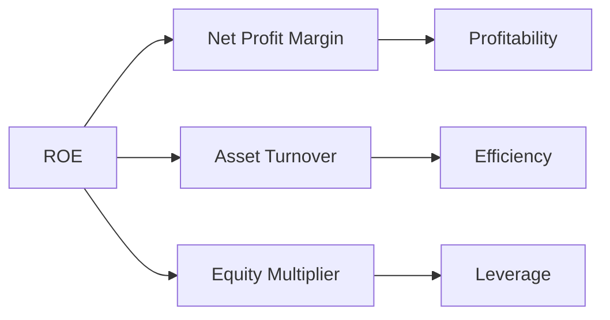

# Financial Statement Analysis

Preparing financial statements is only half the job. A CPA is also expected to read them: to see what changed, explain why, and judge what the change means for the entity's performance and risk. The BAR section tests exactly that skill. You will compare current results with prior periods and budgets, compute and interpret ratios, trace a transaction through the statements and notes, and use the outputs of data analytics to explain results.

This chapter starts with the two basic ways to arrange the numbers (horizontal and vertical analysis), moves to the main families of ratios and the DuPont model, and then covers budget comparisons, transaction analysis, and the data an analyst needs.

---

## Analytical Methods

Every analysis starts by putting numbers side by side. Horizontal analysis lines up the same item across periods to show the trend over time. Vertical analysis lines up the items within one period to show the composition of a statement. Ratio analysis, covered in the next section, relates one account to another.

### Horizontal Analysis (Trend Analysis)

Horizontal analysis compares each line item **across periods**. It answers the question "how have results changed over time?"

$$
\text{Dollar Change} = \text{Current Period} - \text{Prior Period}
$$

$$
\text{Percentage Change} = \frac{\text{Current Period} - \text{Prior Period}}{\text{Prior Period}} \times 100
$$

**Example: Bear Co. Revenue Trend**

| Year | Revenue | Dollar Change | % Change |
|---|---|---|---|
| 20X1 | \$800,000 | N/A | N/A |
| 20X2 | \$920,000 | \$120,000 | 15.0% |
| 20X3 | \$1,012,000 | \$92,000 | 10.0% |

Bear Co.'s revenue grew each year, but the rate of growth slowed from 15% to 10%. The numbers alone cannot say why. An analyst would look for a cause, such as market saturation, pricing pressure, or a deliberate change in strategy.

### Vertical Analysis (Common-Size Statements)

Vertical analysis expresses every line item as a **percentage of a base amount** in the same period. On the income statement the base is net revenue. On the balance sheet the base is total assets.

$$
\text{Common-Size \%} = \frac{\text{Line Item}}{\text{Base Amount}} \times 100
$$

**Example: Bear Co. Common-Size Income Statement (20X3)**

| Line Item | Amount | % of Revenue |
|---|---|---|
| Net Revenue | \$1,012,000 | 100.0% |
| Cost of Goods Sold | \$607,000 | 60.0% |
| Gross Profit | \$405,000 | 40.0% |
| Operating Expenses | \$243,000 | 24.0% |
| Operating Income | \$162,000 | 16.0% |
| Net Income | \$101,200 | 10.0% |

Because every line is a percentage, common-size statements let you compare companies of different sizes, or compare a company with its industry average. If a competitor spends 30% of revenue on operating expenses, Bear Co.'s 24% suggests tighter cost control, or perhaps underinvestment in selling and administration.

---

## Key Financial Ratios

A ratio condenses two numbers into one that is easy to compare across periods and entities. The exam groups ratios into four families: **liquidity, profitability, solvency, and activity (efficiency)**.

### Liquidity Ratios

Liquidity ratios measure the ability to pay **short-term obligations** as they come due. Each one is stricter than the last about which assets count.

| Ratio | Formula | Interpretation |
|---|---|---|
| **Current Ratio** | Current Assets ÷ Current Liabilities | Broad measure of short-term liquidity |
| **Quick (Acid-Test) Ratio** | (Cash + Short-Term Investments + Net Receivables) ÷ Current Liabilities | Excludes inventory and prepaid items |
| **Cash Ratio** | (Cash + Cash Equivalents) ÷ Current Liabilities | Most conservative liquidity measure |

**Example: Polar Inc.**

Polar Inc. reports current assets of \$240,000 (\$60,000 cash, \$80,000 receivables, \$70,000 inventory, and \$30,000 prepaids) and current liabilities of \$150,000. It has no short-term investments.

$$
\text{Current Ratio} = \frac{240{,}000}{150{,}000} = 1.60
$$

$$
\text{Quick Ratio} = \frac{60{,}000 + 80{,}000}{150{,}000} = 0.93
$$

$$
\text{Cash Ratio} = \frac{60{,}000}{150{,}000} = 0.40
$$

:::warning

A current ratio above 1.0 does **not** guarantee that the entity can pay its bills. If current assets are mostly slow-moving inventory or doubtful receivables, the ratio overstates liquidity. Look at the composition of current assets, which is what the quick and cash ratios do.

:::

### Profitability Ratios

Profitability ratios show how well the company turns revenue, assets, or equity into earnings.

| Ratio | Formula |
|---|---|
| **Gross Margin** | Gross Profit ÷ Net Revenue |
| **Operating Margin** | Operating Income ÷ Net Revenue |
| **Net Profit Margin** | Net Income ÷ Net Revenue |
| **Return on Assets (ROA)** | Net Income ÷ Average Total Assets |
| **Return on Equity (ROE)** | Net Income ÷ Average Stockholders' Equity |

**Example: Bear Co. Profitability (20X3)**

Using the 20X3 income statement above, plus average total assets of \$880,000 and average stockholders' equity of \$520,000:

$$
\text{Gross Margin} = \frac{405{,}000}{1{,}012{,}000} = 40.0\%
$$

$$
\text{ROA} = \frac{101{,}200}{880{,}000} = 11.5\%
$$

$$
\text{ROE} = \frac{101{,}200}{520{,}000} = 19.5\%
$$

### Solvency Ratios

Solvency ratios look further out. They measure the ability to meet **long-term obligations** and describe how the company is financed.

| Ratio | Formula | Interpretation |
|---|---|---|
| **Debt-to-Equity** | Total Liabilities ÷ Total Stockholders' Equity | Higher means more leverage |
| **Debt-to-Assets** | Total Liabilities ÷ Total Assets | Portion of assets financed by creditors |
| **Times Interest Earned** | EBIT ÷ Interest Expense | Ability to cover interest payments |

**Example: Grizzly Inc.**

Grizzly Inc. reports total liabilities of \$600,000, total equity of \$400,000, total assets of \$1,000,000, earnings before interest and taxes (EBIT) of \$180,000, and interest expense of \$45,000.

$$
\text{Debt-to-Equity} = \frac{600{,}000}{400{,}000} = 1.50
$$

$$
\text{Debt-to-Assets} = \frac{600{,}000}{1{,}000{,}000} = 0.60
$$

$$
\text{Times Interest Earned} = \frac{180{,}000}{45{,}000} = 4.0\text{x}
$$

Grizzly earns four dollars of operating income for every dollar of interest. That is a comfortable cushion, but lenders often write a minimum coverage ratio into loan covenants, so the analyst should compare 4.0x with any covenant in the debt agreement.

### Activity and Efficiency Ratios

Activity ratios measure how quickly the company turns its assets into sales and cash.

| Ratio | Formula | Result |
|---|---|---|
| **Receivables Turnover** | Net Credit Sales ÷ Average Net Receivables | Times per year |
| **Days Sales Outstanding** | 365 ÷ Receivables Turnover | Days to collect |
| **Inventory Turnover** | COGS ÷ Average Inventory | Times per year |
| **Days in Inventory** | 365 ÷ Inventory Turnover | Days to sell |
| **Total Asset Turnover** | Net Revenue ÷ Average Total Assets | Revenue per dollar of assets |

Turnover ratios divide a flow for the whole year (sales or COGS) by a balance sheet amount. Because the balance sheet is a snapshot, the denominator uses the **average** of the beginning and ending balances. If only the ending balance is given, use it.

**Example: Cub Entertainment**

Cub Entertainment reports net credit sales of \$750,000, average receivables of \$62,500, COGS of \$450,000, and average inventory of \$90,000.

$$
\text{Receivables Turnover} = \frac{750{,}000}{62{,}500} = 12.0\text{x}
$$

$$
\text{Days Sales Outstanding} = \frac{365}{12.0} \approx 30 \text{ days}
$$

$$
\text{Inventory Turnover} = \frac{450{,}000}{90{,}000} = 5.0\text{x}
$$

$$
\text{Days in Inventory} = \frac{365}{5.0} = 73 \text{ days}
$$

Cub collects its receivables in about a month and holds inventory for about two and a half months. Whether that is good depends on its credit terms and its industry, which is why ratios are most useful when compared with a benchmark.

---

## DuPont Analysis

ROE tells you how much the owners earned. It does not tell you how. DuPont analysis splits **return on equity** into its drivers, so you can see whether a change came from margins, from asset efficiency, or from leverage.

### Three-Component DuPont Model

$$
\text{ROE} = \underbrace{\frac{\text{Net Income}}{\text{Revenue}}}_{\text{Net Profit Margin}} \times \underbrace{\frac{\text{Revenue}}{\text{Avg Total Assets}}}_{\text{Asset Turnover}} \times \underbrace{\frac{\text{Avg Total Assets}}{\text{Avg Equity}}}_{\text{Equity Multiplier}}
$$



Revenue and average assets cancel out when the three terms are multiplied, leaving net income over average equity. The equity multiplier is the leverage term: the more of the assets financed with debt, the higher it is.

### Five-Component DuPont Model

The five-component model splits the net profit margin further, into the **tax burden**, the **interest burden**, and the **operating margin**:

$$
\text{ROE} = \frac{\text{Net Income}}{\text{EBT}} \times \frac{\text{EBT}}{\text{EBIT}} \times \frac{\text{EBIT}}{\text{Revenue}} \times \frac{\text{Revenue}}{\text{Avg Assets}} \times \frac{\text{Avg Assets}}{\text{Avg Equity}}
$$

| Component | Measures |
|---|---|
| Net Income ÷ EBT (earnings before taxes) | Tax burden |
| EBT ÷ EBIT | Interest burden |
| EBIT ÷ Revenue | Operating margin |
| Revenue ÷ Avg Assets | Asset turnover |
| Avg Assets ÷ Avg Equity | Financial leverage |

**Example: Kodiak Partners DuPont Decomposition**

| Component | 20X2 | 20X3 |
|---|---|---|
| Net Profit Margin | 8.0% | 10.0% |
| Asset Turnover | 1.20x | 1.10x |
| Equity Multiplier | 2.00x | 2.00x |
| **ROE** | **19.2%** | **22.0%** |

Kodiak Partners' ROE rose from 19.2% to 22.0%. The improvement came from higher profitability (margin up from 8% to 10%), which more than offset a small decline in asset efficiency (turnover down from 1.20x to 1.10x). Leverage did not change, so the higher ROE does not reflect added financial risk.

---

## Comparing Actual Results to Budget

A core BAR task is to compare current results with **prior periods** or with the **budget** and explain the differences.

$$
\text{Variance} = \text{Actual Result} - \text{Budgeted Amount}
$$

A variance is **favorable** if it increases income (more revenue or less expense) and **unfavorable** if it decreases income. In the table below, favorable variances are shown as positive amounts and unfavorable variances in parentheses, so the column adds to the change in operating income.

**Example: Sloth Security Budget vs. Actual**

| Line Item | Budget | Actual | Variance | F / U |
|---|---|---|---|---|
| Service Revenue | \$400,000 | \$425,000 | \$25,000 | Favorable |
| Labor Costs | \$200,000 | \$215,000 | (\$15,000) | Unfavorable |
| Supplies Expense | \$30,000 | \$28,000 | \$2,000 | Favorable |
| Rent Expense | \$48,000 | \$48,000 | \$0 | N/A |
| **Operating Income** | **\$122,000** | **\$134,000** | **\$12,000** | **Favorable** |

Sloth Security beat its operating income budget by \$12,000. Revenue came in \$25,000 over plan because of a new corporate client signed in the third quarter. Labor ran \$15,000 over budget because of the overtime needed to serve that client. The two variances are linked, so management should judge them together: the new client added \$10,000 of income after its labor cost.

A good variance explanation always gives both the direction of the change and a plausible cause. "Revenue went up" is not an explanation; "revenue went up because of a new client" is. Focus on variances that are **material** in both dollar and percentage terms. A \$500 variance on a \$2,000,000 line item rarely deserves a paragraph.

---

## Impact of Transactions on Financial Statements

The exam often describes a transaction and asks how it affects the statements, the notes, or a ratio. A simple routine works for any transaction:

1. **Which accounts are affected?** (assets, liabilities, equity, revenue, expense)
2. **In which direction?** (increase or decrease)
3. **What is the effect on each statement?** (balance sheet, income statement, cash flows)
4. **What must the notes disclose?** (for example, debt terms, contingencies, related parties, subsequent events)

**Example: Bear Co. Issues Bonds at a Discount**

Bear Co. issues \$500,000 of 5-year bonds at 97, receiving \$485,000. The \$15,000 discount is amortized to interest expense over the bond term using the effective interest method.

```journal
Dr. Cash[a] 485,000
Dr. Discount on Bonds Payable[cl] 15,000
    Cr. Bonds Payable[l] 500,000
```

| Financial Statement | Effect |
|---|---|
| **Balance Sheet** | Cash increases \$485,000. Bonds payable are reported at \$500,000 less the \$15,000 unamortized discount, a carrying amount of \$485,000. |
| **Income Statement** | Interest expense each period equals the cash coupon plus the discount amortization. |
| **Statement of Cash Flows** | The \$485,000 proceeds are a financing inflow. Interest paid is an operating outflow, and under the indirect method the discount amortization is added back to net income as a noncash expense. |
| **Notes** | The face amount, stated and effective interest rates, maturity, and any covenants. |

The ratios move as well. Debt-to-equity and debt-to-assets rise because liabilities increase with no change in equity. The current ratio improves because cash rises while the bonds are a long-term liability. Over the bond term, the higher interest expense lowers net income and times interest earned.

---

## Data Analytics in Financial Statement Analysis

Analysts now work with far more data than a set of statements. The BAR blueprint expects you to know what data an analysis needs, where it comes from, and how to read the outputs of analytic tools.

### Data Attributes and Sources

Before you analyze anything, decide what data you need and check that it is complete and accurate. Three attributes describe the data:

| Attribute | Description | Example |
|---|---|---|
| **Structure** | How the data is organized (tables, hierarchies, time series) | Monthly revenue by product line |
| **Format** | Data types and encoding (numeric, text, date) | Currency values in USD, dates in YYYY-MM-DD |
| **Source** | Where the data comes from (ERP system, general ledger, external feeds) | General ledger trial balance export |

The financial statements and notes are themselves a key source. Segment disclosures break results down by operating segment, and for public business entities a new note on expense disaggregation (ASU 2024-03) will show how much of each expense caption is inventory purchases, employee compensation, depreciation, and intangible asset amortization. That note first applies to annual periods beginning after December 15, 2026, and is eligible for testing starting January 1, 2027.

### Analytical Outputs

Analytic tools produce three broad kinds of output:

| Output | Examples | What it helps you see |
|---|---|---|
| **Reports** | Variance reports, aging schedules | Where results departed from plan; which receivables are at risk |
| **Visualizations** | Trend line charts, scatter plots | Trends over time; correlations between two variables |
| **Statistical models** | Regression analysis, anomaly detection | How a cost or revenue responds to a driver; unusual transactions |

Analytics supports judgment; it does not replace it. A trend chart may show that revenue spikes every December. The analyst still has to decide whether that is normal seasonality, channel stuffing (pushing extra goods to distributors before year-end), or a one-time event. Likewise, a scatter plot showing that sales rise with advertising spending shows a correlation, not proof that one causes the other.

---

## Common Pitfalls

:::caution[Common Pitfalls]

- **Mixing up turnover formulas.** Receivables turnover uses *net credit sales*, not total revenue. Inventory turnover uses *COGS*, not revenue.
- **Forgetting to average.** ROA, ROE, and turnover ratios use average balances when beginning and ending amounts are both given.
- **Ignoring leverage.** A rising ROE may come from more debt rather than better operations. Decompose it with DuPont before you call it an improvement.
- **Mislabeling variances.** Favorable means favorable to *income*. Higher revenue is favorable; higher expense is unfavorable.
- **Stopping at the face of the statements.** Transaction questions often ask about the notes or about a ratio, not only the balance sheet and income statement.
- **Skipping the reasonableness check.** If a current ratio comes out at 15.0, recheck the inputs before you move on.

:::
