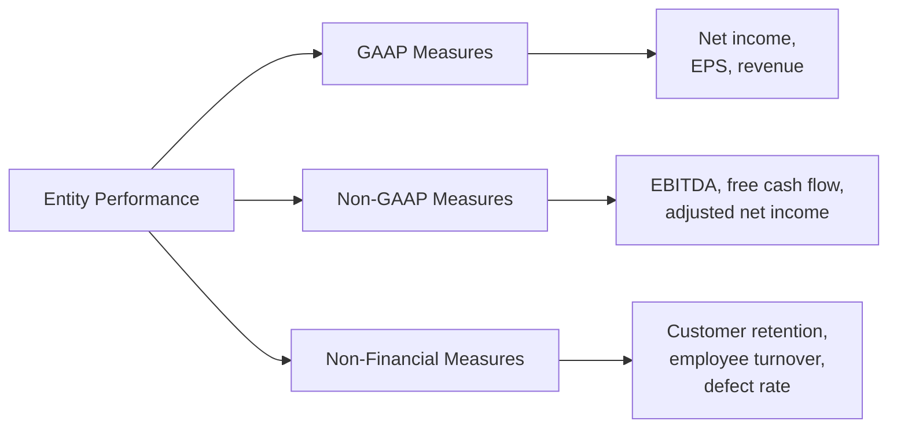
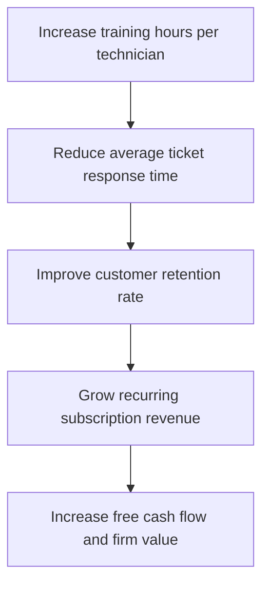

# Non-Financial and Non-GAAP Measures of Performance

GAAP statements give a standardized view of an entity's results, but they do not capture everything that matters. Depreciation choices change reported income without changing cash. A one-time restructuring charge can make one year look worse than the next. And many of a company's real strengths, such as its brand, its people, and the quality of its processes, never appear on the balance sheet at all.

Two kinds of measures fill those gaps. **Non-GAAP financial measures** adjust GAAP numbers to show recurring operating performance or cash generation. **Non-financial measures** track customers, employees, and operations directly. The BAR section expects you to calculate and interpret both, know their limits, use them for benchmarking, and assemble them into a balanced scorecard. This chapter takes them in that order.

---

## Non-GAAP Financial Measures

A non-GAAP measure starts from a GAAP amount and adds or removes items to highlight what management considers recurring performance or cash-generating ability. These are the measures you are most likely to see:

| Measure | Starting Point | Key Adjustments |
|---|---|---|
| EBITDA | Net income | Add back interest, taxes, depreciation, and amortization |
| Adjusted EBITDA | EBITDA | Add or remove items management considers unrepresentative (for example, restructuring charges, stock-based compensation) |
| Free Cash Flow (FCF) | Cash flow from operations | Subtract capital expenditures |
| Core Earnings | Net income | Remove non-recurring gains and losses |
| Adjusted Net Income | Net income | Remove non-recurring items, net of tax |
| Same-Store Sales | Revenue | Count only locations open in both periods |

### EBITDA

EBITDA (earnings before interest, taxes, depreciation, and amortization) removes the effects of financing decisions (interest), tax jurisdictions (taxes), and noncash cost allocations (depreciation and amortization). The result is a rough measure of operating earning power that is easier to compare across companies with different capital structures.

$$
\text{EBITDA} = \text{Net Income} + \text{Interest Expense} + \text{Income Tax Expense} + \text{Depreciation} + \text{Amortization}
$$

**Example: Bear Co.**

| Item | Amount |
|---|---|
| Net Income | \$240,000 |
| Interest Expense | \$30,000 |
| Income Tax Expense | \$60,000 |
| Depreciation | \$45,000 |
| Amortization | \$15,000 |
| **EBITDA** | **\$390,000** |

:::tip[Exam Tip]

EBITDA is **not** a GAAP measure and is **not** a substitute for operating cash flow. It ignores changes in working capital, capital expenditures, and debt repayments. When a question gives you EBITDA, trace it back to the nearest GAAP measure.

:::

### Adjusted EBITDA

Management often goes a step further and presents "Adjusted EBITDA," which also removes items it considers unrepresentative of ongoing operations, such as restructuring charges, stock-based compensation, or acquisition costs.

**Example: Bear Co.**

| Item | Amount |
|---|---|
| EBITDA | \$390,000 |
| Add: Restructuring charges | \$50,000 |
| Add: Stock-based compensation | \$25,000 |
| **Adjusted EBITDA** | **\$465,000** |

The catch is that management chooses what to exclude. An analyst should read the reconciliation and ask whether each excluded item is truly unusual or is an ongoing cost relabeled as a one-time event. Stock-based compensation, for example, recurs every year and is a real cost of paying employees.

### Free Cash Flow (FCF)

Free cash flow is the cash left for debt and equity holders after the entity has paid for the capital spending needed to maintain or expand its asset base.

$$
\text{FCF} = \text{Cash Flow from Operations} - \text{Capital Expenditures}
$$

**Example: Polar Inc.**

| Item | Amount |
|---|---|
| Cash Flow from Operations | \$520,000 |
| Capital Expenditures | (\$180,000) |
| **Free Cash Flow** | **\$340,000** |

FCF is a common input to discounted cash flow valuation and to judging whether a dividend can be sustained.

### Core Earnings and Adjusted Net Income

Both measures try to show sustainable earning power. **Core earnings** remove gains and losses that are not expected to recur, such as gains on asset sales, impairment charges, and litigation settlements. **Adjusted net income** removes similar items on an **after-tax** basis, so the result is still a bottom-line figure.

**Example: Kodiak Partners**

| Item | Amount |
|---|---|
| GAAP Net Income | \$180,000 |
| Less: Gain on sale of subsidiary (after tax) | (\$45,000) |
| Add: Restructuring charge (after tax) | \$20,000 |
| **Adjusted Net Income** | **\$155,000** |

### Same-Store Sales (Comparable-Store Sales)

Retailers and restaurant chains grow in two ways: by selling more at existing locations and by opening new ones. Same-store sales measure only the first. The calculation includes only locations open during **both** the current and prior periods, which isolates organic growth.

$$
\text{Same-Store Sales Growth} = \frac{\text{Current Comparable Revenue} - \text{Prior Comparable Revenue}}{\text{Prior Comparable Revenue}} \times 100
$$

### SEC Rules on Non-GAAP Measures

The SEC does not prohibit non-GAAP measures. It requires transparency, so that investors can see the adjustments and judge them. **Regulation G** applies whenever a public company discloses a non-GAAP measure publicly. **Item 10(e) of Regulation S-K** adds requirements for measures that appear in SEC filings.

| Requirement | Description |
|---|---|
| **Reconciliation** | Present the most directly comparable GAAP measure and a quantitative reconciliation to it (Regulation G and Item 10(e)). |
| **Equal or greater prominence** | In a filing, the GAAP measure must be presented with equal or greater prominence than the non-GAAP measure. |
| **Purpose** | In a filing, explain why management believes the measure is useful to investors. |
| **Prohibited adjustments** | In a filing, a liquidity measure may not exclude charges that required or will require cash settlement (EBIT and EBITDA are excepted), and a performance measure may not remove an item described as non-recurring, infrequent, or unusual if a similar item is reasonably likely to recur within two years or occurred within the prior two years. |
| **Placement and labels** | Non-GAAP measures may not appear on the face of the financial statements or in the notes, and may not use titles confusingly similar to GAAP measures. |

---

## Non-Financial Measures of Performance

Non-financial measures track the customers, employees, and operations that produce financial results. Many are **leading indicators**: a falling retention rate or rising employee turnover usually shows up first in these measures and only later in lower revenue and higher hiring costs.

### Common Non-Financial Measures

| Category | Measure | Formula or Description |
|---|---|---|
| **Customer** | Customer Retention Rate | $((\text{End Customers} - \text{New Customers}) \div \text{Start Customers}) \times 100$ |
| **Customer** | Net Promoter Score (NPS) | % Promoters - % Detractors (from a 0-10 "would you recommend us" survey) |
| **Employee** | Employee Turnover Rate | $\text{Separations} \div \text{Average Headcount} \times 100$ |
| **Productivity** | Labor Productivity Rate | $\text{Output (units or revenue)} \div \text{Labor Hours}$ |
| **Service** | Ticket Response Time | Average time from a customer inquiry to the first response |
| **Quality** | Defect Rate | $\text{Defective Units} \div \text{Total Units Produced} \times 100$ |

### Worked Example: Grizzly Industries

Grizzly Industries tracks the following metrics for the first quarter:

| Metric | Value |
|---|---|
| Customers at start of Q1 | 2,000 |
| New customers acquired in Q1 | 350 |
| Customers at end of Q1 | 2,150 |
| Employee separations in Q1 | 18 |
| Average headcount in Q1 | 200 |
| Units produced in Q1 | 50,000 |
| Labor hours in Q1 | 25,000 |
| Defective units in Q1 | 750 |

The retention rate excludes new customers, because they were not there to retain:

$$
\text{Retention Rate} = \frac{2{,}150 - 350}{2{,}000} \times 100 = \frac{1{,}800}{2{,}000} \times 100 = 90\%
$$

$$
\text{Turnover Rate} = \frac{18}{200} \times 100 = 9\% \text{ for the quarter}
$$

$$
\text{Labor Productivity} = \frac{50{,}000}{25{,}000} = 2.0 \text{ units per labor hour}
$$

$$
\text{Defect Rate} = \frac{750}{50{,}000} \times 100 = 1.5\%
$$

Note that 9% turnover in one quarter would be roughly 36% for a full year, which would be high for most industries.

---

## The Balanced Scorecard

The **balanced scorecard**, developed by Robert Kaplan and David Norton, translates strategy into objectives and measures from **four perspectives**. Its purpose is balance: it keeps management from watching financial results while ignoring the customer, process, and people drivers that produce them.

| Perspective | Key Question | Example Objectives | Example Measures |
|---|---|---|---|
| **Financial** | How do we look to shareholders? | Increase profitability; use capital efficiently | ROE, EBITDA margin, FCF growth, economic value added |
| **Customer** | How do customers see us? | Improve satisfaction; grow market share | NPS, retention rate, on-time delivery % |
| **Internal Process** | What must we excel at? | Reduce defects; shorten cycle times | Defect rate, order fulfillment time, process cost |
| **Learning and Growth** | Can we keep improving and creating value? | Develop talent; foster innovation | Training hours per employee, turnover rate, patents filed |

### Balanced Scorecard Example: Cub Entertainment

Cub Entertainment set the following targets for the year:

| Perspective | Objective | Measure | Target | Actual | Status |
|---|---|---|---|---|---|
| Financial | Grow revenue | Revenue growth % | 12% | 14% | Met |
| Financial | Improve cash generation | Free cash flow | \$2.0M | \$1.8M | Missed |
| Customer | Raise loyalty | Customer retention rate | 92% | 90% | Missed |
| Customer | Improve responsiveness | Avg. ticket response time | Under 4 hrs | 3.5 hrs | Met |
| Internal Process | Reduce errors | Defect rate | Under 1.0% | 0.8% | Met |
| Learning and Growth | Develop employees | Training hours per employee | 40 hrs | 35 hrs | Missed |

Cub Entertainment **beat** its revenue target, but the scorecard shows weaknesses behind the headline: free cash flow fell short, retention was below target, and training was cut. Looking only at revenue, management would have missed all three.

:::tip[Exam Tip]

When a question presents a balanced scorecard, look for **conflicting signals** across perspectives. A favorite exam point is that strong financial results can hide weakening customer, process, or learning measures.

:::

### Linking the Perspectives

The scorecard is most useful when the measures are linked in a cause-and-effect chain, running from learning and growth, through internal processes and customers, to financial results. For a security monitoring company such as Sloth Security, the chain might look like this:

Tracing the chain shows management which operational levers matter most and where to spend. Different decisions call for different measures:

| Decision Context | Useful Measures |
|---|---|
| Evaluate an acquisition target | EBITDA, adjusted EBITDA, FCF, customer retention |
| Assess operational efficiency | Labor productivity, defect rate, cycle time |
| Monitor strategic execution | Balanced scorecard with targets and actuals |
| Compare with peers | Benchmarked EBITDA margins, turnover rates, NPS |
| Evaluate dividend sustainability | FCF relative to dividend payments |

---

## Benchmarking

Benchmarking compares an entity's measures with a reference point: its own results elsewhere in the business, its competitors, or the best performers at a particular task.

| Type | Description | Example |
|---|---|---|
| **Internal** | Compares divisions, locations, or periods within the same entity | Sloth Security compares ticket response times across its East, Central, and West regions. |
| **External (competitive)** | Compares the entity with direct competitors or industry averages | Bear Co. compares its EBITDA margin with the industry median of 22%. |
| **Functional** | Compares one function or process with best-in-class performers, even in other industries | Polar Inc. studies a leading online retailer's warehouse operations to improve its own order fulfillment. |

A competitor analysis follows a simple sequence:

1. Select the key performance indicators (KPIs) to compare.
2. Gather peer data.
3. Normalize the data for comparability.
4. Identify the gaps.
5. Develop action plans.
6. Monitor progress.

The normalizing step deserves care. Before comparing, make sure **accounting policies**, **business models**, and **geographic mix** are similar enough. A different depreciation method or revenue recognition pattern can make a profitable company look weaker than its peers, or the reverse.

**Example: Bear Co. vs. Industry**

| Metric | Bear Co. | Industry Median | Gap |
|---|---|---|---|
| EBITDA Margin | 19.5% | 22.0% | -2.5 pp |
| Customer Retention | 88% | 91% | -3.0 pp |
| Employee Turnover | 14% | 10% | +4.0 pp |
| Defect Rate | 2.1% | 1.4% | +0.7 pp |

Bear Co. trails the industry on all four measures (pp means percentage points). The measures are probably connected: high turnover means a less experienced workforce, which can explain both the higher defect rate and the weaker retention. Management would likely start with workforce stability before expecting the other measures to improve.

---

## Limitations of Non-GAAP Measures

Non-GAAP measures are useful, but they carry risks that analysts and exam candidates must keep in mind.

| Limitation | Explanation |
|---|---|
| **No standard definition** | Each company defines its own EBITDA or adjusted net income, which makes comparisons difficult. |
| **Management bias** | Companies may choose exclusions that paint an overly favorable picture. |
| **Real costs excluded** | Stock-based compensation and restructuring charges consume real resources, whatever label management gives them. |
| **Capital intensity ignored** | EBITDA ignores depreciation, the cost of using up long-lived assets. Capital-intensive businesses can look far more profitable on an EBITDA basis than their cash flows support. |
| **Less assurance** | Non-GAAP measures sit outside the audited financial statements and do not receive the same audit scrutiny. |
| **Distraction from GAAP** | Heavy reliance on adjusted figures can draw attention away from weakening GAAP results. |

:::caution

If GAAP net income is falling while adjusted EBITDA is rising, look closely at the **nature and frequency** of the excluded items. "Non-recurring" charges that appear every year are a red flag that the adjustments may be hiding weaker fundamentals.

:::
