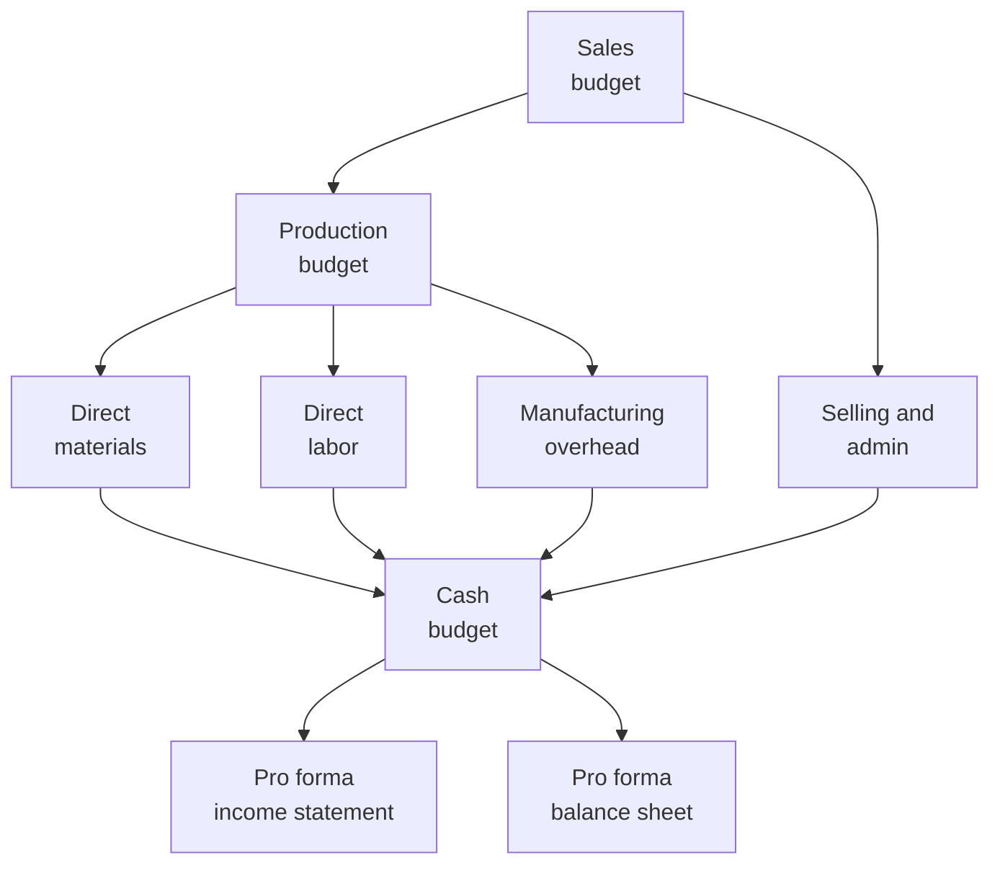

# Budgeting, Forecasting, and Projection

Historical analysis asks what happened. Planning asks what will happen, and what the entity should do about it. Three related tools turn strategy into numbers. A **budget** sets targets for a future period. A **forecast** estimates future outcomes from historical data and statistical methods. A **projection** models results under one or more hypothetical ("what-if") assumptions.

The BAR section tests whether you can prepare a budget from supportable assumptions, use forecasting techniques to model revenue, costs, and profit, run planning analyses such as sensitivity and breakeven, and judge a forecast's reasonableness with ratios and outside indices. This chapter starts with the data a plan is built on, then walks through the master budget, forecasting methods, planning techniques, and the analysis of the results.

---

## Data Transformation for Budgeting

A budget is only as good as its data. Organizations hold **structured data** (general ledger balances, ERP tables, sales databases) and **unstructured data** (emails, contracts, customer feedback). Before modeling, the raw data has to be transformed into something reliable and usable:

| Step | Description | Example |
|---|---|---|
| **Collecting** | Gathering data from internal and external sources | Exporting 36 months of sales from the ERP system |
| **Cleaning** | Removing duplicates, correcting errors, standardizing formats | Eliminating duplicate invoice records |
| **Scrubbing** | Validating data against business rules and resolving anomalies | Flagging negative unit quantities for review |
| **Structuring** | Organizing data into a consistent, analyzable format | Converting free-text dates to YYYY-MM-DD |
| **Enriching** | Adding external benchmarks or indices to internal data | Appending CPI data for inflation-adjusted projections |

The old rule "garbage in, garbage out" applies. A budget built on duplicate transactions, miscoded accounts, or stale prices produces misleading targets and unreliable variance analysis later.

---

## Budgeting Overview

A budget does four jobs at once. It forces **planning**, because management must put numbers on its goals. It aids **coordination**, because the sales plan drives the production plan, which drives purchasing and hiring. It supports **control**, because actual results can be measured against it. And it allows **performance evaluation**, through the variance analysis covered in [Managerial and Cost Accounting](../business-analysis-historical/managerial-and-cost-accounting.md).

Budgets fall into three broad types:

| Budget Type | Scope |
|---|---|
| **Operating budget** | Revenue, production, and operating expense plans for the coming period |
| **Financial budget** | Cash budget, budgeted balance sheet, and budgeted statement of cash flows |
| **Capital budget** | Long-term investments in plant, equipment, and other capital assets |

---

## The Master Budget

The master budget is the organization's complete financial plan. Its parts are linked in sequence: everything starts with the sales forecast and ends with pro forma (projected) financial statements.

The **sales budget** is the starting point: expected unit sales times the expected selling price. The **production budget** then works out how many units to make, allowing for the inventory the company wants on hand at the end of the period:

$$
\text{Required Production} = \text{Budgeted Sales (units)} + \text{Desired Ending Inventory} - \text{Beginning Inventory}
$$

The **direct materials budget** applies the same logic to raw materials, and the **direct labor budget** prices the hours needed:

$$
\text{Materials to Purchase} = \text{Production Needs} + \text{Desired Ending Materials} - \text{Beginning Materials}
$$

$$
\text{Budgeted Labor Cost} = \text{Units to Produce} \times \text{Labor Hours per Unit} \times \text{Wage Rate per Hour}
$$

The **manufacturing overhead** and **selling and administrative** budgets separate fixed and variable costs, so that a flexible budget can be prepared later. All of these feed the **cash budget**, which projects cash receipts and payments month by month and shows whether the entity will need to borrow. It is the main tool for short-term cash management.

### Worked Example: Bear Co. Cash Budget

Bear Co. is preparing a cash budget for the second quarter (April through June) using these assumptions:

- **Sales forecast:** March (actual) \$180,000; April \$200,000; May \$240,000; June \$260,000; July \$260,000.
- **Collections:** 60% in the month of sale, 35% in the following month, and 5% uncollectible.
- **Purchases:** 50% of the next month's sales, paid in the month of purchase.
- **Fixed operating expenses:** \$40,000 per month, including \$5,000 of depreciation. The cash portion is \$35,000.
- **Cash balance:** \$25,000 on April 1. Bear Co. wants at least \$20,000 on hand at the end of every month and would borrow to stay above it.

**Step 1: Cash collections**

| Source | April | May | June |
|---|---|---|---|
| Current month sales (60%) | \$120,000 | \$144,000 | \$156,000 |
| Prior month sales (35%) | \$63,000 | \$70,000 | \$84,000 |
| **Total collections** | **\$183,000** | **\$214,000** | **\$240,000** |

**Step 2: Cash disbursements**

| Item | April | May | June |
|---|---|---|---|
| Purchases (50% of next month's sales) | \$120,000 | \$130,000 | \$130,000 |
| Fixed operating expenses (cash portion) | \$35,000 | \$35,000 | \$35,000 |
| **Total disbursements** | **\$155,000** | **\$165,000** | **\$165,000** |

**Step 3: Cash budget summary**

| Line | April | May | June |
|---|---|---|---|
| Beginning cash balance | \$25,000 | \$53,000 | \$102,000 |
| Add: Total collections | \$183,000 | \$214,000 | \$240,000 |
| Less: Total disbursements | (\$155,000) | (\$165,000) | (\$165,000) |
| **Ending cash balance** | **\$53,000** | **\$102,000** | **\$177,000** |

Bear Co. stays above its \$20,000 minimum every month, so it does not need to borrow. The growing balance suggests it will have excess cash by June to invest short term or use to repay debt. Notice two details that exam questions like to test: the 5% of sales that is never collected never appears as a receipt, and depreciation is excluded because it is not a cash payment.

---

## Budget Approaches

Organizations budget in different ways, and the exam expects you to recognize and compare them.

| Approach | Description | Advantage | Disadvantage |
|---|---|---|---|
| **Static budget** | Prepared for a single activity level | Simple to prepare | Not useful when actual volume differs from plan |
| **Flexible budget** | Restates budgeted costs for the actual activity level achieved | Allows meaningful variance analysis | Requires reliable cost behavior estimates |
| **Rolling (continuous)** | Adds a new period as each period ends | Always covers a full planning horizon | More administrative effort |
| **Zero-based** | Every expense must be justified from zero each period | Removes budgetary slack | Time-consuming |
| **Incremental** | Starts from the prior budget and adjusts | Quick and easy | Carries forward past inefficiencies |
| **Activity-based** | Budgets costs from expected activities and their cost drivers | More accurate where overhead is large | Requires detailed activity analysis |

The static and flexible budgets are the pair most often confused. A static budget stays at the volume originally planned. A flexible budget restates the budget for the volume actually achieved. Comparing actual costs with a static budget mixes the effect of volume with the effect of efficiency, which is why variance analysis uses the flexible budget.

:::tip[Exam Tip]

When a question describes a budget that "adjusts for the actual number of units produced," it is describing a **flexible budget**.

:::

---

## Forecasting Techniques

Forecasting turns historical data into estimates of future revenue, cost, and profit. The techniques range from simple extrapolation to statistical models.

**Trend analysis** extends a historical pattern. If Bear Co.'s revenue grew 8%, 9%, and 10% over the past three years, a simple trend projection might assume 10% to 11% growth next year.

A **moving average** smooths short-term fluctuations by averaging the most recent periods. A three-period moving average forecast for period 4 is:

$$
\text{MA}_4 = \frac{\text{Period 1} + \text{Period 2} + \text{Period 3}}{3}
$$

If sales were \$100,000, \$110,000, and \$120,000, the forecast for period 4 is \$110,000. Each period counts equally, so the average lags behind a strong trend.

**Exponential smoothing** gives more weight to recent results. The smoothing constant $\alpha$, between 0 and 1, sets how quickly the forecast responds:

$$
F_{t+1} = \alpha \times A_t + (1 - \alpha) \times F_t
$$

Here $F$ is the forecast and $A$ is the actual result. With $\alpha = 0.3$, a prior forecast of \$100,000, and actual sales of \$110,000, the next forecast is 0.3 × \$110,000 + 0.7 × \$100,000 = \$103,000. An $\alpha$ closer to 1 reacts faster to recent changes.

**Regression analysis** fits a line to historical data to measure how a dependent variable (for example, total cost) moves with one or more independent variables (for example, units produced):

$$
Y = a + bX
$$

$Y$ is the predicted value, $a$ is the intercept (the fixed component), $b$ is the slope (the variable rate), and $X$ is the activity level. Unlike the high-low method, regression uses every observation. Two statistics describe the fit. The **correlation coefficient** ($r$, from -1 to +1) shows the strength and direction of the relationship. The **coefficient of determination** ($R^2$, from 0 to 1) shows the share of the variation in $Y$ that $X$ explains. Regression assumes a linear relationship, so look at a scatter plot first. If the data curves, a straight line will mislead.

---

## Projection Techniques: Pro Forma Financial Statements

Pro forma statements show what the financial statements will look like if a given set of assumptions holds. A typical build follows four steps:

1. **Start with the sales forecast.** Apply a supportable growth rate to historical revenue.
2. **Model cost behavior.** Use fixed and variable cost relationships to project COGS and operating expenses.
3. **Project the balance sheet.** Estimate receivables, inventory, payables, and capital spending using turnover ratios or percentage-of-sales relationships.
4. **Derive the cash flows.** Build operating, investing, and financing cash flows from the projected income statement and the changes in the projected balance sheet.

Every assumption should be traceable to historical data, a contract, or a documented management decision. "Revenue will double" with no support is not a budget assumption.

---

## Planning Techniques

Once a base plan exists, management tests it. Each technique below asks a different question about the same numbers.

### Cost-Benefit Analysis

Cost-benefit analysis compares the expected costs of a decision with its expected benefits. A proposal is worth pursuing when the net benefit is positive.

$$
\text{Net Benefit} = \text{Total Benefits} - \text{Total Costs}
$$

**Example:** Polar Inc. is considering a new inventory management system that costs \$150,000 to implement and is expected to cut carrying costs by \$45,000 a year for five years. Total benefits are \$45,000 × 5 = \$225,000, so the net benefit is \$225,000 - \$150,000 = \$75,000. The project is justified on an undiscounted basis. A full analysis would discount the savings, as shown in [Investment Alternatives](investment-alternatives.md).

### Sensitivity Analysis

Sensitivity analysis changes **one input at a time** to see how much the output moves. It answers questions like "how much does profit depend on the selling price?"

**Example:** Bear Co. budgets 10,000 units at \$50 each, variable costs of \$30 per unit, and fixed costs of \$100,000. Budgeted operating income is 10,000 × (\$50 - \$30) - \$100,000 = \$100,000. If the selling price falls 10% to \$45:

$$
\text{Revised Operating Income} = 10{,}000 \times (\$45 - \$30) - \$100{,}000 = \$50{,}000
$$

A 10% drop in price cuts operating income by **50%**. Profit is highly sensitive to price because the whole \$5 price cut comes straight out of the \$20 contribution margin.

### What-If Scenarios

What-if analysis changes **several inputs together**. Management often models a best case, a most likely case, and a worst case.

| Scenario | Units Sold | Price | Variable Cost | Fixed Cost | Operating Income |
|---|---|---|---|---|---|
| **Best case** | 12,000 | \$52 | \$29 | \$100,000 | \$176,000 |
| **Most likely** | 10,000 | \$50 | \$30 | \$100,000 | \$100,000 |
| **Worst case** | 8,000 | \$47 | \$32 | \$105,000 | \$15,000 |

Even the worst case is profitable, but only barely. That tells management how much room for error the plan has.

### Breakeven Analysis

Breakeven analysis finds the volume at which contribution margin exactly covers fixed costs, so profit is zero. The formulas and the related margin of safety are covered in detail in the cost-volume-profit section of [Managerial and Cost Accounting](../business-analysis-historical/managerial-and-cost-accounting.md). As a planning tool, breakeven shows how far sales can fall before the plan produces a loss.

**Example:** In Bear Co.'s base plan, the contribution margin is \$20 per unit, so breakeven is \$100,000 ÷ \$20 = 5,000 units. Budgeted sales of 10,000 units give a margin of safety of 5,000 units, or 50%. After the 10% price cut, the contribution margin falls to \$15 and breakeven rises to \$100,000 ÷ \$15 = 6,667 units.

### Predictive Analytics

Predictive analytics applies statistical and machine-learning techniques to historical data to predict outcomes. Typical uses include predicting which customers are likely to leave (churn), forecasting revenue from economic indicators with multiple regression, and scoring the credit risk of receivables. Models are judged on **accuracy** (how often the prediction is right) and **precision** (of the cases the model flags, how many are real). Their output still needs professional judgment before it drives a decision.

---

## Analyzing Forecasts and Projections

A finished forecast still has to pass a reasonableness test. Two tools help.

First, compute the same ratios used in historical analysis (current ratio, gross margin, ROA, ROE, debt-to-equity) on the **projected** statements. Compare them with the entity's historical ratios (is the trend consistent?), with industry benchmarks (is the projection competitive or out of line?), and with debt covenant thresholds (will the entity stay in compliance?).

Second, compare the projection with outside economic and industry indices:

| Index or Benchmark | Question It Answers |
|---|---|
| **GDP growth rate** | Is the projected revenue growth reasonable given expected economic conditions? |
| **Consumer Price Index (CPI)** | Are projected cost increases consistent with expected inflation? |
| **Industry revenue growth** | Is the company projected to gain or lose market share? |
| **Prime rate or SOFR** | Are projected interest costs consistent with expected borrowing rates? |

A projection that departs sharply from the indices needs an explanation. If Kodiak Partners projects 15% revenue growth while its industry is growing 4%, the analyst should look for a supportable reason, such as a new product launch or an acquisition, or revise the assumption downward. A strong historical correlation between a company's sales and an index (for example, housing starts for a building supplier) can also be used to test, or even build, the revenue forecast.

---

## Common Pitfalls

:::caution[Common Pitfalls]

- **Using a static budget to evaluate performance.** It mixes volume effects with efficiency effects. Use a flexible budget.
- **Ignoring the collection lag.** Sales recognized in one month may be collected over the next one or two months, and uncollectible amounts are never collected.
- **Including noncash items.** Depreciation is an expense but not a cash payment. Leave it out of cash disbursements.
- **Using the wrong margin for breakeven.** Breakeven uses **contribution margin**, not gross margin. Gross margin can include fixed manufacturing overhead under absorption costing.
- **Accepting unsupported assumptions.** Every growth rate and cost estimate should trace to evidence.

:::
