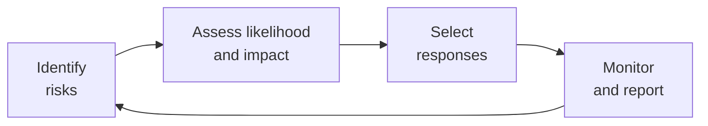

# Risk Management

Every strategy carries risk. A new product may not sell, a key supplier may fail, interest rates may jump, or a customer may never pay. **Risk management** is the discipline of identifying such events, judging how likely and how serious they are, and deciding what to do about them. The goal is not to eliminate risk, which would mean doing nothing, but to keep it within limits the organization has chosen so it can pursue its strategy with confidence.

The BAR section tests the COSO Enterprise Risk Management (ERM) framework, including its application to environmental, social, and governance (ESG) risks, along with practical tools: strategies for mitigating financial risks, approaches to managing working capital, SWOT analysis, and the effect of a proposed transaction on key performance measures. This chapter covers them in that order.

---

## Basic Risk Concepts

COSO defines **risk** as the possibility that events will occur and affect the achievement of strategy and business objectives. That effect can be negative or positive: the same uncertainty that creates a threat can also create an opportunity. Managing risk follows a continuous cycle:

A few terms recur throughout the framework:

| Concept | Definition |
|---|---|
| **Inherent risk** | The risk before management takes any action to change its likelihood or impact |
| **Residual risk** | The risk that remains after management's response |
| **Risk capacity** | The maximum amount of risk the entity is able to absorb in pursuing its strategy |
| **Risk appetite** | The types and amount of risk, on a broad level, the entity is willing to accept in pursuit of value |
| **Tolerance** | The acceptable range of variation in performance around a specific business objective |

Risk appetite and tolerance work at different levels. The board sets the **risk appetite** as a broad statement about the entity as a whole. Management translates it into **tolerances**: specific, measurable limits for individual objectives.

**Example (Bear Co.):** Bear Co.'s board adopts this risk appetite statement: "We accept moderate financial risk to pursue organic revenue growth of 8% to 12% a year." The CFO sets a tolerance for currency exposure: "Receivables denominated in foreign currencies shall not exceed 15% of total receivables."

---

## The COSO ERM Framework (2017)

The Committee of Sponsoring Organizations of the Treadway Commission (COSO) published *Enterprise Risk Management: Integrating with Strategy and Performance* in 2017. Its central message is in the title. Risk is managed as part of setting and carrying out strategy, not as a separate compliance exercise. The framework's purpose is to help an organization create, preserve, and realize value by considering risk when it chooses a strategy and when it measures performance. (COSO's separate *Internal Control* framework addresses the narrower subject of internal control over operations, reporting, and compliance.)

### Five Components and Twenty Principles

The framework has five interrelated components, supported by 20 principles. You do not need to memorize the principles word for word, but you should know which component each group belongs to.

| Component | Focus | Principles |
|---|---|---|
| **Governance and Culture** | Who is responsible for risk, and what values guide decisions | 1-5: board risk oversight, operating structures, desired culture, commitment to core values, attracting, developing, and retaining capable individuals |
| **Strategy and Objective-Setting** | How much risk the entity is willing to take | 6-9: analyzing business context, defining risk appetite, evaluating alternative strategies, formulating business objectives |
| **Performance** | What could go wrong, or right, and what to do about it | 10-14: identifying risk, assessing severity, prioritizing risks, implementing risk responses, developing a portfolio view |
| **Review and Revision** | Whether the approach is still working | 15-17: assessing substantial change, reviewing risk and performance, pursuing improvement in ERM |
| **Information, Communication, and Reporting** | Whether the right people get the right risk information | 18-20: leveraging information and technology, communicating risk information, reporting on risk, culture, and performance |

### Identifying and Assessing Risks

Within the Performance component, management first identifies the events that could affect its objectives, using techniques such as brainstorming, scenario analysis, process flow analysis, and industry benchmarking. It then assesses each risk's severity on two dimensions: **likelihood** (how probable the event is) and **impact** (how much it would matter). A **heat map** plots the two to show where attention is needed most:

| | Low Impact | Medium Impact | High Impact |
|---|---|---|---|
| **High Likelihood** | Monitor | Significant | Critical |
| **Medium Likelihood** | Low | Monitor | Significant |
| **Low Likelihood** | Low | Low | Monitor |

The framework also asks for a **portfolio view**: looking at risks together, because several moderate risks that move together can add up to more than the entity's appetite.

### Risk Responses

For each significant risk, management chooses a response. COSO 2017 lists five:

| Response | Description | Example |
|---|---|---|
| **Accept** | Take no action, because the risk is within appetite | Bear Co. accepts minor price swings on office supplies |
| **Avoid** | Exit the activity that creates the risk | Bear Co. leaves an unprofitable foreign market rather than carry its currency risk |
| **Pursue** | Accept more risk to achieve better performance | Polar Inc. expands aggressively into a fast-growing market, judging that the added risk is within its appetite |
| **Reduce** | Act to lower the likelihood or impact | Polar Inc. strengthens its controls over cash disbursements to reduce fraud risk |
| **Share** | Transfer part of the risk to another party | Kodiak Partners buys property insurance to cover catastrophic loss |

Sharing usually means insurance, hedging, or outsourcing. The risk does not disappear; a counterparty bears it in exchange for a premium or fee.

---

## ESG Risk Management

In 2018, COSO and the World Business Council for Sustainable Development (WBCSD) issued *Enterprise Risk Management: Applying Enterprise Risk Management to Environmental, Social and Governance-related Risks*. Its message is that ESG risks belong in the same ERM process as every other risk, not in a separate silo.

| Category | Examples | Potential Impact |
|---|---|---|
| **Environmental** | Carbon emissions, water scarcity, waste, physical climate risks such as floods | Regulatory fines, asset impairment, supply chain disruption |
| **Social** | Labor practices, data privacy, community relations, workforce diversity | Litigation, reputational damage, loss of talent |
| **Governance** | Board independence, executive pay, anti-corruption policies, lobbying transparency | Shareholder activism, regulatory sanctions, loss of investor confidence |

The guidance walks each ESG risk through the five components:

1. **Governance and Culture.** The board takes on oversight of ESG risks and sets the tone for sustainable practices.
2. **Strategy and Objective-Setting.** Management builds ESG factors into the business context, the risk appetite, and strategic planning.
3. **Performance.** ESG risks are identified, assessed for severity, prioritized alongside other risks, and given responses, such as reducing emissions, diversifying the supply chain, or strengthening data privacy controls.
4. **Review and Revision.** ESG exposures are monitored against targets, such as emissions reduction goals, and the approach is revised as conditions and regulations change.
5. **Information, Communication, and Reporting.** ESG risk information is communicated inside the entity and reported to stakeholders, often using a recognized sustainability reporting framework.

ESG regulation keeps changing, so the exam focuses on applying the COSO framework, not on any one set of reporting rules. The SEC's climate disclosure rules adopted in 2024, for example, were stayed and never took effect, and in 2026 the SEC proposed rescinding them. They are not tested as requirements.

---

## Mitigating Financial Risks

Financial risks come from movements in market prices, interest rates, and exchange rates, and from the possibility of running short of cash. As with other risks, the aim is to bring exposure within the entity's appetite, not to remove it entirely.

### Market (Price) Risk

Market risk is the risk of loss from changes in market prices, such as commodity or equity prices. Derivatives are the usual hedge.

**Example (Grizzly Industries):** Grizzly Industries uses 50,000 barrels of crude oil a quarter. To protect against rising prices, it buys futures contracts at \$75 a barrel. If the spot price rises to \$85, the hedge saves \$10 a barrel, or \$500,000. If the price falls to \$70, Grizzly effectively pays \$5 a barrel more than the market price. Either way, it has locked in a cost of \$75.

### Interest Rate Risk

Interest rate risk is the risk that rate changes will raise borrowing costs (on variable-rate debt) or change the fair value of fixed-rate instruments.

| Strategy | Description | When It Fits |
|---|---|---|
| **Fixed-rate borrowing** | Locks in a known interest cost | Rates are expected to rise |
| **Variable-rate borrowing** | Interest cost moves with the market | Rates are expected to fall |
| **Interest rate swap** | Exchanges fixed payments for variable payments, or the reverse | To change existing exposure without refinancing |

**Example (Bear Co.):** Bear Co. has a \$10,000,000 variable-rate loan at SOFR + 2%. Worried about rising rates, it enters into a pay-fixed, receive-variable swap: it pays 5% fixed and receives SOFR. Whatever SOFR does, Bear's net cost is fixed at 7%:

| | SOFR at 3% | SOFR at 4% |
|---|---|---|
| Pay on loan (SOFR + 2%) | 5% | 6% |
| Receive on swap (SOFR) | (3%) | (4%) |
| Pay on swap (fixed) | 5% | 5% |
| **Net cost** | **7%** | **7%** |

The swap converts variable-rate debt into synthetic fixed-rate debt. Accounting for swaps as hedges is covered in [Derivatives and Hedge Accounting](../technical-accounting-combinations-and-reporting/derivatives-and-hedge-accounting.md).

### Currency Risk

Currency risk arises when an entity has assets, liabilities, or expected cash flows in a foreign currency.

| Strategy | Description |
|---|---|
| **Forward contract** | Locks in an exchange rate for a future date, removing the uncertainty |
| **Currency option** | Gives the right, but not the obligation, to exchange at a set rate; protects against loss while keeping the upside, for a premium |
| **Natural hedge** | Matches revenues and expenses (or assets and liabilities) in the same foreign currency so they offset |

**Example (Polar Inc.):** Polar Inc. expects to receive €2,000,000 from a European customer in 90 days. The spot rate is \$1.10 per euro. Polar enters a 90-day forward contract at \$1.09, locking in proceeds of \$2,180,000 regardless of how the rate moves.

### Liquidity Risk

Liquidity risk is the risk that an entity cannot meet its obligations as they come due. The common defenses are a cash reserve, a **revolving credit facility** (pre-arranged borrowing capacity), careful cash flow forecasting, and holding assets that can be sold quickly without significant loss. When a question describes a company under liquidity pressure, look for whether it can draw on a credit line, speed up collections, or renegotiate payables.

---

## Working Capital Management

**Working capital** is current assets minus current liabilities. Managing it is a balancing act. Too little, and the entity risks missing payments. Too much, and cash sits idle when it could be earning a return.

$$
\text{Working Capital} = \text{Current Assets} - \text{Current Liabilities}
$$

### Aggressive and Conservative Strategies

The blueprint asks you to compare strategies for managing working capital. They differ in how much the entity holds in current assets and how it finances them.

| Strategy | Current Assets Held | Financing | Result |
|---|---|---|---|
| **Conservative** | Ample cash and inventory | Long-term funds finance even some seasonal needs | Lower liquidity risk, lower return (more idle, costly funds) |
| **Matching (hedging)** | Moderate | Maturity of financing matched to the life of the asset: short-term debt for seasonal needs, long-term funds for permanent needs | Balanced risk and return |
| **Aggressive** | Lean cash and inventory | Short-term debt finances even some permanent needs | Higher return, higher liquidity and refinancing risk |

### Cash Conversion Cycle

The **cash conversion cycle (CCC)** measures the number of days between paying suppliers for inventory and collecting cash from customers. A shorter cycle means the entity gets its cash back sooner and needs less financing.

$$
\text{CCC} = \text{DSO} + \text{DIO} - \text{DPO}
$$

DSO is days sales outstanding (the collection period for receivables), DIO is days inventory outstanding (also called days in inventory), and DPO is days payable outstanding (the time taken to pay suppliers).

**Example: Cub Entertainment**

| Metric | Calculation | Days |
|---|---|---|
| DSO | (\$400,000 receivables ÷ \$6,000,000 revenue) × 365 | 24.3 |
| DIO | (\$500,000 inventory ÷ \$3,600,000 COGS) × 365 | 50.7 |
| DPO | (\$300,000 payables ÷ \$3,600,000 COGS) × 365 | 30.4 |
| **CCC** | 24.3 + 50.7 - 30.4 | **44.6** |

Cub Entertainment's cash is tied up for about 45 days. It can shorten the cycle by collecting faster, holding less inventory, or paying suppliers more slowly. Each lever has a cost, as the next three topics show.

### Receivables

| Approach | Description | Trade-Off |
|---|---|---|
| **Tighter credit policy** | Stricter credit standards and shorter terms | Fewer bad debts, but possibly lower sales |
| **Looser credit policy** | More lenient terms to attract customers | More sales, but higher bad debts and DSO |
| **Factoring** | Selling receivables to a third party at a discount | Immediate cash, at the cost of the discount |
| **Early payment discounts** | Terms such as 2/10, net 30 | Faster collection, but less cash per dollar of sales |

### Inventory

| Strategy | Description | Best For |
|---|---|---|
| **Economic order quantity (EOQ)** | The order size that minimizes total ordering and holding costs | Stable demand |
| **Just-in-time (JIT)** | Inventory arrives just when needed, so little is held | Reliable suppliers and predictable demand |
| **Safety stock** | Extra inventory held as a buffer | Volatile demand or unreliable supply |

$$
EOQ = \sqrt{\frac{2DS}{H}}
$$

$D$ is annual demand in units, $S$ is the cost of placing one order, and $H$ is the cost of holding one unit for a year. If annual demand is 10,000 units, each order costs \$50, and holding a unit costs \$4 a year, the EOQ is $\sqrt{2 \times 10{,}000 \times 50 \div 4} = \sqrt{250{,}000} = 500$ units.

### Payables

Paying suppliers later keeps cash in the business longer, but it can cost more than it appears to, because it often means giving up an early payment discount.

**Example (Kodiak Partners):** A supplier offers Kodiak Partners terms of 2/10, net 30: a 2% discount for paying within 10 days, otherwise the full amount in 30 days. Skipping the discount means paying 2% more to keep the money for 20 extra days. The annualized cost is:

$$
\text{Annualized Cost} = \frac{\text{Discount \%}}{1 - \text{Discount \%}} \times \frac{365}{\text{Full Period} - \text{Discount Period}} = \frac{0.02}{0.98} \times \frac{365}{20} \approx 37.2\%
$$

That is an expensive source of credit. Kodiak should take the discount if it has the cash, or if it can borrow for less than 37.2%. Stretching payments beyond the agreed terms is not a sustainable strategy: it damages supplier relationships, may trigger penalties, and can disrupt supply.

---

## SWOT Analysis

A **SWOT analysis** looks at an entity's **Strengths, Weaknesses, Opportunities, and Threats** to help it choose a strategy. Strengths and weaknesses are **internal**: they describe the entity itself. Opportunities and threats are **external**: they describe its environment.

| Factor | Source | Nature | Examples |
|---|---|---|---|
| **Strengths** | Internal | Favorable | Strong brand, proprietary technology, low-cost production |
| **Weaknesses** | Internal | Unfavorable | High employee turnover, aging equipment, limited product line |
| **Opportunities** | External | Favorable | Growing market, favorable regulation, emerging technology |
| **Threats** | External | Unfavorable | New competitors, economic downturn, changing customer preferences |

### Worked Example: Sloth Security

Sloth Security is a mid-size cybersecurity firm deciding whether to expand into government contracts.

| | Favorable | Unfavorable |
|---|---|---|
| **Internal** | **Strengths:** Experienced engineering team; 95% client retention rate; proprietary threat-detection software | **Weaknesses:** Little experience with government procurement; small sales team; dependence on three key engineers |
| **External** | **Opportunities:** Government cybersecurity spending projected to grow 12% a year; few competitors hold the required federal security authorizations | **Threats:** Large defense contractors entering cybersecurity; complex federal compliance requirements |

**Interpretation:** Sloth Security can use its proprietary technology (a strength) to pursue the growing government market (an opportunity). Before it does, it needs to fix its lack of procurement experience (a weakness), through hiring or a partnership, before larger competitors (a threat) take the market. A good SWOT conclusion ties each recommendation to specific factors, which is what exam questions ask you to do.

---

## Impact of Transactions on Key Performance Measures

A common exam task gives you a proposed transaction and asks how it would change key performance measures, such as the current ratio, debt-to-equity, return on assets (ROA), return on equity (ROE), or earnings per share. A five-step approach works every time:

1. **Identify** the measures being tested.
2. **Compute the baseline** before the transaction.
3. **Apply the transaction** to every affected account, including income effects such as interest.
4. **Recompute** the measures.
5. **Interpret** the change.

### Worked Example: Bear Co. Borrows to Buy Back Stock

Bear Co. has total assets of \$5,000,000, total liabilities of \$2,000,000, total equity of \$3,000,000, and net income of \$450,000. It proposes to issue \$1,000,000 of long-term bonds at par at 6% and use the proceeds to repurchase common stock. Its tax rate is 25%.

The bonds bring in \$1,000,000 of cash, and the buyback pays it out, so total assets stay at \$5,000,000. Liabilities rise to \$3,000,000 and equity falls to \$2,000,000. The new interest costs \$60,000 a year, or \$45,000 after tax, so net income falls to \$405,000.

| Measure | Before | After |
|---|---|---|
| Debt-to-equity | \$2,000,000 ÷ \$3,000,000 = 0.67 | \$3,000,000 ÷ \$2,000,000 = 1.50 |
| ROA | \$450,000 ÷ \$5,000,000 = 9.0% | \$405,000 ÷ \$5,000,000 = 8.1% |
| ROE | \$450,000 ÷ \$3,000,000 = 15.0% | \$405,000 ÷ \$2,000,000 = 20.3% |

Leverage more than doubles. ROA falls because of the interest. ROE rises, because the assets earn more (9% after tax, before the new interest) than the debt costs after tax (4.5%), and the earnings are now spread over a smaller equity base. With fewer shares outstanding, EPS would also likely rise. Management has to weigh those gains against the higher financial risk and any loan covenants that limit leverage.
