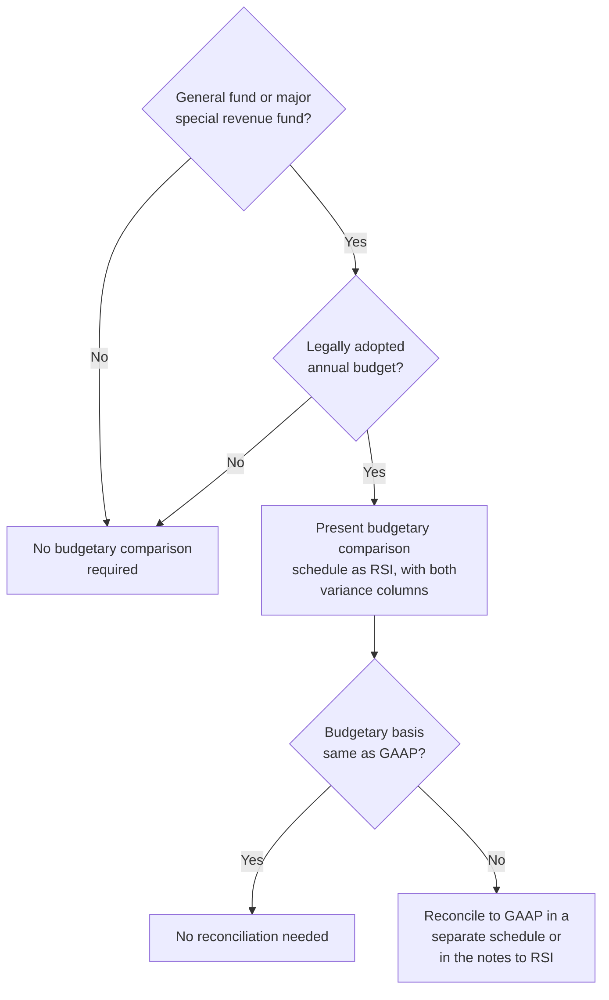

# Budgetary Comparison Reporting

For a government, the budget is more than a plan. Once the legislative body adopts it, the budget is law: appropriations set the legal limit on what the government may spend. Readers of a government's annual report therefore want to know whether the government raised and spent money as the budget allowed. **Budgetary comparison reporting** answers that question by setting the original budget, the final budget, and actual results side by side for the government's main operating funds.

This chapter explains what the comparison is for, which funds need one, how the schedule is built under GASB Statement No. 103, and how budgetary amounts are reconciled to GAAP.

---

## Purpose and Objectives

Budgetary comparisons serve several purposes at once:

| Objective | Description |
|---|---|
| **Legal compliance** | Shows whether the government stayed within its legally authorized appropriations |
| **Accountability** | Shows citizens and oversight bodies how actual results compared with the approved budget |
| **Transparency** | Reveals how much the budget was amended during the year |
| **Performance evaluation** | Highlights variances that management should explain |

The first objective drives the design. To show compliance with the budget, the actual amounts must be measured the same way the budget was, so the actual column is reported on the **budgetary basis**, which may differ from GAAP.

---

## Which Funds Require a Comparison

Budgetary comparison schedules are required for the **general fund** and for each **major special revenue fund** that has a **legally adopted annual budget**.

| Fund Type | Required? | Condition |
|---|---|---|
| **General fund** | Yes | Always required |
| **Major special revenue fund** | Yes | Only if it has a legally adopted annual budget |
| **Nonmajor special revenue fund** | No | May be presented voluntarily, outside RSI |
| **Capital projects fund** | No | Usually has project-length budgets, not annual budgets |
| **Debt service fund** | No | Not required, even if budgeted |
| **Proprietary and fiduciary funds** | No | Not part of the required comparison |

:::warning[Common Pitfall]

A major special revenue fund **without** a legally adopted annual budget does not need a budgetary comparison. Being major is not enough; the fund must also have a legally adopted annual budget.

:::

---

## Presentation Under GASB 103

GASB Statement No. 103, *Financial Reporting Model Improvements*, effective for fiscal years beginning after June 15, 2025, changed how the comparison is presented. Under the older GASB 34 rules, a government could present it either as a basic financial statement or as required supplementary information (RSI), and the variance columns were optional. GASB 103 removed both choices.

- **Location:** Budgetary comparison schedules are presented only as **RSI**. They are no longer an option among the basic financial statements.
- **Columns:** The schedule shows the **original budget**, the **final budget**, and **actual amounts on the budgetary basis**, plus two **required variance columns**: original budget to final budget, and final budget to actual.
- **Explanations:** Significant variances in both columns must be explained in the **notes to RSI**.

| Column | Description |
|---|---|
| **Original budget** | The first complete appropriated budget adopted by the legislative body |
| **Final budget** | The original budget adjusted for all legally authorized amendments, transfers, and other changes during the year |
| **Variance: original to final** | How much the budget was changed during the year |
| **Actual (budgetary basis)** | Actual inflows and outflows measured on the same basis as the budget |
| **Variance: final to actual** | How actual results compared with the final budget |

Because the schedule is RSI, it sits after the notes to the basic financial statements and is not covered by the auditor's opinion on those statements. The auditor applies limited procedures to it instead.

---

## Example Budgetary Comparison Schedule

**Bear City, General Fund, Budgetary Comparison Schedule (RSI)**
**For the Fiscal Year Ended June 30, 20X7**

| | Original Budget | Final Budget | Variance: Original to Final, Increase (Decrease) | Actual (Budgetary Basis) | Variance: Final to Actual, Favorable (Unfavorable) |
|---|---|---|---|---|---|
| **Revenues:** | | | | | |
| Property taxes | \$8,000,000 | \$8,000,000 | \$0 | \$8,150,000 | \$150,000 |
| Sales taxes | 3,500,000 | 3,700,000 | 200,000 | 3,620,000 | (80,000) |
| Intergovernmental | 1,200,000 | 1,200,000 | 0 | 1,250,000 | 50,000 |
| Charges for services | 800,000 | 850,000 | 50,000 | 870,000 | 20,000 |
| **Total revenues** | **13,500,000** | **13,750,000** | **250,000** | **13,890,000** | **140,000** |
| **Expenditures:** | | | | | |
| General government | 2,800,000 | 2,900,000 | 100,000 | 2,870,000 | 30,000 |
| Public safety | 5,200,000 | 5,400,000 | 200,000 | 5,380,000 | 20,000 |
| Public works | 2,500,000 | 2,500,000 | 0 | 2,550,000 | (50,000) |
| Culture and recreation | 1,100,000 | 1,050,000 | (50,000) | 1,020,000 | 30,000 |
| **Total expenditures** | **11,600,000** | **11,850,000** | **250,000** | **11,820,000** | **30,000** |
| **Excess of revenues over expenditures** | **1,900,000** | **1,900,000** | **0** | **2,070,000** | **170,000** |
| Other financing sources (uses) | (400,000) | (400,000) | 0 | (400,000) | 0 |
| **Net change in fund balance** | **\$1,500,000** | **\$1,500,000** | **\$0** | **\$1,670,000** | **\$170,000** |

Reading the schedule tells a story. During the year the council raised the sales tax estimate by \$200,000 and added \$250,000 of appropriations, mostly for public safety and general government. Actual sales taxes still fell \$80,000 short of the revised estimate. Public works spent \$2,550,000 against a final appropriation of \$2,500,000. If appropriations are legally controlled at the function level, that \$50,000 overspending is a violation of the budget, and it is exactly the kind of significant variance the notes to RSI must explain.

For the final-to-actual column, a revenue variance is favorable when actual revenue **exceeds** the budget, and an expenditure variance is favorable when actual spending is **less** than the budget. GASB's own illustrations label the variance columns "over (under)" instead. Either labeling works if it is applied consistently.

---

## Budgetary Basis and GAAP Basis

Many governments budget on a basis that differs from GAAP. Common differences include:

| Item | Budgetary Basis Treatment | GAAP (Modified Accrual) Treatment |
|---|---|---|
| **Encumbrances** | Often charged against the appropriation as if spent | Not expenditures; amounts are reported within restricted, committed, or assigned fund balance as appropriate |
| **Transfers** | May be budgeted with revenues or expenditures | Reported as other financing sources (uses) |
| **Timing** | Cash or near-cash basis is common | Modified accrual basis |
| **Inventory** | Purchases method (charged when bought) | Purchases or consumption method |
| **Perspective** | May cover only legally budgeted activities or a different fund structure | Covers all activity of the fund |

When the two bases differ, the budgetary schedule must be accompanied by a **reconciliation** of the budgetary amounts to the GAAP amounts in the governmental fund statements. The reconciliation can be a separate schedule or part of the notes to RSI.

### Example Reconciliation

| Item | Amount |
|---|---|
| Net change in fund balance (budgetary basis) | \$1,670,000 |
| Add: Encumbrances outstanding at year-end (budgetary expenditures, not GAAP expenditures) | 95,000 |
| Less: Encumbrances outstanding at the beginning of the year (charged to last year's budget, but GAAP expenditures this year when the goods arrived) | (72,000) |
| Add: Increase in inventory (consumption method under GAAP) | 15,000 |
| **Net change in fund balance (GAAP basis)** | **\$1,708,000** |

The reconciliation is a schedule, not a set of journal entries. Nothing is posted to the ledger to prepare it.

---

## Decision Flow

---

## Summary

| Concept | Key Point |
|---|---|
| **Required for** | General fund and each major special revenue fund with a legally adopted annual budget |
| **Location** | Required supplementary information only (GASB 103) |
| **Columns** | Original budget, final budget, actual on the budgetary basis, and two variance columns (original to final; final to actual) |
| **Explanations** | Significant variances explained in the notes to RSI |
| **Basis** | Actual column uses the budgetary basis, which may differ from GAAP |
| **Reconciliation** | Required when the budgetary basis differs from GAAP |
| **Audit status** | Not covered by the opinion on the basic statements; the auditor applies limited procedures |

:::tip[Exam Tip]

Older study materials describe the GASB 34 rules: a choice between a basic statement and RSI, and an optional variance column. Those rules no longer apply. Under GASB 103 the comparison is always RSI, and both variance columns are required.

:::
