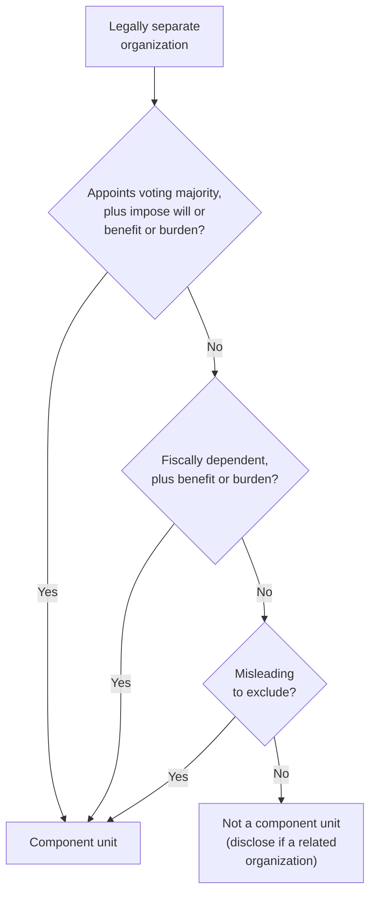
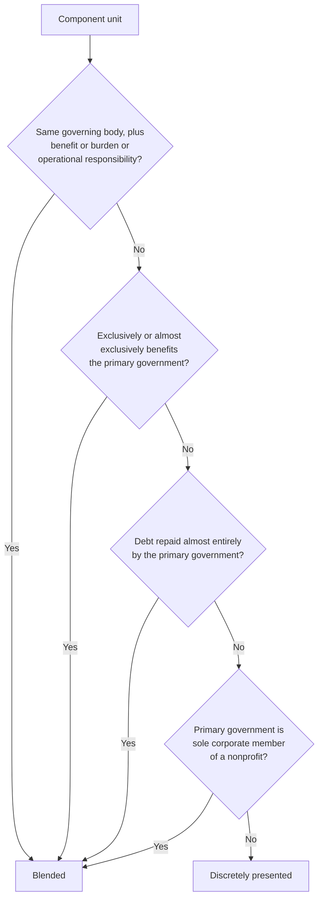

# Financial Reporting Entity

A city government rarely acts alone. It may have a transit authority, a housing authority, a building authority that issues its bonds, and a foundation that raises money for its parks. Each is a legally separate organization, yet a reader of the city's annual report would be misled if the report ignored the ones the city effectively controls or stands behind. The **financial reporting entity** solves this problem: it is the **primary government** plus its **component units**, the legally separate organizations for which the primary government is financially accountable or whose exclusion would be misleading.

The BAR section tests two decisions: whether an organization is a component unit, and if so, whether it is **blended** into the primary government's own statements or **discretely presented** beside them. The rules come from GASB Statement No. 14, as amended by later statements. This chapter defines the primary government, walks through the component unit criteria, explains the two presentation methods (including the GASB 103 change for major component units), and finishes with an example.

---

## The Primary Government

A **primary government** is a state government, a general-purpose local government (such as a city, county, town, or village), or a special-purpose government (such as a school district) that meets **all three** of these criteria:

| Criterion | Description |
|---|---|
| Separately elected governing body | Its governing body is elected by the citizens in a general, popular election |
| Legally separate | It has corporate powers, such as the right to sue and be sued in its own name |
| Fiscally independent | It can adopt its budget, levy taxes or set rates, and issue debt without another government's approval |

A special-purpose government that fails one of these tests, for example a school district whose budget must be approved by the city, is not a primary government. It is likely a component unit of the government it depends on.

---

## Component Unit Criteria

A legally separate organization is a **component unit** of a primary government if any of the following three conditions applies.

**1. Financial accountability through appointment.** The primary government appoints a **voting majority** of the organization's governing board, **and** either:

- it can **impose its will** on the organization (for example, it can remove board members at will, approve or modify the budget, or veto decisions), **or**
- there is a potential **financial benefit or burden** relationship (for example, the primary government is entitled to the organization's resources, is legally obligated to finance its deficits, or is obligated for its debt).

**2. Fiscal dependency.** The organization is **fiscally dependent** on the primary government (it cannot adopt its budget, levy taxes or set rates, or issue debt without the primary government's approval), **and** there is a potential financial benefit or burden relationship.

**3. Misleading to exclude.** The nature and significance of the relationship is such that leaving the organization out would make the reporting entity's statements **misleading**. GASB 39 applies this idea to legally separate, tax-exempt organizations such as foundations. Such an organization is a discretely presented component unit if all three of these are true: its resources are entirely or almost entirely for the direct benefit of the primary government, its component units, or its constituents; the primary government or its component units are entitled to, or can otherwise access, a majority of those resources; and those resources are significant to the primary government.

---

## Blended Component Units

Most component units are presented discretely, apart from the primary government. A component unit is **blended**, reported as though it were part of the primary government, only when it is so closely tied to the primary government that it is, in substance, part of it. That is the case when **any one** of these criteria is met:

| Criterion | Description |
|---|---|
| **Same governing body, plus a link** | The component unit's governing body is substantively the same as the primary government's, **and** there is a financial benefit or burden relationship or the primary government's management has operational responsibility for the component unit |
| **Exclusive benefit** | The component unit provides services entirely or almost entirely to the primary government, or otherwise exclusively or almost exclusively benefits it |
| **Debt repaid by the primary government** | The component unit's total debt outstanding, including leases, is expected to be repaid entirely or almost entirely with the primary government's resources |
| **Sole corporate member** | The component unit is a not-for-profit corporation in which the primary government is the sole corporate member (GASB 80) |

A blended component unit's funds are reported as funds of the primary government, usually as special revenue, debt service, capital projects, or enterprise funds. The primary government's general fund remains the only general fund. If a blended component unit has its own general fund, that fund is reported as a special revenue fund.

**Example:** A city creates a **Building Authority** whose only purpose is to issue bonds to build facilities for the city. The city council serves as the Authority's board, and the city's lease payments will repay all of the Authority's debt. The Authority is blended, because its debt will be repaid entirely with the city's resources (and it exclusively benefits the city).

---

## Discretely Presented Component Units

A component unit that meets none of the blending criteria is **discretely presented**: reported in the government-wide statements, but separately from the primary government, so readers can tell the two apart. Discretely presented component units do **not** appear in the fund financial statements.

GASB Statement No. 103, effective for fiscal years beginning after June 15, 2025, changed how **major** component units are shown. Under GASB 34, a government could present major component unit information in the government-wide statements, in combining statements, or in condensed form in the notes. GASB 103 removed the notes option:

- Each **major** component unit is presented in its own column in the government-wide statement of net position and statement of activities, unless doing so would reduce the readability of those statements.
- If separate columns would reduce readability, **combining statements** of the major component units are presented after the fund financial statements.

| Statement | Presentation of Discretely Presented Component Units |
|---|---|
| Government-wide statement of net position | Columns to the right of the primary government total, one for each major component unit (or a total column supported by combining statements) |
| Government-wide statement of activities | Separate rows for component unit expenses and program revenues, and separate columns for their net (expense) revenue and changes in net position |
| Fund financial statements | Not included |

**Example:** A city's **Housing Authority** has a board appointed by the mayor, and the city guarantees its bonds (a financial burden). The Authority serves the public, not the city, and repays its bonds from rents. It is a discretely presented component unit.

:::warning[Common Exam Trap]

Discretely presented component units appear **only** in the government-wide statements. Blended component units appear in **both** the fund statements and the government-wide statements, because they are treated as part of the primary government.

:::

| Type | Government-Wide Statements | Fund Statements |
|---|---|---|
| **Primary government** | Included | Included |
| **Blended component unit** | Combined with the primary government | Reported as funds of the primary government |
| **Discretely presented component unit** | Separate columns and rows | Not included |

---

## Related Organizations, Joint Ventures, and Jointly Governed Organizations

Not every organization with ties to the government is a component unit:

| Category | Description | Reporting |
|---|---|---|
| **Related organization** | The primary government appoints a voting majority of the board but is not financially accountable | Note disclosure only |
| **Joint venture** | Jointly controlled by two or more participants, each retaining an ongoing financial interest or responsibility | Equity interest reported as an investment, plus note disclosure |
| **Jointly governed organization** | Jointly controlled, but no participant has an ongoing financial interest or responsibility | Note disclosure only |

Related organizations are a favorite distractor. The primary government appoints the board, so the organization looks like a component unit, but the government can neither impose its will nor faces a financial benefit or burden. It is disclosed, not included.

---

## Development of the Standards

| GASB Statement | Key Provision |
|---|---|
| **GASB 14** (1991) | Defined the financial reporting entity and the component unit criteria |
| **GASB 39** (2002) | Added criteria for including legally separate, tax-exempt organizations such as foundations |
| **GASB 61** (2010) | Added the benefit or burden requirement for fiscally dependent organizations and tightened the "same governing body" blending criterion |
| **GASB 80** (2016) | Added blending for not-for-profit corporations in which the primary government is the sole corporate member |
| **GASB 97** (2020) | Clarified the criteria for defined contribution pension and OPEB plans and Section 457 deferred compensation plans that have no governing board |
| **GASB 103** (2024) | Requires each major component unit to be presented separately in the government-wide statements, or in combining statements; removed the notes option |

---

## Example: Bear City

Bear City has relationships with four organizations:

| Organization | Board Appointed by City? | Impose Will or Benefit or Burden? | Serves | Debt Repaid From |
|---|---|---|---|---|
| Bear City Transit Authority | Yes (7 of 9 members) | City guarantees the Authority's bonds | The public | Fare revenues |
| Bear City Parking Garage Corp. | Yes (city council members serve as the board) | Same governing body | The city only | City payments |
| Bear City Arts Foundation | Yes (4 of 7 members) | Neither | The public | Its own revenues |
| County Library District | No | Not applicable | The public | Its own tax levy |

| Organization | Component Unit? | Presentation |
|---|---|---|
| Bear City Transit Authority | Yes: the city appoints a majority and bears a financial burden (the guarantee) | **Discretely presented**: it serves the public and repays its own debt |
| Bear City Parking Garage Corp. | Yes: the city appoints the entire board, and because the board is the city council, the city can impose its will | **Blended**: it serves the city exclusively, and its debt is repaid with city resources |
| Bear City Arts Foundation | No: the city appoints a majority but is not financially accountable | **Related organization**: note disclosure only |
| County Library District | No: the city does not appoint the board and the district is fiscally independent | Not part of the reporting entity |

:::tip[Exam Tip]

Work through component unit questions in order: (1) Is the organization legally separate? (2) Is the primary government financially accountable, or would exclusion be misleading? (3) If it is a component unit, does it meet any blending criterion? If not, it is discretely presented.

:::
