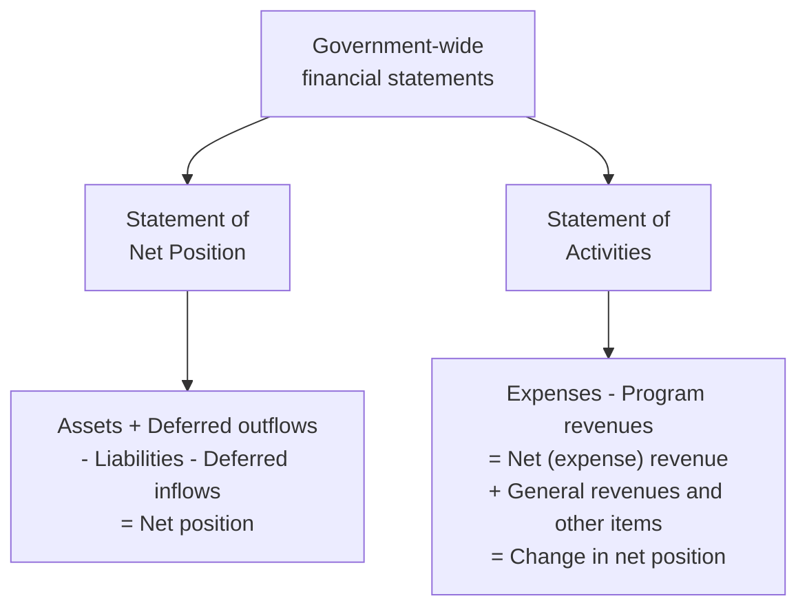

# Government-Wide Financial Statements

Fund statements tell readers whether a government lived within this year's resources. They do not show whether the government as a whole is better or worse off: they leave out its roads and buildings, its long-term debt, and its pension liability. The **government-wide financial statements**, required by GASB Statement No. 34, fill that gap. They report the whole government, other than its fiduciary activities, on the **economic resources measurement focus** and the **full accrual basis of accounting**, much as a business would.

The BAR section tests the concepts behind these statements and asks you to prepare both of them from trial balances. This chapter explains what the statements include, how they are measured, the format of the statement of net position and the statement of activities, and then works through a preparation example.

---

## Overview and Purpose

| Feature | Government-Wide Statements | Governmental Fund Statements |
|---|---|---|
| Measurement focus | Economic resources | Current financial resources |
| Basis of accounting | Full accrual | Modified accrual |
| Capital assets | Reported and depreciated | Not reported |
| Long-term liabilities | Reported | Not reported |
| Scope | All activities except fiduciary | Individual funds |

There are two government-wide statements:

| Statement | Purpose |
|---|---|
| **Statement of Net Position** | Reports assets, deferred outflows of resources, liabilities, deferred inflows of resources, and net position at the end of the year |
| **Statement of Activities** | Reports expenses and program revenues by function, to show the net cost of each, and then the general revenues that cover those costs |



---

## Activities Reported

The government-wide statements are organized in **columns** by type of activity:

| Column | Description | Included |
|---|---|---|
| **Governmental activities** | Financed mainly by taxes, intergovernmental revenues, and other nonexchange revenues | General, special revenue, debt service, capital projects, and permanent funds, plus most internal service funds |
| **Business-type activities** | Financed mainly by fees charged to external users | Enterprise funds |
| **Total primary government** | Governmental plus business-type activities | Required |
| **Discretely presented component units** | Legally separate entities reported apart from the primary government | Each major component unit in its own column, or a total column supported by combining statements (GASB 103) |

A total column for the entire reporting entity (primary government plus component units) may be added but is not required.

**Internal service funds** are usually reported with **governmental activities**, because they mainly serve governmental funds. Their assets and liabilities are folded into the governmental activities column when the fund statements are converted to the government-wide statements. An internal service fund that mainly serves enterprise funds is reported with business-type activities instead.

**Fiduciary activities** (pension trust, investment trust, private-purpose trust, and custodial funds) are **never** included. Those resources belong to others and cannot be used for the government's own programs.

---

## Measurement Focus and Basis of Accounting

Under the economic resources measurement focus, the statements report all assets and liabilities, current and long-term. Under the full accrual basis, revenues are recognized when earned (or, for nonexchange revenues, when the recognition requirements are met) and expenses when incurred, regardless of when cash changes hands. The differences from the governmental funds are easiest to see transaction by transaction:

| Item | Government-Wide Treatment | Governmental Fund Treatment |
|---|---|---|
| Capital asset purchase | Capitalize and depreciate | Expenditure |
| Bond issuance | Liability | Other financing source |
| Bond principal payment | Reduces the liability | Expenditure |
| Accrued interest on long-term debt | Liability and expense | Generally not recorded until due |
| Net pension liability | Long-term liability | Not reported |

:::warning[Key Distinction]

The most common exam trap is mixing up modified accrual (fund level) and full accrual (government-wide). When a question asks about the **government-wide** statements, think like a business: capitalize assets, record depreciation, report all long-term debt, and recognize revenue without regard to whether it is available to pay this year's bills.

:::

---

## Statement of Net Position

### Format

GASB encourages the **net position format**:

$$
\text{Assets} + \text{Deferred Outflows of Resources} - \text{Liabilities} - \text{Deferred Inflows of Resources} = \text{Net Position}
$$

A balance sheet format (assets plus deferred outflows equal liabilities plus deferred inflows plus net position) is also allowed. Assets and liabilities may be listed in order of liquidity or classified as current and noncurrent. Long-term liabilities show separately the amounts due within one year and the amounts due later.

### Components of Net Position

| Component | Definition | Example |
|---|---|---|
| **Net investment in capital assets** | Capital assets net of accumulated depreciation, less the outstanding debt used to acquire, build, or improve them (excluding debt whose proceeds are still unspent) | Buildings and infrastructure, less the bonds that financed them |
| **Restricted** | Subject to constraints imposed externally (by creditors, grantors, contributors, or other governments' laws) or by the government's constitution or enabling legislation | Debt service reserves, unspent restricted grants |
| **Unrestricted** | Everything else; internal designations do not make it restricted | Available for any lawful purpose |

$$
\text{Net Investment in Capital Assets} = \text{Capital Assets (net)} - \text{Capital-Related Debt} + \text{Unspent Debt Proceeds}
$$

If bond proceeds have not yet been spent on capital assets, the debt related to them does not reduce net investment in capital assets. Only debt whose proceeds have been spent on capital assets does.

### Example: Bear City Statement of Net Position

| | Governmental Activities | Business-Type Activities | Total |
|---|---:|---:|---:|
| **Assets** | | | |
| Cash and investments | \$12,500,000 | \$4,200,000 | \$16,700,000 |
| Receivables (net) | 3,800,000 | 1,600,000 | 5,400,000 |
| Internal balances | 500,000 | (500,000) | 0 |
| Capital assets (net of depreciation) | 85,000,000 | 32,000,000 | 117,000,000 |
| **Total assets** | **101,800,000** | **37,300,000** | **139,100,000** |
| **Deferred outflows of resources** | 2,200,000 | 400,000 | 2,600,000 |
| **Liabilities** | | | |
| Accounts payable | 2,100,000 | 900,000 | 3,000,000 |
| Accrued liabilities | 1,400,000 | 300,000 | 1,700,000 |
| Long-term liabilities: | | | |
| &emsp;Due within one year | 4,500,000 | 1,200,000 | 5,700,000 |
| &emsp;Due in more than one year | 38,000,000 | 14,000,000 | 52,000,000 |
| **Total liabilities** | **46,000,000** | **16,400,000** | **62,400,000** |
| **Deferred inflows of resources** | 3,000,000 | 200,000 | 3,200,000 |
| **Net position** | | | |
| Net investment in capital assets | 42,500,000 | 16,800,000 | 59,300,000 |
| Restricted | 5,500,000 | 1,200,000 | 6,700,000 |
| Unrestricted | 7,000,000 | 3,100,000 | 10,100,000 |
| **Total net position** | **\$55,000,000** | **\$21,100,000** | **\$76,100,000** |

Notice the **internal balances** line. Amounts owed between governmental and business-type activities appear as an asset in one column and a liability in the other, and they offset to zero in the total column. Balances between two funds of the same activity type (for example, two governmental funds) are eliminated entirely and do not appear at all.

---

## Statement of Activities

### Net (Expense) Revenue Format

The statement of activities has a format found nowhere else in accounting. For each function or program, it subtracts the **program revenues** that the function generates from the function's **expenses**, giving its **net (expense) revenue**: the amount that must be covered by taxes and other general revenues. General revenues are then added at the bottom to reach the change in net position.

| Category | Definition | Examples |
|---|---|---|
| **Charges for services** (program) | Revenues from exchange transactions directly related to a function | Water fees, building permits, park admissions |
| **Operating grants and contributions** (program) | Restricted to the operating purposes of a function | Federal education grant, state highway maintenance grant |
| **Capital grants and contributions** (program) | Restricted to the capital purposes of a function | Federal grant for bridge construction |
| **General revenues** | Not tied to a specific function | Property taxes, sales taxes, unrestricted state aid, unrestricted investment earnings |

:::tip[Exam Tip]

**All taxes are general revenues**, even taxes dedicated to a specific program, such as a gasoline tax earmarked for roads. Program revenues come from the program's own charges or from grants and contributions restricted to it.

:::

Below the general revenues, the statement reports, in this order: contributions to term and permanent endowments and to permanent fund principal, **transfers** between governmental and business-type activities, and **unusual or infrequent items**. GASB 103 replaced the old categories of special items and extraordinary items with a single category: transactions and events that are **unusual in nature or infrequent in occurrence**. Each such item is shown separately, as the last flow before the change in net position, and its inflows and outflows are not netted. A flood that brings \$2,500,000 of state cleanup grants and \$10,000,000 of cleanup costs, for example, shows both amounts.

### Example: Bear City Statement of Activities

| Functions/Programs | Expenses | Charges for Services | Operating Grants | Capital Grants | Net (Expense) Revenue |
|---|---:|---:|---:|---:|---:|
| **Governmental activities:** | | | | | |
| General government | \$4,200,000 | \$800,000 | \$100,000 | 0 | (\$3,300,000) |
| Public safety | 8,500,000 | 1,200,000 | 500,000 | 0 | (6,800,000) |
| Public works | 6,000,000 | 400,000 | 1,000,000 | \$2,500,000 | (2,100,000) |
| Culture and recreation | 2,800,000 | 600,000 | 200,000 | 0 | (2,000,000) |
| Interest on long-term debt | 1,500,000 | 0 | 0 | 0 | (1,500,000) |
| **Total governmental activities** | **23,000,000** | **3,000,000** | **1,800,000** | **2,500,000** | **(15,700,000)** |
| **Business-type activities:** | | | | | |
| Water utility | 3,800,000 | 4,500,000 | 0 | 1,000,000 | 1,700,000 |
| Parking facilities | 1,200,000 | 1,400,000 | 0 | 0 | 200,000 |
| **Total business-type activities** | **5,000,000** | **5,900,000** | **0** | **1,000,000** | **1,900,000** |
| **Total primary government** | **\$28,000,000** | **\$8,900,000** | **\$1,800,000** | **\$3,500,000** | **(\$13,800,000)** |

| | Governmental Activities | Business-Type Activities | Total |
|---|---:|---:|---:|
| **Net (expense) revenue** | (\$15,700,000) | \$1,900,000 | (\$13,800,000) |
| **General revenues:** | | | |
| Property taxes | 10,000,000 | 0 | 10,000,000 |
| Sales taxes | 4,500,000 | 0 | 4,500,000 |
| Unrestricted investment earnings | 800,000 | 200,000 | 1,000,000 |
| Transfers | (500,000) | 500,000 | 0 |
| **Total general revenues and transfers** | **14,800,000** | **700,000** | **15,500,000** |
| **Change in net position** | **(900,000)** | **2,600,000** | **1,700,000** |
| Net position, beginning | 55,900,000 | 18,500,000 | 74,400,000 |
| **Net position, ending** | **\$55,000,000** | **\$21,100,000** | **\$76,100,000** |

The ending net position ties to the statement of net position. Read the net (expense) revenue column as the burden each function places on general revenues. Negative amounts are functions supported by taxes, which is typical of governmental activities. Positive amounts are self-supporting, which is typical of business-type activities. Bear City had no unusual or infrequent items this year; if it had, they would appear after transfers.

### Interfund Eliminations

| Transaction Type | Treatment in the Government-Wide Statements |
|---|---|
| Interfund receivables and payables within the same activity type | Eliminated |
| Interfund receivables and payables between activity types | Reported as internal balances |
| Transfers within the same activity type | Eliminated |
| Transfers between activity types | Reported on one line, "Transfers," netting to zero in the total column |
| Interfund services provided and used (for example, the general fund buying water from the utility) | Not eliminated; reported as revenue and expense |
| Internal service fund activity | Folded into the activity it mainly serves, usually governmental activities |

---

## Example: Preparing Government-Wide Statements from Trial Balances

Bear County has the following year-end trial balance for its governmental funds (combined):

| Account | Debit | Credit |
|---|---:|---:|
| Cash | \$6,000,000 | |
| Taxes receivable (net) | 2,400,000 | |
| Expenditures: general government | 3,500,000 | |
| Expenditures: public safety | 5,000,000 | |
| Expenditures: capital outlay | 8,000,000 | |
| Expenditures: debt service principal | 2,000,000 | |
| Expenditures: debt service interest | 900,000 | |
| Revenues: property taxes | | \$14,000,000 |
| Revenues: charges for services (general government) | | 1,800,000 |
| Revenues: operating grants (public safety) | | 1,200,000 |
| Revenues: capital grants (public safety) | | 3,000,000 |
| Other financing sources: bond proceeds | | 5,000,000 |
| Fund balance, beginning | | 2,800,000 |
| **Totals** | **\$27,800,000** | **\$27,800,000** |

Additional information:

- Capital assets at the beginning of the year were \$40,000,000, net of accumulated depreciation. Depreciation for the year is \$3,200,000: \$1,200,000 for general government and \$2,000,000 for public safety.
- Bonds payable at the beginning of the year were \$20,000,000. All bonds financed capital assets, and all proceeds have been spent.
- Accrued interest payable at year-end is \$150,000 (none at the beginning of the year).
- Property tax revenue is the same on both bases.

### Step 1: Convert to Full Accrual

Each adjustment below is a worksheet entry, not an entry in the fund ledgers.

Capitalize the capital outlay:

```journal
Dr. Capital Assets[a] 8,000,000
    Cr. Expenditures: Capital Outlay 8,000,000
```

Record depreciation:

```journal
Dr. Depreciation Expense 3,200,000
    Cr. Accumulated Depreciation[ca] 3,200,000
```

Reclassify the bond proceeds as a liability:

```journal
Dr. Other Financing Sources: Bond Proceeds 5,000,000
    Cr. Bonds Payable[l] 5,000,000
```

Reclassify the principal payment as a reduction of the liability:

```journal
Dr. Bonds Payable[l] 2,000,000
    Cr. Expenditures: Debt Service Principal 2,000,000
```

Accrue interest:

```journal
Dr. Interest Expense 150,000
    Cr. Accrued Interest Payable[l] 150,000
```

### Step 2: Statement of Activities

| Function | Fund Expenditures | Depreciation | Interest Accrual | Expense |
|---|---:|---:|---:|---:|
| General government | \$3,500,000 | \$1,200,000 | 0 | \$4,700,000 |
| Public safety | 5,000,000 | 2,000,000 | 0 | 7,000,000 |
| Interest on long-term debt | 900,000 | 0 | \$150,000 | 1,050,000 |
| **Total** | **\$9,400,000** | **\$3,200,000** | **\$150,000** | **\$12,750,000** |

The \$8,000,000 of capital outlay and the \$2,000,000 of principal are gone entirely: one became a capital asset and the other a reduction of debt.

| Function | Expenses | Charges for Services | Operating Grants | Capital Grants | Net (Expense) Revenue |
|---|---:|---:|---:|---:|---:|
| General government | \$4,700,000 | \$1,800,000 | 0 | 0 | (\$2,900,000) |
| Public safety | 7,000,000 | 0 | \$1,200,000 | \$3,000,000 | (2,800,000) |
| Interest on long-term debt | 1,050,000 | 0 | 0 | 0 | (1,050,000) |
| **Total governmental activities** | **\$12,750,000** | **\$1,800,000** | **\$1,200,000** | **\$3,000,000** | **(\$6,750,000)** |
| General revenues: property taxes | | | | | 14,000,000 |
| **Change in net position** | | | | | **7,250,000** |
| Net position, beginning | | | | | 22,800,000 |
| **Net position, ending** | | | | | **\$30,050,000** |

Beginning net position is the beginning fund balance plus the full accrual items the funds leave out: \$2,800,000 + \$40,000,000 of capital assets - \$20,000,000 of bonds = \$22,800,000.

### Step 3: Statement of Net Position

| Governmental Activities | Amount |
|---|---:|
| Cash | \$6,000,000 |
| Taxes receivable (net) | 2,400,000 |
| Capital assets, net (\$40,000,000 + \$8,000,000 - \$3,200,000) | 44,800,000 |
| **Total assets** | **\$53,200,000** |
| Accrued interest payable | \$150,000 |
| Bonds payable (\$20,000,000 + \$5,000,000 - \$2,000,000) | 23,000,000 |
| **Total liabilities** | **\$23,150,000** |
| Net investment in capital assets (\$44,800,000 - \$23,000,000) | \$21,800,000 |
| Unrestricted | 8,250,000 |
| **Total net position** | **\$30,050,000** |

The two statements tie at \$30,050,000.

:::tip[Exam Tip]

When converting governmental fund data to government-wide amounts, run through the same checklist every time: (1) capitalize capital outlay, (2) add depreciation by function, (3) remove debt principal payments, (4) accrue interest and other expenses, and (5) turn bond proceeds into a liability.

:::
