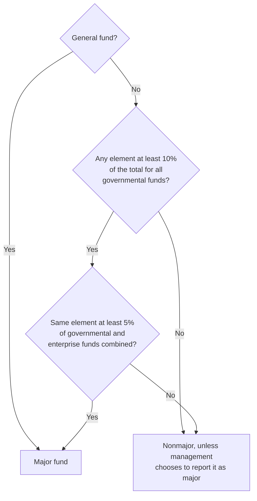

# Governmental Funds Financial Statements

The government-wide statements show the government's long-run financial health. The governmental fund statements answer a shorter-term question that taxpayers and legislators care about just as much: did the government raise enough this year to pay for what it spent this year? To answer it, these statements report only **current financial resources**, measured on the **modified accrual** basis. That focus on **fiscal accountability** makes them the main way a government shows it has complied with its budget and legal limits.

The BAR section tests the concepts behind these statements and asks you to prepare the balance sheet and the statement of revenues, expenditures, and changes in fund balances from trial balances. This chapter covers the five governmental fund types, the measurement rules, the format of each statement, major fund reporting, the reconciliations to the government-wide statements, and a worked example.

---

## The Five Governmental Fund Types

Governmental funds account for activities financed mainly by taxes, grants, and other nonexchange revenues. There are five types:

| Fund | Purpose | When Used |
|---|---|---|
| **General fund** | All financial resources not accounted for in another fund | Always; every government has exactly **one** |
| **Special revenue funds** | Proceeds of specific revenue sources restricted or committed to purposes other than debt service or capital projects | When required by law or chosen by the government; a restricted or committed revenue source must be the fund's foundation |
| **Debt service funds** | Resources restricted, committed, or assigned to pay principal and interest on general long-term debt | When legally required or when resources are being accumulated for future debt service |
| **Capital projects funds** | Resources restricted, committed, or assigned to acquire or build capital facilities and other capital assets | When legally required or chosen for major projects |
| **Permanent funds** | Resources legally restricted so that only the **earnings**, not the principal, may be spent on the government's programs | When the government holds such resources |

The general fund is always reported as a **major fund** and is the only fund every government must have. Permanent funds are easy to confuse with private-purpose trust funds. The difference is the beneficiary: a permanent fund's earnings support the **government's own** programs (for example, an endowment for a city cemetery), while a private-purpose trust benefits individuals or organizations outside the government.

---

## Measurement Focus and Basis of Accounting

Governmental funds combine a measurement focus and a basis of accounting found nowhere else:

| Feature | Governmental Funds | Government-Wide Statements |
|---|---|---|
| **Measurement focus** | Current financial resources | Economic resources |
| **Basis of accounting** | Modified accrual | Full accrual |
| **Reports capital assets?** | No | Yes |
| **Reports long-term debt?** | No | Yes |
| **Accountability emphasized** | Fiscal | Operational |

Under the **current financial resources** focus, the balance sheet reports only assets that will become cash soon and liabilities that will be paid from those resources. Capital assets are not reported, so purchases are expenditures. Long-term debt is not reported, so borrowing shows up as an other financing source. What is left over is **fund balance**, not net position.

### Revenue Recognition

Under modified accrual, revenues are recognized when they are both **measurable** (the amount can be reasonably estimated) and **available** (collectible within the period or soon enough after it to pay the period's liabilities). For property taxes, "soon enough" means within **60 days** after year-end, and many governments apply a similar period to other revenues.

| Revenue Type | Recognition Rule |
|---|---|
| Property taxes | In the year for which they are levied, to the extent collected during the year or within 60 days after |
| Sales and income taxes | When the underlying sale or income occurs, if available |
| Expenditure-driven grants | When the qualifying expenditures are incurred, if available |
| Other grants | When all eligibility requirements are met, if available |

Amounts that are receivable but not yet available are reported as **deferred inflows of resources (unavailable revenue)**. They become revenue in the period they become available.

### Expenditure Recognition

Expenditures are generally recognized when the fund liability is incurred. The important exceptions involve long-term obligations, which are recognized only as they come due for payment from current resources:

| Item | Recognition Rule |
|---|---|
| General operating costs | When the liability is incurred |
| Debt service principal and interest | When **due** (payable) |
| Compensated absences | Only the amount that has matured, such as unpaid leave owed to employees who have left |
| Claims and judgments | Only the amount that has matured and is payable |
| Pensions and OPEB | The amount paid or due to the plan for the period |

:::warning[Key Exception: Debt Service]

Debt service principal and interest are expenditures when they are **due**, not as interest accrues. Interest owed for December on a bond that pays in March is not recorded at a December 31 year-end. There is one option: if resources for debt service due early in the next year (no more than a month after year-end) have already been provided to the debt service fund, the government may recognize the expenditure and liability in the current year.

:::

---

## Required Financial Statements

Governmental funds present two statements, each with a column for every **major** fund and one aggregated column for all **nonmajor** funds:

| Statement | Purpose |
|---|---|
| **Balance Sheet** | Assets, deferred outflows, liabilities, deferred inflows, and fund balances at year-end |
| **Statement of Revenues, Expenditures, and Changes in Fund Balances** | Inflows, outflows, and the net change in fund balance for the year |

Each statement must also be reconciled to the government-wide statements, as discussed later in this chapter.

---

## Balance Sheet: Format and Components

The balance sheet uses a balance sheet format:

$$
\text{Assets} + \text{Deferred Outflows of Resources} = \text{Liabilities} + \text{Deferred Inflows of Resources} + \text{Fund Balances}
$$

| Assets | Liabilities | Fund Balances |
|---|---|---|
| Cash and cash equivalents | Accounts payable | Nonspendable |
| Investments | Accrued liabilities | Restricted |
| Receivables (taxes, accounts) | Due to other funds | Committed |
| Due from other funds | Unearned revenue | Assigned |
| Inventories | Matured debt and interest payable | Unassigned |
| Prepaid items | | |

Because of the current financial resources focus, several large items are **not** on this balance sheet: capital assets, bonds and notes payable, the net pension and OPEB liabilities, and interest accrued on long-term debt that is not yet due. All of them appear only on the government-wide statement of net position.

### Fund Balance Classifications

GASB 54 classifies fund balance by how tightly its use is constrained:

| Classification | Description |
|---|---|
| **Nonspendable** | Not in spendable form (inventories, prepaid items) or legally or contractually required to stay intact (permanent fund principal) |
| **Restricted** | Constrained by external parties (creditors, grantors, contributors, other governments' laws) or by the government's constitution or enabling legislation |
| **Committed** | Constrained by formal action of the government's highest decision-making authority, such as an ordinance; only the same kind of action can remove the constraint |
| **Assigned** | Intended for a specific purpose by the governing body or an official it has delegated that authority to |
| **Unassigned** | The residual. Only the general fund reports a positive unassigned balance; another governmental fund reports negative unassigned fund balance if it has a deficit |

### Example: Bear City Governmental Funds Balance Sheet

| | General Fund | Debt Service Fund | Capital Projects Fund | Nonmajor Funds | Total |
|---|---:|---:|---:|---:|---:|
| **Assets** | | | | | |
| Cash and investments | \$4,800,000 | \$1,200,000 | \$3,500,000 | \$950,000 | \$10,450,000 |
| Property taxes receivable | 1,600,000 | 400,000 | 0 | 200,000 | 2,200,000 |
| Due from other funds | 300,000 | 0 | 0 | 0 | 300,000 |
| Inventories | 150,000 | 0 | 0 | 0 | 150,000 |
| **Total assets** | **\$6,850,000** | **\$1,600,000** | **\$3,500,000** | **\$1,150,000** | **\$13,100,000** |
| **Liabilities** | | | | | |
| Accounts payable | \$620,000 | 0 | \$800,000 | \$90,000 | \$1,510,000 |
| Due to other funds | 0 | 0 | 0 | 300,000 | 300,000 |
| Unearned revenue | 200,000 | 0 | 0 | 50,000 | 250,000 |
| **Total liabilities** | **820,000** | **0** | **800,000** | **440,000** | **2,060,000** |
| **Deferred inflows of resources** | | | | | |
| Unavailable revenue (property taxes) | 400,000 | 100,000 | 0 | 50,000 | 550,000 |
| **Fund balances** | | | | | |
| Nonspendable | 150,000 | 0 | 0 | 0 | 150,000 |
| Restricted | 0 | 1,500,000 | 2,700,000 | 500,000 | 4,700,000 |
| Committed | 800,000 | 0 | 0 | 160,000 | 960,000 |
| Assigned | 500,000 | 0 | 0 | 0 | 500,000 |
| Unassigned | 4,180,000 | 0 | 0 | 0 | 4,180,000 |
| **Total fund balances** | **5,630,000** | **1,500,000** | **2,700,000** | **660,000** | **10,490,000** |
| **Total liabilities, deferred inflows, and fund balances** | **\$6,850,000** | **\$1,600,000** | **\$3,500,000** | **\$1,150,000** | **\$13,100,000** |

---

## Statement of Revenues, Expenditures, and Changes in Fund Balances

The operating statement for governmental funds follows a fixed order:

1. **Revenues**, classified by source.
2. **Expenditures**, classified by function for current operations, then debt service and capital outlay.
3. **Excess (deficiency) of revenues over expenditures.**
4. **Other financing sources and uses.**
5. **Unusual or infrequent items**, if any.
6. **Net change in fund balances**, then beginning and ending fund balances.

| Revenue Category | Examples |
|---|---|
| Taxes | Property, sales, and income taxes |
| Licenses and permits | Business licenses, building permits, vehicle registrations |
| Intergovernmental | Federal and state grants, shared revenues |
| Charges for services | Recording fees, park fees, court costs |
| Fines and forfeitures | Traffic fines, code enforcement penalties |
| Investment earnings | Interest, changes in the fair value of investments |
| Miscellaneous | Donations, small sales of surplus property |

| Expenditure Classification | Examples |
|---|---|
| **Current:** general government, public safety, public works, health and welfare, culture and recreation, education | City council and finance department; police and fire; streets and sanitation; clinics; parks and libraries; schools (if the government runs them) |
| **Debt service:** principal and interest | Bond principal and interest payments |
| **Capital outlay** | Building construction, equipment purchases |

**Other financing sources and uses** change fund balance but are not revenues or expenditures:

| Item | Classification |
|---|---|
| Transfers in and transfers out | Other financing source; other financing use |
| Face amount of bonds issued | Other financing source |
| Premium on bonds issued (discount) | Other financing source (use) |
| Proceeds from sales of capital assets | Usually an other financing source; small amounts are often reported as miscellaneous revenue |
| Payment to a refunding bond escrow agent | Other financing use |

**Unusual or infrequent items.** GASB 103 replaced the old special and extraordinary items with one category: transactions and events that are unusual in nature **or** infrequent in occurrence. In the governmental fund operating statement, each such item is reported **after** other financing sources and uses, as the last flow before the net change in fund balances. Its inflows and outflows are shown separately, not netted. For example, flood cleanup costs of \$10,000,000 and the \$2,500,000 state grant received to help pay them would appear as two lines. Debt refundings are never unusual or infrequent items in governmental funds, because they are already reported as other financing sources and uses.

### Example: Bear City Statement of Revenues, Expenditures, and Changes in Fund Balances

| | General Fund | Debt Service Fund | Capital Projects Fund | Nonmajor Funds | Total |
|---|---:|---:|---:|---:|---:|
| **Revenues:** | | | | | |
| Property taxes | \$8,200,000 | \$2,100,000 | 0 | \$600,000 | \$10,900,000 |
| Sales taxes | 3,400,000 | 0 | 0 | 0 | 3,400,000 |
| Licenses and permits | 450,000 | 0 | 0 | 80,000 | 530,000 |
| Intergovernmental | 1,800,000 | 0 | \$2,500,000 | 400,000 | 4,700,000 |
| Charges for services | 900,000 | 0 | 0 | 150,000 | 1,050,000 |
| Investment earnings | 180,000 | 50,000 | 120,000 | 30,000 | 380,000 |
| **Total revenues** | **14,930,000** | **2,150,000** | **2,620,000** | **1,260,000** | **20,960,000** |
| **Expenditures:** | | | | | |
| Current: | | | | | |
| &emsp;General government | 3,200,000 | 0 | 0 | 200,000 | 3,400,000 |
| &emsp;Public safety | 5,800,000 | 0 | 0 | 300,000 | 6,100,000 |
| &emsp;Public works | 2,400,000 | 0 | 0 | 500,000 | 2,900,000 |
| &emsp;Culture and recreation | 1,100,000 | 0 | 0 | 180,000 | 1,280,000 |
| Debt service: | | | | | |
| &emsp;Principal | 0 | 1,800,000 | 0 | 0 | 1,800,000 |
| &emsp;Interest | 0 | 950,000 | 0 | 0 | 950,000 |
| Capital outlay | 600,000 | 0 | 4,200,000 | 0 | 4,800,000 |
| **Total expenditures** | **13,100,000** | **2,750,000** | **4,200,000** | **1,180,000** | **21,230,000** |
| **Excess (deficiency) of revenues over expenditures** | **1,830,000** | **(600,000)** | **(1,580,000)** | **80,000** | **(270,000)** |
| **Other financing sources (uses):** | | | | | |
| Transfers in | 0 | 700,000 | 500,000 | 0 | 1,200,000 |
| Transfers out | (1,200,000) | 0 | 0 | 0 | (1,200,000) |
| Bond proceeds | 0 | 0 | 3,000,000 | 0 | 3,000,000 |
| **Total other financing sources (uses)** | **(1,200,000)** | **700,000** | **3,500,000** | **0** | **3,000,000** |
| **Net change in fund balances** | **630,000** | **100,000** | **1,920,000** | **80,000** | **2,730,000** |
| Fund balances, beginning | 5,000,000 | 1,400,000 | 780,000 | 580,000 | 7,760,000 |
| **Fund balances, ending** | **\$5,630,000** | **\$1,500,000** | **\$2,700,000** | **\$660,000** | **\$10,490,000** |

The ending fund balances tie to the balance sheet. Transfers in and out offset to zero in the total column, and the \$3,000,000 of bond proceeds is an other financing source, never revenue.

---

## Major Fund Reporting

Each **major** fund gets its own column; all other governmental funds are combined in one nonmajor column. A fund is major if:

- it is the **general fund** (always major); or
- it passes **both** parts of the size test for the same element (total assets and deferred outflows, total liabilities and deferred inflows, revenues, or expenditures):
  1. the element is at least **10%** of the corresponding total for **all governmental funds**, and
  2. the same element is at least **5%** of the corresponding total for **all governmental and enterprise funds combined**; or
- management believes it is particularly important to users and chooses to report it as major.



Nonmajor funds appear in a **single aggregated column**, usually labeled "Other Governmental Funds" or "Nonmajor Governmental Funds." Detail for each nonmajor fund is presented in **combining statements**, which are supplementary information, not part of the basic financial statements.

---

## Reconciliation to the Government-Wide Statements

Because the two sets of statements measure different things, the governmental fund statements must be reconciled to the governmental activities column of the government-wide statements. The reconciliation appears at the bottom of each fund statement or in an accompanying schedule.

### Fund Balance to Net Position

| Reconciling Item | Effect |
|---|---|
| Capital assets used in governmental activities, net of accumulated depreciation | **Add** (not reported in the funds) |
| Long-term liabilities (bonds, notes, compensated absences, net pension liability) | **Subtract** (not reported in the funds) |
| Deferred outflows and inflows related to pensions and OPEB | **Add** outflows; **subtract** inflows |
| Unavailable revenue (deferred inflows in the funds) | **Add** (recognized as revenue under full accrual) |
| Internal service fund net position | **Add** (included in governmental activities) |
| Accrued interest on long-term debt | **Subtract** (not recorded in the funds until due) |

**Example: Bear City**

| | Amount |
|---|---|
| Total fund balances (governmental funds) | \$10,490,000 |
| Capital assets used in governmental activities | 68,000,000 |
| Accumulated depreciation | (22,000,000) |
| Bonds payable | (28,000,000) |
| Compensated absences | (1,200,000) |
| Net pension liability | (5,500,000) |
| Deferred outflows related to pensions | 2,200,000 |
| Deferred inflows related to pensions | (1,800,000) |
| Unavailable revenue recognized under full accrual | 550,000 |
| Internal service fund net position | 1,260,000 |
| Accrued interest payable | (450,000) |
| **Net position of governmental activities** | **\$23,550,000** |

### Net Change in Fund Balances to Change in Net Position

| Reconciling Item | Effect |
|---|---|
| Capital outlay (expenditure in the funds, capitalized government-wide) | **Add** |
| Depreciation (not in the funds) | **Subtract** |
| Bond proceeds (other financing source in the funds, liability government-wide) | **Subtract** |
| Debt principal repaid (expenditure in the funds, reduction of the liability government-wide) | **Add** |
| Change in unavailable revenue | **Add** an increase; **subtract** a decrease |
| Increase in accrued interest | **Subtract** |
| Internal service fund change in net position | **Add** (or subtract a decrease) |
| Pension and OPEB expense in excess of contributions | **Subtract** |

The chapter on [Deriving Government-Wide Financial Statements](../governmental-transactions-and-items/deriving-government-wide-financial-statements.md) works through these reconciliations step by step.

---

## Worked Example: Grizzly County General Fund

Grizzly County's general fund reports the following adjusted trial balance at September 30, 20X7, before closing:

| Account | Debit | Credit |
|---|---:|---:|
| Cash | \$3,200,000 | |
| Property taxes receivable | 800,000 | |
| Due from special revenue fund | 150,000 | |
| Inventories | 60,000 | |
| Accounts payable | | \$420,000 |
| Due to capital projects fund | | 100,000 |
| Unearned revenue | | 90,000 |
| Deferred inflows: unavailable property taxes | | 180,000 |
| Fund balance, beginning | | 2,700,000 |
| Property tax revenue | | 7,500,000 |
| Sales tax revenue | | 2,800,000 |
| Charges for services | | 620,000 |
| Expenditures: general government | 2,100,000 | |
| Expenditures: public safety | 4,200,000 | |
| Expenditures: public works | 1,500,000 | |
| Expenditures: culture and recreation | 700,000 | |
| Expenditures: capital outlay | 350,000 | |
| Transfer out to debt service fund | 800,000 | |
| Transfer out to capital projects fund | 550,000 | |
| **Totals** | **\$14,410,000** | **\$14,410,000** |

### Step 1: Statement of Revenues, Expenditures, and Changes in Fund Balance

Start with the operating statement, because its result updates fund balance.

| | Amount |
|---|---:|
| **Revenues:** | |
| Property taxes | \$7,500,000 |
| Sales taxes | 2,800,000 |
| Charges for services | 620,000 |
| **Total revenues** | **10,920,000** |
| **Expenditures:** | |
| Current: | |
| &emsp;General government | 2,100,000 |
| &emsp;Public safety | 4,200,000 |
| &emsp;Public works | 1,500,000 |
| &emsp;Culture and recreation | 700,000 |
| Capital outlay | 350,000 |
| **Total expenditures** | **8,850,000** |
| **Excess of revenues over expenditures** | **2,070,000** |
| **Other financing uses:** | |
| Transfer out to debt service fund | (800,000) |
| Transfer out to capital projects fund | (550,000) |
| **Total other financing uses** | **(1,350,000)** |
| **Net change in fund balance** | **720,000** |
| Fund balance, beginning | 2,700,000 |
| **Fund balance, ending** | **\$3,420,000** |

The closing entry moves the year's activity into fund balance:

```journal
Sep 30, 20X7
Dr. Property Tax Revenue 7,500,000
Dr. Sales Tax Revenue 2,800,000
Dr. Charges for Services 620,000
    Cr. Expenditures: General Government 2,100,000
    Cr. Expenditures: Public Safety 4,200,000
    Cr. Expenditures: Public Works 1,500,000
    Cr. Expenditures: Culture and Recreation 700,000
    Cr. Expenditures: Capital Outlay 350,000
    Cr. Transfer Out to Debt Service Fund 800,000
    Cr. Transfer Out to Capital Projects Fund 550,000
    Cr. Fund Balance[e] 720,000
```

### Step 2: Balance Sheet

| Assets | Amount |
|---|---:|
| Cash | \$3,200,000 |
| Property taxes receivable | 800,000 |
| Due from special revenue fund | 150,000 |
| Inventories | 60,000 |
| **Total assets** | **\$4,210,000** |

| Liabilities, Deferred Inflows, and Fund Balance | Amount |
|---|---:|
| Accounts payable | \$420,000 |
| Due to capital projects fund | 100,000 |
| Unearned revenue | 90,000 |
| **Total liabilities** | **610,000** |
| Deferred inflows: unavailable property taxes | 180,000 |
| **Fund balance:** | |
| &emsp;Nonspendable (inventories) | 60,000 |
| &emsp;Unassigned | 3,360,000 |
| **Total fund balance** | **3,420,000** |
| **Total liabilities, deferred inflows, and fund balance** | **\$4,210,000** |

The check: \$610,000 + \$180,000 + \$3,420,000 = \$4,210,000, and the \$3,420,000 fund balance matches the ending balance on the operating statement. Because inventories are not in spendable form, \$60,000 of fund balance is classified as nonspendable, and the rest of the general fund's balance is unassigned.
