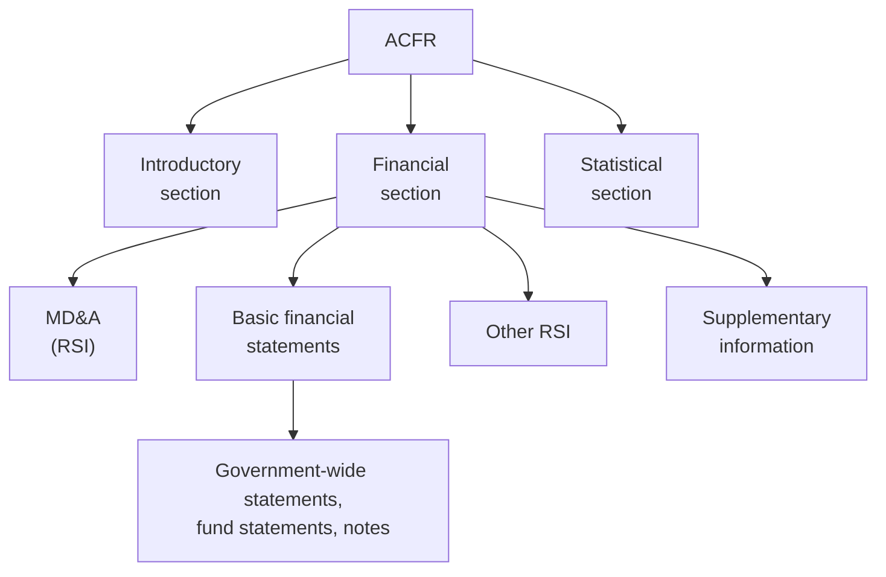

# Management's Discussion and Analysis

A government's financial statements are long and technical, and most of their readers are not accountants. **Management's discussion and analysis (MD&A)** is management's plain-language guide to them. It comes just before the basic financial statements in the annual comprehensive financial report (ACFR) and gives an objective, easily readable analysis of the government's financial activities, based on currently known facts, decisions, or conditions, comparing the current year with the prior year.

The BAR section tests the objectives and components of MD&A. Those components changed recently. GASB Statement No. 103, *Financial Reporting Model Improvements*, effective for fiscal years beginning after June 15, 2025, replaced the eight topics that GASB 34 required with **five sections**. This chapter explains where MD&A fits in the ACFR, walks through the five sections with examples, and closes with the limits on what MD&A may contain.

---

## Purpose and Nature of MD&A

MD&A lets the government's financial managers, who know the transactions, the fiscal policies, and the conditions behind the numbers, explain them to readers who may have no detailed knowledge of governmental accounting. It should help a reader judge whether the government's financial position improved or worsened during the year, and **why**.

| Characteristic | Description |
|---|---|
| **Authoritative source** | GASB 34, as amended by GASB 103 |
| **Classification** | Required supplementary information (RSI) |
| **Placement** | Immediately before the basic financial statements |
| **Responsibility** | The government's management |
| **Basis** | Currently known facts, decisions, or conditions (what management knows when the statements are issued) |
| **Comparison** | Current year with the prior year, with emphasis on the current year |
| **Focus** | The primary government, distinguishing it from discretely presented component units |
| **Tone** | Objective and factual, not promotional |

MD&A is **required**, but it is RSI, not part of the basic financial statements. That matters for the audit: the auditor applies **limited procedures** to RSI and does not express an opinion on it.

---

## Where MD&A Fits in the ACFR

The ACFR has three sections. MD&A sits at the front of the financial section and is the only RSI that comes **before** the basic financial statements.

| Component | Position | Classification |
|---|---|---|
| Letter of transmittal | Introductory section | Not RSI; unaudited |
| Independent auditor's report | Start of the financial section | Auditor's report |
| **MD&A** | Before the basic financial statements | RSI |
| Government-wide statements, fund statements, and notes | Basic financial statements | Covered by the audit opinion |
| Budgetary comparison schedules, pension and OPEB schedules, modified approach information | After the notes | RSI |
| Combining statements for nonmajor funds | After the RSI | Supplementary information |

:::warning[Common Misconception]

Do not confuse MD&A with the **letter of transmittal**. The letter is in the introductory section, is not RSI, and receives no audit procedures. MD&A is in the financial section, is RSI, and receives limited procedures. GASB encourages governments not to repeat MD&A information in the transmittal letter.

:::

---

## The Five Required Sections

Under GASB 103, MD&A is limited to the topics in five sections:

| # | Section | What It Contains |
|---|---|---|
| 1 | **Overview of the Financial Statements** | A description of the basic financial statements and how they relate to each other, focusing on the significant differences in the information each provides |
| 2 | **Financial Summary** | Condensed government-wide information comparing the current year with the prior year, for governmental and business-type activities |
| 3 | **Detailed Analyses** | Explanations of **why** the government's financial position and results changed, at the government-wide level and for each major fund |
| 4 | **Significant Capital Asset and Long-Term Financing Activity** | Significant capital asset additions and disposals, and significant debt, lease, public-private partnership (PPP), and subscription-based IT arrangement (SBITA) activity |
| 5 | **Currently Known Facts, Decisions, or Conditions** | Facts, decisions, or conditions expected to have a significant effect on financial position or to make future results differ significantly from this year's |

Two topics that GASB 34 placed in MD&A were moved out. The analysis of **budget variances** now appears in the notes to RSI, next to the budgetary comparison schedules. The discussion of infrastructure reported under the **modified approach** also moved to the notes to RSI. Older study materials that list eight MD&A topics, including those two, describe the superseded GASB 34 rules.

### Section 1: Overview of the Financial Statements

This section orients the reader. It explains what the government-wide statements, the fund statements, and the notes each show, and how they differ: for example, that the government-wide statements use full accrual accounting and report capital assets and long-term debt, while the governmental fund statements focus on current financial resources.

### Section 2: Financial Summary

The financial summary presents **condensed information from the government-wide statements**, comparing the current year with the prior year for both governmental and business-type activities. GASB 103 lists the elements to include where applicable. From the statement of net position: total assets (separating capital assets from other assets), deferred outflows, total liabilities (separating long-term liabilities from other liabilities), deferred inflows, and net position by component. From the statement of activities: program revenues by major source, general revenues by major source, total revenues, program expenses at least by function, total expenses, contributions to endowments, transfers, unusual or infrequent items, and beginning net position, change in net position, and ending net position.

**Condensed Statement of Net Position (Example City)**

| | Governmental: Current Year | Governmental: Prior Year | Business-Type: Current Year | Business-Type: Prior Year |
|---|---:|---:|---:|---:|
| Current and other assets | \$17,800,000 | \$17,100,000 | \$6,300,000 | \$5,500,000 |
| Capital assets (net) | 85,000,000 | 82,000,000 | 32,000,000 | 30,500,000 |
| **Total assets** | **102,800,000** | **99,100,000** | **38,300,000** | **36,000,000** |
| Deferred outflows of resources | 2,200,000 | 1,900,000 | 400,000 | 350,000 |
| Long-term liabilities | 42,500,000 | 40,000,000 | 15,200,000 | 14,500,000 |
| Other liabilities | 3,500,000 | 3,200,000 | 1,200,000 | 1,100,000 |
| **Total liabilities** | **46,000,000** | **43,200,000** | **16,400,000** | **15,600,000** |
| Deferred inflows of resources | 3,000,000 | 2,800,000 | 200,000 | 150,000 |
| Net investment in capital assets | 42,500,000 | 41,000,000 | 16,800,000 | 16,000,000 |
| Restricted | 5,500,000 | 5,200,000 | 1,200,000 | 1,100,000 |
| Unrestricted | 8,000,000 | 8,800,000 | 4,100,000 | 3,500,000 |
| **Total net position** | **\$56,000,000** | **\$55,000,000** | **\$22,100,000** | **\$20,600,000** |

**Condensed Statement of Activities (Example City)**

| | Governmental: Current Year | Governmental: Prior Year | Business-Type: Current Year | Business-Type: Prior Year |
|---|---:|---:|---:|---:|
| **Program revenues:** | | | | |
| &emsp;Charges for services | \$3,200,000 | \$3,000,000 | \$5,900,000 | \$5,600,000 |
| &emsp;Operating grants and contributions | 1,800,000 | 1,700,000 | 0 | 0 |
| &emsp;Capital grants and contributions | 2,500,000 | 2,000,000 | 1,000,000 | 800,000 |
| **General revenues:** | | | | |
| &emsp;Property taxes | 10,500,000 | 10,000,000 | 0 | 0 |
| &emsp;Sales taxes | 4,800,000 | 4,500,000 | 0 | 0 |
| &emsp;Other | 900,000 | 850,000 | 200,000 | 180,000 |
| **Total revenues** | **23,700,000** | **22,050,000** | **7,100,000** | **6,580,000** |
| **Program expenses:** | | | | |
| &emsp;General government | 4,400,000 | 4,300,000 | | |
| &emsp;Public safety | 9,200,000 | 8,500,000 | | |
| &emsp;Public works | 5,400,000 | 5,500,000 | | |
| &emsp;Culture and recreation | 2,000,000 | 2,000,000 | | |
| &emsp;Interest on long-term debt | 1,200,000 | 1,200,000 | | |
| &emsp;Water utility | | | 4,600,000 | 4,400,000 |
| &emsp;Parking facilities | | | 1,500,000 | 1,500,000 |
| **Total expenses** | **22,200,000** | **21,500,000** | **6,100,000** | **5,900,000** |
| Excess before transfers | 1,500,000 | 550,000 | 1,000,000 | 680,000 |
| Transfers | (500,000) | (400,000) | 500,000 | 400,000 |
| **Change in net position** | **1,000,000** | **150,000** | **1,500,000** | **1,080,000** |
| Net position, beginning | 55,000,000 | 54,850,000 | 20,600,000 | 19,520,000 |
| **Net position, ending** | **\$56,000,000** | **\$55,000,000** | **\$22,100,000** | **\$20,600,000** |

### Section 3: Detailed Analyses

The numbers in the financial summary are only the starting point. GASB 103 stresses that the analysis should explain **why** balances and results changed, and how much, not merely restate the amounts or percentages. It has two parts.

**Government-wide analysis.** Management summarizes the significant changes in the financial position and results of both governmental and business-type activities and explains their causes. The discussion should include facts a reader may not know (not every reader lives in the area), significant policy changes such as new tax rates or a hiring freeze, and important economic factors such as changes in the tax or employment base.

> *"The net position of the City's governmental activities increased by \$1,000,000 (1.8%) during the current year, compared with an increase of \$150,000 in the prior year. Property tax revenue rose \$500,000 because new construction added to the tax base, and capital grants rose \$500,000 as federal funding for the Main Street bridge project began. These increases were partly offset by a \$700,000 increase in public safety expenses under new collective bargaining agreements effective July 1."*

**Major fund analysis.** Management also explains the significant changes in the fund balance or net position and results of **each major fund**, including restrictions, commitments, and assignments that significantly affect the availability of fund resources for future use. GASB 103 no longer requires an analysis of nonmajor funds in the aggregate. Where an explanation already given at the government-wide level applies to a fund, the major fund analysis may refer to it instead of repeating it.

| Fund | Typical Points to Explain |
|---|---|
| **General fund** | Why fund balance changed; revenue and expenditure trends; significant commitments and assignments |
| **Major special revenue funds** | Changes in the restricted revenue source; significant grant activity |
| **Major capital projects funds** | Project progress; bond proceeds received and spent |
| **Major enterprise funds** | Changes in operating income; rate changes; capital investment |

### Section 4: Significant Capital Asset and Long-Term Financing Activity

This section describes the year's significant **capital asset activity** (additions, disposals, and changes in commitments to acquire capital assets, including intangible right-to-use assets) and significant **long-term financing activity** (new debt, leases, PPPs, and SBITAs, changes in credit ratings, and changes in debt limits that could affect planned facilities or services). It may summarize the capital asset and long-term liability notes and refer readers to them for detail.

| Capital Assets (Net) | Governmental Activities | Business-Type Activities |
|---|---:|---:|
| Beginning balance | \$82,000,000 | \$30,500,000 |
| Additions | 6,500,000 | 3,200,000 |
| Disposals | (300,000) | (100,000) |
| Depreciation and amortization | (3,200,000) | (1,600,000) |
| **Ending balance** | **\$85,000,000** | **\$32,000,000** |

| Long-Term Liabilities | Governmental Activities | Business-Type Activities |
|---|---:|---:|
| Beginning balance | \$40,000,000 | \$14,500,000 |
| New debt and other additions | 5,000,000 | 2,000,000 |
| Repayments and other reductions | (2,500,000) | (1,300,000) |
| **Ending balance** | **\$42,500,000** | **\$15,200,000** |

A short narrative would then explain the main items, for example that the \$5,000,000 of new governmental debt was a bond issue for the Main Street bridge, and whether the city's credit rating changed.

### Section 5: Currently Known Facts, Decisions, or Conditions

The final section looks ahead, but only on the basis of what management **currently knows** when the statements are issued. It is not a forecast. It describes facts, decisions, or conditions expected to significantly affect financial position or to make future results differ significantly from this year's. GASB 103's examples include:

- Trends in relevant economic and demographic data, such as population, customer base, income levels, building permits, enrollment, and unemployment.
- Factors used in developing next year's budget, such as tax rate or fee changes, inflation, labor contracts, new laws, and program additions or cuts.
- Expected changes in budgetary fund balance or net position.
- Actions the government has taken on postemployment benefit liabilities, capital improvement plans, leases, PPPs, SBITAs, and other long-term financing.
- Actions other parties have taken that will affect the government, such as new legislation or regulations imposed on it.

These items may or may not also be subsequent events. A tax rate increase approved this year but effective next year is not a subsequent event, yet it belongs in this section.

---

## Limits on MD&A Content

MD&A has firm boundaries. Information must relate to the topics in the five sections. A government may add detail about those topics, but information that does not relate to them belongs elsewhere, such as in the letter of transmittal or in other supplementary information.

| Appropriate in MD&A | Not Appropriate in MD&A |
|---|---|
| Topics within the five required sections, with whatever detail helps explain them | Information unrelated to the required topics |
| Objective, fact-based analysis of why amounts changed | Promotional content or unsupported opinions |
| Currently known facts, decisions, or conditions | Speculation or forecasts |
| Explanations focused on the most relevant information about the primary government | "Boilerplate" discussion repeated from year to year |
| References to an explanation already given in another section | Unnecessary duplication of the same explanation |

:::tip[Exam Tip]

When a question asks whether an item belongs in MD&A, test it against the five sections. A discussion of budget variances, for example, now belongs in the notes to RSI, not in MD&A. A discussion of a new bond issue belongs in Section 4, and an approved future tax increase belongs in Section 5.

:::
