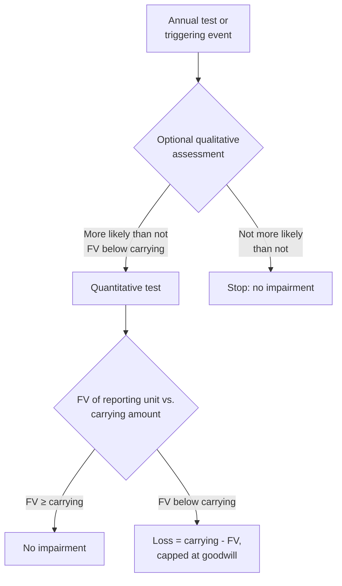

# Indefinite-Lived Intangible Assets and Goodwill

Most intangible assets wear out on a schedule: a patent expires, a customer contract ends. A few have no foreseeable end. A well-known trade name that can be renewed indefinitely, a broadcast license renewed routinely by regulators, and the goodwill bought in an acquisition can all keep producing cash flows for as long as anyone can predict. Because there is no useful life to spread their cost over, these assets are **not amortized**. Instead, they are carried at cost and tested for **impairment** at least once a year.

The BAR blueprint asks you to recall the impairment indicators for goodwill and other indefinite-lived intangibles and to calculate their carrying amounts (initial measurement, subsequent measurement, and impairment) with journal entries. Because BAR may test differences between public and private companies, this chapter also covers the private company alternative for goodwill. It starts with what makes an intangible indefinite-lived, then covers initial measurement, the impairment tests, and the special situations of reclassification and disposal.

---

## What Makes an Intangible Indefinite-Lived

An intangible asset has an **indefinite** useful life when no legal, regulatory, contractual, competitive, economic, or other factor limits the period over which it is expected to contribute to the entity's cash flows (ASC 350-30). "Indefinite" does not mean "infinite." It means management cannot see a limit.

Typical examples:

- **Goodwill**, which has no legal or contractual life at all
- **Trademarks and trade names** that the entity intends to renew and can renew at little cost
- **Broadcast licenses** and certain **franchises** that are routinely renewed at little cost without material changes
- **In-process research and development** acquired in a business combination, which is indefinite-lived until the project is completed (then amortized) or abandoned (then written off); see [Research and Development Costs](research-and-development-costs.md)

If an intangible's legal life can be renewed and the entity expects to renew it at minimal cost with no material modifications, the renewals count toward its useful life, which can make it indefinite.

Three rules apply to every indefinite-lived intangible, goodwill included:

1. It is **not amortized**.
2. It is tested for impairment **at least annually**, and between annual tests whenever events or changes in circumstances suggest it may be impaired.
3. An impairment loss, once recognized, is **never reversed**.

---

## Goodwill and Its Initial Measurement

**Goodwill** arises only in a **business combination** (ASC 805). It is the part of the price paid for a business that cannot be assigned to identifiable assets: an assembled workforce, expected synergies, going-concern value, and future customers not yet under contract. Internally generated goodwill is never recognized.

In general, goodwill is measured as:

$$
\text{Goodwill} = \text{Consideration Transferred} + \text{FV of Noncontrolling Interest} + \text{FV of Previously Held Interest} - \text{FV of Net Identifiable Assets}
$$

When the acquirer buys 100% in a single transaction, the middle two terms are zero, and goodwill is simply the price paid less the fair value of the identifiable net assets. Business combinations, including partial acquisitions, are covered in depth in their own chapter.

### Example: Bear Co. Acquires Cub Entertainment

Bear Co. pays \$5,000,000 in cash for 100% of Cub Entertainment. At the acquisition date, the fair values of Cub's identifiable assets and liabilities are:

| Item | Fair value |
|------|-----------|
| Current assets | \$1,200,000 |
| Property, plant, and equipment | 2,400,000 |
| Customer relationships (finite-lived intangible) | 600,000 |
| Trade name (indefinite-lived intangible) | 400,000 |
| **Total identifiable assets** | **4,600,000** |
| Current liabilities | (800,000) |
| Long-term debt | (1,000,000) |
| **Fair value of identifiable net assets** | **\$2,800,000** |

$$
\text{Goodwill} = \$5{,}000{,}000 - \$2{,}800{,}000 = \$2{,}200{,}000
$$

```journal
Dr. Current Assets[a] 1,200,000
Dr. Property, Plant, and Equipment[a] 2,400,000
Dr. Customer Relationships[a] 600,000
Dr. Trade Name[a] 400,000
Dr. Goodwill[a] 2,200,000
Cr. Current Liabilities[l] 800,000
Cr. Long-Term Debt[l] 1,000,000
Cr. Cash[a] 5,000,000
```

The trade name and the goodwill are both indefinite-lived and will be tested for impairment. The customer relationships are finite-lived and will be amortized.

If the price paid is **less** than the fair value of the identifiable net assets, the acquirer first rechecks that every asset and liability was identified and measured correctly. Any remaining excess is a **bargain purchase gain** in earnings, not negative goodwill.

### Other Indefinite-Lived Intangibles

An indefinite-lived intangible acquired in a business combination, like Cub's trade name, is recorded at **fair value**. One purchased on its own is recorded at **cost**, including costs such as legal fees needed to acquire it.

Polar Inc. buys a well-known trademark from an unrelated company for \$750,000 and pays \$10,000 of legal fees to complete the transfer. Polar intends to renew the registration indefinitely at negligible cost.

```journal
Dr. Trademark[a] 760,000
Cr. Cash[a] 760,000
```

---

## Impairment Indicators

An entity must watch for events and circumstances that suggest an asset may be impaired, both to decide whether to test between annual dates and as the inputs to the optional qualitative assessment.

**For goodwill**, the indicators are assessed for the reporting unit:

| Category | Examples |
|---|---|
| Macroeconomic conditions | A deteriorating economy, limited access to capital, unfavorable currency or interest rate changes |
| Industry and market | A more competitive environment, declining market multiples, regulatory or political change |
| Cost factors | Rising raw material, labor, or other costs that squeeze earnings |
| Financial performance | Declining actual or planned revenue or earnings, negative cash flows |
| Entity-specific events | Loss of key personnel or a major customer, litigation, bankruptcy, a change in strategy |
| Reporting unit events | A planned sale of all or part of the reporting unit, or a change in its composition |
| Share price | A sustained decrease in share price |

**For other indefinite-lived intangibles**, the same kinds of factors are assessed for the asset itself, along with asset-specific ones: an adverse legal or regulatory change (such as loss of legal protection), competitor actions that diminish the asset's value, obsolescence, a rise in the cost of renewal, or a decision to stop using the asset.

An indicator does not mean the asset is impaired. It means the entity has to look harder. And the absence of indicators never excuses the **annual** test.

---

## Impairment of Other Indefinite-Lived Intangibles

The test for an indefinite-lived intangible other than goodwill is a direct comparison at the **individual asset** level:

$$
\text{Impairment Loss} = \text{Carrying Amount} - \text{Fair Value} \quad (\text{if positive})
$$

The entity may first perform an optional **qualitative assessment**. If, after weighing the indicators, it concludes that it is **not more likely than not** (a likelihood of 50% or less) that the asset is impaired, no further testing is needed. Otherwise, or if the entity skips the qualitative step, it measures fair value and compares. An entity can skip the qualitative step for any asset in any period and use it again later.

Two years after buying its trademark, Polar Inc. faces an aggressive rebranding campaign by a competitor. It determines that the trademark's fair value has fallen to \$580,000.

$$
\text{Impairment Loss} = \$760{,}000 - \$580{,}000 = \$180{,}000
$$

```journal
Dr. Impairment Loss 180,000
Cr. Trademark[a] 180,000
```

The trademark's new carrying amount is \$580,000, and that is the basis for future tests.

:::tip[Exam Tip]

The indefinite-lived test is **one step**: fair value against carrying amount. Do not apply the two-step test for finite-lived long-lived assets under ASC 360, which first asks whether undiscounted cash flows recover the carrying amount.

:::

---

## Impairment of Goodwill

Goodwill cannot be sold or valued on its own, so it is tested at the level of a **reporting unit**: an operating segment or one level below it (a component). Goodwill is assigned to reporting units at the acquisition date.



**The qualitative assessment** (often called Step 0) asks whether it is more likely than not that the reporting unit's fair value is below its carrying amount. If not, the test stops.

**The quantitative test** compares the reporting unit's fair value (measured with income, market, or cost approaches) with its carrying amount, **including goodwill**. If fair value is lower, the impairment loss is the difference, but no more than the goodwill assigned to the unit:

$$
\text{Goodwill Impairment Loss} = \min\bigl(\text{Carrying Amount of RU} - \text{Fair Value of RU},\;\text{Goodwill of RU}\bigr)
$$

This single-step test came from ASU 2017-04, which eliminated the old Step 2 (computing an "implied fair value" of goodwill). Under the current rule, a shortfall larger than goodwill is not pushed onto the unit's other assets; goodwill simply goes to zero. The annual test can be performed at any time of year, as long as it is the same time each year.

### Example 1: Partial Impairment

Bear Co. tests a reporting unit with these amounts:

| Item | Amount |
|------|--------|
| Carrying amount of identifiable net assets | \$3,500,000 |
| Goodwill | 1,200,000 |
| **Carrying amount of the reporting unit** | **\$4,700,000** |
| **Fair value of the reporting unit** | **\$4,100,000** |

The shortfall is \$4,700,000 - \$4,100,000 = \$600,000. That is less than the \$1,200,000 of goodwill, so the full \$600,000 is recognized, leaving goodwill of \$600,000.

```journal
Dr. Goodwill Impairment Loss 600,000
Cr. Goodwill[a] 600,000
```

### Example 2: Shortfall Exceeds Goodwill

Polar Inc.'s consulting reporting unit has identifiable net assets of \$2,000,000, goodwill of \$300,000 (a total carrying amount of \$2,300,000), and a fair value of \$1,800,000. The shortfall is \$500,000, but the loss is capped at the \$300,000 of goodwill.

```journal
Dr. Goodwill Impairment Loss 300,000
Cr. Goodwill[a] 300,000
```

Goodwill is now zero. The other \$200,000 does not create an impairment of goodwill, though the unit's other long-lived assets may need their own test under ASC 360.

:::warning[Common Exam Trap]

When the reporting unit's fair value is far below its carrying amount, always compare the shortfall with the goodwill balance. The loss is capped at goodwill.

:::

### Example 3: No Impairment

Bear Co.'s tax advisory reporting unit has identifiable net assets of \$6,000,000 and goodwill of \$2,500,000, a carrying amount of \$8,500,000. Its fair value is \$9,200,000. Fair value exceeds carrying amount, so there is no impairment and no entry.

---

## The Private Company Alternative for Goodwill

A private company (and, by a later extension, a not-for-profit entity) may elect a simpler model for goodwill. Public business entities may not.

| | Public business entities | Private company alternative |
|---|---|---|
| Amortization | None | **Straight-line over 10 years**, or less if a shorter life is more appropriate |
| When tested | At least annually, plus on triggering events | **Only when a triggering event** occurs; the entity may elect to evaluate triggering events only at the end of each reporting period |
| Level of testing | Reporting unit | **Entity level** or reporting unit level, by policy election |
| Measurement | Carrying amount less fair value, capped at goodwill | Same one-step comparison at the chosen level, capped at goodwill |

Grizzly Inc., a private company that elects the alternative, records \$1,000,000 of goodwill in an acquisition and amortizes it over 10 years:

```journal
Dr. Amortization Expense (Goodwill) 100,000
Cr. Goodwill[a] 100,000
```

A private company that elects the goodwill alternative may also elect not to recognize certain customer-related intangibles and noncompetition agreements separately in a business combination, subsuming them into goodwill instead.

---

## Reclassification From Indefinite to Finite Life

The useful life of an indefinite-lived intangible must be reassessed each period. If an indefinite life is no longer supportable, the entity:

1. Tests the asset for impairment **first**, using the indefinite-lived test (fair value against carrying amount), and then
2. Amortizes the remaining carrying amount **prospectively** over the remaining useful life.

Polar Inc. owns a second trademark, carried at \$500,000 as indefinite-lived. A new regulation limits its remaining useful life to 10 years. Its fair value is \$480,000.

The impairment test comes first:

```journal
Dr. Impairment Loss 20,000
Cr. Trademark[a] 20,000
```

Then amortization begins on the new carrying amount of \$480,000, at \$48,000 per year:

```journal
Dr. Amortization Expense 48,000
Cr. Accumulated Amortization (Trademark)[ca] 48,000
```

---

## Disposal of Part of a Reporting Unit

When a business within a reporting unit is sold, part of the unit's goodwill goes with it. The amount is based on the **relative fair values** of the business sold and the part of the reporting unit that is kept.

Bear Co. has a reporting unit with \$600,000 of goodwill. It sells a business representing 40% of the reporting unit's fair value for \$1,500,000. The business's identifiable net assets have a carrying amount of \$1,100,000.

- Goodwill allocated to the business sold: \$600,000 × 40% = \$240,000
- Carrying amount disposed of: \$1,100,000 + \$240,000 = \$1,340,000
- Gain on disposal: \$1,500,000 - \$1,340,000 = \$160,000

```journal
Dr. Cash[a] 1,500,000
Cr. Net Assets of Business Sold[a] 1,100,000
Cr. Goodwill[a] 240,000
Cr. Gain on Disposal 160,000
```

The \$360,000 of goodwill that remains with the reporting unit is then tested for impairment.

---

## Presentation and Disclosure

| Item | Presentation |
|---|---|
| Goodwill | A separate line item on the balance sheet |
| Goodwill impairment losses | A separate line item in the income statement, within continuing operations (unless associated with a discontinued operation) |
| Other intangible assets | At least one separate line item on the balance sheet; impairment losses within continuing operations |
| Notes | Changes in goodwill during the year (acquisitions, impairments, disposals) by reportable segment; the facts and amounts of any impairment; and the carrying amounts of indefinite-lived intangibles by major class |

---

## Summary

| Feature | Goodwill | Other indefinite-lived intangibles |
|---|---|---|
| Source | Business combinations only | Purchased separately or acquired in a business combination |
| Amortization | None (private company alternative: up to 10 years) | None |
| Impairment testing | At least annually and on triggering events (private company alternative: triggering events only) | At least annually and on triggering events |
| Level | Reporting unit (or entity, under the private company alternative) | Individual asset |
| Optional qualitative step | Yes | Yes |
| Loss | Carrying amount less fair value, capped at goodwill | Carrying amount less fair value |
| Reversal of losses | Never | Never |
