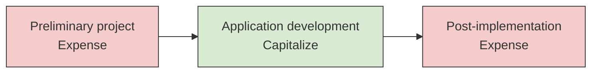
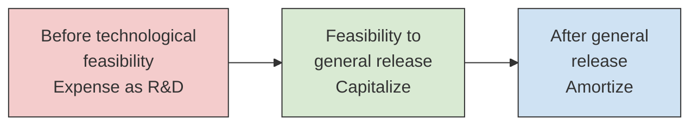

# Internally Developed Software

Companies build software for two very different reasons: to run their own operations, or to sell to customers. GAAP treats the two cases differently. Internal-use software follows **ASC 350-40**, which starts capitalizing costs once a project moves past the planning stage. Software to be sold follows **ASC 985-20**, which treats nearly everything as research and development until the product is technologically feasible. This chapter works through each model in turn (what to capitalize, when to start and stop, how to amortize, and how to test for impairment) and ends with a side-by-side summary. The 2027 BAR blueprint (Area II, Group B) asks you to recall the capitalization criteria for both kinds of software and to calculate the capitalized cost and the related amortization.

---

## Part 1: Software for Internal Use (ASC 350-40)

### Scope

ASC 350-40 applies when software is developed or obtained **solely to meet the entity's internal needs** and there is **no substantive plan** to market it externally. Typical examples are an ERP system, an internal accounting platform, and a company intranet. If a plan to sell the software exists, the project falls under ASC 985-20 instead.

### The Three Stages

An internal-use project moves through three stages, and the stage in which a cost is incurred decides whether it is expensed or capitalized. The logic is simple: until management has chosen a path and committed money to it, the project is still an idea, so its costs are expensed. Once the company is actually building the software, the costs create an asset. Once the software is running, the remaining costs keep it running and are expensed.



| Stage | Typical activities | Treatment |
| --- | --- | --- |
| **1. Preliminary project** | Conceptual formulation, evaluating alternatives, choosing the technology, selecting vendors | Expense as incurred |
| **2. Application development** | Designing the chosen path, coding, installing hardware, testing (including parallel processing) | Capitalize |
| **3. Post-implementation and operation** | Training, maintenance, minor bug fixes | Expense as incurred |

Capitalization **begins** when two things are true: the preliminary project stage is complete, and management with the relevant authority commits to funding the project and believes it is probable the project will be completed and the software will be used as intended. Capitalization **stops** when the software is substantially complete and ready for its intended use, which means all substantial testing is done.

### Which Costs Are Capitalized

Only three kinds of cost incurred during the application development stage are capitalized:

1. External direct costs of materials and services, such as fees paid to consultants and the cost of purchased software.
2. Payroll and payroll-related costs of employees who work directly on the project, to the extent of the time they spend on it.
3. Interest cost incurred during development, under the capitalized interest rules of ASC 835-20.

Several costs are expensed even when they are incurred during the application development stage. General and administrative overhead and the cost of reengineering business processes are expensed. **Data conversion** costs are expensed as well; the one exception is the cost to develop or obtain software that lets the new system access or convert old data, which is capitalized. Upgrades and enhancements are capitalized only if they add functionality the software did not have before; routine maintenance is expensed.

:::warning[Common Trap]

**Training costs are always expensed**, even when the training happens during the application development stage. The stage rule tells you when capitalization is possible, but only qualifying cost types are capitalized.

:::

### Example: Bear Co. Builds an ERP System

Bear Co. incurs the following costs to develop a custom ERP system for its own use.

| Cost | Amount | Stage |
| --- | --- | --- |
| Feasibility study and vendor evaluation | \$50,000 | Preliminary project |
| External consultant (coding and configuration) | \$400,000 | Application development |
| Salaries of programmers working directly on the project | \$200,000 | Application development |
| Testing before go-live | \$80,000 | Application development |
| Training end users | \$60,000 | Post-implementation |
| Bug fixes and maintenance after launch | \$30,000 | Post-implementation |

The three application development costs are capitalized:

$$
\$400{,}000 + \$200{,}000 + \$80{,}000 = \$680{,}000
$$

Everything else (\$50,000 + \$60,000 + \$30,000 = \$140,000) is expensed.

```journal
Dr. Software (Internal Use)[a] 680,000
Dr. Software Development Expense 140,000
Cr. Cash[a] 820,000
```

### Amortization

Amortization begins when the software is ready for its intended use, whether or not it has actually been placed in service. Internal-use software is amortized on a **straight-line basis** over its estimated useful life.

Bear Co.'s ERP system (\$680,000) is ready for use on January 1, Year 1. Its estimated useful life is 5 years with no residual value, so annual amortization is \$680,000 / 5 = \$136,000.

```journal
Dec 31, Year 1
Dr. Amortization Expense 136,000
Cr. Accumulated Amortization (Software)[ca] 136,000
```

### Impairment and Abandonment

Internal-use software is a finite-lived asset, so it is tested for impairment under the **ASC 360** model for long-lived assets held and used. The test runs only when events suggest the carrying amount may not be recoverable, for example when the software is no longer expected to provide substantive service or when its use changes significantly. It has two steps:

1. **Recoverability.** Compare the carrying amount with the **undiscounted** future cash flows expected from the asset. If the carrying amount is higher, the asset is impaired.
2. **Measurement.** The impairment loss is the carrying amount minus **fair value**.

Suppose Bear Co. later changes strategy. The ERP system has a carrying amount of \$420,000, expected undiscounted cash flows of \$350,000, and a fair value of \$300,000. Because \$420,000 exceeds \$350,000, the asset fails the recoverability test, and the loss is \$420,000 - \$300,000 = \$120,000.

```journal
Dr. Impairment Loss 120,000
Cr. Accumulated Amortization (Software)[ca] 120,000
```

The \$300,000 becomes the new cost basis and is amortized over the remaining useful life. The loss is never reversed. Keep this two-step model separate from the goodwill test in ASC 350-20, which is a single comparison of a reporting unit's fair value with its carrying amount.

If a project is **abandoned** before the software is ready for use, the capitalized costs are written off, because uncompleted software is presumed to have no fair value. Polar Inc., for example, had capitalized \$250,000 on a project it abandons:

```journal
Dr. Loss on Abandoned Software 250,000
Cr. Software (Internal Use)[a] 250,000
```

:::note[Coming change: ASU 2025-06]

ASU 2025-06 (issued September 2025) removes the project stages from ASC 350-40. Under the new model, capitalization starts when management has authorized and committed to funding the project and it is probable the project will be completed and the software will perform its intended function. That threshold is not met while significant development uncertainty remains, such as unresolved novel features. The ASU is effective for annual periods beginning after December 15, 2027, and is eligible for testing starting January 1, 2028. Through December 31, 2027, the three-stage model in this chapter is the tested rule.

:::

---

## Part 2: Software to Be Sold, Leased, or Marketed (ASC 985-20)

### Scope and Technological Feasibility

ASC 985-20 applies to software a company develops (or buys and modifies) with the intent to **sell, lease, or otherwise market** it. The central milestone is **technological feasibility**: the point at which the company has shown that the product can be built to meet its design specifications. Every cost incurred before that point is research and development under ASC 730 and is expensed.

Technological feasibility is established when the company has completed either:

- a **detailed program design**, or
- if it does not use a detailed program design, a **working model** that has been tested and confirmed to be consistent with the product design.

Capitalization then continues until the product is **available for general release** to customers. Costs after general release are expensed, and amortization of the capitalized amount begins.



In practice, many companies reach technological feasibility only at the working-model stage, very close to release, so little is capitalized. On the exam, your job is to place each cost on the correct side of the two milestones.

### Which Costs Are Capitalized

Between technological feasibility and general release, the costs of producing the **product masters** are capitalized. A product master is the completed version of the software, documentation, and training materials, ready for copying. Coding and testing done after technological feasibility are part of this cost.

Three kinds of cost are not capitalized as software:

- Costs before technological feasibility are research and development expense.
- Costs of **duplicating** the software, documentation, and training materials from the product masters, and of **physically packaging** the product, are inventory costs. They become cost of sales when the units are sold.
- **Maintenance and customer support** after release are expensed.

### Example: Bear Co. Develops Tax Software for Sale

Bear Co. develops a tax preparation product and incurs these costs:

| Cost | Amount | Timing |
| --- | --- | --- |
| Market research and concept design | \$100,000 | Before technological feasibility |
| Coding and testing of an early prototype | \$300,000 | Before technological feasibility |
| *Working model completed (technological feasibility)* | | *Milestone* |
| Coding and testing after the working model | \$200,000 | Before general release |
| Final documentation and training materials | \$40,000 | Before general release |
| *Product available for general release* | | *Milestone* |
| Duplicating and packaging copies for customers | \$25,000 | After general release |
| Customer support | \$50,000 | After general release |

The two costs before the working model (\$400,000) are R&D expense. The two costs between the milestones (\$240,000) are capitalized. Duplication and packaging (\$25,000) go to inventory, and customer support (\$50,000) is expensed.

```journal
Dr. Research and Development Expense 400,000
Dr. Capitalized Software Costs[a] 240,000
Dr. Inventory[a] 25,000
Dr. Customer Support Expense 50,000
Cr. Cash[a] 715,000
```

### Amortization

Amortization begins when the product is available for general release. Each year, amortization is the **greater of** two amounts:

1. **Revenue-based:** the unamortized cost at the start of the year times the ratio of current-year gross revenue to the total of current and expected future gross revenue.
2. **Straight-line:** the unamortized cost at the start of the year divided by the remaining estimated economic life (including the current year).

$$
\text{Amortization} = \max\left(\text{Unamortized cost} \times \frac{\text{Current revenue}}{\text{Current + future revenue}},\; \frac{\text{Unamortized cost}}{\text{Remaining life}}\right)
$$

The straight-line amount acts as a floor, so the asset is never amortized more slowly than evenly over its life. When a product earns most of its revenue early, the revenue-based amount wins.

Continuing the example, Bear Co.'s \$240,000 of capitalized cost has a 4-year economic life. At release, it expects total revenue of \$1,200,000. Actual revenue is \$480,000 in Year 1 and \$360,000 in Year 2, and the estimate of total revenue does not change.

| | Year 1 | Year 2 |
| --- | --- | --- |
| Unamortized cost, beginning of year | \$240,000 | \$144,000 |
| Revenue ratio | \$480,000 / \$1,200,000 = 40% | \$360,000 / \$720,000 = 50% |
| Revenue-based amount | \$96,000 | \$72,000 |
| Straight-line amount | \$240,000 / 4 = \$60,000 | \$144,000 / 3 = \$48,000 |
| **Amortization (greater)** | **\$96,000** | **\$72,000** |
| Unamortized cost, end of year | \$144,000 | \$72,000 |

In Year 2 the denominator is the \$720,000 of revenue still expected at the start of the year (\$1,200,000 - \$480,000), and the straight-line amount spreads the remaining cost over the remaining 3 years. Working from the unamortized balance this way keeps total amortization equal to the capitalized cost. The Year 1 entry:

```journal
Dec 31, Year 1
Dr. Amortization Expense 96,000
Cr. Accumulated Amortization (Software)[ca] 96,000
```

### Impairment: The Net Realizable Value Test

At **each balance sheet date**, the company compares the unamortized capitalized cost with the product's **net realizable value (NRV)**: the estimated future gross revenue from the product, minus the estimated future costs of completing and disposing of it (including maintenance and customer support). Any excess of cost over NRV is written off. The reduced amount becomes the new cost basis and is not written back up later.

Polar Inc. has a software product with unamortized capitalized cost of \$180,000. After a competitor releases a better product, Polar Inc. expects \$200,000 of remaining revenue and \$90,000 of remaining costs. NRV is \$200,000 - \$90,000 = \$110,000, so the write-down is \$180,000 - \$110,000 = \$70,000.

```journal
Dr. Loss on Software Write-Down 70,000
Cr. Capitalized Software Costs[a] 70,000
```

---

## Presentation

Capitalized internal-use software is reported with intangible assets or with property and equipment, and its amortization follows the function the software supports (for example, selling and administrative expense). Capitalized software to be sold is usually a separate noncurrent asset, and its amortization is charged to cost of sales or a similar expense. Impairment losses are reported in operating income, and costs incurred before technological feasibility are included in R&D expense.

## Summary

| Question | Internal use (ASC 350-40) | For sale (ASC 985-20) |
| --- | --- | --- |
| When does capitalization start? | Preliminary stage complete, management commits to funding, completion is probable | Technological feasibility (detailed program design or working model) |
| When does it stop? | Software is substantially complete and ready for intended use | Product is available for general release |
| What is capitalized? | External direct costs, direct payroll, and interest during application development | Costs of the product masters, including coding and testing after feasibility |
| What is always expensed? | Preliminary stage costs, training, overhead, data conversion | Costs before feasibility (R&D), maintenance and support |
| How is it amortized? | Straight-line over useful life | Greater of revenue-based or straight-line, applied to the unamortized cost |
| How is impairment tested? | ASC 360: recoverability, then fair value, when indicators exist | NRV test at each balance sheet date |
| Can impairment be reversed? | No | No |

The deciding question is always **purpose**. Software built for the company's own use follows ASC 350-40 and is capitalized during application development. Software built to sell follows ASC 985-20 and is capitalized only after technological feasibility.
