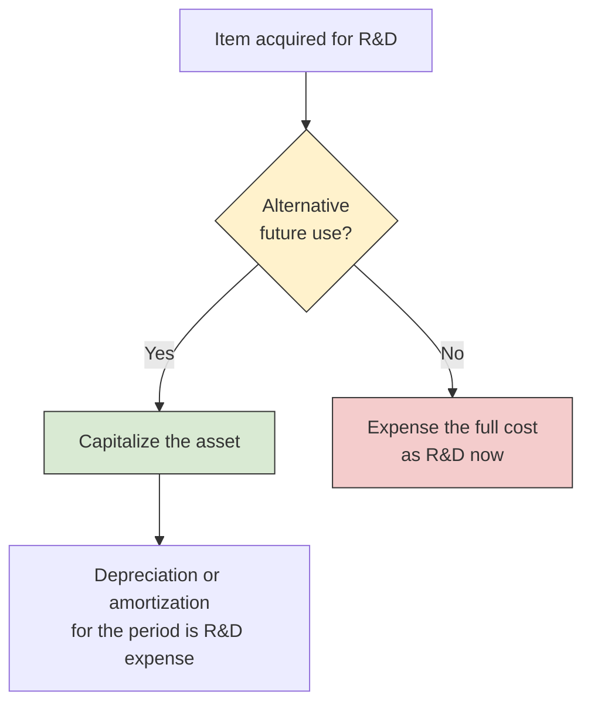

# Research and Development Costs

Companies spend heavily on **research and development (R&D)**, but the future benefit of any single project is uncertain and hard to measure. GAAP responds with a blunt rule in ASC 730: R&D costs are **expensed as incurred**. The interesting questions are at the edges, which costs count as R&D, which assets escape the rule because they have another use, and how R&D performed for others or acquired from others is treated. The 2027 BAR blueprint (Area II, Group E) asks you to identify R&D costs, classify them as expense, and calculate the R&D expense for a period. This chapter covers the general rule, the costs included and excluded, contract and funded R&D, and acquired in-process R&D.

---

## The General Rule

ASC 730 defines the two activities this way:

- **Research** is planned search or critical investigation aimed at discovering new knowledge, in the hope that the knowledge will help develop a new product, service, process, or technique, or significantly improve an existing one.
- **Development** is turning research findings or other knowledge into a plan or design for a new product or process, or for a significant improvement to an existing one, whether it is meant for sale or for the entity's own use.

Both are accounted for the same way, so the exam rarely asks you to tell them apart. What matters is whether a cost falls **inside or outside** ASC 730. If it is inside, it is expensed when incurred, and the entity discloses the total R&D cost charged to expense for each period presented.

Only a few R&D-related items ever appear on the balance sheet:

1. Materials, equipment, facilities, and purchased intangibles that have an **alternative future use**.
2. **In-process R&D acquired in a business combination**.
3. Software costs capitalized under the separate software standards (ASC 350-40 for internal-use software and ASC 985-20 for software to be sold; see [Internally Developed Software](./internally-developed-software.md)). For software to be sold, the costs incurred before technological feasibility are R&D expense.

Activities unique to the extractive industries (such as oil and gas exploration) are outside ASC 730.

---

## Costs Included in R&D

### Materials, Equipment, Facilities, and Purchased Intangibles

The **alternative future use** test is the most heavily tested idea in ASC 730. An item bought for R&D has an alternative future use if the entity can use it in other R&D projects or in its regular operations. If it can, the item is capitalized, and only the depreciation or amortization for the period is R&D expense. If it cannot (for example, equipment built for one experiment), its **full cost** is R&D expense when acquired, even if the equipment will physically last for years.



The same test applies to materials and supplies (consumed materials are expensed) and to intangibles purchased from others, such as a patent or license bought for use in R&D.

### Personnel, Contract Services, and Indirect Costs

R&D expense also includes:

- **Salaries, wages, and benefits** of employees engaged in R&D.
- **Contract services**, meaning the cost of work that outside parties (contract labs, universities) perform for the entity's own R&D.
- A **reasonable allocation of indirect costs** clearly related to R&D. General and administrative costs that are not clearly related to R&D are excluded.

---

## Costs That Are Not R&D

Many activities around a new product look like R&D but are part of commercial production, marketing, or legal work. ASC 730 excludes them, and they are expensed (or capitalized) under other GAAP.

| Activity | Why it is not R&D |
| --- | --- |
| Routine or periodic **quality control testing** during commercial production | Supports ongoing operations |
| **Engineering follow-through** in an early phase of commercial production | Production start-up, not experimentation |
| **Troubleshooting** breakdowns during commercial production | Operations and maintenance |
| Routine design of **tools, jigs, molds, and dies** | Part of manufacturing |
| **Adapting an existing capability** to a particular customer's requirements | Customization within a continuing commercial activity |
| **Seasonal or periodic design changes** and routine efforts to refine an existing product | Sustaining engineering |
| **Legal work** on patent applications or litigation | Legal cost (patent application costs may be capitalized as part of the patent) |
| **Market research and market testing** | Selling and marketing |

Engineering follow-through and adaptation for a customer are common distractors. If the work applies a known process to production or tailors an existing product for one customer, it is not R&D.

---

## Example: Bear Co. Computes R&D Expense

Bear Co. incurs these costs in Year 1 while developing a new product.

| Cost | Amount | In R&D expense? |
| --- | --- | --- |
| Salaries of R&D lab staff | \$400,000 | Yes |
| Materials consumed in experiments | \$120,000 | Yes |
| Equipment bought solely for this project (no alternative future use) | \$250,000 | Yes, full cost |
| Equipment with alternative future use (5-year life, no residual value, used in R&D all year) | \$300,000 | Depreciation only |
| Fees paid to an outside testing laboratory | \$85,000 | Yes |
| Overhead clearly related to R&D | \$60,000 | Yes |
| Quality control testing during regular production | \$45,000 | No |
| Legal fees for a patent application | \$30,000 | No |

Depreciation on the multi-use equipment is \$300,000 / 5 = \$60,000. Total R&D expense is:

| Component | Amount |
| --- | --- |
| R&D salaries | \$400,000 |
| Materials consumed | \$120,000 |
| Equipment with no alternative future use | \$250,000 |
| Depreciation on equipment with alternative future use | \$60,000 |
| Outside testing laboratory | \$85,000 |
| Overhead | \$60,000 |
| **Total R&D expense** | **\$975,000** |

The \$300,000 of multi-use equipment was recorded as equipment when purchased. The R&D entry for the year is:

```journal
Dr. Research and Development Expense 975,000
Cr. Cash[a] 915,000
Cr. Accumulated Depreciation (Equipment)[ca] 60,000
```

The two pieces of equipment show why the alternative future use test matters: the single-use equipment adds \$250,000 to R&D expense this year, while the multi-use equipment adds only \$60,000.

---

## R&D Performed for Others and Funded R&D

When a company performs R&D **under contract for someone else**, and the other party owns the results, the work is not the company's own R&D. Its costs are contract costs (cost of services) matched with the contract revenue under the revenue guidance, and they are not reported as R&D expense.

A related case is an **R&D funding arrangement** (ASC 730-20), in which outside investors provide money for the company's R&D. The key question is who bears the risk that the project fails:

- If the company is **obligated to repay** the funds regardless of the outcome, the funding is in substance a **borrowing**. The company records a liability for the amount it must repay, and it still charges its R&D costs to **R&D expense** as incurred.
- If the company **does not have to repay** unless the project succeeds (the funders bear the risk), the company is in substance performing R&D **for others**, and it accounts for its obligation as a contract to perform services.

### Example: Contract R&D Alongside the Company's Own Projects

In Year 2, Bear Co. runs two of its own projects and performs one project for a client that owns the results and pays a fixed \$200,000.

| Cost | Project Alpha | Project Beta | Client contract |
| --- | --- | --- | --- |
| Personnel | \$200,000 | \$150,000 | \$100,000 |
| Materials consumed | \$50,000 | \$70,000 | \$40,000 |
| Depreciation on shared R&D equipment | \$30,000 | \$20,000 | \$10,000 |
| Equipment with no alternative future use | \$80,000 | \$0 | \$0 |
| Allocated overhead | \$15,000 | \$10,000 | \$5,000 |
| **Total** | **\$375,000** | **\$250,000** | **\$155,000** |

R&D expense includes only Alpha and Beta: \$375,000 + \$250,000 = \$625,000. The \$155,000 for the client is cost of contract services, matched against the \$200,000 of contract revenue.

```journal
Dr. Research and Development Expense 625,000
Cr. Cash[a] 575,000
Cr. Accumulated Depreciation (Equipment)[ca] 50,000
```

```journal
Dr. Cost of Contract Services 155,000
Cr. Cash[a] 145,000
Cr. Accumulated Depreciation (Equipment)[ca] 10,000
```

---

## Acquired In-Process R&D

**In-process R&D (IPR&D)** is a research project that is under way but not finished when it is acquired. Its treatment depends on how it is acquired.

| How IPR&D is acquired | Treatment |
| --- | --- |
| In a **business combination** | Recognize as an intangible asset at fair value, whether or not it has an alternative future use. Classify it as **indefinite-lived** until the project is completed or abandoned. |
| In an **asset acquisition**, no alternative future use | Expense immediately as R&D |
| In an **asset acquisition**, with an alternative future use | Capitalize and amortize |

While IPR&D from a business combination is indefinite-lived, it is not amortized and is tested for impairment at least annually. When the project is **completed**, the asset becomes finite-lived and is amortized over its useful life. When the project is **abandoned**, the carrying amount is written off.

:::warning[Common Trap]

IPR&D acquired in a **business combination** is capitalized even if it has no alternative future use. That is the main exception to the expense-as-incurred rule, and it does not extend to IPR&D bought in an asset acquisition.

:::

### Example: Polar Inc. Acquires a Biotech Company

Polar Inc. acquires 100% of Kodiak Biotech in a business combination for \$8,000,000 cash. The acquisition-date fair values of the identifiable net assets are:

| Item | Fair value |
| --- | --- |
| Tangible net assets | \$4,500,000 |
| Customer relationships (finite-lived) | \$800,000 |
| IPR&D (a drug in Phase II clinical trials) | \$1,200,000 |
| **Total identifiable net assets** | **\$6,500,000** |

Goodwill is \$8,000,000 - \$6,500,000 = \$1,500,000.

```journal
Dr. Tangible Net Assets[a] 4,500,000
Dr. Customer Relationships[a] 800,000
Dr. In-Process R&D[a] 1,200,000
Dr. Goodwill[a] 1,500,000
Cr. Cash[a] 8,000,000
```

If the drug is later approved and has a 10-year useful life, Polar Inc. begins amortizing \$1,200,000 / 10 = \$120,000 per year:

```journal
Dr. Amortization Expense 120,000
Cr. Accumulated Amortization (Patent and Technology)[ca] 120,000
```

If instead the project is abandoned, the whole carrying amount is written off:

```journal
Dr. Impairment Loss (IPR&D) 1,200,000
Cr. In-Process R&D[a] 1,200,000
```

---

## Presentation and Summary

Total R&D expense is shown on the face of the income statement or disclosed in the notes for each period. Equipment with an alternative future use is reported in property, plant, and equipment, and acquired IPR&D is a separate intangible asset until the project is completed or abandoned.

| Question | Answer |
| --- | --- |
| General rule for R&D costs? | Expense as incurred |
| Equipment or intangible with no alternative future use? | Expense the full cost immediately |
| Equipment or intangible with an alternative future use? | Capitalize; the period's depreciation or amortization is R&D expense |
| R&D performed under contract for others? | Cost of contract services, not R&D expense |
| Funded R&D the company must repay regardless of outcome? | Liability for the repayment; costs are still R&D expense |
| IPR&D acquired in a business combination? | Capitalize at fair value as indefinite-lived until completed or abandoned |
| IPR&D acquired in an asset acquisition, no alternative future use? | Expense immediately |
| Quality control, engineering follow-through, patent legal fees? | Not R&D |
