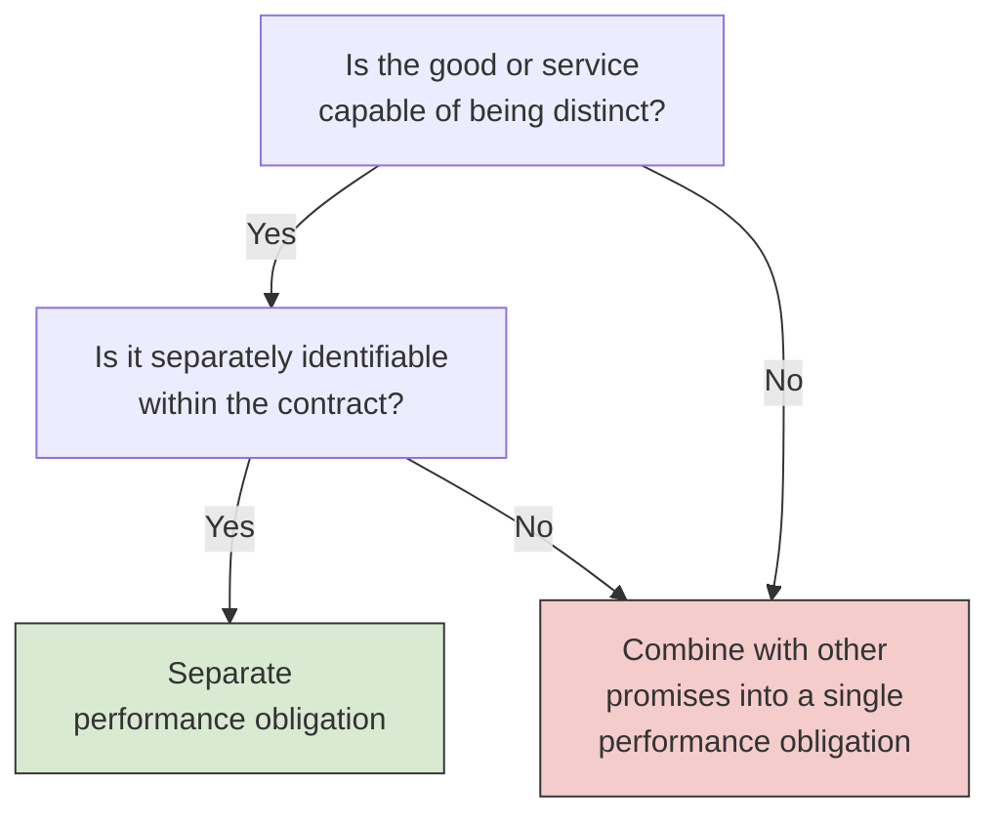
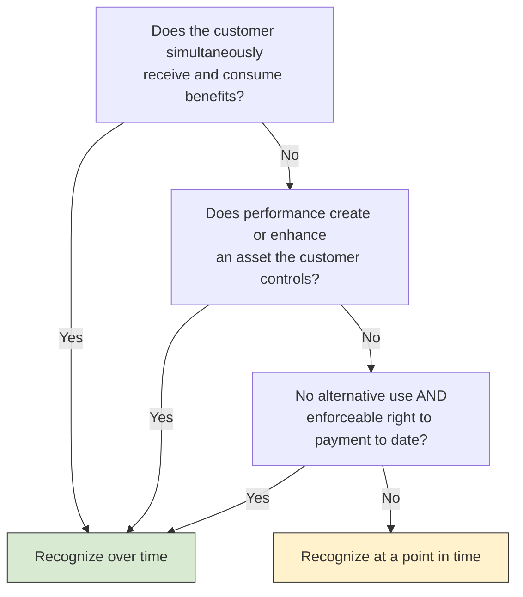
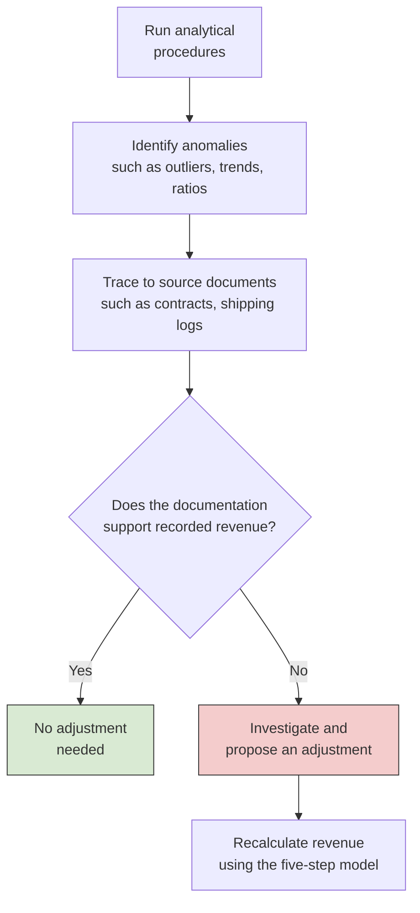

# Revenue Recognition

FAR tests whether you can apply the five-step revenue model in ASC 606. BAR assumes you can, and asks the harder practical question: given a real contract, or a report built from a company's revenue data, has revenue been recognized in the right amount and at the right time? The 2027 BAR blueprint (Area II, Group C) puts it in two tasks: interpret agreements and supporting documents to determine the amount and timing of revenue, and interpret data analytics output to detect, investigate, and resolve discrepancies such as errors, outliers, and unexpected contract terms. This chapter reviews the model briefly, works through the judgment calls that contracts force on you, and then turns to spotting revenue errors in data.

---

## The Five-Step Model in Brief

ASC 606 applies one framework to every contract with a customer. The idea behind it is that revenue should reflect the transfer of promised goods or services to customers, in an amount that reflects what the entity expects to be entitled to in exchange.

| Step | Core question | Where BAR questions focus |
| --- | --- | --- |
| **1. Identify the contract** | Is there an enforceable contract that meets the five criteria? | Missing terms, side letters, unapproved changes, doubtful collection |
| **2. Identify the performance obligations** | Which promises are distinct? | Whether bundled deliverables should be combined |
| **3. Determine the transaction price** | How much does the entity expect to receive? | Variable consideration and the constraint |
| **4. Allocate the transaction price** | How is the price split among the obligations? | Relative standalone selling prices, discounts, bonuses |
| **5. Recognize revenue** | When does control transfer? | Over time or at a point in time, and how to measure progress |

The five contract criteria in Step 1 are that the parties have approved the contract and are committed to it, each party's rights are identifiable, the payment terms are identifiable, the contract has commercial substance, and collection of the consideration is probable. BAR questions rarely ask you to list the steps. They give you a contract and ask for the revenue figure, the recognition pattern, or the reason a company's treatment is wrong.

---

## Counting Performance Obligations

Reading a contract and deciding **how many performance obligations** it contains is the most heavily tested skill in this area, because every later step depends on it. A promised good or service is a separate performance obligation only if it is **distinct**, and it is distinct only if both of these are true:

1. It is **capable of being distinct**: the customer can benefit from it on its own or together with resources readily available to it.
2. It is **distinct within the context of the contract** (separately identifiable): the promise to transfer it is separable from the other promises.



The second test fails, and the promises are combined, when the seller provides a **significant integration service** that uses the items as inputs to one combined output, when one item **significantly modifies or customizes** another, or when the items are **highly interdependent** so that each significantly affects the other.

### Example: Bear Co. Software Bundle

Bear Co. sells Panda Industries a software license, implementation services, and two years of post-contract support (PCS) for \$500,000. The implementation significantly customizes the software to fit Panda's operations.

| Deliverable | Capable of being distinct? | Separately identifiable? | Conclusion |
| --- | --- | --- | --- |
| Software license | Yes (it runs on its own) | No (the implementation significantly modifies it) | Combined with implementation |
| Implementation | Yes (other firms offer it) | No (it customizes the license) | Combined with license |
| PCS (2 years) | Yes (sold separately) | Yes (standard support, not tied to the customization) | Separate obligation |

The contract has **two** performance obligations: the customized software (license plus implementation) and PCS. Implementation that a third party could perform still passes the first test, but significant customization makes it fail the second. If the implementation were routine setup instead, the contract would have three performance obligations.

---

## Variable and Noncash Consideration

### Estimating Variable Consideration

Many contracts include consideration that depends on future events: discounts, rebates, refunds, performance bonuses, penalties, and rights of return. The entity estimates the variable amount using whichever of two methods better predicts what it will receive:

| Method | How it works | Best used when |
| --- | --- | --- |
| **Expected value** | Probability-weighted sum of the possible amounts | There are many possible outcomes, often across many similar contracts |
| **Most likely amount** | The single most likely amount | There are only two possible outcomes, such as a bonus that is earned or not |

### The Constraint

The estimate is then **constrained**: variable consideration is included in the transaction price only to the extent it is **probable that a significant reversal** of cumulative revenue will not occur once the uncertainty is resolved. The risk of a reversal is higher when the amount depends on factors outside the entity's influence (such as market prices or weather), when the uncertainty will last a long time, when the entity has limited experience with similar contracts, or when the range of possible outcomes is broad.

### Example: Bear Co. Performance Bonus

Bear Co. agrees to a consulting engagement with Polar Inc. for a base fee of \$200,000, plus a \$50,000 bonus if the project is finished by March 31. Bear Co. estimates a 75% chance of finishing on time, based on a strong record on similar projects.

The expected value would be \$50,000 × 75% = \$37,500, but that amount cannot actually occur: Bear Co. will receive either \$50,000 or nothing. Because the outcome is binary, the **most likely amount** (\$50,000) is the better estimate. Given its track record, Bear Co. concludes that a significant reversal is not probable, so the constraint does not limit the estimate. The transaction price is \$200,000 + \$50,000 = \$250,000.

### Noncash Consideration and Consideration Payable to a Customer

**Noncash consideration**, such as goods, services, or shares received from the customer, is measured at fair value at contract inception. **Consideration payable to a customer**, such as a coupon, a slotting fee, or equity instruments the seller grants to the customer, reduces the transaction price unless it pays for a distinct good or service the customer provides to the seller.

Two ASUs refine how these rules apply to shares and options. Both are effective for annual periods beginning after December 15, 2026, and are eligible for testing starting January 1, 2027.

- **Shares or options granted to a customer (ASU 2025-04).** If the award vests based on the customer's purchases (including purchases by the customer's own customers), the vesting condition is a **performance condition** under Topic 718. The Topic 606 constraint on variable consideration does not apply to the award, and the seller must estimate forfeitures; it cannot elect to account for them as they occur. Awards to employees and other nonemployees are unchanged.
- **Shares or options received from a customer (ASU 2025-07).** These are accounted for as noncash consideration under Topic 606, not as a derivative (Topic 815) or an equity investment (Topic 321), until the seller's right to receive or keep them is unconditional.

---

## Over Time or at a Point in Time

When revenue is recognized depends on when the customer obtains **control** of the good or service. A performance obligation is satisfied **over time** if **any one** of three criteria is met. If none is met, it is satisfied at a **point in time**, usually when the customer has legal title, physical possession, the significant risks and rewards of ownership, and has accepted the asset, and the seller has a present right to payment.

| Over-time criterion | Question to ask | Typical example |
| --- | --- | --- |
| The customer simultaneously **receives and consumes** the benefits as the entity performs | Would another provider have to substantially redo the work done so far? If not, the criterion is met | Cleaning services, monthly IT support |
| The entity's performance creates or enhances an **asset the customer controls** | Does the customer control the work in progress? | Construction on the customer's land |
| The asset has **no alternative use** to the entity, and the entity has an **enforceable right to payment** for performance to date | Could the entity redirect the partly finished asset to another customer, and would it be paid if the customer canceled? | Custom equipment built to the customer's specifications |



### Measuring Progress

For an obligation satisfied over time, revenue follows a measure of progress toward complete satisfaction. **Input methods** measure the entity's efforts, most often costs incurred to date divided by total estimated costs (cost-to-cost). **Output methods** measure value transferred to the customer, such as units delivered, milestones reached, or surveys of work performed. Choose the method that best depicts the transfer of control; cost-to-cost works when costs track progress.

$$
\text{Cumulative revenue} = \text{Transaction price} \times \frac{\text{Costs incurred to date}}{\text{Total estimated costs}}
$$

### Example: Polar Inc. Builds a Warehouse

Polar Inc. agrees to build a warehouse on Bear Co.'s land for a fixed price of \$3,000,000, with total estimated costs of \$2,400,000. Because Bear Co. controls the asset as it is built (the second criterion), Polar Inc. recognizes revenue over time using cost-to-cost.

| | Year 1 | Year 2 | Year 3 |
| --- | --- | --- | --- |
| Cumulative costs incurred | \$720,000 | \$1,800,000 | \$2,400,000 |
| Percent complete (÷ \$2,400,000) | 30% | 75% | 100% |
| Cumulative revenue | \$900,000 | \$2,250,000 | \$3,000,000 |
| **Revenue for the year** | **\$900,000** | **\$1,350,000** | **\$750,000** |

Each year's revenue is cumulative revenue to date minus revenue already recognized. In Year 2, for example, \$2,250,000 - \$900,000 = \$1,350,000. In Year 1, before Polar Inc. bills Bear Co., the revenue is recorded as a contract asset, and the costs are expensed as incurred:

```journal
Year 1
Dr. Contract Asset[a] 900,000
Cr. Construction Revenue 900,000
```

```journal
Year 1
Dr. Construction Costs 720,000
Cr. Cash, Materials, and Payables 720,000
```

If revised estimates show that a construction-type or production-type contract will lose money overall, the **entire expected loss** is recognized immediately (ASC 605-35), not spread over the remaining work.

---

## Common Contract Scenarios

### Allocating a Bundle Discount

Bear Co. sells three products together for \$180,000. Their standalone selling prices (SSPs), the prices at which Bear Co. sells each one separately, total \$200,000, so the bundle carries a \$20,000 discount. Absent evidence otherwise, the discount is spread across all three in proportion to SSP:

| Product | SSP | Share of total SSP | Allocated price |
| --- | --- | --- | --- |
| A | \$80,000 | 40% | \$72,000 |
| B | \$60,000 | 30% | \$54,000 |
| C | \$60,000 | 30% | \$54,000 |
| **Total** | **\$200,000** | **100%** | **\$180,000** |

The discount may be allocated to only some of the obligations if observable evidence shows it belongs to them, for example because Bear Co. regularly sells those items as a discounted bundle on their own.

### Contract Modifications

Bear Co. agrees to deliver 100 units to Polar Inc. at \$50 each. After 60 units are delivered, the parties add 40 more units at \$42 each. A modification is a **separate contract** only if it adds distinct goods **and** the added price reflects their standalone selling price.

- **If the SSP of a unit is \$42**, the modification is a separate contract. Bear Co. keeps recognizing \$50 for each of the 40 original units still to be delivered and \$42 for each new unit.
- **If the SSP is \$50**, the \$42 price is a discount, so the modification is not a separate contract. Because the remaining units are distinct from those already delivered, Bear Co. treats the change as ending the old contract and starting a new one, prospectively. The remaining consideration is spread over the 80 remaining units: (40 × \$50 + 40 × \$42) / 80 = \$46 per unit.
- **If the remaining goods or services are not distinct** from those already transferred (for example, part of one construction project), the modification is treated as part of the existing contract, with a **cumulative catch-up** adjustment to revenue on the modification date.

### Licenses of Intellectual Property

A license is either a **right to access** the entity's intellectual property (IP) as it exists throughout the license period, recognized **over time**, or a **right to use** the IP as it exists when the license is granted, recognized at the **point in time** the customer can first use it. Under U.S. GAAP, the answer depends on the nature of the IP:

| Type of IP | Examples | Revenue pattern |
| --- | --- | --- |
| **Functional IP**: has standalone functionality | Software, a drug formula, a completed film or song | Right to use: **point in time** |
| **Symbolic IP**: has no standalone functionality; its value comes from the licensor's ongoing activities | Brand names, logos, team or franchise rights | Right to access: **over time** |

Functional IP is recognized over time only in a narrow case: the licensor's ongoing activities are expected to substantively change the IP's functionality, and the customer must use the updated version. Updates that the licensor has promised to deliver are usually a separate performance obligation instead.

Suppose Bear Co. licenses its well-known bear logo to Polar Inc. for three years and receives \$300,000 up front. The logo is symbolic IP, so Bear Co. defers the payment and recognizes \$300,000 / 3 = \$100,000 per year:

```journal
At signing
Dr. Cash[a] 300,000
Cr. Contract Liability[l] 300,000
```

```journal
End of each year
Dr. Contract Liability[l] 100,000
Cr. License Revenue 100,000
```

If Bear Co. instead licensed a finished software product for three years, with no further obligations, it would recognize the full \$300,000 when Polar Inc. could first use the software.

### Principal or Agent

When another party is involved in providing goods to the customer, the seller must decide whether it is the **principal** (it controls the goods before they pass to the customer) or an **agent** (it arranges for another party to provide them). A principal reports revenue **gross**, at the full price the customer pays. An agent reports revenue **net**, at its fee or commission. Three indicators help decide control: primary responsibility for fulfilling the promise, inventory risk before and after transfer, and discretion in setting the price.

Polar Inc. runs an online store. In one product line, Polar Inc. buys goods from suppliers, stores them in its own warehouse, sets the retail price, handles customer complaints, and absorbs returned goods. It is the principal: on a \$100 sale of an item that cost \$80, it reports \$100 of revenue and \$80 of cost of sales. In another line, suppliers set the price, ship directly to customers, and handle returns, and Polar Inc. keeps a 20% fee. There, it is an agent and reports \$20 of revenue on a \$100 sale.

Brief physical possession, such as goods passing through a warehouse for a day, does not by itself establish control. Look for who bears the responsibility, the risk, and the pricing decision.

---

## Using Data Analytics to Detect Revenue Errors

The second BAR task asks you to read **outputs from data analytic techniques** (reports, dashboards, and visualizations) and use them to find and resolve revenue errors. Each technique compares recorded revenue with something it should move with.

| Technique | What it reveals | Example |
| --- | --- | --- |
| **Trend analysis** | Unusual period-to-period changes | Q4 revenue jumps 40% with no increase in contracts signed |
| **Ratio analysis** | Accounts that stop moving together | Days sales outstanding rises while revenue grows, suggesting channel stuffing |
| **Cutoff testing** | Revenue recorded in the wrong period | Sales recorded on December 31 for goods shipped January 3 |
| **Contract-to-revenue reconciliation** | Revenue that does not match contract terms | Revenue recognized ratably on a contract that transfers control at delivery |
| **Outlier detection** | Transactions far outside normal ranges | One invoice is 60% of the quarter's revenue |

Two ratios come up often. **Days sales outstanding (DSO)** shows how long receivables take to collect, and a sudden rise suggests revenue that customers have not accepted or are not obligated to pay yet. The **contract liability balance** (deferred revenue) should usually move with new billings; a sharp drop can mean revenue was released before the work was done.

$$
\text{DSO} = \frac{\text{Accounts receivable}}{\text{Revenue}} \times 365
$$

### Example: Reading Bear Co.'s Revenue Dashboard

Bear Co.'s quarterly dashboard shows the following (dollar amounts in thousands):

| Metric | Q1 | Q2 | Q3 | Q4 |
| --- | --- | --- | --- | --- |
| Revenue | \$1,200 | \$1,250 | \$1,180 | \$1,890 |
| New contracts signed | 45 | 48 | 42 | 47 |
| DSO (days) | 38 | 40 | 39 | 62 |
| Contract liability balance | \$320 | \$310 | \$330 | \$180 |

Three things stand out. First, Q4 revenue is 60% higher than Q3, yet new contracts are about flat, so the extra revenue did not come from new business. Second, DSO jumped from about 39 days to 62, which means much of the Q4 revenue has not been collected; that pattern fits bill-and-hold sales, shipments to distributors ahead of demand (channel stuffing), or side agreements that extend payment terms. Third, the contract liability fell by \$150,000 without a matching increase in completed work, which suggests deferred revenue was recognized before the related performance obligations were satisfied.

The approach is the same for any data question: identify the anomaly, form a hypothesis about which revenue error would explain it, then trace it to source documents and correct it using the five-step model.



---

## Putting It Together: A Multi-Element Contract

Bear Co. signs a contract with Polar Inc. for a fixed price of \$620,000 that includes:

- **Custom equipment** built to Polar Inc.'s specifications and delivered in 6 months. Bear Co. has an enforceable right to payment for work completed to date.
- **Installation**, a routine two-week job after delivery that other vendors could also perform.
- **Two years of maintenance**, with quarterly on-site inspections.
- A **performance bonus** of \$40,000 if the equipment reaches a specified output level within 90 days of installation.

**Step 1: Contract.** Both parties have signed, rights and payment terms are clear, the contract has commercial substance, and collection is probable.

**Step 2: Performance obligations.** All three deliverables are distinct. The equipment works without Bear Co.'s installation, the installation is routine and does not modify the equipment, and the maintenance is a standard service. The contract has **three** performance obligations.

**Step 3: Transaction price.** The bonus has two possible outcomes, so the most likely amount (\$40,000) is used. Bear Co. has met the output level on 9 of its last 10 similar contracts, so a significant reversal is not probable and the bonus is included. The transaction price is \$620,000 + \$40,000 = \$660,000.

**Step 4: Allocation.** The bonus depends only on how the equipment performs, so it is allocated entirely to the equipment. That treatment is allowed when a variable payment relates specifically to one performance obligation and the result is consistent with the allocation objective. The fixed \$620,000 is allocated by relative SSP:

| Obligation | SSP | Share | Fixed price allocated | Bonus | Total allocated |
| --- | --- | --- | --- | --- | --- |
| Equipment | \$450,000 | 60% | \$372,000 | \$40,000 | \$412,000 |
| Installation | \$75,000 | 10% | \$62,000 | | \$62,000 |
| Maintenance | \$225,000 | 30% | \$186,000 | | \$186,000 |
| **Total** | **\$750,000** | **100%** | **\$620,000** | **\$40,000** | **\$660,000** |

**Step 5: Recognition.** The equipment has no alternative use to Bear Co. and Bear Co. has a right to payment to date, so it is recognized over time (cost-to-cost). Installation and maintenance are also recognized over time, because Polar Inc. receives and consumes the benefits as Bear Co. performs.

When the equipment is 50% complete, Bear Co. has earned \$412,000 × 50% = \$206,000 on it:

```journal
Equipment, 50% complete
Dr. Contract Asset[a] 206,000
Cr. Revenue 206,000
```

Installation revenue of \$62,000 is recognized over the two weeks of work. Maintenance revenue is recognized evenly over eight quarters, \$186,000 / 8 = \$23,250 per quarter:

```journal
Each quarter of maintenance
Dr. Accounts Receivable[a] 23,250
Cr. Service Revenue 23,250
```

---

## Summary

| Skill | What to do |
| --- | --- |
| Counting performance obligations | Apply both distinct tests; combine items that are integrated, customized, or highly interdependent |
| Variable consideration | Use expected value for many outcomes and most likely amount for two; then apply the constraint |
| Shares and options with customers | Granted to a customer: Topic 718 performance condition (ASU 2025-04). Received from a customer: Topic 606 noncash consideration (ASU 2025-07) |
| Timing | Over time if any of the three criteria is met; otherwise at the point control transfers |
| Modifications | Separate contract only if distinct goods are added at SSP; otherwise prospective or cumulative catch-up |
| Licenses | Functional IP at a point in time; symbolic IP over time |
| Principal or agent | Control before transfer decides gross or net |
| Data analytics | Identify the anomaly, explain it with a revenue error, trace it to documents, correct it |

BAR revenue questions reward interpretation more than memorization. Read the contract, map each term to a step in the model, and be ready to explain why revenue belongs in a particular amount and period. When a dashboard and the contracts disagree, find the gap and say how to fix it.
