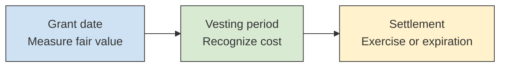
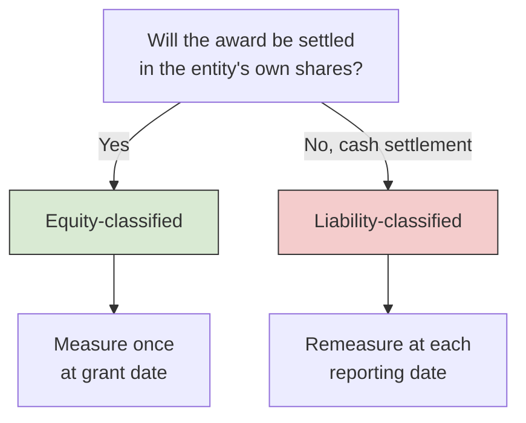

# Stock Compensation (Share-Based Payments)

Companies pay employees with stock because it ties pay to the company's success and conserves cash. The accounting question is how to put a cost on something that may be worth a lot or nothing, and that the employee earns only over several years. **ASC 718** answers in three moves: **measure** the award at fair value, **classify** it as equity or a liability, and **recognize** the cost over the period the employee works to earn it. The 2027 BAR blueprint (Area II, Group D) asks you to recall the key concepts (grant date, vesting conditions, valuation inputs and models) and to prepare journal entries from a given fair value for both equity-classified and liability-classified awards. This chapter covers the vocabulary first, then equity awards, liability awards, valuation inputs, and forfeitures.

---

## The Framework

ASC 718 applies whenever an entity acquires goods or services by issuing, or offering to issue, its own shares, options, or other equity instruments, or by incurring liabilities based on the price of its shares. It covers awards to **employees and nonemployees** alike. ASU 2024-01 (eligible for testing since January 1, 2025) added examples showing when profits interest awards, which are common in partnerships and LLCs, fall within Topic 718.



A few terms carry most of the weight:

| Term | Meaning |
| --- | --- |
| **Grant date** | The date the employer and employee reach a mutual understanding of the key terms. It is the measurement date for equity-classified awards. |
| **Vesting** | The employee earns the right to the award by satisfying its conditions. |
| **Requisite service period** | The period over which the employee must provide service to earn the award, usually the vesting period. Compensation cost is recognized over it. |
| **Exercise (strike) price** | The price the option holder pays for each share. |
| **Fair value** | The price at which the award would be exchanged between willing parties, estimated with an option pricing model. |
| **Intrinsic value** | The share price minus the exercise price. ASC 718 uses it only in limited cases, such as the nonpublic entity election described below. |

On the exam, the fair value of an award is **given**. You will not compute a Black-Scholes value, but you should know what the inputs are and which way each one moves the answer.

### Vesting Conditions

How an award vests changes how its cost is measured and recognized.

| Condition | Example | Effect on the accounting |
| --- | --- | --- |
| **Service condition** | Employee must work for 3 years | Cost is recognized over the 3 years |
| **Performance condition** | Revenue must exceed \$10 million | Not built into fair value. Cost is recognized only if achieving the target is **probable**; the cumulative cost is adjusted when that assessment changes |
| **Market condition** | Share price must reach \$50 | Built into the **grant-date fair value**. Cost is recognized if the employee provides the service, even if the target is never met |

The contrast between the last two rows is a favorite exam point. If a performance target turns out to be unreachable, previously recognized cost is reversed. If a market target is missed, nothing is reversed, because the chance of missing it was already priced into the fair value.

---

## Equity-Classified Awards

An award is **equity-classified** when it will be settled by issuing the entity's own shares. Stock options and restricted stock units are the usual examples. Fair value is measured **once, at the grant date**, and is never remeasured, however much the share price moves afterward. Each period's cost is credited to an equity account (additional paid-in capital).

### Example: Bear Co. Stock Options

On January 1, Year 1, Bear Co. grants employees 10,000 options to buy its \$1 par common stock at \$25 per share. The grant-date fair value is \$8 per option, the options cliff-vest after 4 years, and Bear Co. expects no forfeitures.

Total compensation cost is 10,000 × \$8 = \$80,000, recognized evenly at \$80,000 / 4 = \$20,000 per year. The same entry is made at the end of each of Years 1 through 4:

```journal
Dec 31, Year 1
Dr. Compensation Expense 20,000
Cr. Additional Paid-In Capital (Stock Options)[e] 20,000
```

After vesting, the employees exercise all 10,000 options and pay \$250,000 (10,000 × \$25). The option account is closed into common stock and APIC:

```journal
Dr. Cash[a] 250,000
Dr. Additional Paid-In Capital (Stock Options)[e] 80,000
Cr. Common Stock[e] 10,000
Cr. Additional Paid-In Capital[e] 320,000
```

If the options instead expire unexercised (because the share price stayed below \$25), the cost already recognized is **not** reversed. The balance is simply moved to ordinary APIC:

```journal
Dr. Additional Paid-In Capital (Stock Options)[e] 80,000
Cr. Additional Paid-In Capital[e] 80,000
```

### Example: Bear Co. Restricted Stock Units

A **restricted stock unit (RSU)** entitles the employee to receive a share when it vests, with no exercise price. Its grant-date fair value is generally the share price on the grant date.

On January 1, Year 1, Bear Co. grants an executive 4,500 RSUs when its share price is \$40. The RSUs cliff-vest after 3 years. Total cost is 4,500 × \$40 = \$180,000, or \$60,000 a year:

```journal
Dec 31, Year 1
Dr. Compensation Expense 60,000
Cr. Additional Paid-In Capital (RSUs)[e] 60,000
```

When the RSUs vest at the end of Year 3, Bear Co. issues 4,500 shares of \$1 par stock:

```journal
Dec 31, Year 3
Dr. Additional Paid-In Capital (RSUs)[e] 180,000
Cr. Common Stock[e] 4,500
Cr. Additional Paid-In Capital[e] 175,500
```

### Graded Vesting

Suppose instead the RSUs vested one-third each year (**graded vesting**), so each \$60,000 tranche is earned over a different period. For an award with only service conditions, the entity makes a policy election:

- **Straight-line** over the total service period: \$60,000 each year. The cumulative cost recognized must at least equal the value of the tranches already vested, which it does here.
- **Graded (accelerated) attribution**: each tranche is treated as a separate award and expensed over its own vesting period.

| Year | Tranche 1 (1 year) | Tranche 2 (2 years) | Tranche 3 (3 years) | Graded expense | Straight-line expense |
| --- | --- | --- | --- | --- | --- |
| 1 | \$60,000 | \$30,000 | \$20,000 | \$110,000 | \$60,000 |
| 2 | | \$30,000 | \$20,000 | \$50,000 | \$60,000 |
| 3 | | | \$20,000 | \$20,000 | \$60,000 |
| **Total** | **\$60,000** | **\$60,000** | **\$60,000** | **\$180,000** | **\$180,000** |

Both methods recognize \$180,000 in total; graded attribution simply front-loads it. Awards with performance or market conditions must use graded attribution.

---

## Liability-Classified Awards

An award is **liability-classified** when the entity must, or can be required to, settle it in **cash** or other assets. Cash-settled **stock appreciation rights (SARs)** and phantom stock plans are the common examples. Shares the employee can put back to the company for cash shortly after vesting are also liabilities.



The difference in measurement drives everything else. Because the company will pay cash based on the share price at settlement, a liability award is **remeasured at fair value at each reporting date until it is settled**. At each date, the cumulative cost equals the current fair value times the portion of the service period completed, and the period's expense is whatever brings the liability up (or down) to that amount:

$$
\text{Cumulative cost} = \text{Fair value per award} \times \text{Number of awards} \times \frac{\text{Service completed}}{\text{Total service period}}
$$

A **nonpublic entity** may elect to measure all of its liability-classified awards at intrinsic value instead of fair value, still remeasured each reporting date.

### Example: Polar Inc. Cash-Settled SARs

On January 1, Year 1, Polar Inc. grants employees 6,000 cash-settled SARs with a base price of \$30. Each SAR pays the excess of the share price over \$30. The SARs cliff-vest after 3 years. Fair values per SAR are:

| Date | Fair value per SAR |
| --- | --- |
| Jan 1, Year 1 (grant) | \$7 |
| Dec 31, Year 1 | \$9 |
| Dec 31, Year 2 | \$11 |
| Dec 31, Year 3 (vesting) | \$10 |

The grant-date value plays no role in the accounting, because the award is remeasured at every year-end:

| | Year 1 | Year 2 | Year 3 |
| --- | --- | --- | --- |
| Fair value per SAR | \$9 | \$11 | \$10 |
| Portion of service completed | 1/3 | 2/3 | 3/3 |
| Cumulative cost (and liability balance) | \$18,000 | \$44,000 | \$60,000 |
| **Expense for the year** | **\$18,000** | **\$26,000** | **\$16,000** |

For Year 1, \$9 × 6,000 × 1/3 = \$18,000. For Year 2, \$11 × 6,000 × 2/3 = \$44,000, so the expense is \$44,000 - \$18,000 = \$26,000. Each year's entry has the same form:

```journal
Dec 31, Year 2
Dr. Compensation Expense 26,000
Cr. SAR Liability[l] 26,000
```

On December 31, Year 3, the share price is \$40 and the employees exercise immediately. Polar Inc. pays (\$40 - \$30) × 6,000 = \$60,000, which equals the liability:

```journal
Dec 31, Year 3
Dr. SAR Liability[l] 60,000
Cr. Cash[a] 60,000
```

Total cost for a liability award is not known until settlement. If the fair value falls, the cumulative cost falls with it, and the entity records a credit to compensation expense. If the SARs had stayed outstanding after vesting, Polar Inc. would keep remeasuring the full liability each period, with every change going to expense.

---

## Valuation Inputs

Options are usually valued with the **Black-Scholes-Merton** model. You will not run the model on the exam, but you should know its six inputs and their directional effects:

| Input | What it is | Effect of an increase on option value |
| --- | --- | --- |
| Current share price | Market price of the underlying share | Increases |
| Exercise price | Price the holder pays per share | Decreases |
| Expected term | Expected time until exercise | Increases |
| Risk-free interest rate | Treasury yield for the expected term | Increases |
| Expected volatility | Expected fluctuation of the share price | Increases |
| Expected dividends | Dividends expected during the option's life | Decreases |

The intuition is that an option holder gains from upside but has limited downside. More time and more volatility both widen the range of outcomes and so add value. A higher exercise price and higher dividends (which the option holder does not receive) both reduce it.

Black-Scholes-Merton assumes a single exercise date and constant inputs. A **binomial (lattice) model** handles early exercise and assumptions that change over time. A **Monte Carlo simulation** is common for awards with market conditions, such as total shareholder return targets, where the payoff depends on the path of the share price. A nonpublic entity that cannot estimate its own volatility may use the historical volatility of an appropriate industry index (the **calculated value** method).

---

## Forfeitures

Employees who leave before vesting **forfeit** their awards, and cost is recognized only for awards that vest. For employee and nonemployee awards, the entity makes a policy election:

- **Estimate forfeitures** at the grant date, then true up the estimate as actual departures differ, through a cumulative catch-up.
- **Account for forfeitures as they occur**: recognize cost as if every award will vest, and reverse the cost of an award in the period it is forfeited.

### Example: Forfeiture True-Up

Return to Bear Co.'s grant of 10,000 options (fair value \$8, 4-year cliff vesting), but now assume Bear Co. estimates forfeitures. Through Year 2 it expected 5% to forfeit (9,500 options to vest). During Year 3, departures lead it to expect 8% (9,200 options).

$$
\text{Cumulative cost through Year 3} = 9{,}200 \times \$8 \times \frac{3}{4} = \$55{,}200
$$

$$
\text{Cost recognized through Year 2} = 9{,}500 \times \$8 \times \frac{2}{4} = \$38{,}000
$$

Year 3 expense is \$55,200 - \$38,000 = \$17,200. The catch-up keeps cumulative cost equal to the current estimate times the portion of service completed.

:::note[2027 update: awards to customers]

Under ASU 2025-04 (eligible for testing starting January 1, 2027), the forfeiture election is **not** available for share-based consideration payable to a **customer**, such as warrants that vest based on the customer's purchases. The grantor must estimate forfeitures for those awards, and the vesting condition is treated as a performance condition. Awards to employees and other nonemployees keep the election. See [Revenue Recognition](./revenue-recognition.md) for how these awards reduce revenue.

:::

---

## Summary

| Step | Equity-classified award | Liability-classified award |
| --- | --- | --- |
| **Classify** | Settled in the entity's own shares | Settled, or can be required to be settled, in cash |
| **Measure** | Fair value at grant date, fixed | Fair value at each reporting date until settlement (nonpublic entities may elect intrinsic value) |
| **Recognize** | Over the requisite service period | Cumulative cost trued up each period to current fair value |
| **Record** | Dr. Compensation Expense, Cr. APIC | Dr. Compensation Expense, Cr. Liability |
| **Settle** | Close APIC account to common stock and APIC | Debit the liability, credit cash |
