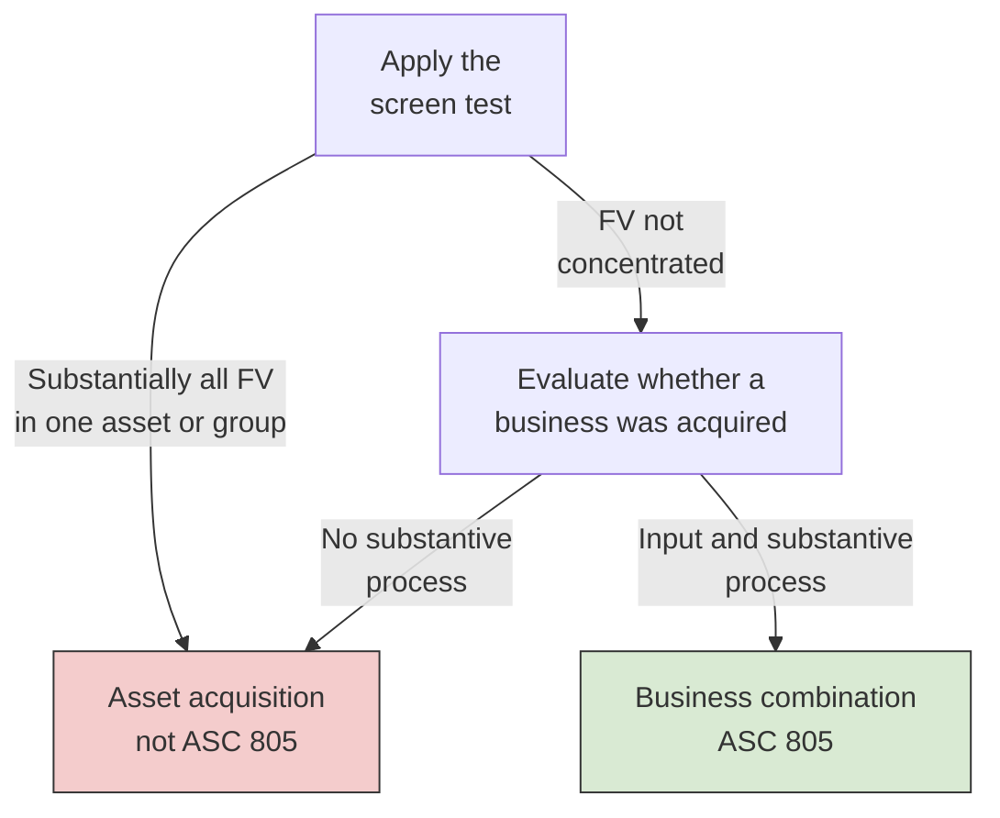

# Business Combinations

When one company buys another, the buyer's balance sheet suddenly has to show assets and liabilities it never recorded before, plus whatever premium it paid for the business as a whole. **ASC 805** governs how that happens: every business combination uses the **acquisition method**, under which the acquirer records what it bought at fair value on the date it obtains control. The 2027 BAR blueprint (Area II, Group F) asks you to recall the key concepts (business versus asset acquisition, contingent consideration, measurement period adjustments), calculate the consideration transferred, and prepare the acquisition entry when the deal produces goodwill, a bargain purchase gain, or a noncontrolling interest. This chapter follows a deal from the threshold question (is it a business at all?) through the acquisition-date entry and the adjustments that come after.

---

## The Acquisition Method

The acquisition method has four steps:

1. **Identify the acquirer**, the entity that obtains control.
2. **Determine the acquisition date**, the date control passes.
3. **Recognize and measure** the identifiable assets acquired, the liabilities assumed, and any noncontrolling interest, generally at fair value.
4. **Recognize goodwill** or, rarely, a **bargain purchase gain**.

Three principles run through all four steps. First, the acquisition method is the only method; pooling of interests is prohibited. Second, everything is measured at the acquisition date, so later changes in value are post-acquisition events. Third, the acquirer's own costs of doing the deal (legal, advisory, valuation, and due diligence fees) are **expensed as incurred**. They are not part of the price paid for the business.

---

## Business or Asset Acquisition?

ASC 805 applies only when the acquired set of assets and activities is a **business**. If it is not, the transaction is an **asset acquisition**, and the accounting changes in important ways.

The analysis starts with an optional **screen test**. If **substantially all** of the fair value of the gross assets acquired is concentrated in a **single identifiable asset or a group of similar identifiable assets** (one building, or a portfolio of similar leases), the set is not a business. If the screen is not met, the set is a business only if it includes, at a minimum, an **input and a substantive process** that together significantly contribute to the ability to create outputs.



| Feature | Business combination (ASC 805) | Asset acquisition |
| --- | --- | --- |
| Excess of cost over fair value of identifiable net assets | Goodwill | No goodwill; total cost is allocated to the assets based on relative fair values |
| Price below fair value | Bargain purchase gain in earnings | No gain; total cost is allocated based on relative fair values |
| Transaction costs | Expensed | Capitalized as part of the cost of the assets |
| Contingent consideration | Recognized at fair value at the acquisition date | Not measured at fair value at acquisition; generally recognized when payment is probable and reasonably estimable |
| In-process R&D | Capitalized at fair value | Expensed unless it has an alternative future use |

---

## Identifying the Acquirer and the Acquisition Date

The **acquirer** is the entity that obtains control. When the deal is paid for in cash or other assets, or by taking on liabilities, the entity that pays is usually the acquirer. When the deal is done mainly by exchanging shares, the acquirer is usually the entity that issues them, but not always. The acquirer weighs factors such as which group of former owners holds the larger share of the combined entity's voting rights, which group controls the board and senior management, which entity is significantly larger, and which entity paid a premium. If the entity that issues shares turns out not to be the acquirer, the deal is a **reverse acquisition**: the legal acquiree is the acquirer for accounting purposes.

**Change for 2027 (ASU 2025-03).** Until now, when the legal acquiree was a variable interest entity (VIE), its primary beneficiary was always treated as the acquirer. Under ASU 2025-03, when the deal is done mainly by exchanging equity interests and the legal acquiree is a VIE that meets the definition of a business, the entity applies the same acquirer factors described above. More of these deals will therefore be accounted for as reverse acquisitions, just as with entities consolidated under the voting interest model. ASU 2025-03 is effective for annual periods beginning after December 15, 2026, and is eligible for testing starting January 1, 2027.

The **acquisition date** is the date the acquirer obtains control, usually the closing date. It is the measurement date for every fair value in the entry.

---

## Recognizing Identifiable Assets and Liabilities

On the acquisition date, the acquirer recognizes all identifiable assets acquired and liabilities assumed, generally at fair value, even items the acquiree never recorded. A few items, such as income taxes, employee benefits, and leases, follow their own standards instead of fair value.

The most common examples of previously unrecorded assets are intangibles. An intangible asset is recognized **separately from goodwill** if it meets either of two criteria:

- **Contractual-legal**: it arises from contractual or other legal rights, such as patents, trademarks, licenses, franchise agreements, customer contracts, and noncompete agreements.
- **Separability**: it can be separated from the business and sold, transferred, or licensed, such as a customer list.

An **assembled workforce** meets neither criterion and is never recognized separately; its value is part of goodwill. Acquired in-process research and development is recognized at fair value as an indefinite-lived intangible until the project is completed or abandoned.

Private companies may elect an accounting alternative under which they do not recognize customer-related intangibles (unless they can be sold or licensed separately) or noncompete agreements apart from goodwill. A private company that makes this election must also adopt the alternative to amortize goodwill.

---

## Measuring the Consideration Transferred

The **consideration transferred** is the sum of the acquisition-date fair values of what the acquirer gives up:

| Component | Measured at |
| --- | --- |
| Cash | Amount paid |
| Shares issued by the acquirer | Fair value of the shares on the acquisition date |
| Other assets transferred | Fair value on the acquisition date (any difference from carrying amount is a gain or loss) |
| Liabilities incurred to the former owners, such as a note to the sellers | Fair value on the acquisition date |
| Contingent consideration | Fair value on the acquisition date |

Transaction costs are **never** part of the consideration. They are expensed, with one exception: costs to **issue shares** reduce additional paid-in capital, and costs to **issue debt** reduce the carrying amount of the debt.

### Example: Bear Co. Acquires Cub Entertainment

On July 1, Bear Co. acquires 100% of Cub Entertainment. Bear Co. pays \$500,000 in cash, issues 20,000 shares of its \$1 par common stock with a fair value of \$30 per share, and agrees to an earn-out payable if Cub's revenue exceeds a target, with a fair value of \$80,000. Bear Co. also pays its investment bank \$45,000 in advisory fees.

$$
\text{Consideration transferred} = \$500{,}000 + (20{,}000 \times \$30) + \$80{,}000 = \$1{,}180{,}000
$$

The \$45,000 fee is excluded and expensed:

```journal
Jul 1
Dr. Acquisition Expense 45,000
Cr. Cash[a] 45,000
```

---

## Goodwill

**Goodwill** is the residual. It is what the acquirer paid for the business as a whole beyond the identifiable net assets, reflecting expected synergies, the assembled workforce, and other benefits that cannot be recognized separately.

$$
\text{Goodwill} = \text{Consideration transferred} + \text{Fair value of NCI} - \text{Fair value of identifiable net assets}
$$

Goodwill arises only in a business combination; internally generated goodwill is never recorded. Public business entities do not amortize goodwill and test it for impairment at least annually at the reporting unit level. Private companies may elect to amortize it over 10 years or less.

Continuing the example, Cub Entertainment's identifiable assets have a fair value of \$1,250,000 and its liabilities \$200,000, so its identifiable net assets are \$1,050,000. With no noncontrolling interest, goodwill is \$1,180,000 - \$1,050,000 = \$130,000. Bear Co.'s shares are recorded at \$20,000 of par value plus \$580,000 of APIC.

```journal
Jul 1
Dr. Identifiable Assets[a] 1,250,000
Dr. Goodwill[a] 130,000
Cr. Liabilities Assumed[l] 200,000
Cr. Cash[a] 500,000
Cr. Common Stock[e] 20,000
Cr. Additional Paid-In Capital[e] 580,000
Cr. Contingent Consideration Liability[l] 80,000
```

---

## Bargain Purchase

A **bargain purchase** occurs when the fair value of the identifiable net assets exceeds the consideration transferred plus the fair value of any NCI. It can happen in a forced or distressed sale, but it can also signal a mistake in the valuation. So before recognizing a gain, the acquirer must **reassess** whether it has identified every asset and liability and must review the procedures it used to measure them. If an excess remains after that review, it is recognized as a **gain in earnings** on the acquisition date and attributed to the acquirer.

### Example: Bear Co. Acquires Sloth Security

Bear Co. acquires 100% of Sloth Security from a seller that must sell quickly, paying \$400,000 in cash. After reassessment, Sloth's identifiable assets have a fair value of \$560,000 and its liabilities \$100,000, for identifiable net assets of \$460,000. The bargain purchase gain is \$460,000 - \$400,000 = \$60,000.

```journal
Jul 1
Dr. Identifiable Assets[a] 560,000
Cr. Liabilities Assumed[l] 100,000
Cr. Cash[a] 400,000
Cr. Gain on Bargain Purchase 60,000
```

---

## Noncontrolling Interest

When the acquirer obtains control with **less than 100%** of the shares, the shares held by outsiders are the **noncontrolling interest (NCI)**. The acquirer still records 100% of the acquiree's identifiable assets and liabilities, because it controls all of them, and records the NCI in **equity**, separately from the parent's equity.

U.S. GAAP requires the NCI to be measured at its **acquisition-date fair value**, usually based on the market price of the shares the acquirer did not buy. Goodwill therefore includes the portion attributable to the NCI (often called **full goodwill**). The NCI's fair value per share may be lower than the price the acquirer paid per share, because the acquirer's price can include a premium for control.

### Example: Bear Co. Acquires 80% of Grizzly Inc.

On January 1, Bear Co. pays \$720,000 in cash for 80% of Grizzly Inc. Grizzly's identifiable assets have a fair value of \$1,100,000 and its liabilities \$250,000, so its identifiable net assets are \$850,000. The fair value of the 20% NCI is \$175,000.

$$
\text{Goodwill} = (\$720{,}000 + \$175{,}000) - \$850{,}000 = \$45{,}000
$$

```journal
Jan 1
Dr. Identifiable Assets[a] 1,100,000
Dr. Goodwill[a] 45,000
Cr. Liabilities Assumed[l] 250,000
Cr. Cash[a] 720,000
Cr. Noncontrolling Interest[e] 175,000
```

Of the \$45,000 of goodwill, \$40,000 belongs to Bear Co. (\$720,000 - 80% × \$850,000) and \$5,000 to the NCI (\$175,000 - 20% × \$850,000). IFRS also permits measuring NCI at its proportionate share of identifiable net assets, which records only the parent's goodwill, but U.S. GAAP does not allow that method.

---

## Contingent Consideration

**Contingent consideration** is the acquirer's obligation to pay the former owners more (or, occasionally, its right to get some back) if specified future events occur, such as an earn-out tied to revenue or earnings targets. It is recognized at **fair value on the acquisition date** as part of the consideration transferred, whatever the probability of payment; the probability is reflected in the fair value.

What happens afterward depends on how the obligation is classified:

| Classification | After the acquisition date |
| --- | --- |
| **Liability** (the usual case, for example an obligation to pay cash) | Remeasured at fair value each reporting date until settled, with changes in **earnings** |
| **Equity** (for example, an obligation to issue a fixed number of shares) | Not remeasured; settlement is accounted for within equity |

Changes in the fair value of contingent consideration after the acquisition date (such as the target becoming more likely) **never adjust goodwill**. Only measurement period adjustments, discussed next, do that.

### Example: Bear Co. Acquires Panda Industries with an Earn-Out

On January 1, Bear Co. acquires 100% of Panda Industries for \$300,000 in cash plus an earn-out of \$75,000 payable if Panda meets revenue targets within two years. The earn-out's acquisition-date fair value is \$50,000. Panda's identifiable assets have a fair value of \$410,000 and its liabilities \$100,000, for identifiable net assets of \$310,000. Total consideration is \$350,000, so goodwill is \$40,000.

```journal
Jan 1
Dr. Identifiable Assets[a] 410,000
Dr. Goodwill[a] 40,000
Cr. Liabilities Assumed[l] 100,000
Cr. Cash[a] 300,000
Cr. Contingent Consideration Liability[l] 50,000
```

By December 31, the targets look more achievable and the earn-out's fair value rises to \$65,000. The \$15,000 increase is a loss:

```journal
Dec 31, Year 1
Dr. Loss on Contingent Consideration 15,000
Cr. Contingent Consideration Liability[l] 15,000
```

In Year 2, Panda meets the targets and Bear Co. pays the full \$75,000, recognizing a further \$10,000 loss:

```journal
Year 2
Dr. Contingent Consideration Liability[l] 65,000
Dr. Loss on Contingent Consideration 10,000
Cr. Cash[a] 75,000
```

---

## Measurement Period Adjustments

Valuations of a newly acquired business often are not finished by the first reporting date, so the acquirer records **provisional amounts** and refines them during the **measurement period**. The measurement period ends when the acquirer has the information it was seeking (or learns it cannot get it), and it can never last more than **one year** from the acquisition date.

Only new information about **facts and circumstances that existed at the acquisition date** qualifies. An appraisal that shows a building was worth more on the acquisition date is a measurement period adjustment. A fire that damages the building a month after closing is not; it is a post-acquisition event recognized in earnings.

A measurement period adjustment changes the provisional asset or liability and **adjusts goodwill**. It is recognized in the reporting period in which the adjustment is determined, **not** by restating prior periods. If the adjustment changes depreciation, amortization, or other income effects, the acquirer records in current-period earnings the full amount, calculated as if the accounting had been completed on the acquisition date, and discloses (or presents) the portion that relates to earlier periods.

After the measurement period ends, the acquisition accounting is revised only to correct an error under ASC 250.

### Example: Grizzly Inc. Patent Appraisal

Return to Bear Co.'s January 1 acquisition of 80% of Grizzly Inc., which recorded provisional goodwill of \$45,000. On June 15, an appraisal shows that a patent was worth \$25,000 more on January 1 than the provisional amount. Revised identifiable net assets are \$875,000, and revised goodwill is (\$720,000 + \$175,000) - \$875,000 = \$20,000.

```journal
Jun 15
Dr. Patent[a] 25,000
Cr. Goodwill[a] 25,000
```

Bear Co. also records, in the current period, any extra amortization on the \$25,000 back to January 1. If the appraisal had instead shown the patent was overvalued by \$25,000, the entry would be reversed (debit goodwill, credit patent).

---

## Comprehensive Example: Bear Co. Acquires 75% of Polar Inc.

On April 1, Bear Co. acquires 75% of Polar Inc. It pays \$450,000 in cash, issues 15,000 shares of \$1 par common stock with a fair value of \$20 per share (\$300,000), and agrees to an earn-out with an acquisition-date fair value of \$60,000. Total consideration is **\$810,000**. Bear Co. also pays \$30,000 of advisory fees. The fair value of the 25% NCI is **\$260,000**.

| Polar Inc. | Book value | Fair value |
| --- | --- | --- |
| Cash | \$80,000 | \$80,000 |
| Accounts receivable | \$120,000 | \$115,000 |
| Inventory | \$200,000 | \$230,000 |
| Property, plant, and equipment | \$400,000 | \$520,000 |
| Customer relationships (unrecorded) | \$0 | \$75,000 |
| **Total identifiable assets** | **\$800,000** | **\$1,020,000** |
| Accounts payable | \$90,000 | \$90,000 |
| Notes payable | \$150,000 | \$150,000 |
| **Total liabilities** | **\$240,000** | **\$240,000** |
| **Identifiable net assets** | **\$560,000** | **\$780,000** |

**Goodwill.** Fair values, not book values, drive the calculation:

$$
\text{Goodwill} = (\$810{,}000 + \$260{,}000) - \$780{,}000 = \$290{,}000
$$

**Advisory fees.** These are expensed:

```journal
Apr 1
Dr. Acquisition Expense 30,000
Cr. Cash[a] 30,000
```

**The acquisition.** Bear Co. records each identifiable asset and liability at fair value, goodwill, each form of consideration, and the NCI:

```journal
Apr 1
Dr. Cash[a] 80,000
Dr. Accounts Receivable[a] 115,000
Dr. Inventory[a] 230,000
Dr. Property, Plant, and Equipment[a] 520,000
Dr. Customer Relationships[a] 75,000
Dr. Goodwill[a] 290,000
Cr. Accounts Payable[l] 90,000
Cr. Notes Payable[l] 150,000
Cr. Cash[a] 450,000
Cr. Common Stock[e] 15,000
Cr. Additional Paid-In Capital[e] 285,000
Cr. Contingent Consideration Liability[l] 60,000
Cr. Noncontrolling Interest[e] 260,000
```

**Measurement period adjustment (August 15).** An updated appraisal shows the PP&E was worth \$40,000 more on April 1. Identifiable net assets become \$820,000, and goodwill falls to \$1,070,000 - \$820,000 = \$250,000:

```journal
Aug 15
Dr. Property, Plant, and Equipment[a] 40,000
Cr. Goodwill[a] 40,000
```

**Earn-out remeasurement (December 31).** The earn-out's fair value rises to \$72,000. This is a post-acquisition change in fair value, so it goes to earnings and goodwill is unaffected:

```journal
Dec 31
Dr. Loss on Contingent Consideration 12,000
Cr. Contingent Consideration Liability[l] 12,000
```

---

## Related Topic: Joint Venture Formations

A newly formed **joint venture** is not a business combination, because no party obtains control. Under ASC 805-60 (added by ASU 2023-05 for joint ventures formed on or after January 1, 2025), the joint venture applies a **new basis of accounting** in its own financial statements. It measures its identifiable net assets at fair value (with the same exceptions as a business combination) and measures its total net assets at the fair value of 100% of its equity. Any excess is goodwill. If the identifiable net assets exceed the fair value of the equity, the difference is an adjustment to additional paid-in capital, not a bargain purchase gain.

---

## Summary

| Topic | Key point |
| --- | --- |
| Business or asset acquisition | Screen test first; a business needs at least an input and a substantive process. Asset acquisitions have no goodwill or gain and capitalize transaction costs |
| Acquirer | The entity that obtains control; in a share exchange, weigh voting rights, board, management, and size (now including VIE acquirees under ASU 2025-03) |
| Consideration transferred | Cash plus fair value of shares, other assets, liabilities to former owners, and contingent consideration; transaction costs excluded |
| Goodwill | Consideration + fair value of NCI - fair value of identifiable net assets |
| Bargain purchase | Reassess, then recognize the remaining excess as a gain in earnings |
| Noncontrolling interest | Measured at fair value (U.S. GAAP); presented in equity |
| Contingent consideration | Fair value at acquisition; liability-classified remeasured through earnings, equity-classified not remeasured |
| Measurement period | Up to one year; acquisition-date facts only; adjust goodwill in the current period, no restatement |
| Transaction costs | Expensed, except share and debt issuance costs |
