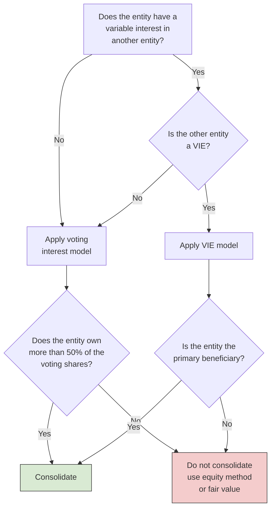
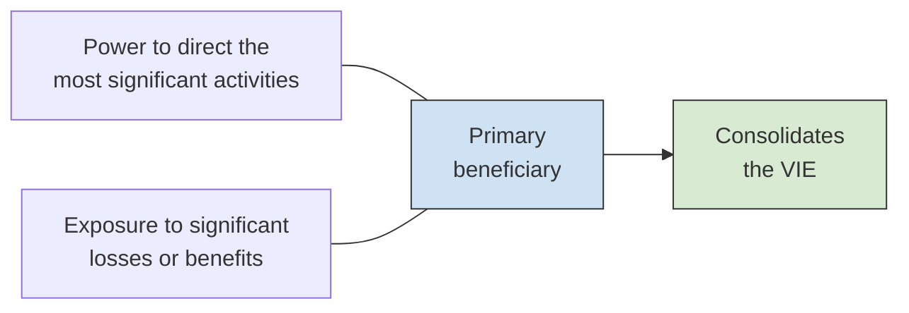
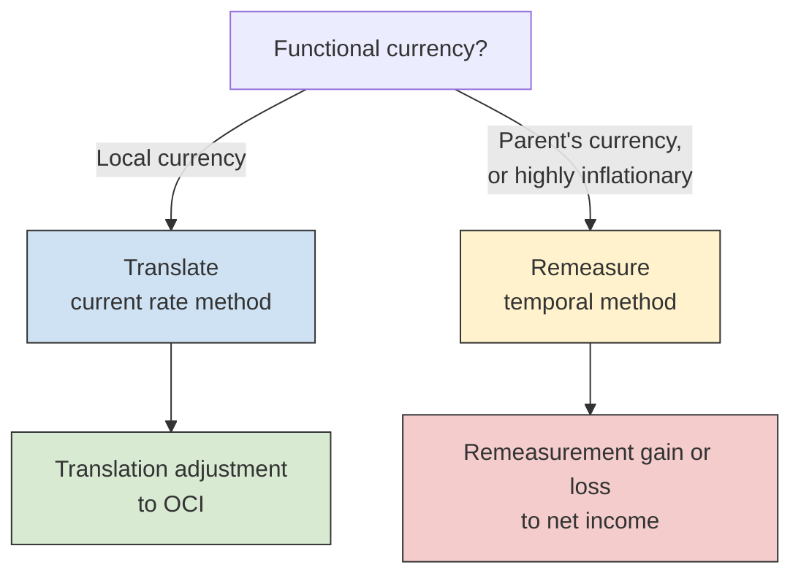

# Consolidated Financial Statements

Consolidated statements present a parent and the entities it controls as if they were one company. FAR covers the mechanics of combining and eliminating. BAR asks two questions that come before and after them: **when** must an entity consolidate another (the voting interest model or the variable interest entity model), and, when the subsidiary is foreign, **how** are its statements brought into the parent's currency and where does the resulting adjustment go. The 2027 BAR blueprint (Area II, Group G) asks you to recall consolidation terms (controlling interest, noncontrolling interest, primary beneficiary, VIE), recall the functional currency indicators, calculate translation adjustments, and present them in comprehensive income. This chapter covers ASC 810 first and then ASC 830.

---

## Two Ways to Have Control

ASC 810 requires a reporting entity to consolidate any entity in which it has a **controlling financial interest**. There are two routes to that conclusion. Most companies are controlled through votes, so the **voting interest model** asks who holds a majority of the voting shares. Some entities are designed so that votes do not tell you who is really in charge or who bears the risks, and for them the **variable interest entity (VIE) model** looks past the votes to power and economic exposure. The VIE analysis comes first: if the other entity is a VIE, the voting interest model does not apply to it.



A few terms recur throughout. The **parent** holds a controlling financial interest in a **subsidiary**. The **noncontrolling interest (NCI)** is the part of a subsidiary's equity not owned by the parent. **Elimination entries** remove intercompany balances and transactions so the consolidated statements show only dealings with outsiders.

---

## The Voting Interest Model

Under the voting interest model, a parent consolidates an entity in which it owns **more than 50%** of the outstanding voting shares. Exactly 50% is not enough; a 50-50 joint venture is usually accounted for by the equity method. Below the consolidation threshold, the usual guide is that 20% to 50% gives significant influence (equity method) and less than 20% does not (fair value), although the facts can rebut either presumption. Even a majority owner does not consolidate if control does not actually rest with it, for example when the subsidiary is in legal reorganization or bankruptcy.

Consolidating means four things:

1. **Combine** 100% of the subsidiary's assets, liabilities, revenues, and expenses with the parent's, even if the parent owns less than 100%.
2. **Eliminate** 100% of intercompany balances and transactions, whatever the ownership percentage.
3. **Present the NCI** as a separate component of equity.
4. **Attribute** consolidated net income and comprehensive income between the parent and the NCI.

---

## The Variable Interest Entity Model

### Variable Interests and VIEs

A **variable interest** is a contractual, ownership, or other financial interest whose value changes as the entity's net assets change in value. Equity investments, loans and subordinated debt, guarantees of the entity's debt, residual value guarantees, and some fee arrangements can all be variable interests.

An entity is a **VIE** if any of the following is true:

| Condition | What it means |
| --- | --- |
| **Insufficient equity at risk** | The equity at risk is not enough to finance the entity's activities without additional subordinated financial support |
| **Equity holders lack power** | The equity holders as a group cannot direct the activities that most significantly affect the entity's economic performance |
| **Equity holders lack economics** | The equity holders as a group do not absorb the entity's expected losses or receive its expected residual returns |

### The Primary Beneficiary

A VIE is consolidated by its **primary beneficiary**, the party that has **both**:

1. **Power**: the power to direct the activities that most significantly affect the VIE's economic performance, and
2. **Economics**: the obligation to absorb losses of, or the right to receive benefits from, the VIE that could potentially be significant to it.



Only one party can be the primary beneficiary. Party ownership percentages do not decide it, and a small equity holder can be required to consolidate.

Private companies may elect not to apply the VIE guidance to a legal entity when both it and the private company are under common control and certain other conditions are met. Not-for-profit entities and employee benefit plans are outside the VIE guidance altogether.

### Example: Bear Co. and Kodiak Receivables

Kodiak Receivables LLC was formed to buy and collect a portfolio of receivables. Its equity is only 5% of its total assets, and the rest is borrowed. Bear Co. owns 30% of the equity, guarantees 80% of Kodiak's debt, and decides which receivables Kodiak buys and how they are collected.

| Question | Answer |
| --- | --- |
| Is there sufficient equity at risk? | No. Equity of 5% of assets needs the guarantee to support it |
| Is Kodiak a VIE? | Yes |
| Does Bear Co. have the power to direct the most significant activities? | Yes. It controls purchasing and collections |
| Is Bear Co. exposed to potentially significant losses? | Yes. It guarantees 80% of the debt |
| Is Bear Co. the primary beneficiary? | Yes |

Bear Co. consolidates Kodiak even though it owns only 30% of the equity. On the exam, a VIE fact pattern usually features thin equity plus one party that supplies guarantees or management. Find the party that has both power and exposure.

:::note[2027 update: acquiring a VIE]

Under ASU 2025-03 (eligible for testing starting January 1, 2027), when a VIE that is a business is acquired mainly by exchanging equity interests, the primary beneficiary is no longer automatically the accounting acquirer. The parties weigh the general factors for identifying the acquirer, so some of these deals become reverse acquisitions. See [Business Combinations](./business-combinations.md).

:::

---

## Noncontrolling Interest

When a subsidiary is not wholly owned, the outside shareholders' stake is presented as follows:

| Statement | NCI presentation |
| --- | --- |
| **Balance sheet** | A separate line in equity, apart from the parent's equity (not a liability and not mezzanine) |
| **Income statement** | Consolidated net income, then the amounts attributable to the NCI and to the parent, shown on the face |
| **Statement of comprehensive income** | Comprehensive income attributable to the NCI and to the parent |

Losses are attributed to the NCI even if that drives the NCI balance below zero. And once a parent has control, buying or selling shares of the subsidiary without losing control is an **equity transaction**: the difference between the price and the change in the NCI goes to additional paid-in capital, with no gain or loss and no change to goodwill.

### Example: Attributing Net Income

Bear Co. owns 80% of Sloth Security. This year, Bear Co.'s own operations earn \$500,000 and Sloth earns \$200,000, with no intercompany items. The NCI's share is 20% × \$200,000 = \$40,000.

| | Amount |
| --- | --- |
| Consolidated net income | \$700,000 |
| Less: net income attributable to the NCI | (\$40,000) |
| **Net income attributable to Bear Co.** | **\$660,000** |

---

## Functional Currency

A foreign subsidiary's statements must be expressed in the parent's **reporting currency** (for a U.S. parent, the U.S. dollar) before they can be consolidated. The method depends on the subsidiary's **functional currency**, the currency of the primary economic environment in which it operates: the currency in which it mainly generates and spends cash.

ASC 830 lists economic indicators that point one way or the other:

| Indicator | Points to the local currency | Points to the parent's currency |
| --- | --- | --- |
| **Cash flows** | Mainly in local currency; do not directly affect the parent's cash flows | Directly affect the parent's cash flows and are readily available for remittance |
| **Sales prices** | Set by local competition and regulation; not responsive to short-term exchange rate changes | Set by worldwide markets; responsive to short-term exchange rate changes |
| **Sales market** | Active local market | Mainly in the parent's country, or priced in the parent's currency |
| **Expenses** | Mainly local labor, materials, and costs | Mainly components obtained from the parent's country |
| **Financing** | Mainly in local currency, serviced by local operations | Mainly from the parent or in the parent's currency, or needs the parent's cash to service |
| **Intercompany transactions** | Few, with little interrelationship with the parent | Many, with extensive interrelationship with the parent |

No single indicator decides the question. When the indicators are mixed, management uses judgment to pick the currency that best reflects the subsidiary's economic results. A subsidiary that is essentially a local business has a local functional currency. One that is an extension of the parent, selling the parent's products and funded by the parent, has the parent's currency as its functional currency.

There is one override. If the subsidiary operates in a **highly inflationary economy**, meaning cumulative inflation of approximately 100% or more over three years, its statements are remeasured as if the **reporting currency** were its functional currency.

The functional currency decision determines which of two methods applies:



---

## Translation: The Current Rate Method

**Translation** applies when the subsidiary's functional currency is its local currency. The goal is to express the subsidiary's results in dollars while keeping its financial relationships (its margins and ratios) intact, so nearly everything is translated at current or average rates.

| Item | Rate |
| --- | --- |
| All assets and liabilities | Current rate at the balance sheet date |
| Common stock and APIC | Historical rate when issued |
| Retained earnings | Carried forward: beginning balance in dollars, plus translated net income, minus translated dividends |
| Revenues and expenses | Rates when recognized; a weighted-average rate in practice |
| Dividends | Rate on the declaration date |

Because net assets are translated at the current rate while equity is carried at historical rates, the translated balance sheet does not balance on its own. The difference is the **translation adjustment**. It is reported in **other comprehensive income (OCI)** each period and accumulates in **accumulated other comprehensive income (AOCI)**, where it is often called the **cumulative translation adjustment (CTA)**. It never goes to net income while the subsidiary is held, because it is an unrealized effect of rate changes on a long-term investment.

The direction of the adjustment is intuitive: when the foreign currency weakens against the dollar, the parent's investment in the subsidiary's net assets is worth fewer dollars, and the adjustment is a debit (a loss in OCI).

### Example: Bear Co. Translates Grizzly Ltd.

Bear Co. owns 100% of Grizzly Ltd., a U.K. subsidiary whose functional currency is the British pound. Rates for Year 2, in U.S. dollars per pound:

| Rate | Dollars per pound |
| --- | --- |
| January 1, Year 2 | \$1.25 |
| December 31, Year 2 | \$1.20 |
| Weighted average, Year 2 | \$1.22 |
| When common stock was issued | \$1.50 |
| When dividends were declared | \$1.23 |

Grizzly's Year 2 figures in pounds: total assets £960,000, total liabilities £400,000, common stock £200,000, beginning retained earnings £300,000, revenues £500,000, expenses £420,000, and dividends declared £20,000. From last year's translation, beginning retained earnings were \$380,000 and beginning AOCI was a debit of \$55,000.

**Step 1: Income statement at the average rate.** Revenues are £500,000 × \$1.22 = \$610,000, and expenses are £420,000 × \$1.22 = \$512,400, so net income is **\$97,600**.

**Step 2: Dividends at the declaration-date rate.** £20,000 × \$1.23 = **\$24,600**.

**Step 3: Retained earnings.** \$380,000 + \$97,600 - \$24,600 = **\$453,000**.

**Step 4: Balance sheet.**

| Account | Pounds | Rate | Dollars |
| --- | --- | --- | --- |
| Total assets | £960,000 | \$1.20 current | \$1,152,000 |
| Total liabilities | £400,000 | \$1.20 current | \$480,000 |
| Common stock | £200,000 | \$1.50 historical | \$300,000 |
| Retained earnings | | From Step 3 | \$453,000 |

**Step 5: Cumulative translation adjustment (the plug).** Net assets in dollars are \$1,152,000 - \$480,000 = \$672,000. Common stock and retained earnings total \$753,000. The AOCI balance must therefore be \$672,000 - \$753,000 = a **debit of \$81,000**.

**Step 6: Translation adjustment for Year 2.** AOCI moved from a \$55,000 debit to an \$81,000 debit, so the Year 2 adjustment in OCI is a **\$26,000 loss**. You can confirm it directly by applying each rate change to the items it affected:

| Source | Calculation | Effect |
| --- | --- | --- |
| Beginning net assets | £500,000 × (\$1.20 - \$1.25) | (\$25,000) |
| Net income | £80,000 × (\$1.20 - \$1.22) | (\$1,600) |
| Dividends | -£20,000 × (\$1.20 - \$1.23) | \$600 |
| **Translation adjustment** | | **(\$26,000)** |

The loss makes sense: the pound weakened during the year, so Grizzly's net assets are worth fewer dollars.

### Presentation in Comprehensive Income

The year's translation adjustment appears in OCI, and the cumulative amount appears in AOCI within equity:

| Consolidated statement of comprehensive income (partial) | Amount |
| --- | --- |
| Net income | \$97,600 |
| Other comprehensive loss: foreign currency translation adjustment | (\$26,000) |
| **Comprehensive income** | **\$71,600** |

| Equity attributable to Grizzly in consolidation | Amount |
| --- | --- |
| Common stock | \$300,000 |
| Retained earnings | \$453,000 |
| AOCI (translation adjustment) | (\$81,000) |
| **Total** | **\$672,000** |

If the subsidiary were not wholly owned, the NCI's share of the translation adjustment would be attributed to the NCI. The CTA stays in AOCI until the parent sells the subsidiary or it is completely or substantially liquidated. At that point, the accumulated amount is **reclassified** out of AOCI into net income as part of the gain or loss on the sale. If Bear Co. sold Grizzly with the \$81,000 debit balance in AOCI, it would record:

```journal
Dr. Loss on Sale of Subsidiary 81,000
Cr. AOCI (Translation Adjustment)[e] 81,000
```

---

## Remeasurement: The Temporal Method

**Remeasurement** applies when the subsidiary's functional currency is the parent's reporting currency (or the economy is highly inflationary). The aim is to produce the same dollar amounts that would have resulted if the subsidiary had recorded its transactions in dollars from the start. So items carried at historical cost keep their historical rates, and only monetary items (cash and amounts to be received or paid in a fixed number of currency units) move with the current rate.

| Item | Rate |
| --- | --- |
| Monetary assets and liabilities (cash, receivables, payables, debt) | Current rate |
| Nonmonetary assets and liabilities (inventory at cost, fixed assets, intangibles, deferred revenue) | Historical rates |
| Common stock and APIC | Historical rate |
| Revenues and most expenses | Average rate |
| Cost of goods sold, depreciation, and amortization | Historical rates of the related assets |

The balancing figure is a **remeasurement gain or loss**, and it is reported in **net income**, not OCI. A subsidiary with more monetary liabilities than monetary assets gains when the local currency weakens (it owes fewer dollars) and loses when the currency strengthens.

| Feature | Translation (current rate) | Remeasurement (temporal) |
| --- | --- | --- |
| When used | Functional currency is the local currency | Functional currency is the reporting currency, or highly inflationary economy |
| Assets and liabilities | All at current rate | Monetary at current, nonmonetary at historical |
| Revenues and expenses | Average rate | Average rate, except historical for COGS and depreciation |
| Resulting adjustment | Translation adjustment in **OCI** | Remeasurement gain or loss in **net income** |

:::tip[Memory Aid]

**C**urrent rate method produces the **C**TA, which goes to O**C**I. **T**emporal method goes **T**o income.

:::

### Example: Bear Co. Remeasures Panda Industries

Bear Co. owns 100% of Panda Industries, a subsidiary in Mexico that keeps its books in pesos (MXN). Panda sells mainly to U.S. customers and is financed in dollars by Bear Co., so its functional currency is the U.S. dollar.

| Rate | Dollars per peso |
| --- | --- |
| Current (December 31) | \$0.055 |
| When fixed assets were bought | \$0.065 |
| When ending inventory was bought | \$0.060 |
| When common stock was issued | \$0.070 |
| Weighted average for the year | \$0.058 |

| Balance sheet | Pesos | Rate | Dollars |
| --- | --- | --- | --- |
| Cash | MXN 2,000,000 | \$0.055 current | \$110,000 |
| Accounts receivable | MXN 3,000,000 | \$0.055 current | \$165,000 |
| Inventory at cost | MXN 4,000,000 | \$0.060 historical | \$240,000 |
| Fixed assets, net | MXN 10,000,000 | \$0.065 historical | \$650,000 |
| **Total assets** | **MXN 19,000,000** | | **\$1,165,000** |
| Accounts payable | MXN 2,500,000 | \$0.055 current | \$137,500 |
| Long-term debt | MXN 5,000,000 | \$0.055 current | \$275,000 |
| **Total liabilities** | **MXN 7,500,000** | | **\$412,500** |
| Common stock | MXN 5,000,000 | \$0.070 historical | \$350,000 |
| Beginning retained earnings | | From last year | \$297,500 |

| Income statement | Pesos | Rate | Dollars |
| --- | --- | --- | --- |
| Revenues | MXN 12,000,000 | \$0.058 average | \$696,000 |
| Cost of goods sold | MXN 7,000,000 | \$0.060 historical | (\$420,000) |
| Depreciation | MXN 1,000,000 | \$0.065 historical | (\$65,000) |
| Other expenses | MXN 2,000,000 | \$0.058 average | (\$116,000) |
| **Income before remeasurement gain or loss** | | | **\$95,000** |

Equity must equal remeasured net assets: \$1,165,000 - \$412,500 = \$752,500. Before the remeasurement item, equity is \$350,000 + \$297,500 + \$95,000 = \$742,500. The \$10,000 difference is a **remeasurement gain**, reported in net income:

$$
\text{Net income} = \$95{,}000 + \$10{,}000 = \$105{,}000
$$

Ending retained earnings are \$297,500 + \$105,000 = \$402,500, and total equity is \$350,000 + \$402,500 = \$752,500. The gain makes sense: Panda owes more pesos (MXN 7,500,000 of monetary liabilities) than it holds (MXN 5,000,000 of monetary assets), and the peso weakened, so its net peso debt now costs fewer dollars.

---

## Two Steps: Local to Functional to Reporting Currency

Occasionally a subsidiary keeps its books in a local currency that is neither its functional currency nor the parent's reporting currency. Then both methods apply, in order:

| Step | Method | Adjustment goes to |
| --- | --- | --- |
| 1. Local currency to functional currency | Remeasure (temporal) | Net income |
| 2. Functional currency to reporting currency | Translate (current rate) | OCI |

For example, Cub Entertainment operates in Hong Kong and keeps its books in Hong Kong dollars, but its business is tied to the Japanese market, so its functional currency is the yen. Its parent, Bear Co., reports in U.S. dollars. Cub's books are first remeasured from Hong Kong dollars into yen, with any gain or loss in net income, and the yen statements are then translated into U.S. dollars, with the translation adjustment in OCI. Always remeasure first, then translate.

---

## Summary

| Topic | Key rule |
| --- | --- |
| Voting interest model | Consolidate with more than 50% of the voting shares, unless control does not rest with the majority owner |
| VIE model | Evaluated first; the primary beneficiary (power plus significant economic exposure) consolidates |
| Noncontrolling interest | Separate component of equity; income and losses attributed even if NCI goes negative; ownership changes without loss of control go through equity |
| Functional currency | The currency of the primary economic environment, judged from the indicators |
| Highly inflationary economy | About 100% cumulative inflation over three years; remeasure into the reporting currency |
| Translation (current rate) | Assets and liabilities at current rate, income at average rate; adjustment to OCI, accumulated in AOCI |
| Remeasurement (temporal) | Monetary items at current rate, nonmonetary at historical; gain or loss to net income |
| Two-step process | Remeasure local to functional first, then translate functional to reporting |
| CTA reclassification | Out of AOCI into net income on sale or complete or substantial liquidation |
