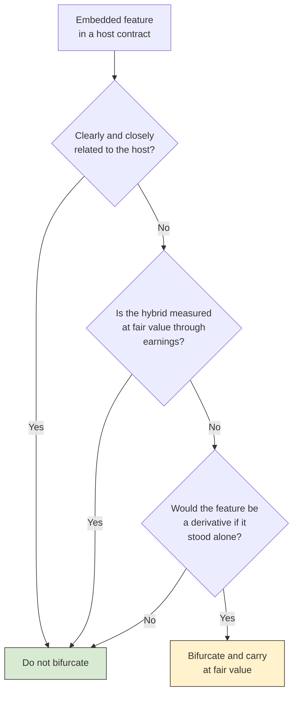

# Derivatives and Hedge Accounting

A **derivative** is a contract whose value comes from something else: an interest rate, a commodity price, an exchange rate, or a share price. Companies use derivatives mainly to manage risk, such as locking in the interest rate on a loan or the price of fuel. **ASC 815** requires every derivative to be recognized on the balance sheet at **fair value**, and it offers optional **hedge accounting** so that a derivative's gains and losses can be matched with the risk it is hedging. The 2027 BAR blueprint (Area II, Group H) asks you to identify freestanding and embedded derivatives, identify the criteria for hedge accounting, recall where gains and losses on swaps, options, and forwards are presented, and prepare the entries for an interest rate swap designated as a fair value hedge or a cash flow hedge. This chapter builds up in that order, from the definition to the two swap hedges.

---

## What Is a Derivative?

A contract is a derivative under ASC 815 only if it has **all three** of these characteristics:

| Characteristic | What it means |
| --- | --- |
| **Underlying and notional amount** (or a payment provision) | The settlement depends on an underlying variable (an interest rate, price, or index) applied to a notional amount, such as a number of units or a dollar principal |
| **No or little initial net investment** | It costs nothing, or much less than buying the underlying asset itself would cost |
| **Net settlement** | It can be settled net in cash, through a market mechanism, or by delivering an asset that is readily convertible to cash |

If any one is missing, the contract is not a derivative. A plain purchase of 1,000 shares, for example, requires a full initial investment, so it is not a derivative even though its value moves with the share price.

Some contracts meet the definition but are **excluded** from ASC 815. The most commonly tested exclusion is **normal purchases and normal sales**: a contract to buy or sell something the entity will take or make delivery of in the normal course of business, such as a manufacturer's fixed-price contract to buy raw materials it will use. Others include certain insurance contracts and contracts indexed to the entity's own stock and classified in equity.

:::note[2027 update: ASU 2025-07 scope exception]

ASU 2025-07 (eligible for testing starting January 1, 2027) adds a scope exception for contracts that are not exchange-traded and whose underlying is based on **operations or activities specific to one of the parties**. Examples are payments tied to a party's EBITDA or net income, or to an event such as obtaining regulatory approval, reaching a product development milestone, or meeting a greenhouse gas emissions target. The exception does **not** cover underlyings based on a market rate, price, or index; on the price or performance of a party's financial asset or liability; contracts on the entity's own equity; or call and put options on debt.

:::

### Common Derivatives

| Instrument | What it is | Typical use |
| --- | --- | --- |
| **Forward** | A privately negotiated agreement to buy or sell an asset at a set price on a future date | Hedging a foreign currency payment or a commodity purchase |
| **Futures** | A standardized, exchange-traded forward, settled daily through margin | Hedging commodity or interest rate exposure |
| **Option** | The **right, but not the obligation**, to buy (call) or sell (put) at a strike price, for a premium | Protecting against an adverse move while keeping the upside |
| **Interest rate swap** | An agreement to exchange fixed-rate and variable-rate interest payments on a notional principal | Converting variable-rate debt to fixed, or fixed to variable |

---

## Freestanding and Embedded Derivatives

A **freestanding derivative** is a separate contract, such as a purchased option, a commodity forward, or a swap. It is recognized at fair value.

An **embedded derivative** is a feature inside a larger **host contract** that makes some of the hybrid instrument's cash flows behave like a derivative. Examples are a bond whose interest payments are tied to the S&P 500 or to the price of gold. The question is whether to **bifurcate** it, that is, separate it from the host and account for it as a freestanding derivative at fair value. Bifurcation is required only if **all three** of these are true:

1. The embedded feature's economic characteristics are **not clearly and closely related** to the host's. (Equity- or commodity-indexed interest on a debt host is not clearly and closely related; an ordinary interest rate feature usually is.)
2. The hybrid instrument is **not** already remeasured at fair value through earnings.
3. A separate instrument with the same terms **would be a derivative**.



The second condition is a common trap. If the whole hybrid is already carried at fair value through earnings, its derivative-like changes are already captured, so there is nothing to separate. An entity can also elect fair value for the entire hybrid instead of bifurcating.

---

## Derivatives Without Hedge Accounting

The default is simple. A derivative that is not designated as a hedge is carried at fair value, and **every change in fair value goes to earnings** in the period it occurs. An increase is recorded as a debit to the derivative asset and a credit to a gain; a decrease is a debit to a loss and a credit to the derivative (or a derivative liability).

The problem with the default is mismatched timing. Suppose a company uses a swap to fix the interest on a variable-rate loan. The swap's fair value changes hit earnings now, while the higher or lower interest on the loan hits earnings in later years. Earnings swing even though the company has reduced its economic risk. Hedge accounting exists to fix that mismatch.

---

## Qualifying for Hedge Accounting

Hedge accounting is **elective**, and it must be earned. The entity must meet all of these requirements:

| Requirement | What it involves |
| --- | --- |
| **Formal designation and documentation at inception** | Identify the hedging instrument, the hedged item, the nature of the risk being hedged, the risk management objective and strategy, and how effectiveness will be assessed |
| **Eligible hedged item** | A recognized asset or liability, a firm commitment, or (for cash flow hedges) a forecasted transaction that is **probable** and specifically identified, exposed to a risk that could affect earnings |
| **Eligible hedging instrument** | Generally a derivative; a few foreign currency hedges may use nonderivative instruments |
| **Highly effective** | Expected to be highly effective, at inception and on an ongoing basis, in offsetting changes in fair value or cash flows from the hedged risk (in practice, offsetting about 80% to 125%) |

If the documentation is missing at inception, hedge accounting is not available, and the derivative gets the default treatment. If a hedge later stops being highly effective, hedge accounting is discontinued prospectively.

ASU 2025-09 (effective for public business entities for annual periods beginning after December 15, 2026, and eligible for testing starting January 1, 2027) makes targeted improvements. For example, a group of forecasted transactions may now be hedged together if they share a **similar** risk exposure rather than the same one, and there are new rules for hedges of choose-your-rate debt and nonfinancial forecasted transactions. The basic fair value and cash flow hedge mechanics in this chapter do not change.

---

## Three Kinds of Hedges

| Hedge | What is hedged | Change in the derivative's fair value | Hedged item |
| --- | --- | --- | --- |
| **Fair value hedge** | Changes in the **fair value** of a recognized asset or liability, or a firm commitment | Earnings | Carrying amount adjusted for the hedged risk, through earnings |
| **Cash flow hedge** | Variability in **future cash flows** of a recognized asset or liability, or a forecasted transaction | OCI, then reclassified to earnings when the hedged transaction affects earnings | No adjustment |
| **Net investment hedge** | Foreign currency exposure of a **net investment in a foreign operation** | OCI, as part of the cumulative translation adjustment | No adjustment |

The rest of the chapter works through the two interest rate swap hedges the blueprint names. In both examples, each year's variable rate is set at the start of the year, and the swap settles at the end of the year.

---

## Fair Value Hedges

A fixed-rate borrower has a fair value exposure: if market rates fall, its fixed-rate debt becomes more expensive relative to the market, and the debt's fair value rises. A **receive-fixed, pay-variable** swap converts the debt to variable rate, so the borrower's interest cost floats with the market and the debt's fair value no longer moves with rates.

In a fair value hedge:

1. The **swap** is carried at fair value, with changes in **earnings**.
2. The **hedged item's** carrying amount is adjusted for the change in its fair value caused by the hedged risk, also through **earnings**.
3. The two changes largely **offset**, and both are presented in the same income statement line as the hedged item's earnings effect (here, interest expense).

### Example: Bear Co. Hedges Fixed-Rate Debt

On January 1, Year 1, Bear Co. issues a \$1,000,000, 3-year note payable at 5% fixed, with interest paid each December 31. It also enters a 3-year interest rate swap with a notional amount of \$1,000,000: Bear Co. **receives 5% fixed and pays SOFR**. SOFR is 5% on January 1, Year 1. Bear Co. designates the swap as a fair value hedge of the note's benchmark interest rate risk.

**At inception**, both legs of the swap are at 5%, so its fair value is zero and no entry is needed.

**At December 31, Year 1**, Bear Co. pays the year's interest. Because SOFR for Year 1 was set at 5%, the swap's two legs cancel and there is no net settlement this year.

```journal
Dec 31, Year 1
Dr. Interest Expense 50,000
Cr. Cash[a] 50,000
```

On the same date, SOFR resets to **6%** for Year 2. Bear Co. now expects to pay 1% more on the swap than it receives for each of the two remaining years, so the swap has become a **liability**. Valuations show a swap fair value of \$18,000 (a liability), and a decrease of \$18,000 in the note's fair value due to the rise in the benchmark rate. The swap loss and the note gain offset:

```journal
Dec 31, Year 1
Dr. Loss on Interest Rate Swap 18,000
Cr. Interest Rate Swap[l] 18,000
```

```journal
Dec 31, Year 1
Dr. Note Payable[l] 18,000
Cr. Gain on Hedged Note Payable 18,000
```

The note's carrying amount is now \$982,000. In Year 2, Bear Co. will pay \$50,000 of interest on the note plus a net swap settlement of (6% - 5%) × \$1,000,000 = \$10,000, for a total interest cost of \$60,000, or 6%. That is the point of the hedge: Bear Co.'s fixed-rate debt now behaves like variable-rate debt.

The giveaway for a fair value hedge on the exam is that the **carrying amount of the hedged item is adjusted**, and both sides go to earnings in the same period.

---

## Cash Flow Hedges

A variable-rate borrower has the opposite exposure: its interest payments rise if rates rise. A **pay-fixed, receive-variable** swap locks in the interest cost.

In a cash flow hedge:

1. The **swap** is carried at fair value on the balance sheet.
2. The change in its fair value goes to **other comprehensive income (OCI)** and accumulates in AOCI.
3. Amounts in AOCI are **reclassified** into earnings when the hedged transaction (here, each interest payment) affects earnings, and they are presented in the same line as the hedged item.

Before ASU 2017-12, the "ineffective portion" of a cash flow hedge was measured and recorded in earnings separately. That is no longer done: the entire change in the fair value of the hedging instrument (other than any components excluded from the effectiveness assessment) goes to OCI.

### Example: Polar Inc. Hedges Variable-Rate Debt

On January 1, Year 1, Polar Inc. borrows \$2,000,000 for 2 years at a variable rate equal to SOFR, set at the start of each year, with interest paid each December 31. SOFR is 4% on January 1, Year 1. Polar Inc. enters a 2-year swap with a notional amount of \$2,000,000: it **pays 4% fixed and receives SOFR**. It designates the swap as a cash flow hedge of its variable interest payments.

**Year 1.** Interest is \$2,000,000 × 4% = \$80,000, and the swap's legs cancel, so there is no settlement.

```journal
Dec 31, Year 1
Dr. Interest Expense 80,000
Cr. Cash[a] 80,000
```

At year-end, SOFR resets to **5%** for Year 2. Polar Inc. will now receive 1% more than it pays on the swap, so the swap is an **asset**. Its fair value is \$19,000, the present value of the \$20,000 net receipt expected at the end of Year 2. The gain goes to OCI:

```journal
Dec 31, Year 1
Dr. Interest Rate Swap[a] 19,000
Cr. Other Comprehensive Income 19,000
```

**Year 2.** Interest on the loan is \$2,000,000 × 5% = \$100,000:

```journal
Dec 31, Year 2
Dr. Interest Expense 100,000
Cr. Cash[a] 100,000
```

Just before settlement, the swap is worth the full \$20,000 Polar Inc. is about to receive, so it rises \$1,000 in value, again through OCI:

```journal
Dec 31, Year 2
Dr. Interest Rate Swap[a] 1,000
Cr. Other Comprehensive Income 1,000
```

The counterparty pays the net settlement of (5% - 4%) × \$2,000,000 = \$20,000, which settles the swap asset:

```journal
Dec 31, Year 2
Dr. Cash[a] 20,000
Cr. Interest Rate Swap[a] 20,000
```

Finally, because the hedged interest payment has now affected earnings, the \$20,000 in AOCI is reclassified to interest expense:

```journal
Dec 31, Year 2
Dr. Other Comprehensive Income 20,000
Cr. Interest Expense 20,000
```

| | Year 1 | Year 2 |
| --- | --- | --- |
| Interest on the loan | \$80,000 | \$100,000 |
| Reclassified from AOCI | | (\$20,000) |
| **Net interest expense** | **\$80,000** | **\$80,000** |
| Swap fair value at year-end | \$19,000 asset | \$0 |
| AOCI at year-end | \$19,000 credit | \$0 |

Polar Inc.'s interest cost is \$80,000, or 4%, in both years: it has locked in the fixed rate. Many textbooks shorten Year 2 by crediting the \$20,000 cash receipt directly to interest expense; the result is the same.

### Comparing the Two Interest Rate Swap Hedges

| Feature | Fair value hedge | Cash flow hedge |
| --- | --- | --- |
| Risk hedged | Change in fair value of an existing item | Variability of future cash flows |
| Typical setting | Fixed-rate debt | Variable-rate debt |
| Swap | Receive fixed, pay variable | Pay fixed, receive variable |
| Swap's change in fair value | Earnings | OCI, reclassified later |
| Hedged item | Carrying amount adjusted through earnings | Not adjusted |
| Result | Debt behaves like variable-rate debt | Interest cost is fixed |

---

## Where Gains and Losses Go

| Situation | Presentation of the derivative's gains and losses |
| --- | --- |
| No hedge designation (swaps, options, forwards alike) | Earnings, as they occur |
| Fair value hedge | Earnings, in the same line as the offsetting change in the hedged item |
| Cash flow hedge | OCI, accumulated in AOCI, then reclassified to earnings (same line as the hedged item) when the hedged transaction affects earnings |
| Net investment hedge | OCI, as part of the cumulative translation adjustment, until the foreign operation is sold or liquidated |
| Components excluded from the effectiveness assessment, such as an option's time value | Earnings, generally through a systematic and rational amortization |

---

## Discontinuing Hedge Accounting

Hedge accounting stops **prospectively** when the derivative expires or is sold or terminated, when the hedge is no longer highly effective, or when the entity removes the designation. What happens to amounts already recorded depends on the type of hedge:

- **Fair value hedge.** No further adjustments are made to the hedged item. The adjustments already made stay in its carrying amount and are amortized to earnings over the item's remaining life, like any other part of its carrying amount.
- **Cash flow hedge.** The amount in AOCI generally **stays there** and is reclassified when the forecasted transaction affects earnings. The exception: if it becomes **probable that the forecasted transaction will not occur** (by the end of the originally specified period or within two months after), the AOCI amount is reclassified to earnings **immediately**.
