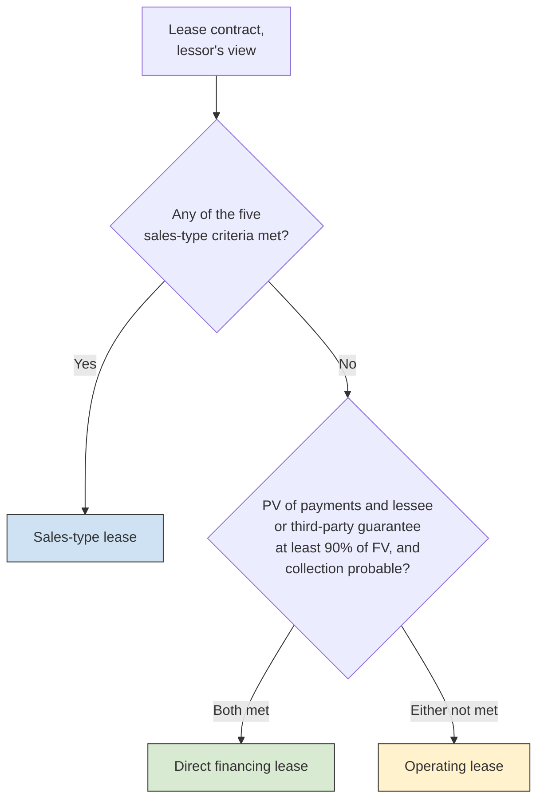
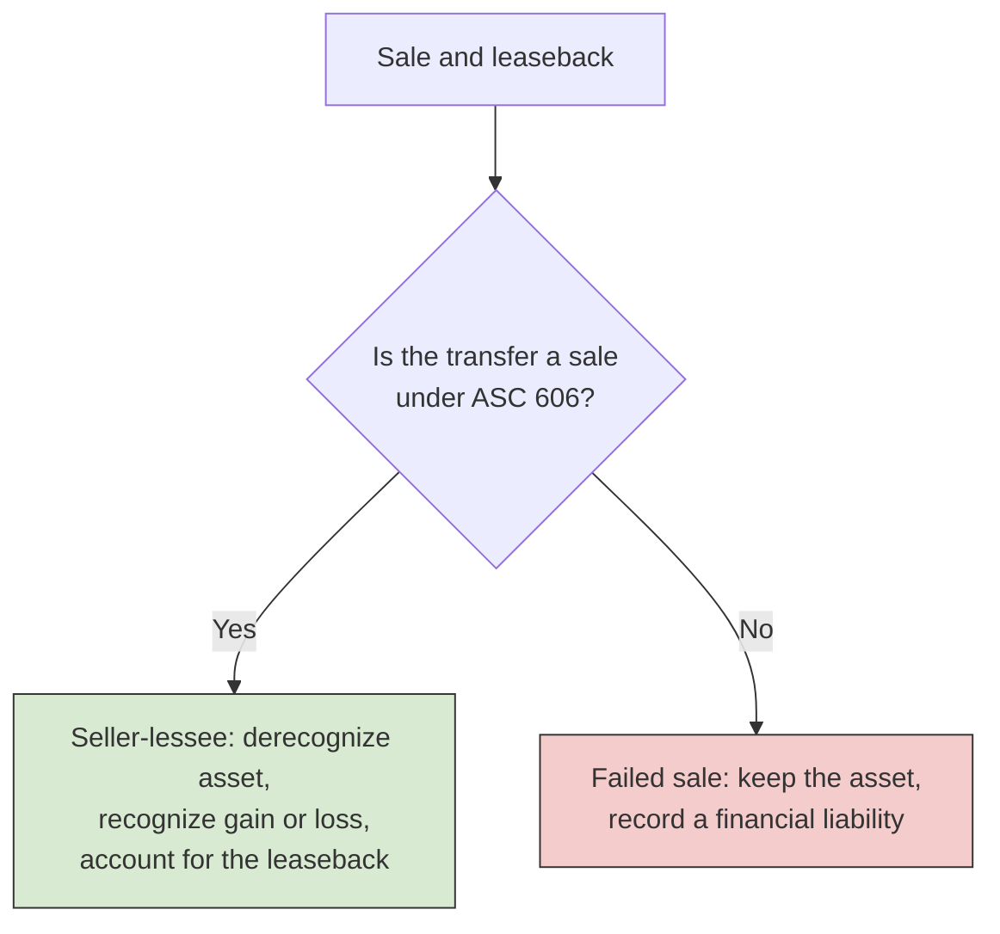

# Leases

FAR covers ASC 842 from the lessee's side: right-of-use assets, lease liabilities, and the split between finance and operating leases. BAR turns the lease around and looks at it from the **lessor's** side, and it adds two kinds of judgment: accounting for a **sale and leaseback** and reading a **lease agreement** to decide how the lessee should account for it. The 2027 BAR blueprint (Area II, Group I) asks you to identify the lessor classification criteria, calculate lessor balances and lease income and prepare the lessor's entries, prepare the seller-lessee's entries in a sale and leaseback, and interpret an agreement to prepare the lessee's entries. This chapter takes those tasks in that order.

---

## How a Lessor Classifies a Lease

A lessee has two lease categories; a lessor has three: **sales-type**, **direct financing**, and **operating**. The classification decides whether the lessor keeps the asset on its books or replaces it with a receivable, and whether it recognizes any profit at the start.

### Step 1: The Five Sales-Type Criteria

The lessor first applies the same five criteria a lessee uses. If **any one** is met, the lease is a **sales-type lease**, because the lessee has effectively bought the asset.

| Criterion | Test |
| --- | --- |
| **Ownership transfer** | Title transfers to the lessee by the end of the lease term |
| **Purchase option** | The lessee has an option to buy the asset that it is reasonably certain to exercise |
| **Lease term** | The lease term is a major part (75% or more is a common benchmark) of the asset's remaining economic life |
| **Present value** | The present value of the lease payments plus any residual value guaranteed by the **lessee** is substantially all (90% or more is a common benchmark) of the asset's fair value |
| **Specialized asset** | The asset is so specialized that it has no alternative use to the lessor at the end of the term |

Many textbooks remember these as **OWNES**: Ownership, Written purchase option, Ninety percent, Economic life, Specialized.

### Step 2: The Direct Financing Test

If none of the five is met, the lease is a **direct financing lease** if **both** of these are true:

1. The present value of the lease payments plus any residual value guaranteed by the lessee **or any third party unrelated to the lessor** is substantially all of the asset's fair value.
2. It is **probable** that the lessor will collect the lease payments plus any amount needed to satisfy a residual value guarantee.

The difference from Step 1 is the third-party guarantee. A residual value guarantee from an insurance company, for example, counts in the direct financing test but not in the sales-type test. So a lease that fails the 90% test in Step 1 can still be a direct financing lease when a third party guarantees the residual.

### Step 3: Otherwise, Operating

A lease that is neither sales-type nor direct financing is an **operating lease**. One more rule applies here: if a lease has variable payments that do not depend on an index or rate, and classifying it as sales-type or direct financing would produce a selling loss at commencement, the lessor classifies it as an operating lease.



A lease that is a finance lease to the lessee will be sales-type or, occasionally, direct financing to the lessor.

---

## Sales-Type Leases

A sales-type lease is treated much like a sale on credit. At commencement, the lessor **derecognizes** the asset, records a **net investment in the lease**, and recognizes any **selling profit or loss**.

The net investment has two parts:

- The **lease receivable**: the present value, at the rate implicit in the lease, of the lease payments, including any residual value guaranteed by the lessee or a third party.
- The **unguaranteed residual asset**: the present value of the part of the expected residual value that no one guarantees.

The selling profit is revenue minus cost of goods sold, where:

- **Revenue** is the fair value of the asset (or, if lower, the lease receivable plus any lease payments received before commencement).
- **Cost of goods sold** is the asset's carrying amount minus the unguaranteed residual asset. The unguaranteed residual is excluded from both revenue and cost because the lessor has not sold that part of the asset; it will get it back.

**Initial direct costs**, such as commissions, are expensed at commencement if the fair value differs from the carrying amount (that is, if there is a selling profit or loss). If fair value equals carrying amount, they are deferred and included in the net investment.

### Example: Bear Co. Sales-Type Lease

Bear Co. manufactures a machine at a cost of \$72,000 and leases it to Polar Inc. on January 1. The machine's fair value is \$86,590, the lease term is 5 years (equal to its economic life), payments of \$20,000 are due at the end of each year, the rate implicit in the lease is 5%, and the expected residual value is zero.

Because the lease term equals the economic life, the lease-term criterion is met and the lease is sales-type. The lease receivable is the present value of the payments:

$$
\$20{,}000 \times \frac{1 - (1.05)^{-5}}{0.05} = \$20{,}000 \times 4.32948 = \$86{,}590
$$

With no unguaranteed residual, revenue is \$86,590, cost of goods sold is \$72,000, and the selling profit is \$14,590.

```journal
Jan 1
Dr. Net Investment in Lease[a] 86,590
Cr. Machinery Inventory[a] 72,000
Cr. Selling Profit on Lease 14,590
```

Afterward, the lessor earns **interest income** on the net investment using the effective interest method. Each payment covers the interest and reduces the net investment by the rest:

```journal
Dec 31, Year 1
Dr. Cash[a] 20,000
Cr. Interest Income 4,330
Cr. Net Investment in Lease[a] 15,670
```

| Year | Beginning net investment | Interest (5%) | Payment | Reduction | Ending net investment |
| --- | ---: | ---: | ---: | ---: | ---: |
| 1 | \$86,590 | \$4,330 | \$20,000 | \$15,670 | \$70,920 |
| 2 | \$70,920 | \$3,546 | \$20,000 | \$16,454 | \$54,466 |
| 3 | \$54,466 | \$2,723 | \$20,000 | \$17,277 | \$37,189 |
| 4 | \$37,189 | \$1,859 | \$20,000 | \$18,141 | \$19,048 |
| 5 | \$19,048 | \$952 | \$20,000 | \$19,048 | \$0 |
| **Total** | | **\$13,410** | **\$100,000** | | |

Total interest income (\$13,410) is the total cash collected (\$100,000) minus the initial net investment (\$86,590). Over the lease, Bear Co. earns \$14,590 of selling profit plus \$13,410 of interest.

---

## Direct Financing Leases

A direct financing lease is accounted for like a sales-type lease, with one difference: the lessor **does not recognize a selling profit** at commencement. Any profit is deferred and included in the net investment, so it comes into income over the lease term through the interest rate. A selling **loss**, by contrast, is recognized at commencement. Initial direct costs are included in the net investment.

### Example: Bear Co. Direct Financing Lease

Bear Co. buys a delivery truck for \$50,000, its fair value, and leases it to Panda Industries on January 1 for 4 years. The truck's economic life is 8 years. Panda pays \$10,007 at the end of each year and returns the truck at the end of the lease. An insurance company unrelated to Bear Co. guarantees a residual value of \$16,000. The rate implicit in the lease is 4%.

| Test | Result |
| --- | --- |
| Ownership transfer, purchase option, specialized asset | Not met |
| Lease term: 4 / 8 = 50% | Not met |
| Present value of payments: \$10,007 × 3.62990 = \$36,324, or 73% of fair value (the third-party guarantee does not count here) | Not met |
| Direct financing: \$36,324 + PV of the guarantee (\$16,000 × 0.85480 = \$13,677) = \$50,001, or 100% of fair value; collection is probable | **Met** |

The lease is a direct financing lease. Because cost equals fair value, there is no selling profit to defer, and the net investment is \$50,000:

```journal
Jan 1
Dr. Net Investment in Lease[a] 50,000
Cr. Truck[a] 50,000
```

| Year | Beginning net investment | Interest (4%) | Payment | Reduction | Ending net investment |
| --- | ---: | ---: | ---: | ---: | ---: |
| 1 | \$50,000 | \$2,000 | \$10,007 | \$8,007 | \$41,993 |
| 2 | \$41,993 | \$1,680 | \$10,007 | \$8,327 | \$33,666 |
| 3 | \$33,666 | \$1,347 | \$10,007 | \$8,660 | \$25,006 |
| 4 | \$25,006 | \$1,001 | \$10,007 | \$9,006 | \$16,000 |
| **Total** | | **\$6,028** | **\$40,028** | | |

(Year 4 interest includes a \$1 rounding adjustment.) The Year 1 entry is:

```journal
Dec 31, Year 1
Dr. Cash[a] 10,007
Cr. Interest Income 2,000
Cr. Net Investment in Lease[a] 8,007
```

When the truck comes back at the end of Year 4, Bear Co. reclassifies the remaining net investment to the truck:

```journal
Dec 31, Year 4
Dr. Truck[a] 16,000
Cr. Net Investment in Lease[a] 16,000
```

If the truck were worth less than \$16,000, the insurer would pay Bear Co. the shortfall. Total income over the lease, \$6,028, equals the cash inflows (\$40,028 of payments plus the \$16,000 residual) minus the \$50,000 investment.

---

## Operating Leases

In an operating lease, the lessor has not given up the asset in substance, so it **keeps the asset** on its balance sheet, keeps **depreciating** it, and recognizes **lease income on a straight-line basis** over the lease term (even if the payments are uneven). Initial direct costs are deferred and expensed over the lease term. If collection of the payments is not probable, lease income is limited to the cash received.

### Example: Polar Inc. Leases Office Space

Polar Inc. owns an office building that cost \$500,000 (approximately its fair value), has a 25-year useful life, and has no salvage value. On January 1, it leases the building to Sloth Security for 5 years at \$45,000 a year, paid at year-end. The lease term is only 20% of the useful life, and the present value of the payments at 6% (\$45,000 × 4.21236 = \$189,556) is only 38% of fair value. No other criterion is met, so this is an operating lease.

Each year, Polar Inc. records rental income and depreciation. Its net margin is \$45,000 - \$20,000 = \$25,000 a year.

```journal
Dec 31, Year 1
Dr. Cash[a] 45,000
Cr. Lease Income 45,000
```

```journal
Dec 31, Year 1
Dr. Depreciation Expense 20,000
Cr. Accumulated Depreciation (Building)[ca] 20,000
```

---

## Comparing the Three Lessor Classifications

| Feature | Sales-type | Direct financing | Operating |
| --- | --- | --- | --- |
| When it applies | Any of the five criteria met | None of the five met, but PV with third-party guarantee is substantially all of FV and collection is probable | Neither |
| Underlying asset | Derecognized | Derecognized | Stays on the balance sheet and is depreciated |
| Net investment in the lease | Recognized | Recognized | None |
| Selling profit | Recognized at commencement | Deferred into the interest rate (a loss is recognized at once) | None |
| Income over the term | Interest income | Interest income, including deferred profit | Straight-line lease income, less depreciation |
| Initial direct costs | Expensed if FV differs from carrying amount; otherwise deferred | Included in the net investment | Deferred and expensed over the term |

### Practice: Classify Three Leases

Bear Co. leases three assets on January 1. None transfers ownership, has a purchase option, or is specialized.

| Asset | Facts | Classification |
| --- | --- | --- |
| Forklift | 6-year lease of a forklift with a 6-year economic life | Sales-type (lease term is the whole economic life) |
| Delivery van | 4-year lease, 10-year life; PV of payments is 73% of FV; a third party guarantees a residual that brings the PV to 98% of FV; collection probable | Direct financing |
| Office furniture | 3-year lease, 15-year life; PV of payments is 36% of FV; no guarantee | Operating |

---

## Sale and Leaseback Transactions

In a **sale and leaseback**, a company (the **seller-lessee**) sells an asset to another party (the **buyer-lessor**) and immediately leases it back. Companies do this to raise cash while keeping the use of the asset. The accounting turns on one question: did the buyer actually obtain **control** of the asset, so that the transfer is a **sale** under ASC 606?

The transfer is **not** a sale in two common situations:

- The **leaseback is a finance lease** for the seller-lessee (a sales-type lease for the buyer-lessor). In that case, the seller-lessee has kept control of the asset.
- The seller-lessee has an **option to repurchase** the asset, unless the exercise price is the asset's fair value at the time of exercise and substantially similar assets are readily available in the market.



### When the Transfer Is a Sale

If the transfer is a sale at fair value, the seller-lessee:

1. **Derecognizes** the asset and recognizes the **full gain or loss** (sale price minus carrying amount).
2. Accounts for the **leaseback** like any other lease, recording a right-of-use asset and a lease liability.

### Example: Bear Co. Sells and Leases Back Its Building

On January 1, Bear Co. sells a building with a carrying amount of \$400,000 to Kodiak Partners for \$600,000, its fair value, and leases it back for 10 years at \$72,000 a year, paid at year-end. The building's remaining useful life is 30 years, and Bear Co.'s incremental borrowing rate is 6%. Kodiak obtains title, and Bear Co. has no repurchase option.

To classify the leaseback, Bear Co. applies the lessee criteria. The lease term is 10 / 30 = 33% of the remaining life, and the present value of the payments is \$72,000 × 7.36009 = \$529,927, or 88% of fair value. Neither test is met, so the leaseback is an **operating lease**, and the transfer qualifies as a sale. The gain is \$600,000 - \$400,000 = \$200,000.

```journal
Jan 1
Dr. Cash[a] 600,000
Cr. Building[a] 400,000
Cr. Gain on Sale of Building 200,000
```

```journal
Jan 1
Dr. Right-of-Use Asset[a] 529,927
Cr. Lease Liability[l] 529,927
```

Because the leaseback is an operating lease with level payments, Bear Co. recognizes straight-line lease expense equal to the \$72,000 payment each year. (Behind that single expense, the liability accrues interest and the right-of-use asset is reduced by the difference.)

```journal
Dec 31, Year 1
Dr. Lease Expense 72,000
Cr. Cash[a] 72,000
```

### Off-Market Terms

If the sale price or the lease payments are not at market, the seller-lessee adjusts so that the gain reflects fair value:

| Situation | Adjustment |
| --- | --- |
| Sale price **above** fair value, or lease payments **above** market | The excess is **additional financing** from the buyer-lessor, recorded as a financial liability, not as gain |
| Sale price **below** fair value, or lease payments **below** market | The shortfall is a **prepayment of rent**, added to the right-of-use asset |

Always compare the sale price with fair value before computing the gain.

### When the Transfer Is Not a Sale

In a **failed sale and leaseback**, neither party records a sale or purchase. The seller-lessee keeps the asset on its books, keeps depreciating it, and records the cash received as a **financial liability**:

```journal
Jan 1
Dr. Cash[a] 600,000
Cr. Financial Liability[l] 600,000
```

Its "lease" payments are then split between interest expense and repayment of the liability, like payments on a loan.

---

## Interpreting a Lease Agreement (Lessee)

The final BAR task is to read an agreement and decide how the lessee should account for it. Five questions organize the analysis:

1. **Is there a lease?** The contract must convey the right to control the use of an **identified asset** for a period of time. The customer must have the right to obtain substantially all of the asset's economic benefits and the right to direct its use. If the supplier can substitute another asset whenever it wants and would benefit from doing so, there is no identified asset.
2. **What are the components?** Separate **lease components** (the right to use the asset) from **nonlease components** (services such as maintenance), allocating the consideration on a relative standalone price basis. A lessee may instead elect, by class of asset, to treat each lease and its related services as a single lease component.
3. **What is the lease term?** The noncancelable period, plus periods covered by an option to **extend** that the lessee is reasonably certain to exercise, plus periods covered by an option to **terminate** that the lessee is reasonably certain **not** to exercise.
4. **What are the lease payments?** Fixed payments (less lease incentives), variable payments that depend on an **index or rate** (measured using the index or rate at commencement), the exercise price of a purchase option the lessee is reasonably certain to exercise, termination penalties if the term reflects termination, and amounts probable of being owed under a residual value guarantee. Variable payments based on **usage or performance**, such as a percentage of sales, are excluded and expensed as incurred.
5. **How is it classified and measured?** Apply the five criteria (finance or operating for the lessee), then measure the lease liability at the present value of the lease payments, using the rate implicit in the lease if readily determinable or otherwise the incremental borrowing rate.

### Example: Bear Co. Leases a Milling Machine

Bear Co. signs a contract with Grizzly Inc. for a CNC milling machine. The contract's key terms:

| Term | Detail |
| --- | --- |
| Asset | CNC milling machine, serial number 4892 |
| Payments, end of each year | \$96,000 for the machine plus \$14,400 for maintenance |
| Noncancelable term | 7 years |
| Renewal option | 3 more years at the same payments; Bear Co. is reasonably certain to renew |
| Machine fair value | \$700,000 |
| Machine economic life | 12 years |
| At end of term | Machine returns to Grizzly; no purchase option |
| Bear Co.'s incremental borrowing rate | 7% (implicit rate not readily determinable) |

**Is there a lease?** Yes. The machine is identified by serial number, and Bear Co. directs its use and gets all of its output.

**Components.** Bear Co. separates the components. The \$96,000 is the lease payment; the \$14,400 for maintenance is expensed as the service is received.

**Lease term.** 7 years plus the 3-year renewal Bear Co. is reasonably certain to exercise, for **10 years**.

**Classification.** The lease term is 10 / 12 = 83% of the economic life, so the lease-term criterion is met and the lease is a **finance lease**. (The present value test is met as well.)

**Measurement.**

$$
\text{Lease liability} = \$96{,}000 \times \frac{1 - (1.07)^{-10}}{0.07} = \$96{,}000 \times 7.02358 = \$674{,}264
$$

```journal
Jan 1, Year 1
Dr. Right-of-Use Asset[a] 674,264
Cr. Lease Liability[l] 674,264
```

At the end of Year 1, interest is \$674,264 × 7% = \$47,198, so the \$96,000 payment reduces the liability by \$48,802. The right-of-use asset is amortized straight-line over the 10-year lease term (shorter than the 12-year life, since ownership does not transfer): \$674,264 / 10 = \$67,426.

```journal
Dec 31, Year 1
Dr. Interest Expense 47,198
Dr. Lease Liability[l] 48,802
Cr. Cash[a] 96,000
```

```journal
Dec 31, Year 1
Dr. Amortization Expense (Right-of-Use Asset) 67,426
Cr. Right-of-Use Asset[a] 67,426
```

Renewal and termination options are where agreements most often change the answer. Measured over the 7-year noncancelable term alone, this lease would cover only 58% of the machine's life; including the renewal that Bear Co. is reasonably certain to exercise turns it into a finance lease.

---

## Summary

| Task | Key points |
| --- | --- |
| Classify a lease as lessor | Any of five criteria: sales-type. Otherwise, third-party guarantee test plus probable collection: direct financing. Otherwise: operating |
| Sales-type lease | Derecognize the asset; net investment = lease receivable + unguaranteed residual; selling profit at commencement; interest income after |
| Direct financing lease | Same, but selling profit is deferred into the interest rate |
| Operating lease | Keep and depreciate the asset; straight-line lease income |
| Sale and leaseback | A sale only if control transfers (no finance leaseback, no disqualifying repurchase option); then full gain plus leaseback; otherwise a financing |
| Off-market terms | Price above fair value: additional financing. Price below fair value: prepaid rent |
| Lessee analysis of an agreement | Identified asset and control; components; term with reasonably certain options; payments; classify and measure |
