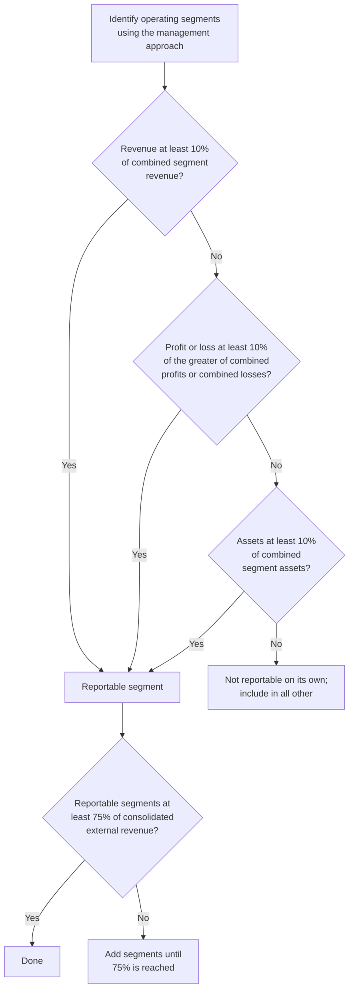

# Public Company Reporting Topics

A company whose securities trade publicly reports not only under GAAP but also under the rules of the Securities and Exchange Commission (SEC). Those rules decide what goes into an annual report, how the financial statements are formatted, how the data are tagged for computers to read, and how a company breaks its results into segments. The 2027 BAR blueprint (Area II, Group J) asks you to recall the requirements of **Regulation S-X** and **Regulation S-K**, the purpose and key characteristics of **XBRL**, the criteria for identifying **reportable segments**, and the required **segment disclosures**. All four are "recall" tasks, so this chapter focuses on the rules and the reasoning behind them, with one worked example of the segment tests.

---

## Regulation S-X: The Financial Statements

**Regulation S-X** sets the **form and content of the financial statements** a company files with the SEC, including those in registration statements and in the annual report on Form 10-K. One way to remember the split between the two regulations: S-X governs the numbers (the financial statements, their notes, and the periods presented), and S-K governs the words around them.

The articles most worth knowing:

| Article | What it covers |
| --- | --- |
| Article 2 | Qualifications and reports of accountants, including auditor independence |
| Article 3 | Which financial statements are required and for which periods |
| Article 3A | Consolidated and combined financial statements |
| Article 4 | Rules of general application: form, order, and terminology |
| Article 5 | Line items for commercial and industrial companies |
| Article 8 | Financial statements of smaller reporting companies |
| Article 10 | Interim financial statements (as in Form 10-Q) |
| Article 11 | Pro forma financial information, for example after a significant acquisition |
| Article 12 | Supporting schedules, such as valuation and qualifying accounts |

In an annual filing, a company generally presents:

- **Balance sheets** as of the end of the two most recent fiscal years, and
- **Statements of income, comprehensive income, cash flows, and changes in stockholders' equity** for each of the three most recent fiscal years.

A smaller reporting company, under Article 8, may present two years of each of these statements instead of three.

---

## Regulation S-K: Everything Around the Financial Statements

**Regulation S-K** sets the requirements for the **nonfinancial-statement** parts of SEC filings: the business description, risk factors, management's discussion and analysis, executive compensation, governance, and similar items. These disclosures give context to the numbers.

| Item | Topic | What it requires |
| --- | --- | --- |
| 101 | Description of business | The business and its development, principal products and services, competition, and human capital |
| 103 | Legal proceedings | Material pending legal proceedings |
| 105 | Risk factors | The material factors that make an investment speculative or risky |
| 106 | Cybersecurity | Processes for assessing and managing cybersecurity risks, the board's oversight, and management's role |
| 201 | Market for common equity | Where the stock trades, holders, and dividends |
| 303 | MD&A | Management's discussion and analysis of financial condition and results of operations |
| 305 | Market risk | Quantitative and qualitative disclosures about market risk (Form 10-K Item 7A) |
| 402 | Executive compensation | Pay of the named executive officers and directors |
| 404 | Related-person transactions | Transactions with directors, officers, and major shareholders |
| 407 | Corporate governance | Director independence, board committees, and the audit committee financial expert |

Two recent changes are worth knowing. Item 106, adopted in 2023, added annual cybersecurity disclosures to Form 10-K, together with a new Form 8-K Item 1.05 for material cybersecurity incidents. And the SEC's 2020 amendments **eliminated** Item 301 (selected financial data), so older materials that list a five-year selected data table are out of date.

### MD&A (Item 303)

**MD&A** is management's explanation of the financial statements, written so that investors can see the company "through the eyes of management." Its objective is to give the information needed to understand the company's financial condition, changes in it, and results of operations, with emphasis on known trends, events, and uncertainties that are reasonably likely to affect the future. MD&A covers:

- **Liquidity and capital resources**, including material cash requirements from known contractual and other obligations. Off-balance-sheet arrangements are discussed here, as part of liquidity and capital resources, rather than in a separate section.
- **Results of operations**, including significant components of revenue and expense, unusual events, and the reasons for material changes.
- **Critical accounting estimates**: estimates that involve a significant level of uncertainty and have had or are reasonably likely to have a material effect, with why they are uncertain and how sensitive they are.

Do not confuse SEC MD&A with the MD&A that GASB requires state and local governments to present as required supplementary information. The two serve similar purposes but come from different frameworks.

---

## XBRL

**XBRL (eXtensible Business Reporting Language)** is an open, XML-based standard for tagging business and financial data so software can read it. The SEC requires public companies to tag the financial statements, notes, and cover page of their filings, which makes data easier to find, compare across companies, and analyze, and reduces the rekeying of numbers by hand.

The SEC requires **Inline XBRL**, in which the tags are embedded directly in the HTML filing itself. A single document is therefore readable by people in a browser and by machines, instead of a human-readable filing plus a separate XBRL exhibit.

Tags come from a **taxonomy**, a dictionary of standardized elements. For financial statements, filers use the **U.S. GAAP Financial Reporting Taxonomy**, maintained by the FASB. A taxonomy has several kinds of information:

| Component | What it does |
| --- | --- |
| Elements | Individual concepts, such as Revenues or Assets |
| Labels | Human-readable names for each element |
| References | Links from an element to the authoritative literature, such as the ASC paragraph |
| Calculation relationships | How elements add up, such as current assets summing to total current assets |
| Presentation relationships | How elements are ordered and grouped for display |
| Dimensions | Axes for breaking data down, such as by segment or geographic area |

When no standard element fits a concept, a company may create an **extension element**, but it should use standard elements whenever possible so its data stay comparable with other filers'. XBRL tagging is not covered by the auditor's opinion on the financial statements.

---

## Segment Reporting (ASC 280)

Investors in a diversified company want to know how each of its businesses is doing. **ASC 280** requires public entities to report information about their **operating segments**, in annual and interim statements, so readers can see the company the way its management sees it.

### The Management Approach

ASC 280 uses the **management approach**: segments follow the way the **chief operating decision maker (CODM)**, the person or group that allocates resources and assesses performance (often the CEO or an executive committee), organizes the business internally.

An **operating segment** is a component of a public entity that has all three of these characteristics:

1. It engages in business activities from which it may earn revenues and incur expenses (including revenues and expenses from transactions with other parts of the same company).
2. Its operating results are **regularly reviewed by the CODM** to make decisions about resources and assess performance.
3. **Discrete financial information** is available for it.

A corporate headquarters or a functional department that earns no revenue, or earns only incidental revenue, is not an operating segment.

### Aggregation

Before applying the quantitative tests, two or more operating segments **may be aggregated** into one if aggregation is consistent with the objective of ASC 280, the segments have **similar economic characteristics** (such as similar long-term gross margins), and they are similar in **each** of the following:

1. The nature of the products and services
2. The nature of the production processes
3. The type or class of customer
4. The methods used to distribute products or provide services
5. The nature of the regulatory environment, if applicable

For example, if Bear Co.'s East Region and West Region both sell commercial insurance to mid-sized businesses through independent agents, under the same regulations and with similar margins, Bear Co. may report them as one "Commercial Insurance" segment.

### The Quantitative Tests

An operating segment is a **reportable segment**, and must be reported separately, if it meets **any one** of three 10% tests:

| Test | The segment's... | ...is at least 10% of |
| --- | --- | --- |
| **Revenue** | Revenue, including intersegment sales | The combined revenue of all operating segments |
| **Profit or loss** | Profit or loss, in absolute amount | The greater, in absolute amount, of (a) the combined profit of all segments that reported a profit, or (b) the combined loss of all segments that reported a loss |
| **Assets** | Assets | The combined assets of all operating segments |

Then a second check applies: the reportable segments together must account for at least **75% of consolidated external revenue**. If they do not, the company adds more operating segments as reportable, even ones that fail every 10% test, until the 75% level is reached. Operating segments that are not reportable are combined and shown as **"all other."** As a practical matter, once a company has more than about 10 reportable segments, it should consider whether the information has become too detailed.

### Example: Bear Co.'s Five Segments

Bear Co. has five operating segments. All revenue is from external customers.

| Segment | Revenue | Profit (loss) | Assets |
| --- | ---: | ---: | ---: |
| A | \$400,000 | \$120,000 | \$2,000,000 |
| B | \$250,000 | \$60,000 | \$1,500,000 |
| C | \$180,000 | \$20,000 | \$800,000 |
| D | \$120,000 | (\$150,000) | \$500,000 |
| E | \$50,000 | (\$10,000) | \$200,000 |
| **Total** | **\$1,000,000** | **\$40,000** | **\$5,000,000** |

The three thresholds are:

- **Revenue:** 10% × \$1,000,000 = \$100,000.
- **Profit or loss:** The profitable segments earned \$200,000 in total (A, B, and C), and the loss segments lost \$160,000 in total (D and E). The greater is \$200,000, so the threshold is \$20,000. Net segment profit (\$40,000) plays no role.
- **Assets:** 10% × \$5,000,000 = \$500,000.

| Segment | Revenue at least \$100,000? | Profit or loss at least \$20,000? | Assets at least \$500,000? | Reportable? |
| --- | --- | --- | --- | --- |
| A | Yes | Yes | Yes | Yes |
| B | Yes | Yes | Yes | Yes |
| C | Yes | Yes (exactly \$20,000) | Yes | Yes |
| D | Yes | Yes (\$150,000 loss) | Yes (exactly \$500,000) | Yes |
| E | No | No | No | No |

Segments A through D are reportable, and E goes in "all other." The 75% check is met: the four reportable segments have \$950,000 of the \$1,000,000 of external revenue, or 95%.

The most common mistake on this test is to compare each segment with 10% of **net** profit. The comparison base is the larger of total profits or total losses, each taken separately.

---

## Required Segment Disclosures

### Updated Requirements (ASU 2023-07)

ASU 2023-07, eligible for testing since July 1, 2024, expanded segment disclosures, mainly so that investors can see each segment's major expenses. The 10% tests, the 75% test, and the aggregation criteria did not change. The main additions:

- **Significant segment expenses.** For each reportable segment, the company discloses the significant expense categories and amounts that are **regularly provided to the CODM** and included in segment profit or loss.
- **Other segment items.** For each reportable segment, the company discloses the difference between segment revenue, less the significant expenses, and segment profit or loss, with a qualitative description of what it includes.
- **Interim reporting.** All the annual disclosures about segment profit or loss and assets are now required in **interim** periods too, and the significant expense and other segment item disclosures apply annually and in interim periods.
- **More than one profit measure.** If the CODM uses more than one measure of segment profit or loss, the company may report more than one, but at least one must be the measure **most consistent with GAAP** as applied in the consolidated statements.
- **The CODM.** The company discloses the CODM's **title and position** and explains how the CODM uses the reported measures to assess performance and allocate resources.
- **Single-segment entities.** A public entity with only **one** reportable segment must provide all of the segment disclosures, including the new ones.

For example, Polar Inc.'s CODM, its chief executive officer, receives monthly reports for the Software segment showing employee compensation and cloud hosting costs separately. Its segment note for Software might show:

| Software segment | Amount |
| --- | ---: |
| Revenue | \$900,000 |
| Less: employee compensation | (400,000) |
| Less: cloud hosting | (150,000) |
| Less: other segment items (rent, travel, and other operating costs) | (50,000) |
| **Segment operating income** | **\$300,000** |

### The Full Set of Disclosures

| Category | What is disclosed |
| --- | --- |
| **General information** | The factors used to identify reportable segments (including whether segments have been aggregated), the types of products and services each segment sells, and the title and position of the CODM |
| **Profit or loss and assets** | A measure of profit or loss and total assets for each reportable segment. Also, when included in the measure reviewed by the CODM or otherwise regularly provided to the CODM: revenues from external customers, intersegment revenues, interest revenue and expense, depreciation and amortization, income tax expense, equity in the income of equity method investees, and significant noncash items. Plus the significant expense categories and other segment items described above |
| **Measurement** | How segment profit or loss and assets are measured, and how the CODM uses the measures |
| **Reconciliations** | Segment totals reconciled to consolidated revenue, profit or loss (before income taxes), assets, and other significant items |
| **Entity-wide disclosures** | Revenue by product or service; revenue and long-lived assets by geographic area (domestic and foreign); and **major customers** |

The **major customer** disclosure applies when revenue from a single external customer is **10% or more** of total revenue. The company discloses that fact, the amount of revenue from each such customer, and the segment or segments reporting it, but it does not have to name the customer. A group of entities under common control counts as one customer, and so does each level of government (federal, state, local, or foreign). So if Polar Inc. earns 12% of its revenue from various agencies of the federal government, it must disclose that the federal government is a major customer, the amount, and which segments report the sales.

---

## Summary

| Topic | Key point |
| --- | --- |
| Regulation S-X | Form, content, and periods of the financial statements: two years of balance sheets, three years of the other statements (two for smaller reporting companies) |
| Regulation S-K | Nonfinancial-statement disclosures: business, risk factors, cybersecurity (Item 106), MD&A, market risk, compensation, governance |
| MD&A | Liquidity and capital resources, results of operations, and critical accounting estimates, through the eyes of management |
| XBRL | XML-based tagging; Inline XBRL makes one document readable by people and machines; FASB maintains the U.S. GAAP taxonomy |
| Operating segment | Earns revenues and incurs expenses, reviewed regularly by the CODM, with discrete information |
| Aggregation | Similar economics and similar in all five qualitative areas |
| 10% tests | Revenue, absolute profit or loss (against the greater of total profits or total losses), and assets; meeting any one makes a segment reportable |
| 75% test | Reportable segments must cover at least 75% of consolidated external revenue |
| ASU 2023-07 | Significant segment expenses, other segment items, interim disclosures, CODM title, and full disclosures for single-segment entities |
| Major customer | 10% or more of revenue; disclose the amount and segment, not the name |
