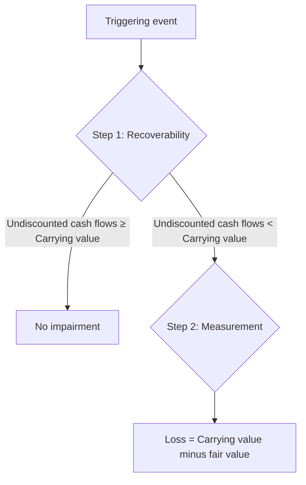
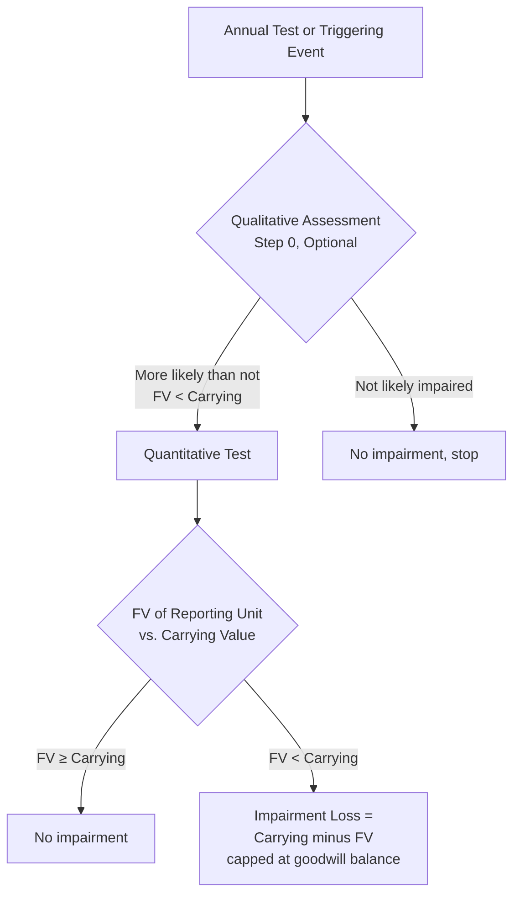

# Intangible Assets

Intangible assets are **long-lived assets without physical substance** that represent legal rights or competitive advantages. Their accounting depends on whether the useful life is **finite** or **indefinite**: finite-life intangibles are amortized, and indefinite-life intangibles are not.

## Types of Intangible Assets

| Intangible                 | Description                                                                                   | Typical Life                     |
| -------------------------- | --------------------------------------------------------------------------------------------- | -------------------------------- |
| **Patent**                 | Exclusive right to manufacture, use, or sell an invention                                     | Legal: 20 years                  |
| **Copyright**              | Exclusive right to reproduce and sell artistic or literary works                              | Legal: creator's life + 70 years |
| **Trademark / Trade name** | Symbol, word, or phrase identifying a product or company                                      | Indefinite (renewable)           |
| **Goodwill**               | Excess of purchase price over fair value of net identifiable assets in a business combination | Indefinite                       |
| **Franchise**              | Right granted to operate a business under a franchisor's brand                                | Per contract term                |

:::info

The CPA exam focuses on how each type is **measured**, **amortized** (or not), and **tested for impairment**.

:::

## Purchased vs. Internally Developed Intangibles

| Source                                                          | Treatment                                                                |
| --------------------------------------------------------------- | ------------------------------------------------------------------------ |
| **Purchased** (from a third party or in a business combination) | Capitalize at cost (or fair value in a combination)                      |
| **Internally developed**                                        | Generally **expensed as incurred**, including research and development (R&D), advertising, and employee training |

Direct costs to obtain legal protection for an internally developed intangible, such as legal and registration fees for a patent, are capitalized.

:::warning

Under U.S. generally accepted accounting principles (GAAP), internally generated **goodwill**, **brands**, and **customer lists** are **never** capitalized.

:::

### Example: Bear Co. Purchases a Patent

Bear Co. acquires a patent from an independent inventor for \$120,000 and pays \$5,000 in legal fees to register the patent.

```journal
Dr. Patent                           125,000
    Cr. Cash                             125,000
```

The \$125,000 total cost is amortized over the **shorter** of the patent's remaining legal life or its expected economic life.

## Finite Life Intangibles: Amortization

Finite life intangibles are amortized over the **shorter of** their economic life or legal life. Use the **straight-line method** unless another pattern better reflects how the benefits are consumed.

$$
\text{Amortization Period} = \min(\text{Economic Life},\; \text{Legal Life})
$$

### Example: Polar Co.

Polar Co. purchases a patent for \$125,000 with 16 years remaining on its legal life. Polar estimates the technology will be useful for only 8 years, so the amortization period is 8 years.

$$
\text{Annual Amortization} = \frac{\$125{,}000}{8} = \$15{,}625
$$

```journal
Dr. Amortization expense             15,625
    Cr. Accumulated amortization (patent)  15,625
```

:::tip

Intangibles usually have **no residual value**, so the entire cost is amortized.

:::

## Impairment of Finite Life Intangibles

Finite life intangibles follow the **same two-step test** as property, plant, and equipment (PP&E) under Accounting Standards Codification (ASC) 360:



**Example: Grizzly Inc.**

Grizzly Inc. holds a patent with a carrying value of \$80,000. Due to a competitor's breakthrough, expected undiscounted future cash flows are \$60,000 and fair value is \$45,000.

- **Step 1:** \$60,000 < \$80,000, so the patent is impaired.
- **Step 2:** Loss = \$80,000 - \$45,000 = **\$35,000**

```journal
Dr. Impairment loss                   35,000
    Cr. Accumulated amortization (patent)  35,000
```

:::danger

Under U.S. GAAP, impairment losses on intangibles held for use are **never reversed**.

:::

## Indefinite Life Intangibles

Indefinite life intangibles are **not amortized**. Instead, they are tested for impairment **at least annually**, and more often if a triggering event occurs. These intangibles have **no foreseeable limit** on the period over which they generate cash flows:

- **Goodwill**: arises only in business combinations
- **Certain trademarks**: when the entity intends to renew indefinitely and has the ability to do so
- **Federal Communications Commission (FCC) broadcast licenses**: renewable at negligible cost

For indefinite life intangibles other than goodwill, the impairment test is a one-step comparison. If carrying value exceeds fair value, recognize a loss for the excess. An entity may first perform an optional qualitative assessment. Each period, the entity also reassesses whether the life is still indefinite; if it becomes finite, amortization begins.

## Goodwill: Recognition and Impairment

### Recognition

Goodwill arises in a **business combination** when the purchase price exceeds the fair value of the net identifiable assets acquired.

$$
\text{Goodwill} = \text{Purchase Price} - \text{Fair Value of Net Identifiable Assets}
$$

**Example: Panda Industries acquires Kodiak Partners.**

| Item | Amount |
|------|--------|
| Purchase price | \$2,000,000 |
| Fair value of identifiable assets | \$2,800,000 |
| Fair value of liabilities assumed | (\$1,200,000) |
| Fair value of net identifiable assets | \$1,600,000 |
| **Goodwill** | **\$400,000** |

```journal
Dr. Identifiable assets           2,800,000
Dr. Goodwill                        400,000
    Cr. Liabilities assumed           1,200,000
    Cr. Cash                          2,000,000
```

### Goodwill Impairment Testing (ASC 350)

Goodwill is tested at the **reporting unit** level at least annually, and more often if a triggering event occurs. An entity may first perform an **optional qualitative assessment** (Step 0) to decide whether a quantitative test is needed.



**Quantitative one-step test** (FV = fair value; RU = reporting unit):

$$
\text{Impairment Loss} = \text{Carrying Value of RU} - \text{Fair Value of RU}
$$

The loss is **capped** at the amount of goodwill allocated to the reporting unit. Goodwill cannot go below zero.

### Example: Cub Entertainment

Cub Entertainment's streaming division (a reporting unit) has:

- Carrying value: \$5,000,000 (including goodwill of \$800,000)
- Fair value: \$4,500,000

$$
\text{Impairment} = \$5{,}000{,}000 - \$4{,}500{,}000 = \$500{,}000
$$

Because \$500,000 is less than the \$800,000 goodwill balance, the full \$500,000 is recognized as a goodwill impairment loss.

```journal
Dr. Goodwill impairment loss         500,000
    Cr. Goodwill                         500,000
```

:::warning

Goodwill impairment losses are **never reversed** under U.S. GAAP.

:::

:::note

Private companies may elect an accounting alternative that amortizes goodwill on a straight-line basis over 10 years, or over a shorter period if the entity shows that a shorter useful life is more appropriate.

:::

## Purchased Software

Software purchased or licensed from a third party for internal use or for sale is recognized as an **intangible asset** and amortized over the shorter of its legal or economic useful life.

### Software Developed for Sale or Lease

Under ASC 985-20, costs are accounted for in stages:

| Phase | Treatment |
|-------|-----------|
| **Before technological feasibility** | Expense as R&D |
| **After technological feasibility, before general release** | **Capitalize** |
| **After general release** | Inventory the costs of duplicating and packaging the software; expense maintenance and customer support as incurred |

Annual amortization of capitalized software costs is the **greater of**:

1. Straight-line amortization over the remaining economic life
2. The revenue-based ratio (current revenue ÷ total expected revenue) times capitalized costs

At each balance sheet date, unamortized capitalized costs that exceed the product's net realizable value (NRV) are written down to NRV.

### Example: Sloth Security

Sloth Security capitalizes \$300,000 in software development costs after establishing technological feasibility. The software has an estimated economic life of 3 years and is expected to generate total revenue of \$1,500,000. Year 1 revenue is \$600,000.

- Straight-line: \$300,000 ÷ 3 = **\$100,000**
- Revenue-based: (\$600,000 ÷ \$1,500,000) × \$300,000 = **\$120,000**

Amortization is the greater of the two, **\$120,000**.

```journal
Dr. Amortization expense            120,000
    Cr. Accumulated amortization (software)  120,000
```

## Cloud Computing Arrangements (CCA)

Under Accounting Standards Update (ASU) 2018-15, a customer in a cloud computing **hosting arrangement** that is a service contract (the customer does **not** control the software) capitalizes certain implementation costs.

| Phase | Treatment |
|-------|-----------|
| **Preliminary project stage** | Expense |
| **Application development stage** | **Capitalize** |
| **Post-implementation stage** | Expense |

Capitalized costs are presented as a **prepaid asset** (not an intangible) and amortized over the term of the hosting arrangement.

:::note

This treatment mirrors the guidance for **internal-use software** (ASC 350-40), which uses the same three-stage model.

:::

## Franchise Accounting: Franchisee

When a franchisee pays an initial franchise fee, it records an **intangible asset** at the **present value** of the payments and amortizes it over the period of expected benefit.

### Example: Bear Co. (Franchisee)

Bear Co. acquires a franchise from a national chain. The initial fee is \$50,000, payable \$10,000 at signing and \$10,000 per year for four years. The appropriate discount rate is 8%.

$$
\text{PV of annuity} = \$10{,}000 \times \text{PV factor}_{4, 8\%} = \$10{,}000 \times 3.3121 = \$33{,}121
$$

$$
\text{Total franchise cost} = \$10{,}000 + \$33{,}121 = \$43{,}121
$$

```journal
Dr. Franchise intangible asset        43,121
Dr. Discount on note payable           6,879
    Cr. Cash                              10,000
    Cr. Note payable                      40,000
```

The franchise asset is amortized over the **franchise agreement term** (for example, 20 years):

$$
\text{Annual amortization} = \frac{\$43{,}121}{20} = \$2{,}156
$$

```journal
Dr. Amortization expense              2,156
    Cr. Accumulated amortization (franchise)  2,156
```

## Start-Up Costs

Under ASC 720, start-up costs (including organization costs) are **expensed as incurred** for financial reporting purposes.

**Example: Kodiak Partners incurs \$25,000 in organization costs.**

```journal
Dr. Start-up costs expense            25,000
    Cr. Cash                              25,000
```

:::tip

For federal income tax purposes, a business may deduct up to \$5,000 of start-up costs (subject to a phase-out) and amortize the rest over 15 years. For financial reporting, which FAR tests, start-up costs are expensed as incurred.

:::

## Research and Development (R&D) Costs

Under ASC 730, R&D costs are **expensed as incurred**. This includes:

- Salaries of R&D personnel
- Materials and supplies consumed in R&D
- The full cost of equipment and facilities that have no alternative future use
- Depreciation of R&D equipment that has alternative future uses
- Contract R&D services performed by others
- A reasonable allocation of indirect costs

### Exceptions to Immediate Expensing

| Exception                                              | Treatment                                                                   |
| ------------------------------------------------------ | --------------------------------------------------------------------------- |
| R&D equipment with **alternative future use**          | Capitalize and depreciate (the depreciation is R&D expense)                 |
| Software development (after technological feasibility) | Capitalize per ASC 985-20                                                   |
| In-process R&D acquired in a **business combination** | Capitalize at fair value as an indefinite-lived intangible until the project is completed (then amortize) or abandoned (then write off) |

:::note

In-process R&D acquired in an **asset acquisition** (not a business combination) is expensed at acquisition unless it has an alternative future use.

:::

**Example: Grizzly Inc. R&D activities.** Grizzly pays \$90,000 for R&D salaries and supplies, records \$30,000 of depreciation on lab equipment that has alternative future uses, and accrues \$30,000 owed for contract research.

```journal
Dr. Research and development expense  150,000
    Cr. Cash                              90,000
    Cr. Accumulated depreciation (equipment)  30,000
    Cr. Accrued liabilities               30,000
```

:::warning

**Materials, equipment, and facilities** acquired for R&D with **no alternative future use** are expensed at acquisition. They are not capitalized as assets.

:::

## Crypto Assets

A **crypto asset** (such as bitcoin or ether) is a digital asset recorded on a distributed ledger (blockchain). Crypto assets are **intangible assets** because they are not cash, financial instruments, or tangible property. Crypto assets within the scope of ASC 350-60 are measured at **fair value**.

### Scope of ASC 350-60

A crypto asset is within the scope of ASC 350-60 only when it meets **all** of the following conditions:

1. It meets the definition of an intangible asset under ASC 350.
2. It does **not** provide the holder with enforceable rights to or claims on underlying goods, services, or other assets.
3. It is created or resides on a distributed ledger based on blockchain or similar technology.
4. It is secured through cryptography.
5. It is fungible.
6. It is **not** created or issued by the reporting entity or its related parties.

### Measurement

Crypto assets within the scope of ASC 350-60 are measured at **fair value each reporting period**, with changes in fair value recognized in **net income**.

**Example:** Bear Co. holds 5 bitcoin (BTC) purchased at \$30,000 each. At year-end, the fair value is \$35,000 per BTC.

$$
\text{Unrealized gain} = 5 \times (\$35{,}000 - \$30{,}000) = \$25{,}000
$$

```journal
Dec 31
Dr. Crypto assets[a] 25,000
    Cr. Unrealized gain on crypto assets 25,000
```

:::tip[Exam Tip]

Qualifying crypto assets are remeasured to fair value every period through net income. A crypto asset that does **not** meet all six conditions, such as a non-fungible token (NFT), follows the general intangible asset guidance: it is carried at cost less impairment and, if indefinite-lived, tested for impairment at least annually.

:::

---

## Summary

| Category                                    | Amortization                   | Impairment Test                            |
| ------------------------------------------- | ------------------------------ | ------------------------------------------ |
| Finite life intangible                      | Shorter of legal/economic life | Two-step (same as PP&E)                    |
| Indefinite life intangible (excl. goodwill) | None                           | Compare carrying value to fair value at least annually |
| Goodwill                                    | None (private company alternative: up to 10 years) | Optional qualitative screen, then one-step quantitative test |
| R&D costs                                   | N/A (expensed as incurred)     | N/A                                        |
| Start-up costs                              | N/A (expensed as incurred)     | N/A                                        |
| Capitalized software (for sale)             | Greater of straight-line or revenue-based | Write down to NRV                |
| Crypto assets (qualifying)                  | None (fair value through net income) | N/A (remeasured to fair value each period) |

:::info

The most important distinction is between **finite** and **indefinite** life intangibles. It determines whether you amortize and which impairment model applies. Qualifying crypto assets are the exception: they are remeasured to fair value through net income each period.

:::
