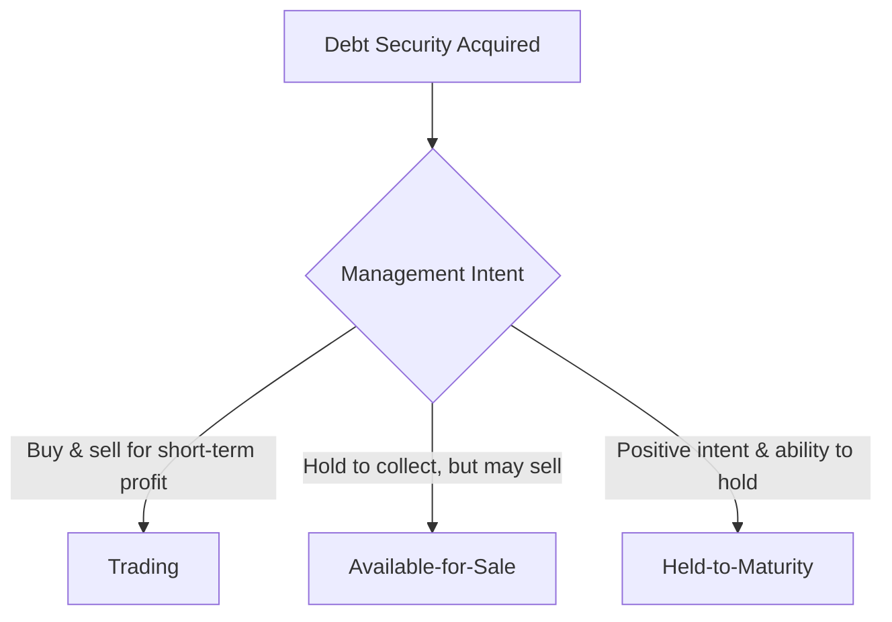
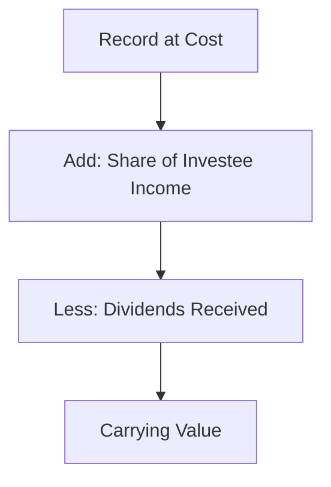

# Investments

This chapter covers the accounting for financial instruments, including **debt securities**, **equity securities**, and **equity method investments**. Classification drives measurement: the category an investment falls into determines its balance sheet value and its effect on income.

## Financial Instruments Overview

A **financial instrument** is any contract that creates a financial asset for one entity and a financial liability (or equity instrument) for another.

| Category | Examples |
|----------|---------|
| **Financial assets** | Cash, receivables, debt securities, equity securities |
| **Financial liabilities** | Accounts payable, bonds payable, notes payable |

## Debt Securities

Debt securities are instruments representing a creditor relationship (e.g., government bonds, corporate bonds, commercial paper). Under Accounting Standards Codification (ASC) 320, debt investments are classified into **three categories** based on management's intent and ability.



### Trading Securities

- Reported at **fair value** on the balance sheet.
- **Unrealized gains and losses** are recognized in **net income** each period.
- Classified as **current assets**.

**Example: Bear Co. purchases bonds for trading purposes:**

```journal
Dr. Investment in trading securities   50,000
    Cr. Cash                               50,000
```

**At year-end, fair value increases to \$53,000:**

```journal
Dr. Investment in trading securities    3,000
    Cr. Unrealized holding gain (net income)    3,000
```

### Available-for-Sale (AFS) Securities

- Reported at **fair value** on the balance sheet.
- **Credit losses** are recognized through an allowance charged to net income (ASC 326-30). The allowance is limited to the amount by which fair value is below amortized cost.
- **Non-credit** unrealized gains and losses are reported in **other comprehensive income (OCI)**. They are the "U" in the PUFI mnemonic for OCI items: **P**ension adjustments, **U**nrealized gains and losses on AFS debt securities and cash flow hedges, **F**oreign currency translation, and **I**nstrument-specific credit risk.

**Example: Polar Co. purchases AFS bonds at par (\$100,000):**

```journal
Dr. Investment in AFS securities      100,000
    Cr. Cash                              100,000
```

**At year-end, fair value drops to \$92,000, and \$5,000 of the decline is a credit loss:**

```journal
Dr. Credit loss expense                 5,000
    Cr. Allowance for credit losses (AFS)   5,000
```

```journal
Dr. Unrealized loss on AFS (OCI)       3,000
    Cr. Investment in AFS securities        3,000
```

:::tip

The total decline is \$8,000. The credit portion (\$5,000) flows through the **income statement**. The remaining \$3,000 goes to **OCI** and accumulates in equity as accumulated other comprehensive income (AOCI).

:::

### Held-to-Maturity (HTM) Securities

- Reported at **amortized cost** on the balance sheet.
- Any premium or discount is amortized over the life of the security using the **effective interest method**.
- Under the current expected credit loss (CECL) model (ASC 326-20), an **allowance for lifetime expected credit losses** is recorded from the date of purchase. Expected losses may be zero for securities such as U.S. Treasuries.
- Classified as **noncurrent assets** (unless maturing within one year).

**Example: Grizzly Inc. purchases a \$100,000, 5-year, 6% bond (annual interest) at \$95,900 to yield 7%:**

```journal
Dr. Investment in HTM securities       95,900
    Cr. Cash                               95,900
```

**First interest receipt and discount amortization:**

$$
\text{Interest revenue} = \$95{,}900 \times 7\% = \$6{,}713
$$

$$
\text{Discount amortization} = \$6{,}713 - (\$100{,}000 \times 6\%) = \$713
$$

```journal
Dr. Cash                               6,000
Dr. Investment in HTM securities          713
    Cr. Interest revenue                    6,713
```

After the first year, the carrying amount is \$95,900 + \$713 = \$96,613. It reaches the \$100,000 face amount at maturity.

### Debt Securities Summary

| Feature                 | Trading    | AFS                                   | HTM                               |
| ----------------------- | ---------- | ------------------------------------- | --------------------------------- |
| Balance sheet           | Fair value | Fair value                            | Amortized cost                    |
| Unrealized gains/losses | Net income | OCI (non-credit); Net income (credit) | N/A (allowance for credit losses) |
| Classification          | Current    | Current or noncurrent                 | Noncurrent (unless < 1 yr)        |

:::warning

Reclassification **out of** HTM is rare and may "taint" the entire HTM portfolio. The CPA exam tests whether specific scenarios justify reclassification.

:::

## Equity Securities

Under ASC 321, equity securities (stocks) that do **not** give the investor significant influence or control are generally measured at **fair value through net income (FVTNI)**.

### Fair Value Through Net Income (Default)

```journal
Dr. Investment in equity securities   30,000
    Cr. Cash                              30,000
```

**At year-end, fair value rises to \$34,000:**

```journal
Dr. Investment in equity securities    4,000
    Cr. Unrealized holding gain (net income)   4,000
```

### Practicability Exception (Measurement Alternative)

For equity securities **without readily determinable fair values**, an entity may elect to measure at:

$$
\text{Cost} \pm \text{Observable Price Changes} - \text{Impairment}
$$

:::info

This election is made **per investment** and applies when fair value is not readily determinable (e.g., private company stock).

:::

### Realized Gains and Losses

When equity securities are sold, the gain or loss equals the selling price minus the carrying amount. The carrying amount already reflects prior fair value adjustments.

**Example: Kodiak Partners sells equity securities (carrying value \$34,000) for \$37,000:**

```journal
Dr. Cash                              37,000
    Cr. Investment in equity securities    34,000
    Cr. Gain on sale of investments         3,000
```

## Equity Method Investments (20% to 50% Ownership)

When an investor holds **20% to 50%** of the voting stock of an investee, there is a **rebuttable presumption** of **significant influence**. The investor applies the **equity method** under ASC 323.

### Core Mechanics



1. **Record** the initial investment at cost.
2. **Pick up** the investor's proportional share of the investee's **net income** (or loss).
3. **Reduce** the investment for **dividends received** (a return of investment, not income).

### Basic Journal Entries: Panda Industries

Panda Industries acquires 30% of Sloth Security for \$600,000. During the year, Sloth Security reports net income of \$200,000 and pays dividends of \$50,000.

**Acquisition:**

```journal
Dr. Investment in Sloth Security     600,000
    Cr. Cash                              600,000
```

**Share of net income (30% × \$200,000):**

```journal
Dr. Investment in Sloth Security      60,000
    Cr. Equity in earnings of investee     60,000
```

**Dividends received (30% × \$50,000):**

```journal
Dr. Cash                              15,000
    Cr. Investment in Sloth Security      15,000
```

**Ending carrying value:**

$$
\$600{,}000 + \$60{,}000 - \$15{,}000 = \$645{,}000
$$

### Excess of Cost Over Book Value

When the purchase price exceeds the investor's share of the investee's **book value (BV)**, the excess is allocated in two steps:

1. **To identifiable assets**, based on the difference between the fair market value (FMV) and book value of the investee's assets.
2. **To goodwill**, for any remaining excess.

| Item | Treatment |
|------|-----------|
| Fixed assets (FMV > BV) | Depreciate the excess over the remaining useful life |
| Land (FMV > BV) | **Not amortized** (indefinite life) |
| Goodwill | **Not amortized** and not tested separately for impairment; the investment as a whole is reviewed for other-than-temporary impairment |

**Example: Excess allocation**

Panda pays \$600,000 for 30% of Sloth Security. Sloth's book value is \$1,500,000 (investor's share: \$450,000). Sloth's building has an FMV \$200,000 above book value (remaining life: 10 years).

| Component | Amount |
|-----------|-------:|
| Cost | \$600,000 |
| Share of book value (30% × \$1,500,000) | (\$450,000) |
| **Total excess** | **\$150,000** |
| Allocated to building (30% × \$200,000) | (\$60,000) |
| **Goodwill** | **\$90,000** |

**Annual excess depreciation adjustment (building: \$60,000 ÷ 10 years):**

```journal
Dr. Equity in earnings of investee     6,000
    Cr. Investment in Sloth Security      6,000
```

:::tip

This adjustment **reduces** the investor's equity earnings each year. It represents additional depreciation that the investee's books do not reflect. Combined with the basic entries above, Panda's year-end carrying value would be \$639,000 (\$645,000 less \$6,000).

:::

## Fair Value vs. Equity Method Comparison

| Feature            | Fair Value (FVTNI)           | Equity Method                           |
| ------------------ | ---------------------------- | --------------------------------------- |
| Ownership level    | Less than 20% (typically)    | 20% to 50%                              |
| Balance sheet      | Fair value                   | Cost ± share of earnings, less dividends |
| Income recognition | Unrealized gains and losses in net income | Share of investee's net income |
| Dividends          | Dividend income              | Reduce carrying value                   |
| Goodwill           | Not applicable               | May arise on purchase                   |

## Transition to the Equity Method

When an investor's ownership **increases** to the 20% to 50% range (e.g., through additional share purchases), the equity method is applied **prospectively** from the date significant influence is achieved. Prior periods are not restated. The investor adds the cost of the new shares to the carrying amount of the shares it already holds.

Under ASC 321, the previously held shares were already measured at fair value through net income, so their unrealized gains and losses are already in earnings. Older material describes reclassifying AFS gains out of AOCI at this point, but equity securities can no longer be classified as AFS.

**Example: Bear Co. increases its stake from 15% to 25%.** Its 15% stake is carried at fair value of \$300,000, and it pays \$200,000 in cash for another 10%.

```journal
Dr. Investment in investee (equity method)   200,000
    Cr. Cash                                      200,000
```

```journal
Dr. Investment in investee (equity method)   300,000
    Cr. Investment in equity securities           300,000
```

The equity method investment starts at \$300,000 + \$200,000 = \$500,000.

:::note

From this point forward, Bear Co. records its share of the investee's earnings and reduces the investment for dividends. **Fair value adjustments cease.**

:::

## Disclosure Requirements

Under U.S. generally accepted accounting principles (GAAP), entities must disclose:

- **Concentrations of credit risk**, including the nature and maximum exposure
- **Methods and assumptions** used to estimate fair values
- **Significant terms** of financial instruments (maturity, interest rates, collateral)
- **Unrealized gains and losses** on AFS securities, in the notes or financial statements

:::warning

Concentrations of credit risk must be disclosed even if no loss has occurred. The potential for loss is enough to trigger the requirement.

:::

## Summary

| Investment Type            | Measurement                              | Income Effect                                     |
| -------------------------- | ---------------------------------------- | ------------------------------------------------- |
| Trading debt               | Fair value                               | Unrealized gains and losses in net income         |
| AFS debt                   | Fair value                               | Credit losses in net income; other changes in OCI |
| HTM debt                   | Amortized cost                           | Interest revenue; credit loss allowance           |
| Equity (default)           | FVTNI                                    | Unrealized gains and losses in net income         |
| Equity (no fair value)     | Cost ± observable changes                | Adjust for observable transactions and impairment |
| Equity method (20% to 50%) | Cost ± share of earnings, less dividends | Share of investee net income                      |
