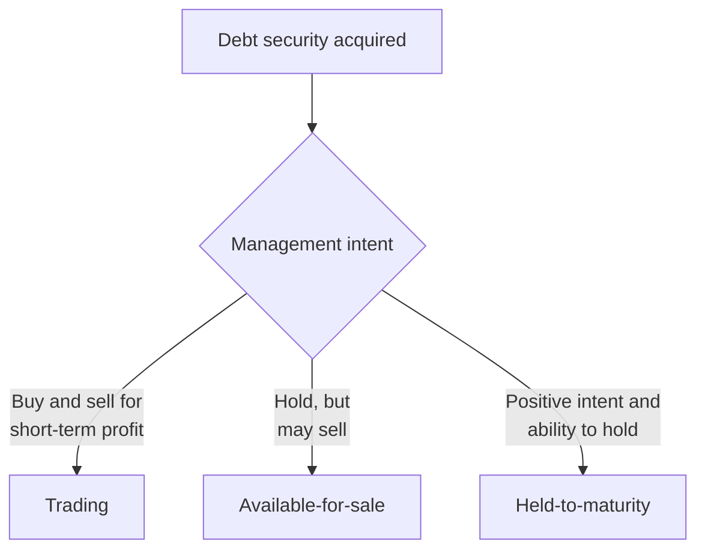

# Investments

Companies invest surplus cash in other entities' bonds and stock, and some buy large enough stakes to influence how the other company is run. The accounting for these investments turns on one idea: **classification drives measurement**. The category an investment falls into determines whether it is carried at fair value or amortized cost, and whether changes in its value hit net income, other comprehensive income, or neither. This chapter covers debt securities first, then equity securities, then the equity method for investments that give the investor significant influence.

## Financial Instruments

A **financial instrument** is cash, an ownership interest in an entity, or a contract that creates a financial asset for one party and a financial liability (or equity instrument) for the other. Receivables, debt securities, and equity securities are financial assets; accounts payable, notes payable, and bonds payable are financial liabilities. This chapter is about the investor's side: debt and equity securities held as assets.

## Debt Securities

A **debt security** represents a creditor relationship, such as a government bond, a corporate bond, or commercial paper. Under Accounting Standards Codification (ASC) 320, a debt security is classified when it is acquired into one of three categories, based on management's intent and ability:



| Feature                 | Trading    | Available-for-sale (AFS) | Held-to-maturity (HTM) |
| ----------------------- | ---------- | ------------------------ | ---------------------- |
| Balance sheet           | Fair value | Fair value               | Amortized cost         |
| Unrealized gains and losses | Net income | Other comprehensive income (OCI), except credit losses | Not recognized |
| Credit losses           | Not separately recognized (already in fair value) | Allowance, through net income, limited to the excess of amortized cost over fair value | Allowance for lifetime expected credit losses, through net income |
| Classification          | Usually current | Current or noncurrent | Noncurrent unless maturing within one year |

Interest income on all three categories is recognized using the effective interest method, so any premium or discount is amortized over the life of the security.

### Trading Securities

Trading securities are bought to profit from short-term price changes, so the balance sheet shows them at **fair value** and every change in fair value goes to **net income**. Bear Co. buys bonds for its trading portfolio:

```journal
Dr. Investment in trading securities[a]   50,000
    Cr. Cash[a]                                50,000
```

At year-end, fair value has risen to \$53,000:

```journal
Dr. Investment in trading securities[a]    3,000
    Cr. Unrealized holding gain (net income)    3,000
```

### Available-for-Sale Securities

AFS securities are also reported at **fair value**, but the unrealized gains and losses go to **OCI** and accumulate in equity as accumulated other comprehensive income (AOCI). The exception is a decline caused by **credit losses**: that portion is recognized in net income through an allowance (ASC 326-30). The allowance cannot exceed the amount by which fair value is below amortized cost, because an investor could always sell the security at fair value.

Polar Co. buys AFS bonds at par for \$100,000. At year-end, fair value has dropped to \$92,000, and Polar determines that \$5,000 of the decline is a credit loss. The credit portion goes to net income:

```journal
Dr. Credit loss expense                 5,000
    Cr. Allowance for credit losses (AFS)[ca]   5,000
```

and the remaining \$3,000 goes to OCI:

```journal
Dr. Unrealized loss on AFS (OCI)       3,000
    Cr. Investment in AFS securities[a]     3,000
```

The investment is now reported at its \$92,000 fair value: \$100,000 of amortized cost, less the \$5,000 allowance and the \$3,000 valuation adjustment. If the credit outlook later improves, the allowance is reduced and the recovery goes to net income.

One case skips the allowance. If Polar **intends to sell** the security, or **more likely than not will be required to sell** it before its amortized cost is recovered, the entire \$8,000 excess of amortized cost over fair value is recognized in net income, and the amortized cost basis is written down to \$92,000.

### Held-to-Maturity Securities

HTM securities are those the investor has the positive intent and ability to hold until they mature. Because the investor does not plan to sell, interim changes in fair value are not relevant to it, and the securities are reported at **amortized cost**.

Grizzly Inc. purchases a \$100,000, five-year, 6% bond (annual interest) for \$95,900, a price that yields 7%:

```journal
Dr. Investment in HTM securities[a]    95,900
    Cr. Cash[a]                            95,900
```

At the first interest date, interest income is the carrying amount times the market (effective) rate, and the difference from the cash received is discount amortization:

$$
\text{Interest income} = \$95{,}900 \times 7\% = \$6{,}713 \qquad \text{Discount amortization} = \$6{,}713 - (\$100{,}000 \times 6\%) = \$713
$$

```journal
Dr. Cash[a]                            6,000
Dr. Investment in HTM securities[a]       713
    Cr. Interest income                     6,713
```

After the first year, the carrying amount is \$96,613 (\$95,900 + \$713), and it reaches the \$100,000 face amount at maturity.

HTM securities are financial assets at amortized cost, so they follow the **current expected credit loss (CECL)** model in ASC 326-20. An allowance for **lifetime expected credit losses** is recorded from the date of purchase and adjusted at each reporting date, as with trade receivables. Expected losses may be zero for securities such as U.S. Treasuries. If Grizzly estimates lifetime expected credit losses of \$1,200 on its bond at year-end:

```journal
Dr. Credit loss expense                  1,200
    Cr. Allowance for credit losses (HTM)[ca]  1,200
```

The bond is then reported at \$95,413, its amortized cost of \$96,613 less the allowance.

Because the HTM category depends on intent, selling or transferring an HTM security before maturity is a serious matter. Outside narrow exceptions (such as a significant deterioration in the issuer's credit), a sale calls into question the entity's intent to hold its other HTM securities, which can "taint" the entire portfolio and force it into AFS.

## Equity Securities

Under ASC 321, investments in stock that do **not** give the investor significant influence or control are measured at **fair value through net income (FVTNI)**. There is no AFS category for equity securities. Dividends received are dividend income.

Kodiak Partners buys equity securities for \$30,000. At year-end, fair value has risen to \$34,000:

```journal
Dr. Investment in equity securities[a]    4,000
    Cr. Unrealized holding gain (net income)   4,000
```

Because the carrying amount already reflects every fair value change, the gain or loss on a later sale is only the change since the last remeasurement. If Kodiak sells the securities for \$37,000:

```journal
Dr. Cash[a]                           37,000
    Cr. Investment in equity securities[a] 34,000
    Cr. Gain on sale of investments         3,000
```

### The Measurement Alternative

Some equity securities, such as shares of a private company, do **not** have a readily determinable fair value. For these, an entity may elect, investment by investment, to measure the security at cost, adjusted for observable price changes in orderly transactions for the identical or a similar security of the same issuer, less impairment:

$$
\text{Carrying amount} = \text{Cost} \pm \text{Observable price changes} - \text{Impairment}
$$

At each reporting date, the entity makes a qualitative assessment of whether the security is impaired. If it is, the security is written down to fair value, and the loss goes to net income.

## Equity Method Investments

When an investor holds enough voting stock to have **significant influence** over the investee's operating and financial policies, but not control, fair value no longer tells the whole story. The investor applies the **equity method** under ASC 323.

Ownership of **20% to 50%** of the voting stock creates a **rebuttable presumption** of significant influence. The presumption can be overcome by evidence such as the investee's successful opposition to the investor's influence, and significant influence can exist below 20%. Indicators include representation on the board of directors, participation in policy-making, material transactions between the two companies, interchange of managerial personnel, and technological dependency. An investor that qualifies for the equity method may instead elect the fair value option.

### Core Mechanics

The equity method treats the investor's share of the investee's results as if the investor had earned it directly:

1. **Record** the initial investment at cost.
2. **Increase** the investment for the investor's share of the investee's **net income** (or decrease it for a loss), recognizing the same amount as equity method income.
3. **Decrease** the investment for **dividends received**. Dividends are a return of the investment, not income, because the income was already recognized in step 2.

Panda Industries acquires 30% of Sloth Security for \$600,000. During the year, Sloth Security reports net income of \$200,000 and pays dividends of \$50,000.

```journal
Dr. Investment in Sloth Security[a]  600,000
    Cr. Cash[a]                           600,000
```

Panda's share of net income is \$60,000 (30% × \$200,000):

```journal
Dr. Investment in Sloth Security[a]   60,000
    Cr. Equity in earnings of investee     60,000
```

Panda's share of dividends is \$15,000 (30% × \$50,000):

```journal
Dr. Cash[a]                           15,000
    Cr. Investment in Sloth Security[a]   15,000
```

The ending carrying amount is \$645,000 (\$600,000 + \$60,000 - \$15,000). If the investee reports losses, the investor records its share until the investment reaches zero and then generally stops, unless it has guaranteed the investee's obligations or committed to provide more support.

### Excess of Cost Over Book Value

An investor usually pays more than its share of the investee's **book value**, because the investee's assets are worth more than their carrying amounts and because of goodwill. The excess is allocated first to identifiable assets whose fair value exceeds book value, with any remainder treated as goodwill. The investor does not record these amounts separately; they are part of the single investment account, but they affect the income it recognizes:

| Item | Treatment |
|------|-----------|
| Depreciable assets (fair value above book value) | Amortize the excess over the remaining useful life, reducing equity method income |
| Land (fair value above book value) | **Not amortized** |
| Goodwill | **Not amortized** and not tested separately for impairment; the investment as a whole is evaluated for an other-than-temporary decline in value |

Panda pays \$600,000 for 30% of Sloth Security. Sloth's book value is \$1,500,000, and its building has a fair value \$200,000 above book value, with a remaining life of 10 years:

| Component | Amount |
|-----------|-------:|
| Cost | \$600,000 |
| Share of book value (30% × \$1,500,000) | (\$450,000) |
| **Total excess** | **\$150,000** |
| Allocated to building (30% × \$200,000) | (\$60,000) |
| **Goodwill** | **\$90,000** |

Each year Panda amortizes the \$60,000 building excess over 10 years. The extra depreciation is not on Sloth's books, so Panda records it as a reduction of its equity method income:

```journal
Dr. Equity in earnings of investee     6,000
    Cr. Investment in Sloth Security[a]   6,000
```

Combined with the basic entries above, Panda's equity method income for the year is \$54,000, and its year-end carrying amount is \$639,000 (\$645,000 less \$6,000).

### Moving to the Equity Method

When an investor's ownership **increases** to the point of significant influence, for example from 15% to 25%, the equity method is applied **prospectively** from that date. Prior periods are not restated. The investor adds the cost of the new shares to the carrying amount of the shares it already holds. Because the earlier shares were measured at fair value through net income under ASC 321, their past fair value changes are already in earnings, and nothing needs to be reclassified.

Bear Co.'s 15% stake is carried at its fair value of \$300,000, and it pays \$200,000 in cash for another 10%:

```journal
Dr. Investment in investee (equity method)[a]   500,000
    Cr. Investment in equity securities[a]           300,000
    Cr. Cash[a]                                      200,000
```

From this point forward, Bear records its share of the investee's earnings and reduces the investment for dividends. Fair value adjustments stop.

### Comparing Fair Value and the Equity Method

| Feature            | Fair Value (FVTNI)           | Equity Method                           |
| ------------------ | ---------------------------- | --------------------------------------- |
| Typical ownership  | Less than 20%                | 20% to 50%                              |
| Balance sheet      | Fair value                   | Cost plus share of earnings, less dividends and excess amortization |
| Income recognized  | Dividends, plus unrealized gains and losses | Share of investee's net income |
| Dividends received | Dividend income              | Reduce the carrying amount              |
| Goodwill           | Not applicable               | May arise on purchase (inside the investment account) |

:::tip[Dividends are the giveaway]

When a question asks about dividends received, check the method first. Under fair value they are income; under the equity method they reduce the investment. Recording equity method dividends as income double-counts the investee's earnings.

:::

## Disclosures

Investment notes describe each category's amortized cost and fair value, the methods and assumptions used to measure fair value, unrealized gains and losses on AFS securities, the allowance for credit losses, and the significant terms of the instruments. Entities must also disclose **concentrations of credit risk**, including the maximum exposure to loss, even if no loss has occurred. The potential for loss is enough to require the disclosure.

## Summary

| Investment Type            | Measurement                              | Income Effect                                     |
| -------------------------- | ---------------------------------------- | ------------------------------------------------- |
| Trading debt               | Fair value                               | Unrealized gains and losses in net income         |
| AFS debt                   | Fair value                               | Credit losses in net income; other changes in OCI |
| HTM debt                   | Amortized cost, less allowance           | Interest income; credit losses through the allowance |
| Equity (default)           | Fair value                               | Unrealized gains and losses in net income         |
| Equity (no readily determinable fair value, elected) | Cost ± observable price changes, less impairment | Price changes and impairment in net income |
| Equity method (20% to 50%) | Cost plus share of earnings, less dividends | Share of investee net income, less excess amortization |
