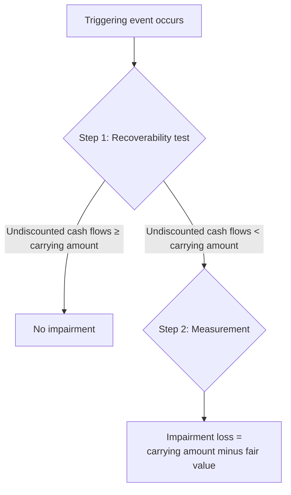

# Property, Plant, and Equipment (PP&E)

Property, plant, and equipment (PP&E) are the **tangible, long-lived assets** a business uses to operate: its land, buildings, machinery, and vehicles. Under U.S. generally accepted accounting principles (GAAP), PP&E is carried at **historical cost** less accumulated depreciation and any impairment losses. The life of an asset gives this chapter its structure: what goes into the cost at acquisition, how that cost is spread over the asset's useful life, when the carrying amount must be written down, and what happens when the asset is held for sale or disposed of. The chapter ends with the rollforward that ties these pieces together, a common simulation format.

## What Qualifies as PP&E

An asset is PP&E when it is **used in operations** (not held for investment or resale), has **physical substance** (which distinguishes it from intangible assets), and has a **useful life longer than one year** or one operating cycle. Land held for a future plant site is PP&E; land held as a speculative investment is not. All PP&E except land is depreciated, because land has an unlimited useful life.

## Initial Measurement: Historical Cost

PP&E is recorded at the **total cost to acquire the asset and prepare it for its intended use**. The test is whether a cost was necessary to get the asset ready. Costs that meet it are capitalized; costs that do not, such as repairing damage caused by careless installation, are expensed.

| Cost Component | Examples |
|----------------|----------|
| Purchase price | Invoice amount less trade and cash discounts |
| Directly attributable costs | Freight, installation, testing, legal fees |
| Site preparation | Grading, draining, clearing |
| Asset retirement obligations (AROs) | Present value (PV) of legally required future removal or restoration costs (debit the asset, credit a liability) |
| Interest during construction | Capitalized for qualifying assets (see below) |

### Land and Land Improvements

Land is recorded at all costs to acquire it and prepare it for use: the purchase price, closing costs (title search, legal fees, recording fees), any liens or back taxes the buyer assumes, permanent improvements such as grading and draining, and the cost of demolishing old structures, net of any salvage proceeds.

**Land improvements**, such as parking lots, fences, lighting, and irrigation systems, are recorded in a separate account and **are** depreciated, because they wear out:

```journal
Dr. Land improvements[a]          80,000
    Cr. Cash[a]                       80,000
```

### Basket (Lump-Sum) Purchases

When several assets are acquired for one price, the total cost is **allocated based on relative fair values**. The allocation matters because land is not depreciated and buildings and equipment are depreciated over different lives.

Polar Co. pays \$900,000 for land, a building, and equipment. Independent appraisals show:

| Asset | Appraised Value | Proportion | Allocated Cost |
|-------|----------------|------------|----------------|
| Land | \$400,000 | 40% | \$360,000 |
| Building | \$500,000 | 50% | \$450,000 |
| Equipment | \$100,000 | 10% | \$90,000 |
| **Total** | **\$1,000,000** | **100%** | **\$900,000** |

```journal
Dr. Land[a]                      360,000
Dr. Building[a]                  450,000
Dr. Equipment[a]                  90,000
    Cr. Cash[a]                      900,000
```

### Donated Assets

A business that **receives** a donated asset records it at **fair value** on the date of donation and recognizes contribution revenue (or a gain). If a private foundation gives Bear Co. a building worth \$500,000:

```journal
Dr. Building[a]                   500,000
    Cr. Contribution revenue          500,000
```

Not-for-profit entities follow the same principle under Accounting Standards Codification (ASC) Topic 958. Grants from governments to business entities will get their own model under ASU 2025-10 (Topic 832), which is not eligible for testing until January 1, 2029.

### Constructed Assets and Capitalized Interest

When a company builds an asset for its own use, or builds a discrete project for sale or lease (such as a ship or a real estate development), the interest it incurs during construction is part of the asset's cost. Such an asset is a **qualifying asset**. Interest is not capitalized on inventory that is routinely produced in large quantities, or on assets that are already in use or ready for use.

The amount capitalized is **avoidable interest**: the interest the company would not have incurred if it had not built the asset. It is computed in three steps:

1. **Compute weighted-average accumulated expenditures (WAAE).** Weight each expenditure by the fraction of the construction period in the year that it was outstanding.
2. **Multiply WAAE by the interest rate.** Apply the rate on any **specific** construction borrowing first. If WAAE exceeds the specific borrowing, apply the **weighted-average rate** on the company's other debt to the excess.
3. **Apply the cap.** Capitalized interest can **never exceed** the actual interest incurred during the period.

Kodiak Partners begins constructing a warehouse on January 1. Expenditures during the year are:

| Date | Amount | Months Outstanding | Weight | Weighted Amount |
|------|--------|-------------------|--------|-----------------|
| Jan 1 | \$200,000 | 12/12 | 1.00 | \$200,000 |
| Jul 1 | \$300,000 | 6/12 | 0.50 | \$150,000 |
| Oct 1 | \$100,000 | 3/12 | 0.25 | \$25,000 |
| **WAAE** | | | | **\$375,000** |

Kodiak has a 10% construction loan of \$250,000 and \$1,000,000 of other debt at a weighted-average rate of 8%. WAAE exceeds the construction loan by \$125,000, so the 8% rate applies to that excess:

$$
\text{Avoidable interest} = (\$250{,}000 \times 10\%) + (\$125{,}000 \times 8\%) = \$25{,}000 + \$10{,}000 = \$35{,}000
$$

Actual interest incurred is \$105,000 (\$25,000 on the construction loan plus \$80,000 on other debt). Avoidable interest is below that cap, so all \$35,000 is capitalized and the remaining \$70,000 is expensed:

```journal
Dr. Building under construction[a] 35,000
Dr. Interest expense               70,000
    Cr. Interest payable[l]           105,000
```

## Costs After Acquisition

Once an asset is in service, the question for each new cost is whether it merely keeps the asset working or makes it better. **Ordinary repairs and maintenance** keep the asset in normal operating condition and are expensed as incurred. **Improvements and extraordinary repairs** extend the useful life or increase capacity or efficiency, and they are capitalized.

Grizzly Inc. spends \$2,500 on routine servicing of a machine (expensed) and \$15,000 on an overhaul that extends the machine's life by three years (capitalized):

```journal
Dr. Repairs and maintenance expense   2,500
    Cr. Cash[a]                           2,500
```

```journal
Dr. Equipment[a]                      15,000
    Cr. Cash[a]                           15,000
```

Many textbooks debit accumulated depreciation instead of the asset when a cost extends useful life, on the theory that the overhaul restores past wear. Either way, book value rises by \$15,000.

## Depreciation

Depreciation **systematically allocates** the cost of a tangible asset, less its salvage value, over its useful life. It is a cost allocation process, not an attempt to track the asset's market value.

$$
\text{Depreciable base} = \text{Cost} - \text{Salvage value}
$$

**Straight-line (SL)** spreads the depreciable base evenly:

$$
\text{Annual depreciation} = \frac{\text{Cost} - \text{Salvage value}}{\text{Useful life}}
$$

**Sum-of-the-years'-digits (SYD)** is an accelerated method. For an asset with a life of $n$ years, the denominator is the sum of the digits 1 through $n$, and year $k$ gets a fraction with the remaining life in the numerator:

$$
\text{SYD} = \frac{n(n+1)}{2} \qquad \text{Depreciation}_k = \frac{n - k + 1}{\text{SYD}} \times (\text{Cost} - \text{Salvage value})
$$

**Declining balance (DB)** applies a constant rate to the **beginning book value** rather than to the depreciable base:

$$
\text{DB rate} = \frac{1}{\text{Useful life}} \times \text{Multiplier}
$$

The most common multiplier is 2, which gives the **double-declining-balance (DDB)** method. Salvage value is ignored in computing each year's charge, but the asset is never depreciated below salvage value.

**Units of production** ties depreciation to use rather than time:

$$
\text{Depreciation} = \frac{\text{Cost} - \text{Salvage value}}{\text{Total estimated units}} \times \text{Units produced}
$$

### Comparing the Methods

Panda Industries purchases equipment for \$100,000 with a \$10,000 salvage value and a five-year useful life:

| Year | Straight-Line | SYD | DDB |
|------|--------------|-----|-----|
| 1 | \$18,000 | \$30,000 | \$40,000 |
| 2 | \$18,000 | \$24,000 | \$24,000 |
| 3 | \$18,000 | \$18,000 | \$14,400 |
| 4 | \$18,000 | \$12,000 | \$8,640 |
| 5 | \$18,000 | \$6,000 | \$2,960 |
| **Total** | **\$90,000** | **\$90,000** | **\$90,000** |

SYD uses a denominator of 15 (5 × 6 ÷ 2), so Year 1 is 5/15 of \$90,000. DDB uses a 40% rate (2 × 1/5) applied to beginning book value: \$100,000 in Year 1, \$60,000 in Year 2, and so on. Book value at the start of Year 5 is \$12,960, so Year 5 DDB depreciation is limited to \$2,960, which brings book value down to the \$10,000 salvage value and no lower. Every method depreciates the same \$90,000 in total; only the timing differs.

### Component and Composite Depreciation

**Component depreciation** depreciates each significant part of an asset separately, such as an aircraft's engines and its airframe. U.S. GAAP permits it but does not require it.

**Composite (or group) depreciation** goes the other way, depreciating a group of similar assets with a single rate:

$$
\text{Composite rate} = \frac{\text{Total annual depreciation}}{\text{Total cost}} \qquad \text{Composite life} = \frac{\text{Total depreciable base}}{\text{Total annual depreciation}}
$$

Under composite depreciation, **no gain or loss** is recognized when an individual asset is retired. The asset's cost is removed, the proceeds are recorded, and the difference goes to accumulated depreciation.

## Depletion of Natural Resources

Natural resources such as oil, gas, minerals, and timber are consumed as they are extracted, so their cost is allocated through **depletion**, using the units-of-production approach:

$$
\text{Depletion per unit} = \frac{\text{Cost} + \text{Development costs} + \text{Restoration costs} - \text{Residual value}}{\text{Total estimated units}}
$$

Bear Co. pays \$5,000,000 for mineral rights, incurs \$500,000 of development costs, and records an asset retirement obligation for restoration with a present value of \$300,000. It estimates 2,000,000 recoverable tons and extracts 250,000 tons in Year 1:

$$
\text{Depletion per ton} = \frac{\$5{,}000{,}000 + \$500{,}000 + \$300{,}000}{2{,}000{,}000} = \$2.90
$$

Year 1 depletion is \$725,000 (250,000 × \$2.90). Depletion is a product cost. It is charged to inventory and becomes part of cost of goods sold when the ore is sold:

```journal
Dr. Inventory (ore)[a]           725,000
    Cr. Accumulated depletion[ca]    725,000
```

## Impairment of Assets Held for Use

An asset's carrying amount should not exceed what the company can recover from it. Under ASC 360, a long-lived asset held for use is tested for impairment whenever events or changes in circumstances (**triggering events**) indicate that its carrying amount may not be recoverable. Examples include a significant drop in the asset's market price, a major adverse change in how it is used, or a history of operating losses tied to it. The test has two steps:



In **Step 1**, compare the asset's carrying amount with the sum of its **undiscounted** expected future cash flows. If the cash flows are lower, the carrying amount is not recoverable. In **Step 2**, write the asset down to **fair value**. The loss is the carrying amount minus fair value. Notice that the two steps use different yardsticks: undiscounted cash flows decide whether there is an impairment, and fair value decides how much.

Cub Entertainment owns a theme park ride with a carrying amount of \$800,000. Because attendance has declined, it estimates undiscounted future cash flows of \$600,000 and a fair value of \$500,000. The ride fails the recoverability test (\$600,000 is less than \$800,000), so Cub recognizes a loss of \$300,000 (\$800,000 - \$500,000):

```journal
Dr. Impairment loss              300,000
    Cr. Accumulated depreciation[ca] 300,000
```

The \$500,000 carrying amount becomes the asset's new cost basis, and depreciation continues over the remaining useful life. For assets held for use, impairment losses are **never reversed** under U.S. GAAP, even if fair value later recovers.

## Assets Held for Sale

An asset (or group of assets) that a company plans to sell is classified as **held for sale** when **all** of the following criteria are met:

1. Management, with the authority to approve the action, commits to a plan to sell.
2. The asset is available for immediate sale in its present condition, subject only to usual and customary terms.
3. An active program to locate a buyer has begun.
4. The sale is probable and is expected to be completed within one year (with limited exceptions for delays outside the company's control).
5. The asset is being actively marketed at a price that is reasonable compared with its current fair value.
6. It is unlikely that the plan will change significantly or be withdrawn.

If any criterion is not met, the asset continues to be classified as held for use, depreciated, and tested for impairment under the held-for-use model.

An asset held for sale is measured at the **lower of its carrying amount or fair value less costs to sell**, and it is presented separately on the balance sheet. Depreciation stops once the asset is classified as held for sale.

| Feature | Held for Use | Held for Sale |
|---------|-------------|-------------------|
| Depreciation | Continues | **Ceases** |
| Impairment measurement | Write down to fair value | Write down to fair value **less costs to sell** |
| Subsequent recovery | Not permitted | **Permitted**, up to the cumulative loss recognized while held for sale |

Sloth Security commits to selling an office building and meets all six criteria on June 30. The building has a carrying amount of \$410,000, a fair value of \$400,000, and estimated costs to sell of \$25,000. It is written down to \$375,000, and Sloth recognizes a \$35,000 loss:

```journal
Jun 30
Dr. Loss on write-down of asset held for sale 35,000
    Cr. Building held for sale[a]                35,000
```

If fair value less costs to sell rises to \$395,000 at year-end, Sloth recognizes a \$20,000 gain. If it rose to \$420,000, the gain would be limited to \$35,000, the loss previously recognized, so the building would never be carried above its \$410,000 carrying amount at the date it was classified as held for sale.

## Disposals

To record a disposal, first record depreciation up to the disposal date. Then remove the asset's cost and accumulated depreciation, and recognize a gain or loss for the difference between any proceeds and book value.

Sloth Security sells equipment with a cost of \$50,000 and accumulated depreciation of \$35,000 for \$20,000. Book value is \$15,000, so the gain is \$5,000:

```journal
Dr. Cash[a]                       20,000
Dr. Accumulated depreciation[ca]  35,000
    Cr. Equipment[a]                  50,000
    Cr. Gain on sale of equipment      5,000
```

A fully depreciated asset that is scrapped with no proceeds produces no gain or loss; the entry simply removes the cost and the accumulated depreciation.

An **involuntary conversion**, such as the destruction of an asset by fire, is treated the same way, with the insurance proceeds in place of sale proceeds. If equipment with a book value of \$15,000 (cost \$50,000, accumulated depreciation \$35,000) is destroyed and the insurer pays \$60,000, the gain is \$45,000. Under U.S. GAAP, the gain or loss is recognized even if the proceeds are reinvested in replacement property.

```journal
Dr. Cash (insurance proceeds)[a]   60,000
Dr. Accumulated depreciation[ca]   35,000
    Cr. Equipment[a]                   50,000
    Cr. Gain on involuntary conversion  45,000
```

## Rollforwards and Subledger Reconciliations

A **PP&E rollforward** explains the change in gross cost and accumulated depreciation from the beginning of the year to the end. Each column follows the same pattern: beginning balance, plus additions, less disposals, equals ending balance. Net PP&E is gross cost less accumulated depreciation.

Grizzly Inc. reports the following for the year:

| | Gross cost | Accumulated depreciation | Net |
|---|---:|---:|---:|
| Beginning balance | \$900,000 | \$(300,000) | \$600,000 |
| Additions (purchases) | 150,000 | | 150,000 |
| Depreciation expense | | (80,000) | (80,000) |
| Disposals | (60,000) | 45,000 | (15,000) |
| **Ending balance** | **\$990,000** | **\$(335,000)** | **\$655,000** |

The disposal row removes the asset's full cost and its accumulated depreciation, so the net effect is the asset's \$15,000 book value. Any proceeds and gain or loss appear in cash and the income statement, not in the rollforward.

The fixed asset subledger lists each asset with its cost, accumulated depreciation, and location, and its totals should agree with the general ledger. When they do not, common causes are an asset disposed of in the field but never removed from the records, a repair that was capitalized (or an improvement that was expensed), an addition recorded in the ledger but not the subledger, and depreciation computed on the wrong life or method. Each difference should be traced to its source before the general ledger is adjusted.

## Summary

| Topic                          | Key Rule                                        |
| ------------------------------ | ----------------------------------------------- |
| Initial measurement            | Historical cost (all costs to ready for use)    |
| Land                           | Never depreciated                               |
| Basket purchase                | Allocate by relative fair value                 |
| Capitalized interest           | WAAE × interest rate; capped at actual interest |
| Ordinary repairs               | Expense                                         |
| Improvements and extraordinary repairs | Capitalize                              |
| Depletion                      | Units-of-production method                      |
| Impairment (held for use)      | Undiscounted cash flow test, then write down to fair value; no reversal |
| Held for sale                  | Six criteria; lower of carrying amount or fair value less costs to sell; no depreciation; recovery allowed up to prior losses |
| Disposal                       | Gain or loss = proceeds minus book value        |
