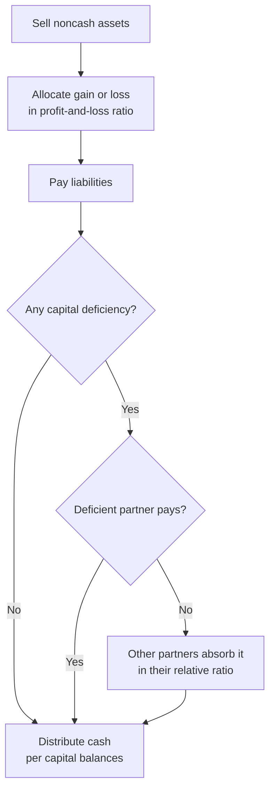

# Partnership Accounting

A **partnership** is an association of two or more persons who carry on a business as co-owners for profit. Instead of common stock and retained earnings, a partnership tracks each owner's stake in a separate **capital account**, and most of partnership accounting is about moving amounts into, out of, and between those accounts. FAR tests this capital account activity: forming a partnership, admitting a new partner, dividing profits, a partner's withdrawal, and liquidation. This chapter takes the events in the order a partnership lives through them.

## Capital Accounts and Taxation

Each partner's capital account increases with contributions and allocated income, and decreases with withdrawals (drawings) and allocated losses:

$$\text{Ending capital} = \text{Beginning capital} + \text{Contributions} + \text{Share of income} - \text{Drawings} - \text{Share of losses}$$

Partnerships are **not separate taxable entities**. Income and losses pass through to the partners, who report them on their own tax returns. The partnership files an information return but pays no federal income tax, which is why partnership financial statements show no income tax expense.

| Feature | Partnership | Corporation |
|---|---|---|
| **Taxation** | Pass-through (no entity-level tax) | Taxed at entity level (C corporation) or pass-through (S corporation) |
| **Ownership tracking** | Capital accounts | Stockholders' equity (stock, additional paid-in capital, retained earnings) |
| **Life** | Limited (a partner's withdrawal or death ends the old partnership) | Perpetual |
| **Liability** | General partners have unlimited liability | Shareholders have limited liability |

---

## Formation

Each partner's contribution is recorded at **fair value** on the date of contribution, because that is the economic value each partner is putting at risk. If the partnership assumes a liability attached to a contributed asset, that partner's capital account is credited for the net amount.

Bear and Polar form Kodiak Partners. Bear contributes cash of \$80,000. Polar contributes equipment with a fair value of \$120,000 and a remaining mortgage of \$20,000, which the partnership assumes:

```journal
Dr. Cash[a] 80,000
    Cr. Bear, Capital[e] 80,000
```

```journal
Dr. Equipment[a] 120,000
    Cr. Mortgage Payable[l] 20,000
    Cr. Polar, Capital[e] 100,000
```

After formation, total partnership capital is \$180,000 (Bear \$80,000 + Polar \$100,000). Polar's original cost for the equipment does not matter for the partnership's books.

---

## Dividing Profits and Losses

Partners share profits and losses according to their **partnership agreement**. If the agreement is **silent**, partners share them **equally**, regardless of capital balances or time devoted to the business. Agreements commonly combine three steps:

- **Salary allowances**: fixed amounts that compensate partners for services
- **Interest on capital balances**: a return on invested capital
- **Residual ratio**: the remaining profit (or loss), split by an agreed ratio

Bear, Polar, and Panda are partners in Kodiak Partners. Their agreement provides salary allowances of \$40,000, \$30,000, and \$20,000; interest of 10% on beginning capital balances of \$200,000, \$150,000, and \$100,000; and a residual ratio of 40%, 35%, and 25%. Net income for the year is \$170,000:

| Step | Bear | Polar | Panda | Total |
|---|---|---|---|---|
| Salary allowances | \$40,000 | \$30,000 | \$20,000 | \$90,000 |
| Interest (10% of capital) | \$20,000 | \$15,000 | \$10,000 | \$45,000 |
| Subtotal allocated | \$60,000 | \$45,000 | \$30,000 | \$135,000 |
| Remainder (\$170,000 - \$135,000 = \$35,000) | \$14,000 | \$12,250 | \$8,750 | \$35,000 |
| **Total share of income** | **\$74,000** | **\$57,250** | **\$38,750** | **\$170,000** |

```journal
Dec 31
Dr. Income Summary 170,000
    Cr. Bear, Capital[e] 74,000
    Cr. Polar, Capital[e] 57,250
    Cr. Panda, Capital[e] 38,750
```

Salary and interest allowances are **not expenses** of the partnership. They are only steps in dividing profit, and they are allocated in full even if net income is less than the total allowances. In that case, the remainder is **negative** and is allocated to the partners as a loss in the residual ratio. If Kodiak had earned only \$115,000, the remainder would be a \$20,000 loss, and Bear's share would be \$52,000 (\$60,000 - 40% × \$20,000).

---

## Admitting a New Partner

A new partner can join in one of two ways, and the accounting is completely different.

**Buying an interest from an existing partner.** The payment goes to the selling partner personally, not to the partnership, so the partnership's assets do not change. The partnership simply transfers capital from the seller's account to the buyer's account, whatever price the two agree on. If Panda pays Bear \$70,000 for half of Bear's \$120,000 capital interest, the partnership records only:

```journal
Dr. Bear, Capital[e] 60,000
    Cr. Panda, Capital[e] 60,000
```

**Contributing assets to the partnership.** Total assets and capital increase. The accounting depends on how the contribution compares with the book value of the ownership share the new partner receives. If they are equal, the entry is simple. Kodiak Partners has total capital of \$200,000. Panda contributes \$100,000 for a one-third interest. Total capital after admission is \$300,000, and one-third of it is \$100,000, exactly what Panda paid, so Panda's capital account is credited for \$100,000 and no adjustment is needed.

When the contribution and the share differ, the partnership agreement specifies one of two methods. The **bonus method** keeps total capital equal to prior capital plus the contribution and reallocates capital among the partners. The **goodwill method** records goodwill so that each partner's capital reflects the implied value of the business. The examples below all start from the same partnership: Kodiak Partners has total capital of \$200,000 (Bear \$120,000, Polar \$80,000), and Bear and Polar share profits equally.

### Bonus Method

**Bonus to existing partners.** Grizzly contributes \$160,000 for a 25% interest. Total capital after admission is \$360,000 (\$200,000 + \$160,000), so Grizzly's 25% share is \$90,000. Grizzly paid \$70,000 more than the book value received, and that excess is a bonus to Bear and Polar in their profit-and-loss ratio (\$35,000 each):

```journal
Dr. Cash[a] 160,000
    Cr. Grizzly, Capital[e] 90,000
    Cr. Bear, Capital[e] 35,000
    Cr. Polar, Capital[e] 35,000
```

**Bonus to the new partner.** Cub contributes only \$40,000 for a 25% interest, perhaps because Cub brings valuable skills. Total capital after admission is \$240,000, so Cub's share is \$60,000. The \$20,000 difference is a bonus to Cub, taken from Bear and Polar in their profit-and-loss ratio (\$10,000 each):

```journal
Dr. Cash[a] 40,000
Dr. Bear, Capital[e] 10,000
Dr. Polar, Capital[e] 10,000
    Cr. Cub, Capital[e] 60,000
```

### Goodwill Method

**Goodwill to existing partners.** Use the same facts as the first bonus example: Grizzly contributes \$160,000 for a 25% interest. If \$160,000 buys 25%, the whole partnership is implicitly worth \$640,000 (\$160,000 ÷ 0.25). Recorded capital after the contribution would be only \$360,000, so the implied goodwill is \$280,000, credited to the existing partners in their profit-and-loss ratio:

```journal
Dr. Goodwill[a] 280,000
    Cr. Bear, Capital[e] 140,000
    Cr. Polar, Capital[e] 140,000
```

```journal
Dr. Cash[a] 160,000
    Cr. Grizzly, Capital[e] 160,000
```

After these entries, capital is Bear \$260,000 + Polar \$220,000 + Grizzly \$160,000 = \$640,000, and Grizzly's share is 25%, as agreed.

**Goodwill to the new partner.** Sloth contributes \$30,000 for a 20% interest, and the partners agree that Sloth brings goodwill (an established client base, for example). Now the existing partners' capital is the basis for valuing the business: their \$200,000 represents the remaining 80%, so implied total capital is \$250,000 (\$200,000 ÷ 0.80). Sloth's 20% share is \$50,000, and the \$20,000 Sloth did not contribute in cash is recorded as goodwill brought in by Sloth:

```journal
Dr. Cash[a] 30,000
Dr. Goodwill[a] 20,000
    Cr. Sloth, Capital[e] 50,000
```

After this entry, capital is Bear \$120,000 + Polar \$80,000 + Sloth \$50,000 = \$250,000, and Sloth's share is 20%.

:::tip[Which partner does the bonus or goodwill go to?]

Compare the contribution with the book value of the share received. If the new partner pays **more**, the existing partners benefit (bonus to them, or goodwill credited to them). If the new partner pays **less**, the new partner benefits. The bonus method never changes total capital beyond the cash contributed; the goodwill method adds an intangible asset.

:::

---

## Withdrawal of a Partner

When a partner withdraws and is paid from partnership assets, the payment rarely equals the partner's capital balance. The difference is handled with either the bonus or the goodwill method.

Grizzly withdraws from a three-partner firm. Capital balances are Bear \$100,000, Polar \$80,000, and Grizzly \$70,000, and the partners share profits and losses equally. The partnership pays Grizzly \$85,000.

**Bonus method.** Grizzly receives \$15,000 more than the capital balance. That bonus comes from the remaining partners in their profit-and-loss ratio:

```journal
Dr. Grizzly, Capital[e] 70,000
Dr. Bear, Capital[e] 7,500
Dr. Polar, Capital[e] 7,500
    Cr. Cash[a] 85,000
```

If Grizzly instead accepted \$60,000, the \$10,000 difference would be a bonus to Bear and Polar (\$5,000 each).

**Goodwill method.** The \$15,000 premium implies that the partnership has unrecorded goodwill. Because Grizzly's profit-and-loss share is one-third, the \$15,000 represents one-third of the total, so implied goodwill is \$45,000 (\$15,000 ÷ 1/3). The partnership records it in all three capital accounts:

```journal
Dr. Goodwill[a] 45,000
    Cr. Bear, Capital[e] 15,000
    Cr. Polar, Capital[e] 15,000
    Cr. Grizzly, Capital[e] 15,000
```

Grizzly's capital is now \$85,000, and the partnership pays it out by debiting Grizzly, Capital and crediting Cash.

---

## Liquidation

**Liquidation** winds down the partnership: it sells its assets, pays its creditors, and distributes what is left to the partners. The steps are always in this order:

1. **Sell the noncash assets** (called realization) and recognize the gains or losses.
2. **Allocate the gains or losses** to the partners in their **profit-and-loss ratio**.
3. **Pay the liabilities** to outside creditors.
4. **Distribute the remaining cash** to the partners according to their **capital balances**.

The last step is the most commonly tested point. After gains and losses have been allocated, each capital balance is exactly what that partner is owed, so the profit-and-loss ratio no longer matters.

### A Simple Liquidation

Bear, Polar, and Panda decide to liquidate Kodiak Partners. They share profits and losses 50:30:20. Before liquidation, the partnership has cash of \$30,000, noncash assets of \$270,000, liabilities of \$60,000, and capital balances of Bear \$120,000, Polar \$72,000, and Panda \$48,000. The noncash assets are sold for \$180,000, a loss of \$90,000:

```journal
Dr. Cash[a] 180,000
Dr. Bear, Capital[e] 45,000
Dr. Polar, Capital[e] 27,000
Dr. Panda, Capital[e] 18,000
    Cr. Noncash Assets[a] 270,000
```

The partnership pays the \$60,000 of liabilities, leaving cash of \$150,000 (\$30,000 + \$180,000 - \$60,000), which is distributed according to the capital balances:

| Partner | Original Capital | Loss Allocation | Ending Capital and Cash Received |
|---|---|---|---|
| Bear | \$120,000 | (\$45,000) | \$75,000 |
| Polar | \$72,000 | (\$27,000) | \$45,000 |
| Panda | \$48,000 | (\$18,000) | \$30,000 |
| **Total** | **\$240,000** | **(\$90,000)** | **\$150,000** |

### Capital Deficiencies

A **capital deficiency** occurs when a partner's capital account has a **debit balance** after realization losses are allocated. The deficient partner owes that amount to the partnership.

Change the facts: capital balances are Bear \$130,000, Polar \$80,000, and Panda \$30,000 (still \$240,000 in total), and the noncash assets sell for only \$60,000, a loss of \$210,000:

| Partner | Original Capital | Loss (50:30:20) | Ending Capital |
|---|---|---|---|
| Bear | \$130,000 | (\$105,000) | \$25,000 |
| Polar | \$80,000 | (\$63,000) | \$17,000 |
| Panda | \$30,000 | (\$42,000) | **(\$12,000)** |
| **Total** | **\$240,000** | **(\$210,000)** | **\$30,000** |

After the \$60,000 of liabilities is paid, cash is \$30,000, which equals total capital. Panda has a \$12,000 **deficiency**, and there are two possible outcomes.

**The deficient partner pays.** Panda contributes \$12,000, bringing its capital to zero. Cash is now \$42,000, and it is distributed to Bear (\$25,000) and Polar (\$17,000).

**The deficient partner cannot pay.** Bear and Polar absorb the deficiency in their **relative profit-and-loss ratio**, 50:30, or 5:3. Bear absorbs \$7,500 (\$12,000 × 5/8) and Polar absorbs \$4,500 (\$12,000 × 3/8):

```journal
Dr. Bear, Capital[e] 7,500
Dr. Polar, Capital[e] 4,500
    Cr. Panda, Capital[e] 12,000
```

Capital balances are now Bear \$17,500, Polar \$12,500, and Panda \$0, and the \$30,000 of cash is distributed in those amounts:

```journal
Dr. Bear, Capital[e] 17,500
Dr. Polar, Capital[e] 12,500
    Cr. Cash[a] 30,000
```

Either way, the cash distributed equals the remaining capital balances.


