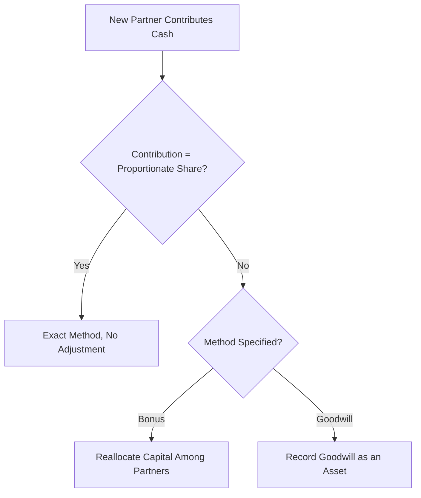
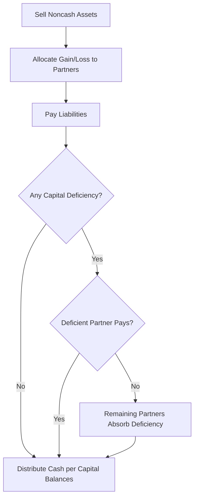

# Partnership Accounting

## Overview

A **partnership** is an association of two or more persons who carry on a business as co-owners for profit. Unlike corporations, partnerships are **not separate taxable entities**. Income and losses pass through to the individual partners, who report them on their personal tax returns. The partnership files an information return (Form 1065) but pays no federal income tax.

Each partner has a **capital account** that tracks the partner's ownership interest in the partnership's net assets. The capital account increases with contributions and allocated income. It decreases with withdrawals (drawings) and allocated losses.

$$\text{Ending Capital} = \text{Beginning Capital} + \text{Contributions} + \text{Share of Income} - \text{Drawings} - \text{Share of Losses}$$

| Feature | Partnership | Corporation |
|---|---|---|
| **Taxation** | Pass-through (no entity-level tax) | Taxed at entity level (C corporation) or pass-through (S corporation) |
| **Ownership tracking** | Capital accounts | Stockholders' equity (stock, additional paid-in capital, retained earnings) |
| **Life** | Limited (dissolves on a partner's withdrawal or death) | Perpetual |
| **Liability** | General partners have unlimited liability | Shareholders have limited liability |

:::tip[Exam Tip]

The CPA exam frequently tests the **bonus** and **goodwill** methods for admitting or withdrawing a partner. Know how to prepare the journal entries for each method.

:::

---

## Formation of a Partnership

Each partner's contribution is recorded at **fair value**. If the partnership assumes a liability attached to a partner's contributed assets, that partner's capital account is credited for the net amount (fair value of the assets minus the liability assumed).

**Example:** Bear and Polar form Kodiak Partners. Bear contributes cash of \$80,000. Polar contributes equipment with a fair value of \$120,000 and a remaining mortgage of \$20,000, which the partnership assumes.

```journal
Dr. Cash[a] 80,000
    Cr. Bear, Capital[e] 80,000
```

```journal
Dr. Equipment[a] 120,000
    Cr. Mortgage Payable[l] 20,000
    Cr. Polar, Capital[e] 100,000
```

After formation, total partnership capital is \$180,000 (Bear \$80,000 + Polar \$100,000).

---

## Admission of a Partner

A new partner may be admitted in one of two ways:

1. **Purchasing an interest from an existing partner.** The payment goes to the selling partner personally, not to the partnership. The partnership only transfers capital from the seller's account to the buyer's account, so total partnership assets and capital do not change.
2. **Contributing assets to the partnership.** Total assets and capital increase. The accounting depends on how the contribution compares with the book value of the ownership share the new partner receives, which leads to the three methods below.

### Exact Method

The new partner contributes an amount **exactly equal** to the book value of the share received (the proportionate share of net assets after the contribution). No bonus or goodwill is recorded.

**Example:** Kodiak Partners has total capital of \$200,000 (Bear \$100,000, Polar \$100,000). Panda contributes \$100,000 for a one-third interest.

$$\text{Total capital after admission} = \$200{,}000 + \$100{,}000 = \$300{,}000$$

$$\text{Panda's one-third interest} = \$300{,}000 \times \tfrac{1}{3} = \$100{,}000$$

Because the contribution equals the proportionate share, no adjustment is needed:

```journal
Dr. Cash[a] 100,000
    Cr. Panda, Capital[e] 100,000
```

### Bonus Method

When the new partner's contribution **differs** from the proportionate share of post-admission capital, the bonus method treats the difference as a **bonus**: a reallocation among the partners' capital accounts. No new asset (such as goodwill) is created.

#### Bonus to Existing Partners

If the new partner contributes **more** than the book value of the share received, the excess is a bonus to the existing partners, allocated in their profit-and-loss ratio.

**Example:** Kodiak Partners has total capital of \$200,000 (Bear \$120,000, Polar \$80,000; they share profits equally). Grizzly contributes \$160,000 for a 25% interest.

$$\text{Total capital after admission} = \$200{,}000 + \$160{,}000 = \$360{,}000$$

$$\text{Grizzly's 25\% share} = \$360{,}000 \times 0.25 = \$90{,}000$$

$$\text{Bonus to existing partners} = \$160{,}000 - \$90{,}000 = \$70{,}000$$

The \$70,000 bonus is split equally between Bear and Polar (\$35,000 each):

```journal
Dr. Cash[a] 160,000
    Cr. Grizzly, Capital[e] 90,000
    Cr. Bear, Capital[e] 35,000
    Cr. Polar, Capital[e] 35,000
```

#### Bonus to New Partner

If the new partner contributes **less** than the book value of the share received, the existing partners give up part of their capital as a bonus to the new partner, in their profit-and-loss ratio.

**Example:** Kodiak Partners has total capital of \$200,000 (Bear \$120,000, Polar \$80,000; profits shared equally). Cub Entertainment contributes \$40,000 for a 25% interest.

$$\text{Total capital after admission} = \$200{,}000 + \$40{,}000 = \$240{,}000$$

$$\text{Cub Entertainment's 25\% share} = \$240{,}000 \times 0.25 = \$60{,}000$$

$$\text{Bonus from existing partners} = \$60{,}000 - \$40{,}000 = \$20{,}000$$

The \$20,000 is deducted from Bear and Polar equally (\$10,000 each):

```journal
Dr. Cash[a] 40,000
Dr. Bear, Capital[e] 10,000
Dr. Polar, Capital[e] 10,000
    Cr. Cub Entertainment, Capital[e] 60,000
```

### Goodwill Method

Under the goodwill method, the difference between the contribution and the proportionate share is recorded as **goodwill**, an intangible asset on the partnership's balance sheet. This method creates a new asset instead of reallocating existing capital.

#### Goodwill to Existing Partners

If the new partner pays more than the book value of the share received, the existing partnership is worth more than its recorded net assets. The implied goodwill is credited to the **existing partners** in their profit-and-loss ratio.

**Example:** Kodiak Partners has total capital of \$200,000 (Bear \$120,000, Polar \$80,000; profits shared equally). Panda contributes \$150,000 for a 25% interest.

If Panda's \$150,000 buys 25%, the implied total value of the partnership is:

$$\text{Implied Total Value} = \frac{\$150{,}000}{0.25} = \$600{,}000$$

$$\text{Goodwill to existing partners} = \$600{,}000 - (\$200{,}000 + \$150{,}000) = \$250{,}000$$

The goodwill is allocated to Bear and Polar equally (\$125,000 each):

```journal
Dr. Goodwill[a] 250,000
    Cr. Bear, Capital[e] 125,000
    Cr. Polar, Capital[e] 125,000
```

```journal
Dr. Cash[a] 150,000
    Cr. Panda, Capital[e] 150,000
```

After these entries, capital is Bear \$245,000 + Polar \$205,000 + Panda \$150,000 = \$600,000. Panda's share is \$150,000 / \$600,000 = 25%, as agreed.

#### Goodwill to New Partner

If the new partner contributes **less** than the book value of the share received, goodwill may be attributed to the **new partner** for the expertise, reputation, or client base the partner brings. In this case, the existing partners' capital is the basis for valuing the partnership.

**Example:** Kodiak Partners has total capital of \$300,000 (Bear \$180,000, Polar \$120,000). Sloth Security contributes \$60,000 for a 25% interest.

The existing partners' \$300,000 of capital represents the remaining 75% interest, so the implied total capital is:

$$\text{Implied total capital} = \frac{\$300{,}000}{0.75} = \$400{,}000$$

$$\text{Sloth Security's 25\% share} = \$400{,}000 \times 0.25 = \$100{,}000$$

$$\text{Goodwill to new partner} = \$100{,}000 - \$60{,}000 = \$40{,}000$$

```journal
Dr. Cash[a] 60,000
Dr. Goodwill[a] 40,000
    Cr. Sloth Security, Capital[e] 100,000
```

After this entry, capital is Bear \$180,000 + Polar \$120,000 + Sloth Security \$100,000 = \$400,000. Sloth Security's share is \$100,000 / \$400,000 = 25%, as agreed.

:::info[Bonus vs. Goodwill: How to Choose]

The exam problem or the partnership agreement will specify which method to use. The **bonus method** is more conservative: no intangible asset is recorded, so total capital equals prior capital plus the new partner's contribution. The **goodwill method** increases total assets and capital by recording an intangible asset.

:::

### Summary of Admission Methods



---

## Profit and Loss Distribution

Partners share profits and losses according to their **partnership agreement**. The agreement may allocate income using any combination of:

- **Salary allowances:** fixed amounts that compensate partners for services
- **Interest on capital balances:** a return on invested capital
- **Residual ratio:** the remaining profit (or loss), split by an agreed ratio

:::tip[Exam Tip]

If the partnership agreement is **silent** on how to divide profits and losses, partners share them **equally**, regardless of capital balances, time devoted to the business, or any other factor.

:::

### Example: Multi-Step Allocation

Bear, Polar, and Panda are partners in Kodiak Partners with the following agreement:

| Item | Bear | Polar | Panda |
|---|---|---|---|
| Salary allowance | \$40,000 | \$30,000 | \$20,000 |
| Interest on beginning capital (10%) | 10% of \$200,000 | 10% of \$150,000 | 10% of \$100,000 |
| Residual ratio | 40% | 35% | 25% |

Net income for the year is **\$170,000**. Beginning capital balances are Bear \$200,000, Polar \$150,000, and Panda \$100,000.

| Step | Bear | Polar | Panda | Total |
|---|---|---|---|---|
| Salary allowances | \$40,000 | \$30,000 | \$20,000 | \$90,000 |
| Interest (10% of capital) | \$20,000 | \$15,000 | \$10,000 | \$45,000 |
| Subtotal allocated | \$60,000 | \$45,000 | \$30,000 | \$135,000 |
| Remainder (\$170,000 - \$135,000 = \$35,000) | \$14,000 | \$12,250 | \$8,750 | \$35,000 |
| **Total share of income** | **\$74,000** | **\$57,250** | **\$38,750** | **\$170,000** |

```journal
Dec 31
Dr. Income Summary 170,000
    Cr. Bear, Capital[e] 74,000
    Cr. Polar, Capital[e] 57,250
    Cr. Panda, Capital[e] 38,750
```

:::note

Salary and interest allowances are **not expenses** of the partnership. They are simply steps in allocating profit, and they are allocated in full even if net income is less than the total allowances. In that case, the residual amount is **negative** and is allocated to the partners as a loss in the residual ratio.

:::

---

## Withdrawal of a Partner

When a partner withdraws, the partnership pays the departing partner from partnership assets. If the payment differs from the partner's capital balance, the difference is handled with either the **bonus method** or the **goodwill method**.

### Withdrawal Under the Bonus Method

**Example:** Grizzly withdraws from a three-partner firm. Capital balances are Bear \$100,000, Polar \$80,000, and Grizzly \$70,000. All three partners share profits and losses equally. The partnership pays Grizzly \$85,000.

Grizzly receives \$15,000 more than the \$70,000 capital balance. This bonus comes from the remaining partners in their profit-and-loss ratio (equally):

```journal
Dr. Grizzly, Capital[e] 70,000
Dr. Bear, Capital[e] 7,500
Dr. Polar, Capital[e] 7,500
    Cr. Cash[a] 85,000
```

If Grizzly instead accepts only \$60,000, the \$10,000 difference is a bonus to the remaining partners:

```journal
Dr. Grizzly, Capital[e] 70,000
    Cr. Cash[a] 60,000
    Cr. Bear, Capital[e] 5,000
    Cr. Polar, Capital[e] 5,000
```

### Withdrawal Under the Goodwill Method

**Example:** Same facts: Grizzly withdraws and receives \$85,000 against a \$70,000 capital balance. Under the goodwill method, the \$15,000 excess implies the partnership has unrecorded goodwill.

Grizzly's profit-and-loss share is one-third, so the \$15,000 represents one-third of the total implied goodwill:

$$\text{Implied Goodwill} = \frac{\$15{,}000}{1/3} = \$45{,}000$$

```journal
Dr. Goodwill[a] 45,000
    Cr. Bear, Capital[e] 15,000
    Cr. Polar, Capital[e] 15,000
    Cr. Grizzly, Capital[e] 15,000
```

Grizzly's capital is now \$85,000. Pay the withdrawing partner:

```journal
Dr. Grizzly, Capital[e] 85,000
    Cr. Cash[a] 85,000
```

---

## Liquidation of a Partnership

**Liquidation** is the process of **winding down** the partnership: selling assets, paying liabilities, and distributing the remaining cash to partners. The steps are:

1. **Sell noncash assets** (called "realization") and recognize gains or losses.
2. **Allocate gains or losses** on realization to partners in the profit-and-loss ratio.
3. **Pay partnership liabilities** to outside creditors.
4. **Distribute remaining cash** to partners based on their **capital account balances** (not the profit-and-loss ratio).

:::tip[Exam Tip]

Cash is distributed to partners based on **capital balances**, not the profit-and-loss ratio. This is one of the most commonly tested points in partnership liquidation.

:::

### Simple Liquidation Example

Bear, Polar, and Panda decide to liquidate Kodiak Partners. They share profits and losses 50:30:20. Pre-liquidation balances:

| Account | Amount |
|---|---|
| Cash | \$30,000 |
| Noncash Assets | \$270,000 |
| Liabilities | \$60,000 |
| Bear, Capital | \$120,000 |
| Polar, Capital | \$72,000 |
| Panda, Capital | \$48,000 |

The noncash assets are sold for \$180,000, resulting in a loss of \$90,000.

**Step 1. Record the sale and allocate the loss:**

```journal
Dr. Cash[a] 180,000
Dr. Bear, Capital[e] 45,000
Dr. Polar, Capital[e] 27,000
Dr. Panda, Capital[e] 18,000
    Cr. Noncash Assets[a] 270,000
```

**Step 2. Pay liabilities:**

```journal
Dr. Liabilities[l] 60,000
    Cr. Cash[a] 60,000
```

**Step 3. Distribute remaining cash to partners:**

$$\text{Remaining cash} = \$30{,}000 + \$180{,}000 - \$60{,}000 = \$150{,}000$$

| Partner | Original Capital | Loss Allocation | Ending Capital |
|---|---|---|---|
| Bear | \$120,000 | (\$45,000) | \$75,000 |
| Polar | \$72,000 | (\$27,000) | \$45,000 |
| Panda | \$48,000 | (\$18,000) | \$30,000 |
| **Total** | **\$240,000** | **(\$90,000)** | **\$150,000** |

```journal
Dr. Bear, Capital[e] 75,000
Dr. Polar, Capital[e] 45,000
Dr. Panda, Capital[e] 30,000
    Cr. Cash[a] 150,000
```

### Capital Deficiency

A **capital deficiency** occurs when a partner's capital account has a **debit balance** after realization losses are allocated. The deficient partner owes that amount to the partnership.

**Example:** Kodiak Partners has the same cash (\$30,000), noncash assets (\$270,000), liabilities (\$60,000), and 50:30:20 ratio as above, but different capital balances: Bear \$130,000, Polar \$80,000, and Panda \$30,000 (still \$240,000 in total). The noncash assets sell for only \$60,000, a loss of \$210,000.

| Partner | Original Capital | Loss (50:30:20) | Ending Capital |
|---|---|---|---|
| Bear | \$130,000 | (\$105,000) | \$25,000 |
| Polar | \$80,000 | (\$63,000) | \$17,000 |
| Panda | \$30,000 | (\$42,000) | **(\$12,000)** |
| **Total** | **\$240,000** | **(\$210,000)** | **\$30,000** |

After the \$60,000 of liabilities is paid, cash is \$30,000 (\$30,000 + \$60,000 - \$60,000), which equals total capital. Panda has a \$12,000 **deficiency**. Two outcomes are possible.

#### Scenario A: Deficient Partner Pays

Panda contributes \$12,000 to eliminate the deficiency:

```journal
Dr. Cash[a] 12,000
    Cr. Panda, Capital[e] 12,000
```

No capital balance is negative now (Bear \$25,000, Polar \$17,000, Panda \$0). Cash available is \$42,000 (\$30,000 + \$12,000). Distribute it to Bear and Polar:

```journal
Dr. Bear, Capital[e] 25,000
Dr. Polar, Capital[e] 17,000
    Cr. Cash[a] 42,000
```

Cash distributed equals the remaining capital balances: \$25,000 + \$17,000 = \$42,000.

#### Scenario B: Deficient Partner Cannot Pay

If Panda **cannot pay** the deficiency, Bear and Polar absorb it in their **relative profit-and-loss ratio** (50:30, which simplifies to 5:3):

- Bear absorbs \$12,000 × 5/8 = \$7,500
- Polar absorbs \$12,000 × 3/8 = \$4,500

```journal
Dr. Bear, Capital[e] 7,500
Dr. Polar, Capital[e] 4,500
    Cr. Panda, Capital[e] 12,000
```

Updated capital balances are Bear \$17,500, Polar \$12,500, and Panda \$0. Cash available is \$30,000. Distribute:

| Partner | Final Capital | Cash Received |
|---|---|---|
| Bear | \$17,500 | \$17,500 |
| Polar | \$12,500 | \$12,500 |
| Panda | \$0 | \$0 |

```journal
Dr. Bear, Capital[e] 17,500
Dr. Polar, Capital[e] 12,500
    Cr. Cash[a] 30,000
```

Cash distributed equals the remaining capital balances: \$17,500 + \$12,500 = \$30,000.

---

## Liquidation Process: Visual Summary



---

:::note[Chapter Checklist]

- [ ] I can explain why partnerships are pass-through entities for tax purposes
- [ ] I can record the formation of a partnership with assets contributed at fair value, net of liabilities assumed
- [ ] I can apply the **exact method** when a new partner's contribution equals the proportionate share
- [ ] I can apply the **bonus method** for admitting a new partner (bonus to existing or to new partner)
- [ ] I can apply the **goodwill method** for admitting a new partner (goodwill to existing or to new partner)
- [ ] I can allocate partnership profits and losses using salary allowances, interest on capital, and a residual ratio
- [ ] I know that in the absence of an agreement, partners share profits and losses **equally**
- [ ] I can record the withdrawal of a partner using both the bonus and goodwill methods
- [ ] I can walk through a full partnership liquidation: sell assets, allocate gains and losses, pay liabilities, and distribute cash
- [ ] I can handle a **capital deficiency**, whether the partner pays it or the remaining partners absorb it
- [ ] I understand that final cash distributions are based on **capital balances**, not the profit-and-loss ratio

:::
