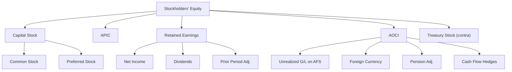

# Stockholders' Equity

## Overview

**Stockholders' equity** is the **residual interest** in a corporation's assets after deducting all liabilities. It is the owners' claim on the company's net assets. The balance sheet reports equity in five major components: capital stock, additional paid-in capital (APIC), retained earnings, accumulated other comprehensive income (AOCI), and treasury stock (a deduction).

$$\text{Stockholders' Equity} = \text{Capital Stock} + \text{APIC} + \text{Retained Earnings} + \text{AOCI} - \text{Treasury Stock}$$

| Component | Description |
|---|---|
| **Capital Stock** | Par or stated value of issued shares (common and preferred) |
| **Additional Paid-in Capital (APIC)** | Amounts received in excess of par value on stock issuances |
| **Retained Earnings** | Cumulative net income less cumulative dividends and other adjustments |
| **Accumulated Other Comprehensive Income (AOCI)** | Cumulative other comprehensive income (OCI) items: unrealized gains and losses on available-for-sale (AFS) debt securities, foreign currency translation, pension adjustments, and cash flow hedges |
| **Treasury Stock** | Cost (or par value) of the company's own shares that have been reacquired |

:::info

Equity is also called **net assets**, **shareholders' equity**, or **owners' equity**. Partnerships and sole proprietorships use different terms (partners' capital, owner's capital), but the concept is the same.

:::

---

## Common Stock

### Properties and Rights

Common stock is the basic **ownership interest** in a corporation. Common stockholders typically have these rights:

1. **Voting rights:** elect the board of directors and vote on major corporate actions
2. **Dividend rights:** share in distributions of earnings when the board declares them
3. **Liquidation rights:** receive a proportionate share of remaining assets after all claims are satisfied
4. **Preemptive rights:** maintain proportionate ownership when new shares are issued (not always granted)

### Issuance of Common Stock

When a corporation issues common stock, it credits the **Common Stock** account for par value and **APIC** for any excess.

**Example:** Bear Co. issues 10,000 shares of \$2 par value common stock at \$25 per share:

```journal
Dr. Cash                        250,000
    Cr. Common Stock                20,000
    Cr. Additional Paid-in Capital  230,000
```

### Issuance for Non-Cash Consideration

Stock issued for property or services is recorded at the **fair value of the consideration received** or the **fair value of the stock issued**, whichever is more readily determinable.

**Example:** Polar Co. issues 5,000 shares of \$1 par common stock (market price \$30 per share) in exchange for a building with an appraised value of \$145,000:

```journal
Dr. Building                    150,000
    Cr. Common Stock                5,000
    Cr. Additional Paid-in Capital  145,000
```

The stock's fair value (5,000 × \$30 = \$150,000) is used because a quoted market price is more readily determinable than the building's appraised value.

### No-Par Stock

Some states allow corporations to issue **no-par stock**. If no-par stock has a **stated value**, the stated value is treated like par value. If there is no stated value, the entire proceeds are credited to Common Stock.

**Example:** Grizzly Inc. issues 1,000 shares of no-par common stock (no stated value) at \$40 per share:

```journal
Dr. Cash                        40,000
    Cr. Common Stock                40,000
```

---

## Preferred Stock

Preferred stock carries **preferential rights** over common stock, usually for dividends and liquidation.

### Types of Preferred Stock

| Type                       | Feature                                                                                                      |
| -------------------------- | ------------------------------------------------------------------------------------------------------------ |
| **Cumulative**             | Unpaid dividends accumulate as **dividends in arrears** and must be paid before any common dividends         |
| **Non-cumulative**         | Unpaid dividends do not accumulate; skipped dividends are lost permanently                                   |
| **Participating**          | After receiving its stated dividend, preferred stock shares in additional dividends with common stock        |
| **Convertible**            | Can be exchanged for common stock at a predetermined conversion ratio                                        |
| **Callable**               | The corporation can redeem the stock at a specified call price                                               |
| **Mandatorily Redeemable** | Must be redeemed on a specified date or upon an event certain to occur; classified as a **liability** under Accounting Standards Codification (ASC) 480 |

:::danger[Mandatorily Redeemable Preferred Stock]

Under ASC 480, mandatorily redeemable financial instruments are classified as **liabilities**, not equity. This distinction is frequently tested. Dividends on mandatorily redeemable preferred stock are reported as **interest expense**.

:::

### Issuance of Preferred Stock

**Example:** Kodiak Partners issues 2,000 shares of \$100 par, 6% cumulative preferred stock at \$108 per share:

```journal
Dr. Cash                        216,000
    Cr. Preferred Stock             200,000
    Cr. Additional Paid-in Capital (Preferred)  16,000
```

### Conversion of Preferred to Common

Conversions of convertible preferred stock use the **book value method**. The carrying amount of the preferred stock moves to common stock, and no gain or loss is recognized.

**Example:** Panda Industries converts 1,000 shares of \$50 par preferred stock (originally issued at \$55 per share, so APIC is \$5,000) into 4,000 shares of \$5 par common stock:

```journal
Dr. Preferred Stock             50,000
Dr. APIC (Preferred)            5,000
    Cr. Common Stock                20,000
    Cr. APIC (Common)               35,000
```

### Dividends in Arrears

Dividends in arrears on cumulative preferred stock are **not a liability** until declared. They must, however, be **disclosed** in the notes to the financial statements.

---

## Book Value Per Share

**Book value per share** measures the net assets attributable to each share of common stock:

$$\text{Book Value per Share} = \frac{\text{Total Stockholders' Equity} - \text{Preferred Stock Equity}}{\text{Common Shares Outstanding}}$$

**Preferred stock equity** is the par value (or the call or liquidation value) of the preferred stock plus any dividends in arrears on cumulative preferred stock.

**Example:** Cub Entertainment reports:

| Item | Amount |
|---|---|
| Total stockholders' equity | \$1,200,000 |
| Preferred stock (1,000 shares, \$100 par, 8% cumulative, callable at \$105) | \$100,000 |
| Dividends in arrears (2 years) | \$16,000 |
| Common shares outstanding | 50,000 |

$$\text{Preferred Stock Equity} = (1{,}000 \times \$105) + \$16{,}000 = \$121{,}000$$

$$\text{Book Value per Share} = \frac{\$1{,}200{,}000 - \$121{,}000}{50{,}000} = \$21.58$$

:::tip

When preferred stock is callable, use the **call price** (not par) to compute preferred stock equity. If it is not callable, use **par value** or **liquidation value** as appropriate.

:::

---

## Additional Paid-in Capital (APIC)

APIC arises from these sources:

- Issue price in excess of par or stated value
- Treasury stock transactions (under both the cost and par value methods)
- Stock-based compensation
- Conversion of preferred stock to common stock
- Retirement of treasury stock (in some cases)
- Donated capital

APIC is **never debited below zero**. If a transaction would reduce an APIC account below zero, the excess is charged to **Retained Earnings**.

---

## Retained Earnings

Retained earnings represent the corporation's **cumulative net income** since inception, less cumulative **dividends** declared, plus or minus **prior period adjustments**.

$$\text{Ending RE} = \text{Beginning RE} + \text{Net Income} - \text{Dividends Declared} \pm \text{Prior Period Adjustments}$$

### Prior Period Adjustments

Prior period adjustments **correct errors** in previously issued financial statements (ASC 250). They are reported, net of tax, as adjustments to the **beginning balance** of retained earnings in the period the error is discovered. If comparative statements are presented, the prior periods are restated.

**Example:** Bear Co. discovers in Year 3 that it failed to record \$30,000 of depreciation expense in Year 1. Its tax return correctly deducted the depreciation. The tax rate is 25%.

```journal
Dr. Retained Earnings           22,500
Dr. Deferred Tax Liability       7,500
    Cr. Accumulated Depreciation    30,000
```

The retained earnings adjustment is net of tax: \$30,000 × (1 - 0.25) = \$22,500. The \$7,500 debit removes the deferred tax liability that arose when book depreciation was understated. If the depreciation had also been omitted from the tax return, the \$7,500 debit would go to Income Tax Refund Receivable instead.

### Appropriated Retained Earnings

The board of directors may **appropriate** (restrict) part of retained earnings for a specific purpose, such as future plant expansion. Appropriated retained earnings are still part of total retained earnings. They are segregated only to signal that those earnings are not available for dividends.

:::note

Appropriations of retained earnings do **not** set aside cash or any other asset. They are merely a reclassification within equity.

:::

### Quasi-Reorganizations

A **quasi-reorganization** allows a corporation to **eliminate a deficit in retained earnings** without going through formal bankruptcy. The process:

1. Revalue assets to fair value. Write-downs increase the deficit; a net write-up of assets is generally not permitted.
2. Eliminate the retained earnings deficit against APIC (or other paid-in capital).
3. Reset the retained earnings balance to **zero**. The new balance is dated (labeled with the reorganization date) for 3 to 10 years.

---

## Treasury Stock

**Treasury stock** is a corporation's own stock that has been **issued and later reacquired** but not retired. It is reported as a **contra-equity** account (a deduction from total stockholders' equity).

:::warning

Treasury shares are **not** outstanding shares. They have no voting or dividend rights and are excluded from earnings per share (EPS) calculations.

:::

### Cost Method

Under the cost method, treasury stock is recorded at its **reacquisition cost**. This is the more common method.

#### Purchase of Treasury Stock

**Example:** Polar Co. reacquires 1,000 shares of its own \$5 par common stock at \$35 per share:

```journal
Dr. Treasury Stock              35,000
    Cr. Cash                        35,000
```

#### Reissuance Above Cost

Polar Co. later reissues 400 of the treasury shares at \$40 per share. The \$5 per share excess over cost (\$2,000) is credited to APIC (Treasury Stock):

```journal
Dr. Cash                        16,000
    Cr. Treasury Stock              14,000
    Cr. APIC (Treasury Stock)       2,000
```

#### Reissuance Below Cost

Polar Co. reissues the remaining 600 shares at \$30 per share:

```journal
Dr. Cash                        18,000
Dr. APIC (Treasury Stock)       2,000
Dr. Retained Earnings           1,000
    Cr. Treasury Stock              21,000
```

The total shortfall is \$3,000 ((\$35 - \$30) × 600 shares). The \$2,000 balance in APIC (Treasury Stock) from the prior reissuance absorbs it first. The remaining \$1,000 is charged to Retained Earnings.

:::tip[Cost Method Rule]

When reissuing treasury stock **below cost**, first reduce APIC (Treasury Stock) to zero, then charge any remaining amount to **Retained Earnings**. Never debit APIC (Treasury Stock) below zero.

:::

#### Retirement of Treasury Stock (Cost Method)

Suppose instead that, before any reissuance, Polar Co. **retires** 200 of its treasury shares. The shares were originally issued at \$25 (\$5 par plus \$20 APIC per share) and reacquired at \$35:

```journal
Dr. Common Stock                1,000
Dr. APIC (Common)               4,000
Dr. Retained Earnings           2,000
    Cr. Treasury Stock              7,000
```

- Common Stock: 200 × \$5 par = \$1,000
- APIC: 200 × \$20 = \$4,000
- Treasury Stock: 200 × \$35 cost = \$7,000
- Excess cost charged to Retained Earnings: \$7,000 - \$1,000 - \$4,000 = \$2,000

### Par Value Method

Under the par value method, treasury stock is recorded at **par value** when reacquired, and the original APIC on those shares is removed.

#### Purchase of Treasury Stock (Par Value Method)

**Example:** Grizzly Inc. reacquires 500 shares of its own \$10 par common stock (originally issued at \$28 per share) at \$32 per share:

```journal
Dr. Treasury Stock              5,000
Dr. APIC (Common)               9,000
Dr. Retained Earnings           2,000
    Cr. Cash                        16,000
```

- Treasury Stock: 500 × \$10 par = \$5,000
- APIC removed: 500 × (\$28 - \$10) = \$9,000
- Excess of cost over original issue price, charged to Retained Earnings: 500 × (\$32 - \$28) = \$2,000

#### Reissuance (Par Value Method)

Reissuance under the par value method is treated like a **new issuance**: credit Treasury Stock for par and APIC for the excess.

Grizzly Inc. reissues 300 of the treasury shares at \$36 per share:

```journal
Dr. Cash                        10,800
    Cr. Treasury Stock              3,000
    Cr. APIC (Common)               7,800
```

### Cost Method vs. Par Value Method Summary

| Feature                    | Cost Method               | Par Value Method               |
| -------------------------- | ------------------------- | ------------------------------ |
| Treasury stock recorded at | Reacquisition cost        | Par value                      |
| APIC affected at purchase? | No                        | Yes, original APIC removed     |
| Total equity at purchase   | Same under both methods   | Same under both methods        |
| Presentation               | Single contra-equity line | Treasury stock + adjusted APIC |

---

## Donated Shares

When a stockholder **donates shares back** to the corporation, the transaction is recorded with a **memo entry only**. No journal entry is required because the corporation gives up no assets. The shares become treasury shares.

If the donated shares are later resold, the proceeds are credited to **APIC (Donated Capital)**.

**Example:** A major shareholder of Sloth Security donates 500 shares back to the company. Sloth Security later sells them for \$20 per share:

```journal
Dr. Cash                        10,000
    Cr. APIC (Donated Capital)      10,000
```

---

## Stock Subscriptions

A **stock subscription** is a contract in which an investor agrees to buy shares and pay for them later, often in installments. The shares are not issued until they are fully paid.

**Example:** Panda Industries receives subscriptions for 2,000 shares of \$5 par common stock at \$22 per share, with a 50% down payment.

On the subscription date:

```journal
Dr. Stock Subscriptions Receivable   44,000
    Cr. Common Stock Subscribed          10,000
    Cr. APIC (Common)                    34,000
```

On receipt of the down payment:

```journal
Dr. Cash                              22,000
    Cr. Stock Subscriptions Receivable    22,000
```

On final payment, collect the balance and issue the shares:

```journal
Dr. Cash                              22,000
    Cr. Stock Subscriptions Receivable    22,000
```

```journal
Dr. Common Stock Subscribed           10,000
    Cr. Common Stock                      10,000
```

:::warning[Balance Sheet Classification]

Stock Subscriptions Receivable is generally reported as a **contra-equity** account (a deduction from stockholders' equity). It may be reported as an asset only in limited circumstances, when there is substantial evidence that the subscriber will pay within a reasonably short period. Securities and Exchange Commission (SEC) registrants generally must report it as contra-equity.

:::

---

## Stock Rights and Warrants

**Stock rights** (or warrants) give existing shareholders the right to buy additional shares at a specified price. For the issuing corporation:

- **Issuance of rights:** usually no journal entry (memo entry only)
- **Exercise of rights:** recorded as a regular stock issuance at the exercise price
- **Expiration of rights:** no journal entry

---

## Distributions to Shareholders

### Cash Dividends

Cash dividends are the most common form of distribution. Three dates matter:

| Date | Event | Journal Entry? |
|---|---|---|
| **Declaration date** | Board declares the dividend; a liability is created | Yes |
| **Record date** | Determines which shareholders receive the dividend | No |
| **Payment date** | Cash is distributed to shareholders | Yes |

**Example:** On March 1, Bear Co. declares a \$2.00 per share cash dividend on 50,000 shares outstanding, payable April 15 to shareholders of record on March 20.

On the declaration date:

```journal
Mar 1
Dr. Retained Earnings (or Dividends Declared)  100,000
    Cr. Dividends Payable                           100,000
```

On the payment date:

```journal
Apr 15
Dr. Dividends Payable           100,000
    Cr. Cash                        100,000
```

### Property Dividends

A **property dividend** is a distribution of noncash assets. The asset is **remeasured to fair value** on the declaration date, and any gain or loss is recognized in income.

**Example:** Cub Entertainment declares a property dividend of investments with a carrying value of \$60,000 and a fair value of \$75,000.

On the declaration date, remeasure the investments to fair value:

```journal
Dr. Investments                 15,000
    Cr. Gain on Appreciation of Investments  15,000
```

Also on the declaration date, record the dividend:

```journal
Dr. Retained Earnings           75,000
    Cr. Property Dividends Payable   75,000
```

On the payment date, distribute the property:

```journal
Dr. Property Dividends Payable  75,000
    Cr. Investments                  75,000
```

:::tip

Property dividends are always recorded at **fair value** on the declaration date. Remember to recognize the gain or loss on remeasurement.

:::

### Stock Dividends

A **stock dividend** distributes additional shares to existing shareholders. No assets leave the corporation; the dividend is a reclassification within equity.

#### Small Stock Dividend (Less Than 20% to 25%)

A small stock dividend is recorded at the **fair market value (FMV)** of the shares distributed.

**Example:** Kodiak Partners has 100,000 shares outstanding (par \$1, market price \$30). It declares a 10% stock dividend (10,000 new shares):

```journal
Dr. Retained Earnings           300,000
    Cr. Common Stock Dividend Distributable  10,000
    Cr. APIC (Common)                        290,000
```

When the shares are distributed:

```journal
Dr. Common Stock Dividend Distributable  10,000
    Cr. Common Stock                         10,000
```

:::note

**Common Stock Dividend Distributable** is reported in the **equity section** of the balance sheet (not as a liability) between the declaration date and the distribution date.

:::

#### Large Stock Dividend (More Than 20% to 25%)

A large stock dividend is recorded at **par value** only.

**Example:** Kodiak Partners declares a 50% stock dividend (50,000 new shares, \$1 par):

```journal
Dr. Retained Earnings           50,000
    Cr. Common Stock Dividend Distributable  50,000
```

### Stock Splits

A **stock split** increases the number of shares outstanding and proportionally decreases the par value per share. **No journal entry is required**; only a memo entry is made.

**Example:** Grizzly Inc. has 100,000 shares of \$10 par common stock outstanding and declares a 2-for-1 stock split:

| | Before Split | After Split |
|---|---|---|
| Shares outstanding | 100,000 | 200,000 |
| Par value per share | \$10 | \$5 |
| Total par value | \$1,000,000 | \$1,000,000 |

:::warning[Stock Dividend vs. Stock Split]

A **small stock dividend** transfers fair value from retained earnings to paid-in capital. A **large stock dividend** transfers par value. A **stock split** changes the number of shares and the par value but transfers nothing. These distinctions are heavily tested.

:::

### Comparison of Distribution Types

| Type                                 | Assets Leave? | Retained Earnings Impact           | Shares Change? | Par Value Change? |
| ------------------------------------ | ------------- | ---------------------------------- | -------------- | ----------------- |
| Cash dividend                        | Yes           | Decrease (amount of cash declared) | No             | No                |
| Property dividend                    | Yes           | Decrease (FV of property)          | No             | No                |
| Small stock dividend (under 20%-25%) | No            | Decrease (FMV of new shares)       | Increase       | No                |
| Large stock dividend (over 20%-25%)  | No            | Decrease (par value of new shares) | Increase       | No                |
| Stock split                          | No            | No change                          | Increase       | Decrease          |

---

## Preferred Stock Dividend Allocation

When both preferred and common stock are outstanding, dividends go to preferred stockholders first, including any arrears on cumulative preferred stock.

**Example:** Polar Co. has:

- 10,000 shares of \$100 par, 6% cumulative preferred stock
- 200,000 shares of \$1 par common stock
- Dividends in arrears: 2 years
- Total dividends declared in Year 3: \$200,000

The annual preferred dividend is 10,000 × \$100 × 6% = \$60,000.

| Allocation | Preferred | Common |
|---|---|---|
| Arrears (2 years × \$60,000) | \$120,000 | \$0 |
| Current year preference | \$60,000 | \$0 |
| Remainder (\$200,000 - \$180,000) | \$0 | \$20,000 |
| **Total** | **\$180,000** | **\$20,000** |

---

## Noncontrolling Interest (NCI)

When a parent consolidates a subsidiary it does not wholly own, the portion of the subsidiary's equity attributable to **outside shareholders** is reported as **noncontrolling interest** in the consolidated balance sheet.

NCI is presented **within stockholders' equity**, separately from the parent's equity. Each period, it is adjusted for the noncontrolling shareholders' share of the subsidiary's net income and dividends.

**Example:** Bear Co. owns 80% of Panda Industries. Panda reports net income of \$100,000 and declares dividends of \$30,000.

NCI share of net income (20% × \$100,000):

```journal
Dr. Income Attributable to NCI   20,000
    Cr. Noncontrolling Interest      20,000
```

NCI share of dividends (20% × \$30,000):

```journal
Dr. Noncontrolling Interest      6,000
    Cr. Dividends Payable (NCI)      6,000
```

---

## Stock Issuance to Nonemployees

Since Accounting Standards Update (ASU) 2018-07, stock issued to **nonemployees** for goods or services falls under ASC 718, the same standard that covers employee stock compensation. The transaction is measured at the **grant-date fair value of the equity instruments issued**.

**Example:** Sloth Security issues 500 shares of \$1 par common stock (market price \$40 per share) to an attorney for legal services billed at \$19,000:

```journal
Dr. Legal Expense               20,000
    Cr. Common Stock                500
    Cr. APIC (Common)               19,500
```

The fair value of the stock (500 × \$40 = \$20,000) is used, not the \$19,000 billed amount.

---

## Components of Stockholders' Equity



---

## Key Formulas

| Formula                                 | Expression                                                                             |
| --------------------------------------- | -------------------------------------------------------------------------------------- |
| **Total Stockholders' Equity**          | $$\text{Assets} - \text{Liabilities}$$                                                 |
| **Retained Earnings (ending)**          | $$\text{Beg. RE} + \text{NI} - \text{Dividends} \pm \text{Prior Period Adj.}$$         |
| **Book Value per Common Share**         | $$\frac{\text{Total SE} - \text{Preferred Equity}}{\text{Common Shares Outstanding}}$$ |
| **Small Stock Dividend (RE reduction)** | $$\text{Shares Issued} \times \text{FMV per share}$$                                   |
| **Large Stock Dividend (RE reduction)** | $$\text{Shares Issued} \times \text{Par Value per share}$$                             |

---

## Summary

| Topic                                  | Key Rule                                                |
| -------------------------------------- | ------------------------------------------------------- |
| Common stock issuance                  | Credit par to Common Stock, excess to APIC              |
| Mandatorily redeemable preferred stock | Classify as **liability**                               |
| Cumulative preferred arrears           | Disclose in notes; not a liability until declared       |
| Treasury stock (cost method)           | Record at reacquisition cost; single contra-equity line |
| Treasury stock (par value method)      | Record at par; remove original APIC at purchase         |
| Small stock dividend                   | Record at **FMV**; debit Retained Earnings              |
| Large stock dividend                   | Record at **par value**; debit Retained Earnings        |
| Stock split                            | Memo entry only; par value decreases, shares increase   |
| Property dividend                      | Remeasure to **fair value**; recognize gain or loss     |
| Noncontrolling interest                | Report in equity, separate from parent's equity         |
