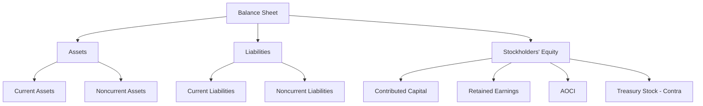
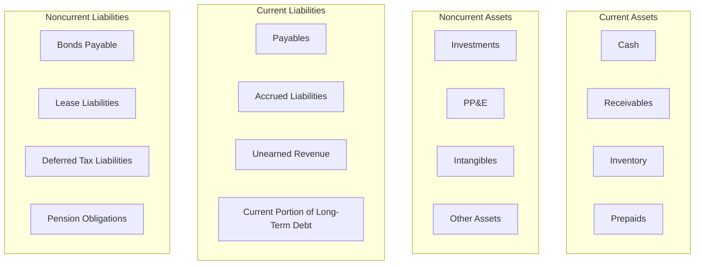

# Balance Sheet / Statement of Financial Position

The **balance sheet** (also called the **statement of financial position**) reports an entity's **assets**, **liabilities**, and **stockholders' equity** at a specific **point in time**. It is the only primary financial statement that shows a snapshot rather than activity over a period.

$$
\text{Assets} = \text{Liabilities} + \text{Stockholders' Equity}
$$

:::info[Key Concept]

The balance sheet answers one question: _What does the company own, what does it owe, and what is the owners' residual interest right now?_

:::

---

## Classified vs. Unclassified Balance Sheet

| Type             | Description                                                                     | Used By                                                |
| ---------------- | ------------------------------------------------------------------------------- | ------------------------------------------------------ |
| **Classified**   | Separates assets and liabilities into **current** and **noncurrent** categories | Most commercial and industrial entities                |
| **Unclassified** | Does not distinguish between current and noncurrent                             | Financial institutions, certain specialized industries |

:::tip[Exam Tip]

The CPA Exam overwhelmingly tests the **classified** balance sheet. Know the current/noncurrent distinction cold.

:::

---

## Liquidity-Based Presentation

Some entities, particularly financial institutions, present assets and liabilities in **order of liquidity** instead of classifying them as current or noncurrent. Under U.S. generally accepted accounting principles (GAAP), the classified format is the norm for general-purpose financial statements. Under International Financial Reporting Standards (IFRS), a liquidity-based presentation is permitted when it provides information that is reliable and more relevant.

---

## Assets

An asset is "a present right of an entity to an economic benefit" (Concepts Statement No. 8, Chapter 4). This December 2021 definition replaced the SFAC No. 6 definition.

### Current Assets

Current assets are expected to be **converted to cash, sold, or consumed within one year** (or the operating cycle, if longer). They are presented in order of **liquidity**.

| Category | Examples |
|---|---|
| **Cash and cash equivalents** | Bank balances, money market funds, Treasury bills with an original maturity of three months or less |
| **Short-term investments** | Trading securities, available-for-sale (AFS) debt securities expected to be sold within one year |
| **Accounts receivable** | Trade receivables (net of the allowance for doubtful accounts) |
| **Inventories** | Raw materials, work-in-process, finished goods |
| **Prepaid expenses** | Prepaid insurance, prepaid rent |
| **Other current assets** | Current portion of notes receivable, income tax receivable |

**Example: Bear Co. current assets section**

| Bear Co. Current Assets | Dec. 31 |
|---|---:|
| Cash and cash equivalents | \$85,000 |
| Short-term investments | 40,000 |
| Accounts receivable, net of \$12,000 allowance | 188,000 |
| Inventories | 220,000 |
| Prepaid expenses | 15,000 |
| **Total current assets** | **\$548,000** |

### Investments and Funds

Noncurrent investments include:

- equity method investments
- held-to-maturity debt securities
- AFS debt securities not expected to be sold within one year
- sinking funds and the cash surrender value of life insurance
- investments in unconsolidated subsidiaries

### Property, Plant, and Equipment (PP&E)

PP&E consists of tangible, long-lived assets used in operations. It is reported at **cost less accumulated depreciation**.

For example, a \$150,000 cash purchase of equipment is recorded at cost:

```journal
Dr. Equipment                    150,000
    Cr. Cash                         150,000
```

A typical PP&E section looks like this:

| Item           |            Cost |    Accum. Depr. |             Net |
| -------------- | --------------: | --------------: | --------------: |
| Land           |       \$200,000 |             N/A |       \$200,000 |
| Buildings      |         800,000 |       (240,000) |         560,000 |
| Equipment      |         350,000 |       (105,000) |         245,000 |
| **Total PP&E** | **\$1,350,000** | **(\$345,000)** | **\$1,005,000** |

:::note

Land is **not depreciated** because it has an indefinite useful life.

:::

### Intangible Assets

Intangible assets lack physical substance but provide future economic benefits. Finite-lived intangibles are amortized. Indefinite-lived intangibles are not amortized; instead, they are tested for impairment at least annually.

| Intangible | Finite or Indefinite Life | Treatment |
|---|---|---|
| Patents | Finite | Amortize over useful life (not to exceed legal life) |
| Copyrights | Finite | Amortize over useful life |
| Trademarks | Indefinite if renewal is expected; otherwise finite | If indefinite, do not amortize; test for impairment at least annually |
| Goodwill | Indefinite | Public business entities: do not amortize; test for impairment at least annually. Private companies and not-for-profits may elect to amortize over 10 years or less |
| Customer lists | Finite | Amortize over useful life |
| Franchise agreements | Depends on terms | Amortize if finite; test for impairment if indefinite |

### Other Noncurrent Assets

- Deferred tax assets (always classified as noncurrent)
- Long-term prepaid expenses
- Operating lease right-of-use assets

---

## Liabilities

A liability is "a present obligation of an entity to transfer an economic benefit" (Concepts Statement No. 8, Chapter 4). This December 2021 definition replaced the SFAC No. 6 definition.

### Current Liabilities

Current liabilities are obligations expected to be settled within **one year** (or the operating cycle, if longer).

| Category | Examples |
|---|---|
| **Accounts payable** | Trade payables to suppliers |
| **Accrued liabilities** | Wages payable, interest payable, taxes payable |
| **Unearned revenue** | Customer deposits, gift card liabilities |
| **Short-term notes payable** | Bank lines of credit, commercial paper |
| **Current portion of long-term debt** | Principal payments due within one year |
| **Dividends payable** | Declared but unpaid cash dividends |

:::warning

A short-term obligation is classified as **current** unless the entity intends to refinance it on a long-term basis **and** demonstrates the ability to do so **before the financial statements are issued** (or available to be issued). Under ASC 470-10, the entity demonstrates that ability in one of two ways:

1. It actually refinances the obligation on a long-term basis after the balance sheet date.
2. It enters into a qualifying financing agreement that clearly permits long-term refinancing.

Under IFRS, by contrast, the refinancing agreement must be in place by the balance sheet date.

:::

**Example: Polar Co. records accrued wages**

```journal
Dr. Wages expense            45,000
    Cr. Wages payable            45,000
```

### Noncurrent Liabilities

Noncurrent liabilities are obligations not due within the next year (or operating cycle, if longer).

| Category | Examples |
|---|---|
| **Long-term notes and bonds payable** | Bonds payable (net of discount or premium and debt issuance costs), mortgage notes |
| **Lease liabilities** | Noncurrent portion of finance and operating lease obligations |
| **Deferred tax liabilities** | Temporary differences that create future taxable amounts |
| **Pension and postretirement obligations** | Net defined benefit liability |

---

## Stockholders' Equity

Stockholders' equity is the residual interest in assets after deducting liabilities. The equity section typically includes:

| Component | Description |
|---|---|
| **Common stock** | Par value of shares issued |
| **Preferred stock** | Par value of preferred shares issued |
| **Additional paid-in capital (APIC)** | Amount received above par value on stock issuances |
| **Retained earnings** | Cumulative net income less cumulative dividends |
| **Accumulated other comprehensive income (AOCI)** | Cumulative other comprehensive income (OCI) items, remembered as PUFI: pension adjustments, unrealized gains and losses on AFS debt securities, foreign currency translation, and instrument-specific credit risk |
| **Treasury stock** | Cost of shares reacquired by the entity (a contra-equity account) |
| **Noncontrolling interest** | Equity in consolidated subsidiaries not owned by the parent (formerly called minority interest) |

**Example: Grizzly Inc. issues 10,000 shares of \$1 par common stock at \$15 per share**

```journal
Dr. Cash                150,000
    Cr. Common stock         10,000
    Cr. APIC               140,000
```

**Example: Grizzly Inc. equity section**

| Grizzly Inc. Stockholders' Equity | Dec. 31 |
|---|---:|
| Preferred stock, \$100 par, 1,000 shares issued | \$100,000 |
| Common stock, \$1 par, 50,000 shares issued | 50,000 |
| Additional paid-in capital | 600,000 |
| Retained earnings | 425,000 |
| Accumulated other comprehensive income | 18,000 |
| Less: Treasury stock (2,000 shares at cost) | (30,000) |
| **Total stockholders' equity** | **\$1,163,000** |

---

## Working Capital

:::info[Definition]

**Working capital** (also called net working capital) is current assets minus current liabilities. It measures the entity's short-term liquidity. The **current ratio** expresses the same relationship as a ratio.

:::

$$
\text{Working Capital} = \text{Current Assets} - \text{Current Liabilities}
$$

$$
\text{Current Ratio} = \frac{\text{Current Assets}}{\text{Current Liabilities}}
$$

**Example: Panda Industries**

- Current assets: \$548,000
- Current liabilities: \$310,000

$$
\text{Working Capital} = \$548{,}000 - \$310{,}000 = \$238{,}000
$$

$$
\text{Current Ratio} = \frac{\$548{,}000}{\$310{,}000} \approx 1.77
$$

:::tip[Exam Tip]

A current ratio above 1.0 means the company has more current assets than current liabilities. Banks and other creditors rely heavily on this ratio in credit analysis.

:::

---

## Balance Sheet Format

There are two common formats.

### Account Format (Horizontal)

Assets appear on the **left**, and liabilities and equity appear on the **right**. This layout mirrors the accounting equation.

### Report Format (Vertical)

Assets are listed **first**, followed by liabilities and then equity, from top to bottom. This is the most common format in practice.



---

## Disclosure Requirements

The balance sheet alone cannot convey everything users need. Required disclosures include:

1. **Accounting policies**: methods used for inventory, depreciation, and revenue recognition
2. **Contingencies**: pending litigation and guarantees
3. **Contractual obligations**: lease payment maturities and purchase commitments
4. **Fair value information**: for financial instruments
5. **Related party transactions**: transactions with affiliates, officers, and directors
6. **Subsequent events**: material events that occur after the balance sheet date but before the financial statements are issued (or available to be issued)

:::warning

Some items are disclosed **parenthetically** on the face of the balance sheet, such as the allowance for doubtful accounts, accumulated depreciation, the par value of stock, and the number of shares authorized, issued, and outstanding.

:::

---

## Common Balance Sheet Classifications: Quick Reference



---

:::danger[Common Exam Pitfalls]

1. **AFS debt securities** are classified as current or noncurrent based on whether management intends to sell them within one year, not simply on their maturity date.
2. **Treasury stock** is a **contra-equity** account. It is deducted from equity, not added.
3. Public business entities never amortize **goodwill**; they only test it for impairment. Private companies and not-for-profits may elect to amortize it over 10 years or less.
4. **Sinking fund assets** are noncurrent even though they are cash, because they are restricted for a specific long-term purpose.
5. A declared but **unpaid cash dividend** is a current liability, because the declaration creates the obligation.

:::

---

## Practice Problem

Sloth Security reports the following balances at December 31:

| Account | Amount |
|---|---:|
| Cash | \$60,000 |
| Accounts receivable | 150,000 |
| Allowance for doubtful accounts | (8,000) |
| Inventory | 200,000 |
| Prepaid insurance | 12,000 |
| Land | 180,000 |
| Building | 500,000 |
| Accumulated depreciation (building) | (100,000) |
| Equipment | 220,000 |
| Accumulated depreciation (equipment) | (55,000) |
| Goodwill | 90,000 |
| Accounts payable | 85,000 |
| Wages payable | 22,000 |
| Bonds payable (due in 5 years) | 400,000 |
| Common stock (\$1 par) | 40,000 |
| APIC | 360,000 |
| Retained earnings | 380,000 |
| AOCI | 12,000 |
| Treasury stock | (50,000) |

**Required:** (a) Calculate total current assets. (b) Calculate working capital. (c) Calculate total stockholders' equity.

<details>
<summary>Solution</summary>

**(a) Total current assets:**

\$60,000 + \$150,000 - \$8,000 + \$200,000 + \$12,000 = **\$414,000**

**(b) Working capital:**

Current liabilities = \$85,000 + \$22,000 = \$107,000

Working capital = \$414,000 - \$107,000 = **\$307,000**

**(c) Total stockholders' equity:**

\$40,000 + \$360,000 + \$380,000 + \$12,000 - \$50,000 = **\$742,000**

**Check that the balance sheet balances:**

- Total assets = \$414,000 current assets + \$180,000 land + \$400,000 building (net) + \$165,000 equipment (net) + \$90,000 goodwill = **\$1,249,000**
- Total liabilities and equity = \$107,000 current liabilities + \$400,000 bonds payable + \$742,000 equity = **\$1,249,000**

</details>
