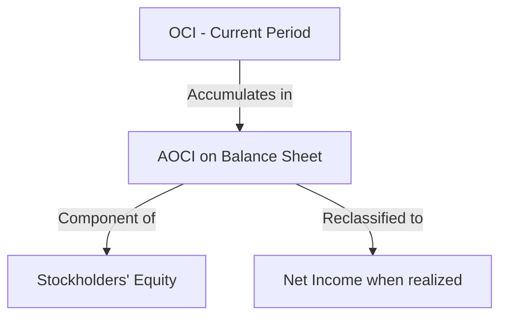
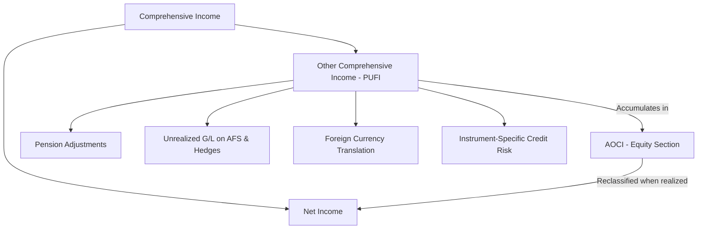

# Statement of Comprehensive Income

**Comprehensive income** is the change in equity during a period from all _nonowner sources_. It is broader than net income because it also captures items that bypass the income statement and go directly to equity.

$$
\text{Comprehensive Income} = \text{Net Income} + \text{Other Comprehensive Income (OCI)}
$$

:::info[Key Concept]

Comprehensive income gives the **complete picture** of an entity's performance. Net income reports the results on the income statement. Other comprehensive income (OCI) captures certain gains and losses that U.S. generally accepted accounting principles (GAAP) keep out of net income.

:::

---

## Other Comprehensive Income (OCI)

OCI includes gains and losses that are recognized in equity but **excluded from net income**. These items are generally unrealized, so they are "parked" in equity until they are realized or reclassified.

### The PUFI Mnemonic

:::tip[Exam Tip: PUFI]

Use **PUFI** to remember the four categories of OCI:

| Letter | Component |
|--------|-----------|
| **P** | **P**ension adjustments (prior service cost and net actuarial gains and losses) |
| **U** | **U**nrealized gains and losses on available-for-sale (AFS) debt securities, plus gains and losses on cash flow hedges |
| **F** | **F**oreign currency translation adjustments |
| **I** | **I**nstrument-specific credit risk (the part of the change in fair value of a liability measured under the fair value option that is caused by the entity's own credit risk) |

:::

### Detailed Breakdown

#### P: Pension Adjustments

When an employer sponsors a defined benefit pension plan, certain changes are recognized first in OCI rather than in pension expense:

- **Prior service cost**: arises from plan amendments that grant credit for past service. It is amortized from accumulated OCI to pension expense over the employees' future service periods.
- **Net actuarial gains and losses**: arise from changes in actuarial assumptions and from differences between the actual and expected return on plan assets. They are amortized using the corridor approach.

For example, a plan amendment that creates \$45,000 of prior service cost increases the projected benefit obligation and is recorded in OCI:

```journal
Dr. OCI (prior service cost)            45,000
    Cr. Projected benefit obligation        45,000
```

#### U: Unrealized Gains and Losses on AFS Debt Securities and Hedges

**AFS debt securities** are reported at fair value. Unrealized gains and losses are recorded in OCI, not net income. The exception is credit losses, which are recognized in net income through an allowance.

**Example: Bear Co. holds AFS debt securities**

- Amortized cost: \$200,000
- Fair value at year-end: \$215,000

The \$15,000 increase is an unrealized gain recorded in OCI:

```journal
Dr. Fair value adjustment (AFS)              15,000
    Cr. OCI (unrealized gain on AFS securities)   15,000
```

For **cash flow hedges**, the change in the hedging instrument's fair value that is included in the assessment of hedge effectiveness is recorded in OCI. It is reclassified to earnings when the hedged transaction affects earnings. Accounting Standards Update (ASU) 2017-12 eliminated the separate measurement of hedge ineffectiveness, so the older term "effective portion" no longer applies.

:::note

**Equity securities** with readily determinable fair values are measured at fair value through **net income** under Accounting Standards Codification (ASC) 321. Their fair value changes do NOT go through OCI.

:::

#### F: Foreign Currency Translation Adjustments

When a foreign subsidiary's financial statements are **translated** from its functional currency into the reporting currency (using the current rate method), the resulting translation adjustment is reported in OCI.

$$
\text{Translation Adjustment} = \text{Net Assets} \times (\text{Current Rate} - \text{Historical Rates Used})
$$

For example, if translating a wholly owned subsidiary's statements produces a \$32,000 translation gain, the parent (applying the equity method on its own books) records:

```journal
Dr. Investment in subsidiary                          32,000
    Cr. OCI (cumulative translation adjustment)           32,000
```

:::warning

Do not confuse **translation** (OCI) with **remeasurement** (net income). Translation uses the current rate method when the subsidiary's functional currency is its local currency. Remeasurement uses the temporal method when the subsidiary's functional currency is the parent's currency.

:::

#### I: Instrument-Specific Credit Risk

When an entity elects the **fair value option** for a financial liability, the part of the change in fair value caused by a change in its own (instrument-specific) credit risk is reported in OCI rather than net income (ASC 825).

## Accumulated Other Comprehensive Income (AOCI)

**AOCI** is the cumulative balance of all OCI items. It is reported as a separate component of **stockholders' equity** on the balance sheet.



**Example: Polar Co. AOCI rollforward**

| Component | Beginning AOCI | Current OCI | Reclassification | Ending AOCI |
|---|---:|---:|---:|---:|
| AFS unrealized gains | \$12,000 | \$8,000 | (\$3,000) | \$17,000 |
| Pension adjustments | (25,000) | (10,000) | 5,000 | (30,000) |
| Translation adjustments | 18,000 | (6,000) | 0 | 12,000 |
| **Total AOCI** | **\$5,000** | **(\$8,000)** | **\$2,000** | **(\$1,000)** |

---

## Presentation Approaches

GAAP allows **two options** for presenting comprehensive income. Under either option, OCI must appear in a statement of comprehensive income.

### Option 1: Single Continuous Statement

Net income and OCI appear together in one statement.

| Cub Entertainment | Year Ended Dec. 31 |
|---|---:|
| Revenues | \$900,000 |
| Expenses | (650,000) |
| **Net income** | **\$250,000** |
| **Other comprehensive income:** | |
| &emsp;Unrealized gain on AFS debt securities (net of \$5,000 tax) | 15,000 |
| &emsp;Foreign currency translation loss (net of \$3,000 tax benefit) | (9,000) |
| &emsp;Pension adjustment (net of \$2,000 tax benefit) | (6,000) |
| **Total other comprehensive income** | **\$0** |
| **Comprehensive income** | **\$250,000** |

### Option 2: Two Separate but Consecutive Statements

1. A traditional **income statement** that ends with net income
2. A separate **statement of comprehensive income** that immediately follows it, begins with net income, and adds the OCI items

For Cub Entertainment, the separate statement looks like this:

| Statement of Comprehensive Income | Amount |
|---|---:|
| **Net income** | **\$250,000** |
| **Other comprehensive income:** | |
| &emsp;Unrealized gain on AFS debt securities (net of tax) | 15,000 |
| &emsp;Foreign currency translation loss (net of tax) | (9,000) |
| &emsp;Pension adjustment (net of tax) | (6,000) |
| **Total other comprehensive income** | **\$0** |
| **Comprehensive income** | **\$250,000** |

:::warning

OCI items may **not** be presented only in the statement of changes in stockholders' equity. They must appear in either a single continuous statement or a separate statement of comprehensive income.

:::

---

## Tax Reporting Options

Each OCI component can be presented in one of two ways. Under either approach, the tax effect of each component must be shown on the face of the statement or disclosed in the notes.

| Approach | Description |
|---|---|
| **Net of tax** | Each OCI item is shown after deducting its own tax effect |
| **Before tax with aggregate tax** | All OCI items are shown at pretax amounts, with a single total tax line |

**Net-of-tax example:**

- Unrealized gain on AFS debt securities: \$20,000 pretax, 25% tax rate
- Reported as \$20,000 - \$5,000 = **\$15,000 net of tax**

**Before-tax with aggregate tax example:**

| Item | Amount |
|---|---:|
| Unrealized gain on AFS securities | \$20,000 |
| Translation loss | (12,000) |
| Pension adjustment | (8,000) |
| Total OCI before tax | \$0 |
| Tax effect | 0 |
| **Total OCI net of tax** | **\$0** |

---

## Reclassification Adjustments

When an OCI item is **realized**, it is **reclassified** out of AOCI and recognized in net income. The reclassification prevents double counting.

### Example: Kodiak Partners Sells AFS Debt Securities

Kodiak Partners holds AFS debt securities with an amortized cost of \$100,000. It previously recorded a \$10,000 unrealized gain in OCI, so the securities are carried at \$110,000 (cost plus a \$10,000 fair value adjustment). In the current year, it sells them for \$110,000, a realized gain of \$10,000.

**Step 1: Record the sale and the realized gain (net income)**

```journal
Dr. Cash                                  110,000
    Cr. AFS debt securities                   100,000
    Cr. Realized gain on sale of securities    10,000
```

**Step 2: Reclassify the gain out of AOCI and remove the fair value adjustment**

```journal
Dr. OCI (reclassification adjustment)     10,000
    Cr. Fair value adjustment (AFS)           10,000
```

:::info

Without the reclassification, the \$10,000 gain would be counted twice in comprehensive income: once in OCI when it arose and again in net income when it was realized. The \$10,000 reclassification adjustment reduces OCI by the amount now in net income, and AOCI for these securities returns to zero.

:::

---

## Journal Entry Summary

### Recording OCI Items

An unrealized gain on AFS debt securities:

```journal
Dr. Fair value adjustment (AFS)              15,000
    Cr. OCI (unrealized gain on AFS securities)   15,000
```

### Tax Effect on OCI

The deferred tax on that gain at a 25% rate (\$15,000 × 25%):

```journal
Dr. OCI (tax effect)               3,750
    Cr. Deferred tax liability         3,750
```

### Reclassification Adjustment

When the securities are sold, the realized gain is recorded in net income with the sale entry (as in the Kodiak Partners example), and the reclassification adjustment removes the gain from AOCI:

```journal
Dr. OCI (reclassification adjustment)    15,000
    Cr. Fair value adjustment (AFS)          15,000
```

---

## Comprehensive Income vs. Net Income

| Feature                      | Net Income | Comprehensive Income                 |
| ---------------------------- | ---------- | ------------------------------------ |
| Includes operating results   | Yes        | Yes                                  |
| Includes OCI items           | No         | Yes                                  |
| Reported on income statement | Yes        | Yes (combined or separate statement) |
| Affects retained earnings    | Yes        | Only the net income portion          |
| Affects AOCI                 | No         | OCI portion goes to AOCI             |

---

## Summary



:::danger[Common Exam Pitfalls]

1. Including fair value changes on **equity securities** in OCI. Those go through **net income**.
2. Forgetting to **reclassify** OCI items when they are realized, which double counts them.
3. Confusing foreign currency **translation** adjustments (OCI) with **transaction** gains and losses (net income).
4. Reporting OCI only in the equity statement. A statement of comprehensive income is **required**.
5. Forgetting the **I** in PUFI. Instrument-specific credit risk is a newer addition (ASU 2016-01).

:::

---

## Practice Problem

Grizzly Inc. reports the following for the year ended December 31:

- Net income: \$400,000
- Unrealized loss on AFS debt securities (pretax): \$20,000
- Foreign currency translation gain: \$35,000 (no tax effect, because the subsidiary's earnings are indefinitely reinvested)
- Prior service cost from a pension plan amendment (pretax): \$50,000
- Tax rate: 25%

**Required:** Calculate comprehensive income.

<details>
<summary>Solution</summary>

| Item | Pretax | Tax Effect | Net of Tax |
|---|---:|---:|---:|
| Net income | | | \$400,000 |
| Unrealized loss on AFS | (\$20,000) | \$5,000 | (\$15,000) |
| Translation gain | \$35,000 | None | \$35,000 |
| Prior service cost | (\$50,000) | \$12,500 | (\$37,500) |
| **Comprehensive income** | | | **\$382,500** |

</details>
