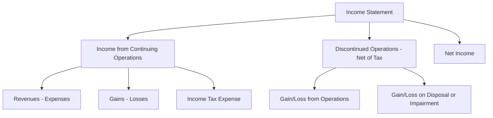

# Income Statement

The **income statement** (also called the **statement of operations** or **profit and loss statement**) reports an entity's financial performance over a period of time. It summarizes revenues, expenses, gains, and losses and arrives at **net income** or **net loss**.

:::info[Key Concept]

The income statement answers one question: _How much did the company earn (or lose) during this period?_ It is an accrual-basis statement. Revenues are recognized when earned and expenses when incurred, regardless of when cash is received or paid.

:::

---

## Core Components

### Revenues and Expenses

- **Revenues** arise from an entity's _ongoing major or central operations_ (for example, sales revenue, service revenue, or interest revenue for a bank).
- **Expenses** are outflows or using up of assets (or incurrences of liabilities) from delivering goods, rendering services, or carrying out other activities that make up the entity's ongoing operations.

### Gains and Losses

- **Gains** are increases in equity from _peripheral or incidental_ transactions (for example, a gain on the sale of equipment).
- **Losses** are decreases in equity from _peripheral or incidental_ transactions (for example, a loss from a lawsuit or on the disposal of assets).

:::tip[Exam Tip]

Revenues and expenses relate to the **core business**. Gains and losses relate to **peripheral** activities. The distinction drives income statement classification.

:::

### Expired vs. Unexpired Costs

| Term               | Definition                                                                                 | Example                                                |
| ------------------ | ------------------------------------------------------------------------------------------ | ------------------------------------------------------ |
| **Unexpired cost** | A cost that has future economic benefit; reported as an **asset** on the balance sheet     | Prepaid insurance, inventory, equipment                |
| **Expired cost**   | A cost whose benefit has been consumed; reported as an **expense** on the income statement | Cost of goods sold, depreciation expense, rent expense |

When a cost _expires_, it moves from the balance sheet to the income statement.

---

## Gross vs. Net Reporting

:::warning[Important Distinction]

**Revenues and expenses** are reported at **gross** amounts. **Gains and losses** are reported at **net** amounts (proceeds minus carrying amount).

:::

**Example: Bear Co. sells equipment**

- Original cost: \$50,000
- Accumulated depreciation: \$30,000
- Sale price: \$25,000

$$
\text{Gain} = \$25{,}000 - (\$50{,}000 - \$30{,}000) = \$5{,}000
$$

The income statement reports the **net gain of \$5,000**, not the gross proceeds of \$25,000.

```journal
Dr. Cash                          25,000
Dr. Accumulated depreciation      30,000
    Cr. Equipment                     50,000
    Cr. Gain on sale of equipment      5,000
```

---

## Income Statement Formats

### Single-Step Income Statement

A single-step statement groups all revenues and gains together, then subtracts all expenses and losses in one step.

|                                |        Amount |
| ------------------------------ | ------------: |
| **Revenues and Gains**         |               |
| Sales revenue                  |     \$500,000 |
| Interest revenue               |        10,000 |
| Gain on sale of equipment      |         5,000 |
| **Total revenues and gains**   | **\$515,000** |
| **Expenses and Losses**        |               |
| Cost of goods sold             |     (300,000) |
| Selling expenses               |      (50,000) |
| Administrative expenses        |      (40,000) |
| Interest expense               |      (15,000) |
| Loss on lawsuit                |       (8,000) |
| **Total expenses and losses**  | **(413,000)** |
| **Income before income taxes** | **\$102,000** |
| Income tax expense             |      (30,600) |
| **Net income**                 |  **\$71,400** |

### Multiple-Step Income Statement

A multiple-step statement separates operating and nonoperating activities and shows subtotals such as **gross profit** and **operating income**.

|                                       |        Amount |
| ------------------------------------- | ------------: |
| Sales revenue                         |     \$500,000 |
| Less: Cost of goods sold              |     (300,000) |
| **Gross profit**                      | **\$200,000** |
| Operating expenses:                   |               |
| &emsp;Selling expenses                |      (50,000) |
| &emsp;Administrative expenses         |      (40,000) |
| **Operating income**                  | **\$110,000** |
| Other revenues and gains:             |               |
| &emsp;Interest revenue                |        10,000 |
| &emsp;Gain on sale of equipment       |         5,000 |
| Other expenses and losses:            |               |
| &emsp;Interest expense                |      (15,000) |
| &emsp;Loss on lawsuit                 |       (8,000) |
| **Income before income taxes**        | **\$102,000** |
| Income tax expense                    |      (30,600) |
| **Income from continuing operations** |  **\$71,400** |

:::tip[Exam Tip]

The multiple-step format is tested more often. Know the order of the lines:

1. Sales
2. Cost of goods sold (COGS)
3. Gross profit
4. Operating expenses
5. Operating income
6. Other revenues, gains, expenses, and losses
7. Income tax expense
8. Income from continuing operations
9. Discontinued operations (net of tax)
10. Net income

:::

---

## Income from Continuing Operations

Income from continuing operations is the result of regular, recurring business activities **before** any discontinued operations. It includes:

1. operating revenues and expenses
2. nonoperating items (interest, and gains or losses on asset disposals)
3. income tax expense on continuing operations

---

## Discontinued Operations

:::warning[Critical Topic]

Discontinued operations are reported **separately**, **net of tax**, **below** income from continuing operations. This is one of the most heavily tested income statement topics on the CPA Exam.

:::

### What Qualifies?

A disposal of a component is reported as a discontinued operation when it represents a **strategic shift** that has (or will have) a major effect on the entity's operations and financial results. The component must be disposed of (by sale or otherwise) or classified as held for sale. Examples include the disposal of:

- a major line of business
- a major geographical area
- a major equity method investment

### Held-for-Sale Classification

A component is classified as **held for sale** when **all** of the following criteria are met:

1. Management commits to a plan to sell.
2. The component is available for immediate sale in its present condition.
3. An active program to locate a buyer has been initiated.
4. The sale is probable and expected to be completed within **one year**.
5. The component is being actively marketed at a reasonable price.
6. It is unlikely that significant changes will be made to the plan.

### Reporting Discontinued Operations

The results of a discontinued operation are reported net of tax. They have two parts:

1. **Income or loss from operations** of the discontinued component (its revenues minus expenses for the period)
2. **Gain or loss on disposal** of the component, including any impairment loss recognized when it is classified as held for sale

The disposal gain or loss may be presented separately on the face of the income statement or disclosed in the notes.

### Impairment Loss on Held-for-Sale Components

A component classified as held for sale is measured at the **lower of its carrying amount or fair value less costs to sell**. Any write-down is an impairment loss.

**Example: Polar Co. discontinues its consulting division**

- Carrying amount of the division's net assets: \$800,000
- Fair value less costs to sell: \$650,000
- Operating loss of the division during the year: \$120,000
- Tax rate: 25%

$$
\text{Impairment loss} = \$800{,}000 - \$650{,}000 = \$150{,}000
$$

```journal
Dr. Loss on impairment (discontinued operations)    150,000
    Cr. Net assets of discontinued component            150,000
```

**Income statement presentation (below income from continuing operations):**

|                                                                                              |        Amount |
| -------------------------------------------------------------------------------------------- | ------------: |
| Income from continuing operations                                                            |     \$500,000 |
| **Discontinued operations (net of tax):**                                                    |               |
| &emsp;Loss from operations of discontinued division (\$120,000 less tax benefit of \$30,000) |      (90,000) |
| &emsp;Impairment loss on discontinued division (\$150,000 less tax benefit of \$37,500)      |     (112,500) |
| **Net income**                                                                               | **\$297,500** |

### Subsequent Fair Value Increases

If fair value less costs to sell **increases** after an impairment write-down, the entity recognizes a gain. The gain cannot exceed the cumulative impairment loss previously recognized, and it is reported in discontinued operations, net of tax.

For example, if the fair value less costs to sell of Polar Co.'s division later rises by \$60,000, Polar Co. recognizes a \$60,000 gain. That amount is within the \$150,000 loss previously recognized.

```journal
Dr. Net assets of discontinued component    60,000
    Cr. Gain on recovery (discontinued operations)    60,000
```

:::note

Because the gain is limited to the cumulative impairment loss, the component can never be written up **above** its carrying amount before the impairment.

:::

---

## Foreign Currency Transactions

When an entity enters into transactions denominated in a **foreign currency**, exchange rate changes create gains and losses.

### Recording at the Spot Rate

Transactions are initially recorded at the **spot exchange rate** on the transaction date.

**Example: Grizzly Inc. buys inventory from a French supplier for €100,000 when the spot rate is \$1.10/€**

$$
\text{Payable in USD} = 100{,}000 \text{ EUR} \times \$1.10 = \$110{,}000
$$

```journal
Dr. Inventory              110,000
    Cr. Accounts payable       110,000
```

### Year-End Adjustment (Remeasurement)

At the balance sheet date, **monetary items** (such as receivables and payables) denominated in a foreign currency are adjusted to the **current spot rate**. The resulting gain or loss is reported in **net income**.

**If the spot rate at year-end is \$1.15/€:**

$$
\text{New payable} = 100{,}000 \text{ EUR} \times \$1.15 = \$115{,}000
$$

$$
\text{Exchange loss} = \$115{,}000 - \$110{,}000 = \$5{,}000
$$

```journal
Dr. Foreign currency transaction loss    5,000
    Cr. Accounts payable                    5,000
```

:::tip[Exam Tip]

A **weakening U.S. dollar** (a higher \$/€ rate) means foreign-currency **payables cost more** (a loss) and foreign-currency **receivables are worth more** (a gain). Think: "Owe more = loss; collect more = gain."

:::

### Settlement

When the transaction is settled, any further exchange difference since the last balance sheet date is recognized.

**If the spot rate at settlement is \$1.12/€:**

$$
\text{Payable at settlement} = 100{,}000 \text{ EUR} \times \$1.12 = \$112{,}000
$$

$$
\text{Exchange gain (since year-end)} = \$115{,}000 - \$112{,}000 = \$3{,}000
$$

```journal
Dr. Accounts payable                    115,000
    Cr. Cash                                112,000
    Cr. Foreign currency transaction gain     3,000
```

---

## Summary



:::danger[Common Exam Pitfalls]

1. Reporting gains **gross** instead of **net**. Gains and losses are always reported net.
2. Forgetting to report discontinued operations **net of tax**.
3. Mixing up foreign currency gains and losses. Check the direction of the rate change and whether you hold a receivable or a payable.
4. Reversing an impairment on a held-for-sale component to an amount **above** its carrying amount before the impairment.

:::

---

## Practice Problem

Panda Industries reports the following for the year ended December 31:

- Sales revenue: \$1,200,000
- Cost of goods sold: \$720,000
- Operating expenses: \$180,000
- Interest expense: \$25,000
- Gain on sale of investments: \$15,000
- Loss from operations of discontinued segment (pretax): \$60,000
- Gain on disposal of discontinued segment (pretax): \$40,000
- Tax rate: 25%

**Required:** Prepare a multiple-step income statement.

<details>
<summary>Solution</summary>

| Panda Industries                            |        Amount |
| ------------------------------------------- | ------------: |
| Sales revenue                               |   \$1,200,000 |
| Cost of goods sold                          |     (720,000) |
| **Gross profit**                            | **\$480,000** |
| Operating expenses                          |     (180,000) |
| **Operating income**                        | **\$300,000** |
| Interest expense                            |      (25,000) |
| Gain on sale of investments                 |        15,000 |
| **Income before income taxes**              | **\$290,000** |
| Income tax expense (25%)                    |      (72,500) |
| **Income from continuing operations**       | **\$217,500** |
| **Discontinued operations (net of tax):**   |               |
| &emsp;Loss from operations (\$60,000 × 75%) |      (45,000) |
| &emsp;Gain on disposal (\$40,000 × 75%)     |        30,000 |
| **Net income**                              | **\$202,500** |

</details>
