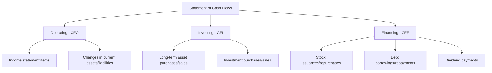
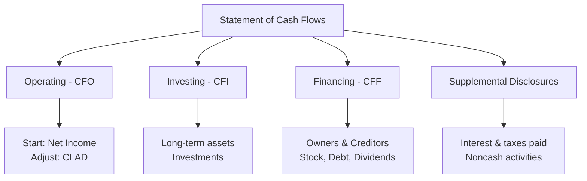

# Statement of Cash Flows

The **statement of cash flows** reports all cash inflows and outflows during a period, classified into three categories: **operating**, **investing**, and **financing** activities. It reconciles the beginning and ending cash balances and answers one question: _Where did cash come from, and where did it go?_

:::info[Key Concept]

The statement of cash flows bridges the accrual-basis income statement and actual cash movements. An entity can report strong net income and still run short of cash, or report a net loss while generating cash.

:::

---

## Cash and Cash Equivalents

**Cash** includes currency on hand and demand deposits.

**Cash equivalents** are short-term, highly liquid investments that are:

- Readily convertible to known amounts of cash
- So near maturity that they present **insignificant risk** of changes in value
- Purchased with an original maturity of **three months or less** (measured from the date the entity buys the investment)

:::tip[Exam Tip: Three-Month Rule]

Maturity is measured from the date **the entity acquires** the investment, not the date the instrument was issued. A 6-month Treasury bill (T-bill) purchased with 2 months remaining **is** a cash equivalent. A 6-month certificate of deposit (CD) purchased at issuance is **not**. A 90-day CD **is** a cash equivalent.

:::

| Cash Equivalent? | Instrument | Reason |
|---|---|---|
| Yes | 60-day T-bill | Original maturity ≤ 3 months |
| Yes | Money market fund | Readily convertible, negligible risk |
| No | 6-month CD (purchased at issuance) | Original maturity > 3 months |
| No | Equity securities | No maturity date; subject to price risk |

---

## Three Sections of the Statement

### Operating Activities (CFO)

Cash flows from operating activities (CFO) come from the entity's **principal revenue-producing activities**. They generally involve income statement items and changes in current assets and current liabilities.

**Cash inflows:**

- Cash received from customers
- Interest and dividends received
- Insurance proceeds related to operations

**Cash outflows:**

- Cash paid to suppliers and employees
- Cash paid for interest
- Cash paid for income taxes
- Cash paid for operating expenses

:::warning[Important Classifications]

Under U.S. generally accepted accounting principles (GAAP):

- **Interest paid:** Operating (even though it relates to financing)
- **Interest received:** Operating
- **Dividends received:** Operating
- **Dividends paid:** **Financing**, not operating
- **Income taxes paid:** Operating (U.S. GAAP does not allocate income taxes to investing or financing activities)

:::

### Investing Activities (CFI)

Cash flows from investing activities (CFI) come from acquiring and disposing of **long-term assets** and of investments that are not cash equivalents.

**Cash inflows:**

- Sale of property, plant, and equipment (PP&E)
- Sale of investments (debt and equity securities)
- Collection of loan principal (notes receivable)
- Sale of a business unit

**Cash outflows:**

- Purchase of PP&E
- Purchase of investments
- Loans made to other entities (notes receivable)
- Acquisition of a business

### Financing Activities (CFF)

Cash flows from financing activities (CFF) come from obtaining resources from **owners** and **creditors**, returning resources to owners, and repaying amounts borrowed.

**Cash inflows:**

- Issuance of common or preferred stock
- Issuance of bonds or notes payable
- Borrowings from banks (short-term or long-term)

**Cash outflows:**

- Repurchase of stock (treasury stock)
- Payment of cash dividends
- Repayment of debt principal
- Payment of finance lease principal



---

## Indirect Method (Most Common)

The indirect method starts with **net income** and adjusts it for noncash items and for changes in operating assets and liabilities. It is the method most used in practice and most often tested.

### The CLAD Framework

:::tip[CLAD Mnemonic]

Use **CLAD** to remember the adjustments from net income to cash from operations:

| Letter | Adjustment | Direction |
|---|---|---|
| **C** | **C**urrent asset/liability changes | See rules below |
| **L** | **L**osses add back / Gains subtract | Reverse direction |
| **A** | **A**mortization, depreciation, depletion | Add back |
| **D** | **D**eferred items (deferred tax, deferred revenue changes) | Adjust accordingly |

:::

### Current Asset and Liability Changes

| Change                                                                    | Effect on Cash from Operations |
| ------------------------------------------------------------------------- | ------------------------------ |
| Current asset **increases** (e.g., accounts receivable goes up)           | **Subtract** (used cash)       |
| Current asset **decreases** (e.g., inventory goes down)                   | **Add** (freed up cash)        |
| Current liability **increases** (e.g., accounts payable goes up)          | **Add** (conserved cash)       |
| Current liability **decreases** (e.g., wages payable goes down)           | **Subtract** (used cash)       |

:::tip[Exam Tip]

If a current **asset** increased, the company spent cash to build up that asset, so subtract. If a current **liability** increased, the company held onto cash by not paying, so add.

:::

### Losses and Gains

Remove gains and losses on investing and financing transactions (e.g., a gain on sale of equipment) from operating activities. The **total** cash from the transaction is reported in investing or financing.

- **Add back losses.** They reduced net income but did not use operating cash.
- **Subtract gains.** They increased net income, but the cash is reported in investing or financing.

### Depreciation, Amortization, Depletion

These are **noncash expenses** that reduced net income. Add them back to convert from the accrual basis to the cash basis.

## Indirect Method Example

**Bear Co.** reports the following for the year ended December 31:

| Item | Amount |
|---|---:|
| Net income | \$180,000 |
| Depreciation expense | 45,000 |
| Amortization of patent | 5,000 |
| Gain on sale of equipment | (12,000) |
| Loss on sale of investment | 8,000 |
| Increase in accounts receivable | (25,000) |
| Decrease in inventory | 15,000 |
| Increase in accounts payable | 10,000 |
| Decrease in wages payable | (3,000) |
| Increase in deferred tax liability | 7,000 |

**Cash flows from operating activities, indirect method:**

| Bear Co.: Operating Activities | Amount |
|---|---:|
| Net income | \$180,000 |
| **Adjustments:** | |
| &emsp;Depreciation expense | 45,000 |
| &emsp;Amortization of patent | 5,000 |
| &emsp;Gain on sale of equipment | (12,000) |
| &emsp;Loss on sale of investment | 8,000 |
| &emsp;Increase in accounts receivable | (25,000) |
| &emsp;Decrease in inventory | 15,000 |
| &emsp;Increase in accounts payable | 10,000 |
| &emsp;Decrease in wages payable | (3,000) |
| &emsp;Increase in deferred tax liability | 7,000 |
| **Net cash provided by operating activities** | **\$230,000** |

---

## Direct Method

The direct method reports **actual cash receipts and payments** from operating activities. It gives more detail but is rarely used in practice.

| Panda Industries: Operating Activities (Direct Method) | Amount |
|---|---:|
| Cash received from customers | \$975,000 |
| Cash paid to suppliers | (580,000) |
| Cash paid to employees | (210,000) |
| Cash paid for interest | (25,000) |
| Cash paid for income taxes | (55,000) |
| **Net cash provided by operating activities** | **\$105,000** |

### Converting Accrual to Cash (Direct Method Formulas)

In each formula, Δ is the increase in the balance during the period (a decrease enters as a negative number). AR is accounts receivable, AP is accounts payable, COGS is cost of goods sold, and OpEx is operating expenses other than noncash items such as depreciation.

$$
\text{Cash from Customers} = \text{Revenue} - \Delta\text{AR} + \Delta\text{Unearned Revenue}
$$

$$
\text{Cash to Suppliers} = \text{COGS} + \Delta\text{Inventory} - \Delta\text{AP}
$$

$$
\text{Cash for Operating Expenses} = \text{OpEx} + \Delta\text{Prepaids} - \Delta\text{Accrued Liabilities}
$$

:::note

An entity that uses the direct method must also present a **reconciliation** of net income to cash from operations (essentially the indirect method) in a separate schedule.

:::

---

## Complete Statement Example

**Polar Co.: Statement of Cash Flows (Year Ended December 31)**

| | Amount |
|---|---:|
| **Cash flows from operating activities:** | |
| Net income | \$250,000 |
| Depreciation expense | 60,000 |
| Loss on sale of equipment | 5,000 |
| Increase in accounts receivable | (30,000) |
| Decrease in prepaid expenses | 4,000 |
| Increase in accounts payable | 18,000 |
| Decrease in income tax payable | (6,000) |
| **Net cash from operating activities** | **\$301,000** |
| | |
| **Cash flows from investing activities:** | |
| Purchase of equipment | (120,000) |
| Proceeds from sale of equipment | 15,000 |
| Purchase of available-for-sale (AFS) debt securities | (50,000) |
| **Net cash used in investing activities** | **(\$155,000)** |
| | |
| **Cash flows from financing activities:** | |
| Proceeds from issuance of common stock | 75,000 |
| Repayment of long-term note payable | (40,000) |
| Payment of cash dividends | (60,000) |
| Purchase of treasury stock | (25,000) |
| **Net cash used in financing activities** | **(\$50,000)** |
| | |
| **Net increase in cash and cash equivalents** | **\$96,000** |
| Cash and cash equivalents, beginning of year | 84,000 |
| **Cash and cash equivalents, end of year** | **\$180,000** |

---

## Supplemental Disclosures

Even under the indirect method, certain items must be **separately disclosed**.

### Required Supplemental Information

| Disclosure                 | Reason                                                     |
| -------------------------- | ---------------------------------------------------------- |
| Cash paid for interest     | Interest is in operating, but users want the actual amount |
| Cash paid for income taxes | The actual cash outflow matters for analysis               |

### Noncash Investing and Financing Activities

Significant noncash transactions are **excluded** from the statement of cash flows because no cash changed hands. They must be disclosed either in a supplemental schedule or in the notes.

**Common examples:**

- Conversion of bonds to common stock
- Acquisition of assets through a finance lease (formerly called a capital lease)
- Issuance of stock for land or other assets
- Exchange of noncash assets

**Example: Grizzly Inc. acquires land by issuing stock:**

```journal
Dr. Land                    200,000
    Cr. Common stock             10,000
    Cr. Additional paid-in capital  190,000
```

This transaction appears as a noncash investing and financing disclosure:

> _Supplemental schedule of noncash investing and financing activities: The Company acquired land valued at \$200,000 by issuing 10,000 shares of common stock._

---

## Classification of Specific Items

:::warning[Frequently Tested Classifications]

| Transaction | Section |
|---|---|
| Cash received from customers | **Operating** |
| Interest paid | **Operating** |
| Interest received | **Operating** |
| Dividends received | **Operating** |
| Income taxes paid | **Operating** |
| **Dividends paid** | **Financing** |
| Purchase of PP&E | **Investing** |
| Sale of investment | **Investing** |
| Proceeds from issuing stock | **Financing** |
| Repayment of debt principal | **Financing** |
| Purchase of treasury stock | **Financing** |
| Payment of finance lease principal | **Financing** |
| Operating lease payments | **Operating** |
| Insurance proceeds (operating claim) | **Operating** |
| Insurance proceeds (from PP&E destruction) | **Investing** |

:::

---

## Journal Entry Connections

The cash side of a journal entry tells you the amount; the other account tells you the classification.

**Example: Kodiak Partners purchases equipment for cash:**

```journal
Dr. Equipment        80,000
    Cr. Cash             80,000
```

**Classification:** Investing activity, cash outflow of \$80,000.

**Example: Kodiak Partners issues bonds:**

```journal
Dr. Cash             500,000
    Cr. Bonds payable    500,000
```

**Classification:** Financing activity, cash inflow of \$500,000.

**Example: Kodiak Partners pays dividends:**

```journal
Dr. Dividends payable    30,000
    Cr. Cash                  30,000
```

**Classification:** Financing activity, cash outflow of \$30,000.

**Example: Kodiak Partners collects on notes receivable:**

```journal
Dr. Cash             25,000
    Cr. Notes receivable    25,000
```

**Classification:** Investing activity, cash inflow of \$25,000 (principal collection).

## Summary



:::danger[Common Exam Pitfalls]

1. Classifying **dividends paid** as operating. They are **financing**.
2. Classifying **interest paid** as financing. It is **operating** under U.S. GAAP.
3. Forgetting to **remove gains** from operating activities. The cash is already in investing or financing.
4. Including **noncash transactions** in the statement. They go in the supplemental disclosures.
5. Reversing the direction of current asset and liability changes. Increases in assets are **subtracted**; increases in liabilities are **added**.
6. Treating **depreciation** as a cash inflow. It is only an add-back of a noncash expense.

:::

---

## Practice Problem

Cub Entertainment provides the following data for the year:

- Net income: \$320,000
- Depreciation: \$75,000
- Gain on sale of building: \$40,000
- Proceeds from sale of building: \$190,000
- Purchase of equipment: \$250,000
- Issuance of common stock: \$100,000
- Repayment of bonds payable: \$150,000
- Dividends paid: \$80,000
- Increase in accounts receivable: \$35,000
- Decrease in accounts payable: \$20,000
- Conversion of preferred stock to common stock: \$50,000

**Required:** Prepare the statement of cash flows using the indirect method.

<details>
<summary>Solution</summary>

| Cub Entertainment: Statement of Cash Flows | Amount |
|---|---:|
| **Operating activities:** | |
| Net income | \$320,000 |
| Depreciation | 75,000 |
| Gain on sale of building | (40,000) |
| Increase in accounts receivable | (35,000) |
| Decrease in accounts payable | (20,000) |
| **Net cash from operating** | **\$300,000** |
| **Investing activities:** | |
| Proceeds from sale of building | 190,000 |
| Purchase of equipment | (250,000) |
| **Net cash used in investing** | **(\$60,000)** |
| **Financing activities:** | |
| Issuance of common stock | 100,000 |
| Repayment of bonds payable | (150,000) |
| Dividends paid | (80,000) |
| **Net cash used in financing** | **(\$130,000)** |
| **Net increase in cash** | **\$110,000** |

**Noncash disclosure:** Conversion of \$50,000 of preferred stock to common stock.

</details>
