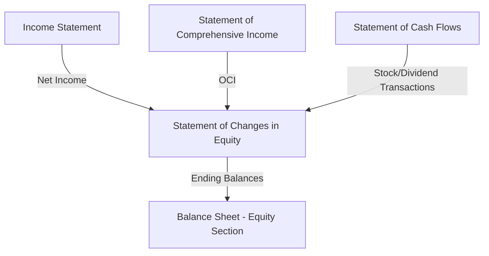

# Statement of Changes in Stockholders' Equity

The **statement of changes in stockholders' equity** (also called the **statement of shareholders' equity**) reconciles the beginning and ending balance of each component of equity for the reporting period. It shows every transaction that changed owners' equity.

:::info[Key Concept]

The balance sheet shows equity at a point in time, and the income statement shows one period's earnings. This statement ties them together by showing _how_ equity moved from the beginning to the end of the period.

:::

---

## Purpose and Importance

The statement answers four questions:

1. How much did the company earn, and how much did it retain versus distribute as dividends?
2. Did the company issue or repurchase stock?
3. What happened to accumulated other comprehensive income (AOCI)?
4. How much did each equity component change overall?

:::tip[Exam Tip]

Under U.S. generally accepted accounting principles (GAAP), when both a balance sheet and an income statement are presented, the entity must disclose the changes in **each separate component** of stockholders' equity and in the number of shares outstanding (ASC 505-10-50-2). Most entities present this as a separate statement, although the disclosure may also appear in the notes. A statement of retained earnings alone is **not** enough.

:::

---

## Components of Stockholders' Equity

| Component                                         | Description                                                                                                                                                                   |
| ------------------------------------------------- | ----------------------------------------------------------------------------------------------------------------------------------------------------------------------------- |
| **Common stock**                                  | Par value × shares issued                                                                                                                                                     |
| **Preferred stock**                               | Par value × preferred shares issued                                                                                                                                           |
| **Additional paid-in capital (APIC)**             | Excess over par from stock issuances, stock option exercises, and other capital transactions                                                                                  |
| **Retained earnings**                             | Cumulative net income less cumulative dividends declared                                                                                                                      |
| **Accumulated other comprehensive income (AOCI)** | Cumulative other comprehensive income (OCI) items, remembered as PUFI: pension adjustments; unrealized gains and losses on available-for-sale (AFS) debt securities and cash flow hedges; foreign currency translation; and instrument-specific credit risk |
| **Treasury stock**                                | Cost of reacquired shares (contra-equity)                                                                                                                                     |
| **Noncontrolling interest (NCI)**                 | Equity in consolidated subsidiaries that belongs to owners other than the parent                                                                                              |

---

## Items That Affect Equity

### Increases to Equity

| Transaction                             | Components Affected                                                 |
| --------------------------------------- | ------------------------------------------------------------------- |
| Net income                              | Increases retained earnings                                         |
| Other comprehensive income              | Increases AOCI                                                      |
| Issuance of common stock                | Increases common stock and APIC                                     |
| Issuance of preferred stock             | Increases preferred stock and APIC                                  |
| Exercise of stock options               | Increases common stock and APIC (net effect)                        |
| Reissuance of treasury stock above cost | Decreases treasury stock (a contra account, so equity rises); increases APIC |

### Decreases to Equity

| Transaction                           | Components Affected                                                   |
| ------------------------------------- | --------------------------------------------------------------------- |
| Net loss                              | Decreases retained earnings                                           |
| Other comprehensive loss              | Decreases AOCI                                                        |
| Dividends declared (cash or property) | Decreases retained earnings                                           |
| Purchase of treasury stock            | Increases treasury stock (a contra account, so equity falls)          |

### Other Equity Items

Some items move amounts between components or can change equity in either direction.

| Transaction                                | Components Affected                                                                     | Effect on Total Equity |
| ------------------------------------------ | --------------------------------------------------------------------------------------- | ---------------------- |
| Stock dividend declared                    | Decreases retained earnings; increases common stock (and APIC for a small stock dividend) | None                   |
| Stock split                                | Changes par value per share and number of shares only                                   | None                   |
| Prior period adjustment (error correction) | Restates beginning retained earnings                                                    | Increase or decrease   |

---

## Journal Entry Examples

### Stock Issuance

**Bear Co. issues 5,000 shares of \$2 par common stock at \$18 per share:**

```journal
Dr. Cash                   90,000
    Cr. Common stock           10,000
    Cr. APIC                   80,000
```

### Cash Dividend Declaration and Payment

**Bear Co. declares a \$1.50 per share cash dividend on 50,000 shares outstanding:**

```journal
Dr. Retained earnings      75,000
    Cr. Dividends payable      75,000
```

**Bear Co. pays the dividend:**

```journal
Dr. Dividends payable      75,000
    Cr. Cash                   75,000
```

### Treasury Stock Purchase (Cost Method)

**Bear Co. repurchases 2,000 shares at \$20 per share:**

```journal
Dr. Treasury stock         40,000
    Cr. Cash                   40,000
```

### Small Stock Dividend (Less Than 20% to 25%)

**Polar Co. declares a 10% stock dividend on 100,000 shares outstanding. Market price is \$25; par value is \$1:**

- New shares issued: 100,000 × 10% = 10,000 shares
- Recorded at **market value** for small stock dividends: 10,000 × \$25 = \$250,000

```journal
Dr. Retained earnings      250,000
    Cr. Common stock            10,000
    Cr. APIC                   240,000
```

:::note

A **small stock dividend** (less than 20% to 25% of shares outstanding) is recorded at **market value**. A **large stock dividend** (20% to 25% or more) is recorded at **par value**. A **stock split** requires no journal entry, only a memo entry.

:::

### Prior Period Adjustment

**Grizzly Inc. discovers it understated depreciation expense by \$30,000 in the prior year (tax rate 25%):**

```journal
Dr. Retained earnings (prior period adjustment)    22,500
Dr. Deferred tax asset                              7,500
    Cr. Accumulated depreciation                       30,000
```

This entry assumes the error affected only the books, not the tax return, so the tax effect is deferred. The \$22,500 net-of-tax amount is shown as a restatement of the **beginning balance** of retained earnings.

## Format and Presentation

The statement is usually presented in a **columnar format**: each equity component is a column, and each transaction is a row.

### Example Statement: Panda Industries

**Statement of Changes in Stockholders' Equity, Year Ended December 31**

| | Common Stock | APIC | Retained Earnings | AOCI | Treasury Stock | Total |
|---|---:|---:|---:|---:|---:|---:|
| **Balance, Jan. 1** | \$50,000 | \$400,000 | \$320,000 | \$15,000 | (\$30,000) | **\$755,000** |
| Net income | | | 180,000 | | | 180,000 |
| Other comprehensive income | | | | 12,000 | | 12,000 |
| Stock issuance (3,000 shares) | 3,000 | 42,000 | | | | 45,000 |
| Cash dividends declared | | | (60,000) | | | (60,000) |
| Treasury stock purchased | | | | | (20,000) | (20,000) |
| **Balance, Dec. 31** | **\$53,000** | **\$442,000** | **\$440,000** | **\$27,000** | **(\$50,000)** | **\$912,000** |

---

## Retained Earnings Reconciliation

The retained earnings (RE) column works as its own mini-statement:

$$
\text{Ending RE} = \text{Beginning RE} + \text{Net Income} - \text{Dividends Declared} \pm \text{Prior Period Adjustments}
$$

**Example: Sloth Security**

| Retained Earnings Reconciliation | Amount |
|---|---:|
| Beginning retained earnings (as previously reported) | \$500,000 |
| Prior period adjustment for error correction (net of tax) | (22,500) |
| **Beginning retained earnings (as restated)** | **\$477,500** |
| Add: Net income | 200,000 |
| Less: Cash dividends declared | (50,000) |
| Less: Stock dividends declared | (100,000) |
| **Ending retained earnings** | **\$527,500** |

---

## AOCI Rollforward

The AOCI column tracks cumulative other comprehensive income items:

| AOCI Rollforward | Amount |
|---|---:|
| Beginning AOCI | \$15,000 |
| Unrealized gain on AFS debt securities (net of tax) | 8,000 |
| Foreign currency translation loss (net of tax) | (4,000) |
| Pension adjustment (net of tax) | (3,000) |
| Reclassification to net income (net of tax) | (2,000) |
| **Ending AOCI** | **\$14,000** |

---

## Comprehensive Example with All Components

**Kodiak Partners: Statement of Changes in Stockholders' Equity**

| | Preferred Stock | Common Stock | APIC | Retained Earnings | AOCI | Treasury Stock | Total |
|---|---:|---:|---:|---:|---:|---:|---:|
| **Jan. 1 balance** | \$100,000 | \$25,000 | \$275,000 | \$410,000 | \$8,000 | (\$15,000) | **\$803,000** |
| Net income | | | | 195,000 | | | 195,000 |
| OCI: AFS gain | | | | | 11,000 | | 11,000 |
| OCI: Translation loss | | | | | (5,000) | | (5,000) |
| Issuance of common stock | | 5,000 | 70,000 | | | | 75,000 |
| Cash dividends | | | | (40,000) | | | (40,000) |
| Preferred dividends | | | | (8,000) | | | (8,000) |
| Treasury stock purchased | | | | | | (25,000) | (25,000) |
| **Dec. 31 balance** | **\$100,000** | **\$30,000** | **\$345,000** | **\$557,000** | **\$14,000** | **(\$40,000)** | **\$1,006,000** |

---

## Relationship to Other Statements



:::warning

The statement of changes in stockholders' equity is the **linking statement**. It carries net income and OCI from the period statements into the equity section of the point-in-time balance sheet. Equity transactions that involve cash, such as stock issuances and dividend payments, also appear as financing activities on the statement of cash flows.

:::

---

## Noncontrolling Interest

In consolidated financial statements, **noncontrolling interest (NCI)** is presented within equity, separately from the parent's equity. Changes in NCI appear in an additional column.

| | ... | NCI | Total Equity |
|---|---:|---:|---:|
| **Beginning balance** | ... | \$45,000 | ... |
| Net income attributable to NCI | ... | 12,000 | ... |
| OCI attributable to NCI | ... | 2,000 | ... |
| Dividends to NCI | ... | (5,000) | ... |
| **Ending balance** | ... | **\$54,000** | ... |

---

:::danger[Common Exam Pitfalls]

1. Confusing **dividends declared** with **dividends paid**. RE is reduced at **declaration**; payment is only a cash flow event.
2. Forgetting that a **stock split** requires no journal entry and does not change total equity. Only par value per share and shares outstanding change.
3. Recording large stock dividends at **market value** instead of **par value**.
4. Running a **prior period adjustment** through current-period income instead of restating beginning retained earnings.
5. Omitting the **AOCI** column. AOCI is a required component of the equity statement.

:::

---

## Practice Problem

Cub Entertainment provides the following information for the year ended December 31:

- Beginning common stock (\$1 par): \$40,000
- Beginning APIC: \$360,000
- Beginning retained earnings: \$280,000
- Beginning AOCI: \$10,000
- Beginning treasury stock: (\$20,000)
- Net income: \$150,000
- OCI, unrealized gain on AFS (net of tax): \$7,000
- OCI, translation loss (net of tax): (\$3,000)
- Cash dividends declared: \$45,000
- Issued 5,000 shares at \$22 per share
- Purchased 1,000 shares of treasury stock at \$19 per share

**Required:** Prepare the statement of changes in stockholders' equity and calculate ending total equity.

<details>
<summary>Solution</summary>

| | Common Stock | APIC | Retained Earnings | AOCI | Treasury Stock | Total |
|---|---:|---:|---:|---:|---:|---:|
| **Beginning** | \$40,000 | \$360,000 | \$280,000 | \$10,000 | (\$20,000) | **\$670,000** |
| Net income | | | 150,000 | | | 150,000 |
| OCI: AFS gain | | | | 7,000 | | 7,000 |
| OCI: Translation loss | | | | (3,000) | | (3,000) |
| Stock issuance | 5,000 | 105,000 | | | | 110,000 |
| Cash dividends | | | (45,000) | | | (45,000) |
| Treasury stock | | | | | (19,000) | (19,000) |
| **Ending** | **\$45,000** | **\$465,000** | **\$385,000** | **\$14,000** | **(\$39,000)** | **\$870,000** |

The 5,000 new shares bring in \$110,000 (5,000 × \$22): \$5,000 to common stock at \$1 par and \$105,000 to APIC. The treasury stock purchase costs \$19,000 (1,000 × \$19).

</details>
