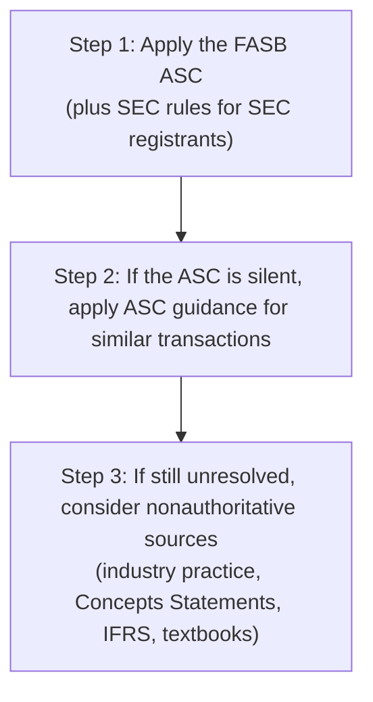

# Introduction to FAR

## What Is FAR?

The **Financial Accounting and Reporting (FAR)** section of the CPA Exam tests the accounting standards, principles, and frameworks used to prepare and analyze financial statements. FAR is widely regarded as the most content-heavy and technically demanding section of the exam.

:::info[Exam Structure]

FAR is one of three Core sections of the Uniform CPA Examination, along with AUD (Auditing and Attestation) and REG (Taxation and Regulation). Each candidate also takes one Discipline section: BAR (Business Analysis and Reporting), ISC (Information Systems and Controls), or TCP (Tax Compliance and Planning). In most jurisdictions, you must pass all four sections within a rolling 30-month window.

:::

---

## Key Content Areas

The FAR blueprint, published by the American Institute of CPAs (AICPA), organizes tested material into three content areas:

| Content Area | Description | Approximate Weight |
|---|---|---|
| **Area I: Financial Reporting** | General-purpose financial statements (for-profit and not-for-profit), state and local government concepts, public company reporting (Forms 10-Q, 10-K, and 8-K; earnings per share), special-purpose frameworks, and financial ratios and performance metrics | 30%-40% |
| **Area II: Select Balance Sheet Accounts** | Cash, receivables, inventory, property, plant, and equipment (PP&E), investments, intangibles, payables and accruals, long-term debt, equity, and related disclosures | 30%-40% |
| **Area III: Select Transactions** | Revenue recognition, leases, business combinations and consolidations, income taxes, fair value, accounting changes and error corrections, contingencies, subsequent events, foreign currency, and stock compensation | 25%-35% |

The blueprint also weights questions by skill level. FAR does not test the highest level, Evaluation:

| Skill Level | Approximate Weight |
|---|---|
| Remembering and Understanding | 5%-15% |
| Application | 45%-55% |
| Analysis | 35%-45% |
| Evaluation | Not tested in FAR |

:::warning[Content Weights May Shift]

The AICPA updates the CPA Exam blueprint periodically. Check the latest version at **aicpa.org** before you finalize your study plan.

:::

---

## Financial Reporting Standards

### U.S. GAAP and the FASB

U.S. generally accepted accounting principles (**GAAP**) are the authoritative standards for financial reporting by nongovernmental entities in the United States. The **Financial Accounting Standards Board (FASB)** sets these standards.

The FASB issues guidance through the **Accounting Standards Codification (ASC)**, a single source that organizes all authoritative GAAP by topic. In FAR you will often see ASC topics such as:

- **ASC 606**: Revenue from Contracts with Customers
- **ASC 842**: Leases
- **ASC 350**: Intangibles - Goodwill and Other
- **ASC 820**: Fair Value Measurement
- **ASC 450**: Contingencies

### The GAAP Hierarchy

ASC 105 recognizes only two levels of GAAP: **authoritative** and **nonauthoritative**.

- **Authoritative:** the FASB ASC. For SEC registrants, rules and interpretive releases of the Securities and Exchange Commission (SEC) are also authoritative.
- **Nonauthoritative:** everything else, including widely recognized industry practice, FASB Concepts Statements, AICPA Issues Papers, International Financial Reporting Standards (IFRS), and textbooks.

When the ASC does not address a transaction, first look for ASC guidance on similar transactions and apply it by analogy. Turn to nonauthoritative sources only after that.



:::tip[Exam Tip]

For the CPA Exam, apply **authoritative GAAP (the ASC)** unless the question says otherwise (for example, IFRS or the cash basis).

:::

### The SEC

The **SEC** has legal authority over financial reporting by publicly traded companies. The SEC generally relies on the FASB to set accounting standards, but it issues its own rules and guidance:

- **Regulation S-X**: form and content of financial statements
- **Regulation S-K**: disclosures outside the financial statements
- **Staff Accounting Bulletins (SABs)**: interpretive guidance from the SEC staff

### IFRS and the IASB

The **International Accounting Standards Board (IASB)** issues **IFRS**. The CPA Exam primarily tests U.S. GAAP, but you should know the key differences between GAAP and IFRS, such as:

- **Inventory:** IFRS prohibits the last-in, first-out (LIFO) method.
- **Development costs:** IFRS requires capitalization when certain criteria are met.
- **Long-lived assets:** IFRS permits revaluation to fair value.
- **Depreciation:** IFRS requires component depreciation.

---

## Study Tips and Approach

### 1. Build a Strong Foundation First

Start with the conceptual framework and the financial statement elements before moving to complex topics such as leases or pensions. Understanding _why_ a rule exists makes it much easier to remember.

### 2. Master Journal Entries

FAR is built on the **accounting equation**: Assets = Liabilities + Equity. Nearly every topic comes back to journal entries, so practice writing them by hand.

For example, if Bear Co. issues 10,000 shares of \$1 par common stock at \$15 per share:

```journal
Dr. Cash                      150,000
    Cr. Common Stock              10,000
    Cr. Additional Paid-in Capital 140,000
```

### 3. Use Active Recall and Spaced Repetition

Passive reading is not enough. After studying a topic:

- Close the book and write down everything you remember.
- Revisit the topic 1 day, 3 days, and 7 days later.
- Use flashcards for key definitions and formulas.

### 4. Practice Under Exam Conditions

Time yourself on practice problems. The CPA Exam includes multiple-choice questions (MCQs) and task-based simulations (TBSs), and both formats require speed and accuracy.

### 5. Focus on High-Weight Topics

Allocate study time in proportion to exam weight. Spending three weeks on governmental accounting while ignoring revenue recognition would be a strategic error.

:::note

Government and not-for-profit topics are unfamiliar to most candidates, but they are very testable. Budget enough time for them even though their weight is lower.

:::

---

## How This Textbook Is Organized

The FAR chapters build from foundations to specialized topics. The sidebar groups them as follows:

| Part | Topics |
|---|---|
| **Introduction and Conceptual Framework** | Financial reporting foundations, the conceptual framework |
| **Financial Statement Presentation** | Income statement, comprehensive income, balance sheet, statement of cash flows, statement of changes in stockholders' equity, notes to financial statements |
| **Assets** | Cash and receivables, inventory, PP&E, investments, intangible assets |
| **Liabilities** | Current liabilities and contingencies, long-term liabilities and bonds |
| **Equity** | Stockholders' equity, partnerships |
| **Special Topics and Transactions** | Revenue recognition, leases, income taxes, accounting changes and error corrections, business combinations, consolidated financial statements, foreign currency, subsequent events, fair value measurement |
| **Specialized Reporting** | Not-for-profit accounting, governmental accounting, modified cash basis, public company reporting, financial ratio analysis |
| **Accounting Basics** | Types of accounts, adjusting journal entries |

:::tip[Navigation]

Use the sidebar to jump to any topic. Chapters include worked examples, journal entries, and exam tips, and several end with a practice problem.

:::

---

## Conventions Used in This Textbook

This textbook uses the following conventions:

- **Journal entries** appear in `journal` code blocks, with debits listed first and credits indented.
- **Dollar amounts** use the \$ symbol (for example, \$50,000).
- **Math formulas** use KaTeX notation, such as $\text{Net Income} = \text{Revenue} - \text{Expenses}$.
- **Company names** in examples are bear-themed (for example, Bear Co., Polar Co., Grizzly Inc., Kodiak Partners, Panda Industries, Cub Entertainment, Sloth Security, Bruin Community Foundation, Polar University, and Bear Valley Hospital).
- **Admonitions** are colored callout boxes that highlight tips, warnings, and important notes.

:::danger[Common Pitfall]

Many candidates underestimate FAR because they "already know accounting." The CPA Exam tests nuance: specific rules, exceptions, and edge cases that go well beyond introductory coursework. Treat every topic with fresh eyes.

:::

---

## Getting Started

Turn to the next chapter, **Financial Reporting Foundations**, to see how the financial statements fit together. The **Conceptual Framework for Financial Reporting** chapter follows it and lays the foundation that every other FAR topic rests on.
