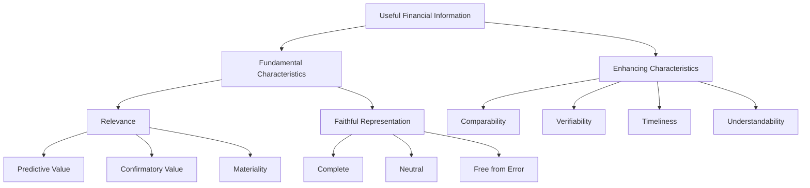
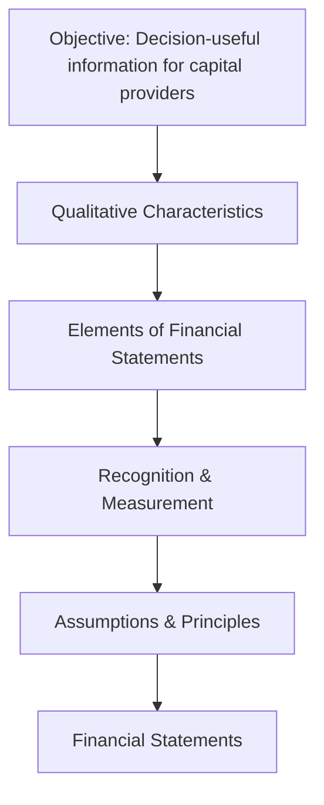

# Conceptual Framework for Financial Reporting

## Overview

The **FASB Conceptual Framework** is a set of objectives and fundamental concepts that guides the Financial Accounting Standards Board (FASB) in developing accounting standards. It also helps preparers reason through transactions that no standard addresses. Think of it as the "constitution" of financial reporting. It does not prescribe specific rules, but every topic in the Accounting Standards Codification (ASC) is built on it.

The framework is set out in **Statements of Financial Accounting Concepts (SFACs)**. The FASB has been replacing the older statements with new chapters of SFAC No. 8:

| SFAC | Title | Status |
|---|---|---|
| SFAC No. 5 | Recognition and Measurement in Financial Statements of Business Enterprises | Largely superseded by SFAC No. 8 chapters issued since 2022 |
| SFAC No. 6 | Elements of Financial Statements | Superseded by SFAC No. 8, Chapter 4 (December 2021) |
| SFAC No. 7 | Using Cash Flow Information and Present Value in Accounting Measurements | Active |
| SFAC No. 8 | Conceptual Framework for Financial Reporting | Active; issued chapter by chapter (Chapters 1 and 3 replaced SFAC No. 1 and 2) |

:::info

SFACs are **not** authoritative GAAP (generally accepted accounting principles). The FASB uses them to develop standards, and preparers can use them to reason through situations that no specific standard addresses.

:::

---

## Objective of General-Purpose Financial Reporting (SFAC No. 8, Chapter 1)

The objective of general-purpose financial reporting is to provide **financial information about the reporting entity that is useful to existing and potential investors, lenders, and other creditors** in making decisions about providing resources to the entity.

These users need information to assess:

1. The entity's prospects for **future net cash inflows**
2. **Management's stewardship** of the entity's economic resources
3. The entity's **economic resources and the claims** against it (financial position)
4. **Changes** in those resources and claims (financial performance)

:::tip[Exam Tip]

The objective focuses on **decision-usefulness** for **capital providers** (investors and creditors), not managers, regulators, or the general public. This is a frequently tested concept.

:::

### Example

Polar Co. is considering whether to extend a \$500,000 line of credit to Panda Industries. Polar Co. will review Panda's financial statements to evaluate:

- whether Panda has enough assets to cover its existing obligations
- whether Panda's revenue trends suggest it can repay
- whether Panda's cash flow from operations is positive and stable

This is exactly the kind of decision the conceptual framework is designed to support.

---

## Qualitative Characteristics of Useful Financial Information (SFAC No. 8, Chapter 3)

Useful financial information has certain **qualitative characteristics**. They are organized in two tiers: fundamental and enhancing.

### Fundamental Characteristics

Information must have **both** fundamental characteristics to be useful: relevance and faithful representation.

#### 1. Relevance

Information is **relevant** if it can make a difference in a user's decision. Relevance has three aspects:

- **Predictive value**: the information helps users form expectations about future outcomes.
- **Confirmatory value**: the information provides feedback on prior evaluations.
- **Materiality**: information is material if omitting or misstating it could influence users' decisions.

Information can have predictive value, confirmatory value, or both.

:::note[Materiality]

Materiality is an entity-specific aspect of relevance, so there is no universal dollar threshold. What is material for a small company like Kodiak Partners may be immaterial for a Fortune 500 corporation.

:::

#### 2. Faithful Representation

Information **faithfully represents** an economic phenomenon when it is:

- **Complete**: it includes everything a user needs to understand the phenomenon.
- **Neutral**: it is free from bias in selection or presentation.
- **Free from error**: the description of the phenomenon has no errors or omissions.

Free from error does not mean perfectly precise. An estimate can be free from error if it is clearly described as an estimate.

:::warning

"Faithful representation" replaced the older term "reliability" when SFAC No. 8 was issued in 2010. The exam uses the newer term.

:::

### Enhancing Characteristics

Enhancing characteristics **improve** the usefulness of information that is already relevant and faithfully represented:

| Characteristic | Description |
|---|---|
| **Comparability** | Users can identify similarities and differences between entities or periods |
| **Verifiability** | Different knowledgeable observers could reach consensus that the information is faithfully represented |
| **Timeliness** | Information is available to decision-makers before it loses its capacity to influence decisions |
| **Understandability** | Information is classified, characterized, and presented clearly and concisely |



### The Cost Constraint

The benefits of reporting financial information should justify the costs of providing it. This **cost constraint** (also called the cost-benefit constraint) applies to all financial reporting. It is a constraint on useful reporting, not a qualitative characteristic.

## Elements of Financial Statements (SFAC No. 8, Chapter 4)

The conceptual framework defines **ten elements** of financial statements. They are the building blocks of every financial statement. Since December 2021, the definitions have appeared in Concepts Statement No. 8 (SFAC No. 8), Chapter 4, which replaced SFAC No. 6.

### Balance Sheet Elements (Stock Concepts)

| Element | Definition |
| --- | --- |
| **Assets** | A present right of an entity to an economic benefit |
| **Liabilities** | A present obligation of an entity to transfer an economic benefit |
| **Equity (Net Assets)** | The residual interest in the assets of an entity after deducting its liabilities: $\text{Equity} = \text{Assets} - \text{Liabilities}$ |

:::note[Older definitions]

The Chapter 4 definitions of assets and liabilities replaced the SFAC No. 6 versions, which described them as "probable" future economic benefits and sacrifices. You may still see the older wording in some study materials.

:::

### Income Statement Elements (Flow Concepts)

| Element      | Definition                                                                                                                                                                                                  |
| ------------ | ----------------------------------------------------------------------------------------------------------------------------------------------------------------------------------------------------------- |
| **Revenues** | Inflows or enhancements of assets (or settlements of liabilities) from delivering goods, rendering services, or other activities that constitute the entity's ongoing major or central operations           |
| **Expenses** | Outflows or using up of assets (or incurrences of liabilities) from delivering goods, rendering services, or carrying out other activities that constitute the entity's ongoing major or central operations |
| **Gains**    | Increases in equity from peripheral or incidental transactions (not from revenues or investments by owners)                                                                                                 |
| **Losses**   | Decreases in equity from peripheral or incidental transactions (not from expenses or distributions to owners)                                                                                               |

### Other Elements

| Element | Definition |
| --- | --- |
| **Comprehensive Income** | The change in equity during a period from nonowner sources. It includes net income plus other comprehensive income (OCI) items, such as unrealized gains and losses on available-for-sale (AFS) debt securities, foreign currency translation adjustments, and pension adjustments |
| **Investments by Owners** | Increases in equity from transfers of assets to the entity by owners |
| **Distributions to Owners** | Decreases in equity from transfers of assets from the entity to owners (dividends) |

:::tip[Revenue vs. Gain]

**Revenue** arises from an entity's _central_ operations. **Gains** arise from _peripheral_ transactions. For Bear Co. (a retail company), selling merchandise generates **revenue**, while selling a delivery truck at a profit generates a **gain**. Both events increase net assets; the classification depends on the nature of the entity's operations.

:::

---

## Recognition and Measurement Concepts

### Recognition Criteria

An item is **recognized** (recorded in the financial statements) only when it meets all four of these criteria:

1. **Definitions**: it meets the definition of a financial statement element.
2. **Measurability**: it has a relevant attribute that can be measured.
3. **Relevance**: the information can make a difference in user decisions.
4. **Faithful representation**: the information is complete, neutral, and free from error.

### Measurement Attributes

GAAP uses several measurement attributes, depending on the type of asset or liability:

| Attribute | Description | Example |
|---|---|---|
| **Historical cost** | Original transaction price | Property, plant, and equipment (PP&E) at acquisition cost |
| **Current cost (replacement cost)** | Cost to acquire an equivalent asset today | Inventory under the lower of cost or market rule (used with last-in, first-out or the retail inventory method) |
| **Current market value (fair value)** | Price in an orderly transaction between market participants | Trading debt securities, equity securities |
| **Net realizable value (NRV)** | Expected selling price less costs to complete and sell (for receivables, the amount expected to be collected) | Inventory under the lower of cost and NRV rule; accounts receivable (net of allowance) |
| **Present value of future cash flows** | Discounted value of expected cash flows | Long-term notes receivable, bonds payable |

:::info

Fair value measurement (ASC 820) uses a three-level hierarchy of inputs: Level 1 (quoted prices in active markets for identical items), Level 2 (other observable inputs), and Level 3 (unobservable inputs). Level 1 is the most reliable; Level 3 requires the most judgment.

:::

---

## Underlying Assumptions

Four assumptions underlie all financial reporting under GAAP.

### 1. Economic Entity Assumption

The activities of the business are **separate and distinct** from those of its owners and other entities. For example, Bear Co.'s financial statements do not include its CEO's personal expenses.

### 2. Going Concern Assumption

The entity is assumed to continue operating for the **foreseeable future**, long enough to carry out its existing commitments. This assumption justifies reporting assets at cost rather than at liquidation value.

:::danger

Under ASC 205-40, management must evaluate whether there is **substantial doubt** about the entity's ability to continue as a going concern within one year after the financial statements are issued (or available to be issued). If substantial doubt exists, management considers whether its plans alleviate that doubt. Disclosure is required either way. If the plans alleviate the doubt, the entity discloses the conditions and the plans. If they do not, the entity must also state that there is substantial doubt.

:::

### 3. Monetary Unit Assumption

Financial statements are expressed in a **stable monetary unit** (for example, U.S. dollars). This assumption ignores inflation and deflation. A \$100,000 building purchased in 2000 is still reported at its \$100,000 cost (less accumulated depreciation), even though the dollar's purchasing power has changed.

### 4. Periodicity (Time Period) Assumption

The economic life of a business can be divided into **artificial time periods** (months, quarters, years) for reporting purposes. This assumption makes interim and annual financial reporting possible.

## Principles of Financial Reporting

### 1. Historical Cost Principle (Measurement Principle)

Assets and liabilities are initially recorded at their **original transaction price**. However, GAAP increasingly permits or requires fair value for certain items, such as trading securities and derivatives.

**Example:** Grizzly Inc. buys equipment for \$80,000. It records the equipment at \$80,000, regardless of its appraised market value:

```journal
Dr. Equipment                  80,000
    Cr. Cash                       80,000
```

### 2. Revenue Recognition Principle (ASC 606)

Revenue is recognized when (or as) the entity satisfies a **performance obligation** by transferring a promised good or service to a customer. ASC 606 applies a five-step model:

1. Identify the contract with a customer.
2. Identify the performance obligations in the contract.
3. Determine the transaction price.
4. Allocate the transaction price to the performance obligations.
5. Recognize revenue when (or as) each performance obligation is satisfied.

**Example:** Cub Entertainment sells a \$120 annual streaming subscription on July 1. It recognizes revenue of \$10 per month as it delivers the service.

When the cash is received:

```journal
July 1
Dr. Cash                       120
    Cr. Unearned Revenue           120
```

After one month of service is delivered:

```journal
July 31
Dr. Unearned Revenue           10
    Cr. Service Revenue            10
```

### 3. Expense Recognition (Matching) Principle

Expenses are recognized in the **same period** as the revenues they help generate. As a result, the income statement shows the cost of earning each period's revenue.

There are three approaches to matching:

| Approach | When Used | Example |
|---|---|---|
| **Direct association (cause and effect)** | A direct link exists between the cost and revenue | Cost of goods sold matched to sales revenue |
| **Systematic and rational allocation** | The cost benefits multiple periods | Depreciation of equipment over its useful life |
| **Immediate recognition** | The cost has no future benefit or cannot be reliably allocated | Advertising expense, CEO salary |

### 4. Full Disclosure Principle

Financial statements should include all information needed to **keep them from being misleading**. Disclosure is provided through:

- the face of the financial statements
- the notes (footnotes) to the financial statements
- supplementary information and schedules

:::note

The notes are an **integral part** of the financial statements, not optional appendices. The first note typically describes significant accounting policies (ASC 235).

:::

---

## Accrual Basis vs. Cash Basis Accounting

### Accrual Basis (GAAP)

Under the accrual basis, transactions are recognized when the **economic event occurs**, regardless of when cash changes hands:

- **Revenue** is recognized when a performance obligation is satisfied.
- **Expenses** are recognized when incurred (when the benefit is consumed or the obligation arises).

### Cash Basis (Non-GAAP)

Under the cash basis, transactions are recognized only when **cash is received or paid**:

- **Revenue** is recognized when cash is received.
- **Expenses** are recognized when cash is paid.

:::warning

The cash basis is **not** GAAP. The CPA Exam assumes the accrual basis unless a question says otherwise. However, converting between the cash and accrual bases is a very common exam task.

:::

### Conversion Example

Sloth Security collected \$300,000 in cash from customers during the year. Additional information:

| Item | Beginning of Year | End of Year |
|---|---|---|
| Accounts receivable (AR) | \$40,000 | \$55,000 |
| Unearned revenue | \$10,000 | \$6,000 |

**Accrual-basis revenue:**

$$\text{Revenue} = \text{Cash collected} + \text{Increase in AR} + \text{Decrease in unearned revenue}$$

$$\text{Revenue} = \$300{,}000 + (\$55{,}000 - \$40{,}000) + (\$10{,}000 - \$6{,}000)$$

$$\text{Revenue} = \$300{,}000 + \$15{,}000 + \$4{,}000 = \$319{,}000$$

The \$15,000 increase in AR is revenue earned this year but not yet collected. The \$4,000 decrease in unearned revenue is cash collected in an earlier year and earned this year. Both are added to cash collections.

---

## Putting It All Together

The conceptual framework builds in a logical order:



:::tip[Reason from First Principles]

When you face an unfamiliar accounting question on the exam, return to first principles. Does the item meet the definition of an element? Can it be measured? Is the information relevant and faithfully represented? The conceptual framework is your fallback reasoning tool.

:::

---

## Summary

| Concept                   | Key Points                                                                                                                           |
| ------------------------- | ------------------------------------------------------------------------------------------------------------------------------------ |
| **Objective**             | Provide decision-useful information to investors, lenders, and other creditors                                                       |
| **Fundamental qualities** | Relevance (predictive value, confirmatory value, materiality) and faithful representation (complete, neutral, free from error)       |
| **Enhancing qualities**   | Comparability, verifiability, timeliness, understandability                                                                          |
| **Elements**              | Assets, liabilities, equity, revenues, expenses, gains, losses, comprehensive income, investments by owners, distributions to owners |
| **Assumptions**           | Economic entity, going concern, monetary unit, periodicity                                                                           |
| **Principles**            | Historical cost, revenue recognition, matching (expense recognition), full disclosure                                                |
| **Constraint**            | Cost-benefit                                                                                                                         |
| **Basis**                 | Accrual basis is GAAP; cash basis is not                                                                                             |
