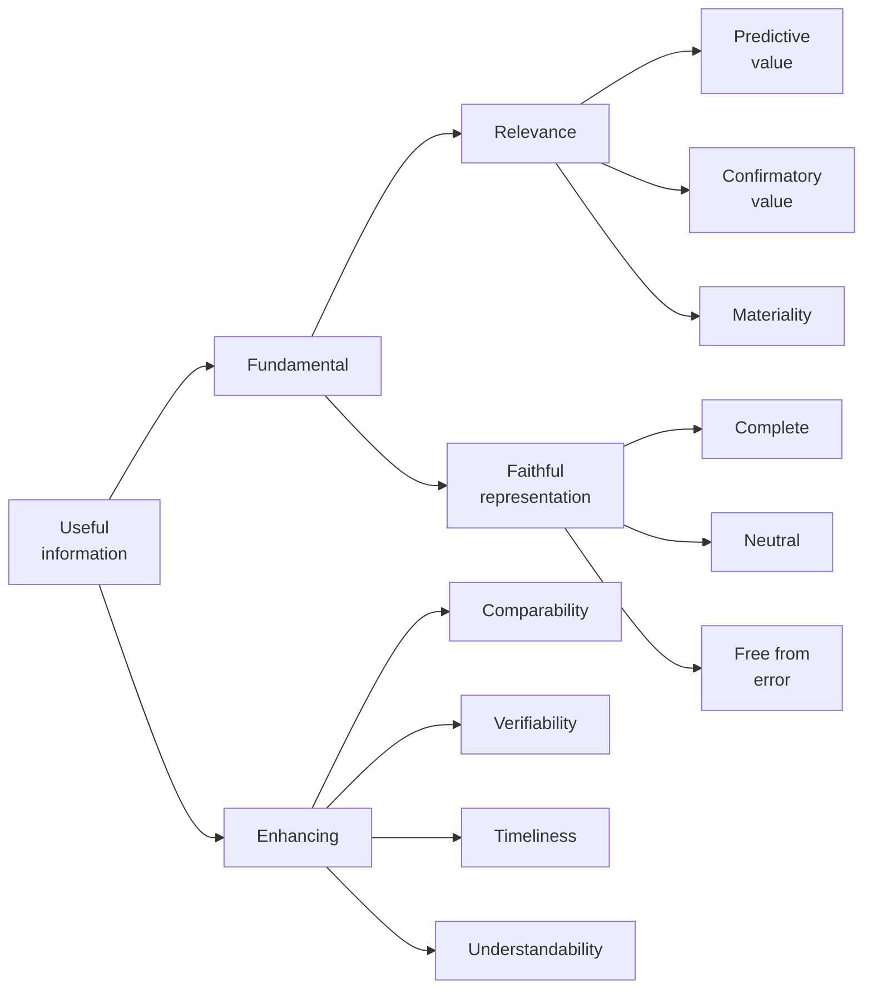

# Conceptual Framework for Financial Reporting

The **FASB Conceptual Framework** is the set of objectives and fundamental concepts that the Financial Accounting Standards Board (FASB) uses to develop accounting standards. Think of it as the constitution of financial reporting: it does not prescribe specific rules, but every topic in the Accounting Standards Codification (ASC) is built on it, and preparers can use it to reason through transactions that no standard addresses. On the exam, the framework shows up in direct definition questions and, more quietly, as the logic behind classification answers. This chapter follows the framework's own order: the objective of reporting, the qualities that make information useful, the elements, recognition and measurement, and finally the assumptions and principles that sit underneath them.

## The Concepts Statements

The framework is set out in **Statements of Financial Accounting Concepts (SFACs)**, also called Concepts Statements. Since 2010 the FASB has been replacing the older statements with chapters of a single statement, SFAC No. 8, *Conceptual Framework for Financial Reporting*. With the measurement chapter issued in 2024, all of the older statements covered in this chapter have now been replaced:

| SFAC No. 8 chapter | Topic | Replaced |
|---|---|---|
| Chapter 1 (2010) | Objective of general purpose financial reporting | SFAC No. 1 |
| Chapter 3 (2010) | Qualitative characteristics of useful financial information | SFAC No. 2 |
| Chapter 4 (December 2021) | Elements of financial statements | SFAC No. 6 |
| Chapter 5 (August 2023) | Recognition and derecognition | The recognition guidance in SFAC No. 5 |
| Chapter 6 (July 2024) | Measurement | SFAC No. 5 and SFAC No. 7 |

Two further chapters address presentation (Chapter 7) and notes to financial statements (Chapter 8).

Concepts Statements are **not** authoritative GAAP (generally accepted accounting principles). The FASB has also removed references to them from the Codification itself (ASU 2024-02), which underlines that they guide standard setting rather than govern individual transactions.

---

## Objective of General Purpose Financial Reporting

The objective of general purpose financial reporting (Chapter 1) is to provide **financial information about the reporting entity that is useful to existing and potential investors, lenders, and other creditors** in making decisions about providing resources to the entity.

To make those decisions, users need to assess the entity's prospects for future net cash inflows and how well management has discharged its stewardship of the entity's resources. That in turn requires information about the entity's economic resources and the claims against them (financial position) and about changes in those resources and claims (financial performance).

The key word is **decision-usefulness**, and the key audience is **capital providers**: investors and creditors, not managers, regulators, or the general public. Exam questions often offer one of those other groups as a distractor.

Consider Polar Co., which is deciding whether to extend a \$500,000 line of credit to Panda Industries. Polar will look at whether Panda has enough assets to cover its existing obligations, whether its revenue trends suggest it can repay, and whether its operating cash flow is positive and stable. That is exactly the kind of decision the framework is designed to support.

---

## Qualitative Characteristics of Useful Information

Chapter 3 describes the qualities that make financial information useful. They come in two tiers. The **fundamental** characteristics, relevance and faithful representation, are required: information without both is not useful. The **enhancing** characteristics make information that is already relevant and faithfully represented more useful.



### Relevance

Information is **relevant** if it can make a difference in a user's decision. It does so by having **predictive value** (it helps users form expectations about future outcomes), **confirmatory value** (it gives feedback on earlier evaluations), or both.

**Materiality** is an entity-specific aspect of relevance. Information is material if omitting or misstating it could influence users' decisions. Because materiality depends on the entity's own circumstances, there is no universal dollar threshold: an amount that is material for a small company like Kodiak Partners may be immaterial for a large public company.

### Faithful Representation

Information **faithfully represents** an economic phenomenon when it is **complete** (it includes everything a user needs to understand the phenomenon), **neutral** (it is free from bias in selection or presentation), and **free from error** (the description has no errors or omissions). Free from error does not mean perfectly precise. An estimate can be free from error if it is clearly described as an estimate and the process used to make it was applied without error.

"Faithful representation" replaced the older term "reliability" when Chapter 3 was issued in 2010. Expect the newer term on the exam.

### Enhancing Characteristics

| Characteristic | Description |
|---|---|
| **Comparability** | Users can identify similarities and differences between entities or periods |
| **Verifiability** | Different knowledgeable and independent observers could reach consensus that the information is faithfully represented |
| **Timeliness** | Information is available to decision makers before it loses its capacity to influence decisions |
| **Understandability** | Information is classified, characterized, and presented clearly and concisely |

### The Cost Constraint

The benefits of reporting financial information should justify the costs of providing and using it. This **cost constraint** applies to all financial reporting. It is a constraint on useful reporting, not a qualitative characteristic.

---

## Elements of Financial Statements

The framework defines **ten elements**, the building blocks of every financial statement. Since December 2021 the definitions have appeared in Chapter 4, which replaced SFAC No. 6.

### Balance Sheet Elements

| Element | Definition |
| --- | --- |
| **Assets** | A present right of an entity to an economic benefit |
| **Liabilities** | A present obligation of an entity to transfer an economic benefit |
| **Equity (Net Assets)** | The residual interest in the assets of an entity after deducting its liabilities: $\text{Equity} = \text{Assets} - \text{Liabilities}$ |

These definitions replaced the SFAC No. 6 versions, which described assets and liabilities as "probable" future economic benefits and sacrifices. You may still see the older wording in some study materials.

### Income Statement Elements

| Element      | Definition |
| ------------ | ---------- |
| **Revenues** | Inflows or enhancements of assets (or settlements of liabilities) from delivering goods, rendering services, or other activities that constitute the entity's ongoing major or central operations |
| **Expenses** | Outflows or using up of assets (or incurrences of liabilities) from delivering goods, rendering services, or carrying out other activities that constitute the entity's ongoing major or central operations |
| **Gains**    | Increases in equity from peripheral or incidental transactions (not from revenues or investments by owners) |
| **Losses**   | Decreases in equity from peripheral or incidental transactions (not from expenses or distributions to owners) |

The difference between revenue and a gain is the nature of the activity, not the effect on net assets. For Bear Co., a retailer, selling merchandise produces **revenue**, while selling a delivery truck at a profit produces a **gain**.

### Other Elements

| Element | Definition |
| --- | --- |
| **Comprehensive Income** | The change in equity during a period from nonowner sources. It includes net income plus other comprehensive income (OCI) items, such as unrealized gains and losses on available-for-sale (AFS) debt securities, foreign currency translation adjustments, and pension adjustments |
| **Investments by Owners** | Increases in equity from transfers of assets to the entity by owners |
| **Distributions to Owners** | Decreases in equity from transfers of assets from the entity to owners (dividends) |

---

## Recognition and Derecognition

**Recognition** means depicting an item in the financial statements in both words and numbers, with the amount included in the statement totals. Disclosing an amount in the notes is not a substitute for recognizing it.

Chapter 5, issued in August 2023, sets out **three recognition criteria**. An item is recognized when:

1. **Definitions**: it meets the definition of an element of financial statements.
2. **Measurability**: it is measurable and has a relevant measurement attribute.
3. **Faithful representation**: it can be depicted and measured with faithful representation.

All three criteria are subject to the cost constraint and to materiality.

The older SFAC No. 5 list had four criteria, with relevance as a separate one. Chapter 5 drops relevance as a separate test, because an item that meets the three criteria is already relevant. If your study materials list four recognition criteria, they are out of date.

**Derecognition** is the reverse: removing an asset, liability, or equity item from the statements. It occurs when an item no longer meets any one of the three recognition criteria. For example, a receivable that has been collected no longer meets the definition of an asset.

---

## Measurement

Chapter 6, issued in July 2024, says that measurement is anchored in **prices**. When an exchange takes place, the price is an entry price to one party and an exit price to the other:

- An **entry price** is the price paid to acquire an asset or received to assume a liability.
- An **exit price** is the price received to sell an asset or paid to transfer or settle a liability.

From these prices come two measurement systems. Both record entry prices when an item is acquired and exit prices when it is sold or settled. They differ in what happens at each reporting date in between.

| | Entry price system | Exit price system |
|---|---|---|
| **Initial amount** | Cost (entry price) | Cost (entry price) |
| **At later reporting dates** | Cost is allocated over the benefit or obligation period, for example through depreciation, amortization, or interest accretion | The item is remeasured to its current exit price |
| **Most relevant when** | The entity's exit price is unique to it (for example, inventory or equipment used with other assets) | Entities would realize the same price for the item (for example, a commodity or a traded security) |
| **GAAP examples** | PP&E at depreciated cost; inventory at cost; bonds payable at amortized cost | Trading debt securities and equity securities at fair value |

Both systems rest on a common premise: an asset should not be reported above what is recoverable through use or sale, and a liability should not be reported below what it would take to settle it. That premise explains the write-downs you will see in later chapters, such as inventory written down to net realizable value and impaired long-lived assets.

In the Codification, these systems appear as specific **measurement attributes**:

| Attribute | Description | Example |
|---|---|---|
| **Historical cost** | Original transaction price | Property, plant, and equipment (PP&E) at acquisition cost |
| **Fair value** | Exit price in an orderly transaction between market participants | Trading debt securities, equity securities |
| **Net realizable value (NRV)** | Expected selling price less costs to complete and sell (for receivables, the amount expected to be collected) | Inventory under the lower of cost and NRV rule; accounts receivable (net of allowance) |
| **Current cost (replacement cost)** | Cost to acquire an equivalent asset today | "Market" in the lower of cost or market rule (used with last-in, first-out or the retail inventory method) |
| **Present value of future cash flows** | Discounted value of expected cash flows, used to estimate a price when none is observable | Long-term notes receivable and bonds payable at issuance |

Fair value measurement (ASC 820) is covered in its own chapter. In brief, it ranks inputs in a three-level hierarchy: Level 1 (quoted prices in active markets for identical items), Level 2 (other observable inputs), and Level 3 (unobservable inputs). Level 3 requires the most judgment.

---

## Underlying Assumptions

Four assumptions underlie financial reporting under GAAP.

**Economic entity.** The activities of the business are separate from those of its owners and other entities. Bear Co.'s financial statements do not include its CEO's personal expenses.

**Going concern.** The entity is assumed to continue operating long enough to carry out its existing commitments. This assumption justifies reporting assets at cost rather than at liquidation value. Under ASC 205-40, management must evaluate whether there is **substantial doubt** about the entity's ability to continue as a going concern within one year after the date the financial statements are issued (or available to be issued). If substantial doubt exists, management considers whether its plans alleviate it. Disclosure is required either way. If the plans alleviate the doubt, the entity discloses the conditions and the plans. If they do not, the entity must also state that there is substantial doubt.

**Monetary unit.** Financial statements are expressed in a stable monetary unit, such as U.S. dollars, and ignore changes in purchasing power. A \$100,000 building purchased in 2000 is still reported at its \$100,000 cost less accumulated depreciation.

**Periodicity.** The life of a business can be divided into artificial time periods (months, quarters, years). This assumption makes interim and annual reporting possible.

## Principles of Financial Reporting

### Historical Cost

Assets and liabilities are initially recorded at their **original transaction price**, the entry price described above. GAAP then permits or requires fair value for certain items, such as trading securities and derivatives.

Grizzly Inc. buys equipment for \$80,000. It records the equipment at \$80,000, regardless of its appraised value:

```journal
Dr. Equipment                  80,000
    Cr. Cash                       80,000
```

### Revenue Recognition (ASC 606)

Revenue is recognized when (or as) the entity satisfies a **performance obligation** by transferring a promised good or service to a customer. ASC 606 applies a five-step model:

1. Identify the contract with a customer.
2. Identify the performance obligations in the contract.
3. Determine the transaction price.
4. Allocate the transaction price to the performance obligations.
5. Recognize revenue when (or as) each performance obligation is satisfied.

Cub Entertainment sells a \$120 annual streaming subscription on July 1 and collects the cash up front:

```journal
July 1
Dr. Cash                       120
    Cr. Unearned Revenue           120
```

It recognizes \$10 of revenue each month as it delivers the service:

```journal
July 31
Dr. Unearned Revenue           10
    Cr. Service Revenue            10
```

### Expense Recognition (Matching)

Expenses are recognized in the **same period** as the revenues they help generate, so the income statement shows the cost of earning each period's revenue. There are three ways to do this:

| Approach | When Used | Example |
|---|---|---|
| **Direct association (cause and effect)** | A direct link exists between the cost and revenue | Cost of goods sold matched to sales revenue |
| **Systematic and rational allocation** | The cost benefits multiple periods | Depreciation of equipment over its useful life |
| **Immediate recognition** | The cost has no future benefit or cannot be reasonably allocated | Advertising expense, CEO salary |

### Full Disclosure

Financial statements should include all information needed to keep them from being misleading, whether on the face of the statements, in the notes, or in supplementary schedules. The notes are an integral part of the financial statements, not optional appendices. The first note typically describes significant accounting policies (ASC 235).

---

## Accrual Basis vs. Cash Basis

Under the **accrual basis**, which GAAP requires, transactions are recognized when the economic event occurs, regardless of when cash changes hands. Revenue is recognized when a performance obligation is satisfied, and expenses are recognized when incurred. Under the **cash basis**, revenue is recognized when cash is received and expenses when cash is paid.

The cash basis is not GAAP, and the exam assumes the accrual basis unless a question says otherwise. Converting from one basis to the other, though, is a very common exam task.

Sloth Security collected \$300,000 in cash from customers during the year. Additional information:

| Item | Beginning of Year | End of Year |
|---|---|---|
| Accounts receivable (AR) | \$40,000 | \$55,000 |
| Unearned revenue | \$10,000 | \$6,000 |

Accrual-basis revenue is:

$$\text{Revenue} = \text{Cash collected} + \text{Increase in AR} + \text{Decrease in unearned revenue}$$

$$\text{Revenue} = \$300{,}000 + (\$55{,}000 - \$40{,}000) + (\$10{,}000 - \$6{,}000) = \$319{,}000$$

The \$15,000 increase in AR is revenue earned this year but not yet collected. The \$4,000 decrease in unearned revenue is cash collected in an earlier year and earned this year. Both are added to cash collections.

:::tip[Reason from first principles]

When an exam question describes an unfamiliar item, walk through the framework in order. Does the item meet the definition of an element? Can it be measured with a relevant attribute? Can it be depicted faithfully? If the answer to any of these is no, the item is not recognized, though it may still need disclosure.

:::

---

## Summary

| Concept                   | Key Points |
| ------------------------- | ---------- |
| **Objective**             | Provide decision-useful information to investors, lenders, and other creditors |
| **Fundamental qualities** | Relevance (predictive value, confirmatory value, materiality) and faithful representation (complete, neutral, free from error) |
| **Enhancing qualities**   | Comparability, verifiability, timeliness, understandability |
| **Elements**              | Assets, liabilities, equity, revenues, expenses, gains, losses, comprehensive income, investments by owners, distributions to owners |
| **Recognition**           | Meets an element definition, is measurable with a relevant attribute, and can be faithfully represented (Chapter 5) |
| **Measurement**           | Entry price system (cost, then allocation) or exit price system (remeasurement each period) (Chapter 6) |
| **Assumptions**           | Economic entity, going concern, monetary unit, periodicity |
| **Principles**            | Historical cost, revenue recognition, matching (expense recognition), full disclosure |
| **Constraint**            | Cost-benefit |
| **Basis**                 | Accrual basis is GAAP; cash basis is not |
