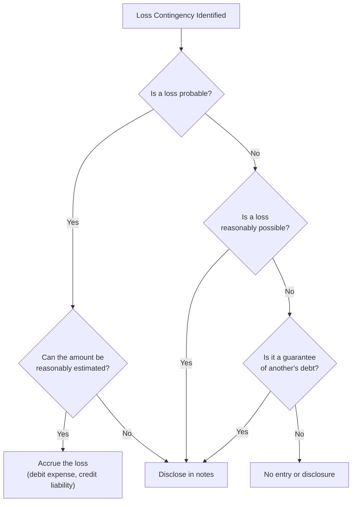

import Tabs from '@theme/Tabs';
import TabItem from '@theme/TabItem';

# Current Liabilities and Contingencies

At the end of every period a business owes someone something: suppliers, employees, tax authorities, lenders. This chapter is about recognizing and measuring those obligations, and about the harder cases where it is not yet clear whether an obligation exists at all. FAR tests both skills. You will calculate accruals and prepare the journal entries for payables, and you will decide whether a lawsuit, guarantee, or warranty calls for a liability, a note disclosure, or nothing. Module 1 covers payables and accrued liabilities, including exit costs and asset retirement obligations. Module 2 covers contingencies, commitments, warranties, and premiums.

## Module 1: Payables and Accrued Liabilities

### Liabilities Defined

A **liability** is a present obligation of an entity to transfer an economic benefit. This is the definition in Financial Accounting Standards Board (FASB) Concepts Statement No. 8, Chapter 4, issued in 2021. It has two parts:

1. A **present obligation** exists at the balance sheet date. It was created by a past transaction or event, and the entity has little or no discretion to avoid it.
2. Settling the obligation requires the entity to **transfer or provide an economic benefit** to others, such as cash, goods, or services.

Older materials use the Concepts Statement No. 6 definition, "probable future sacrifices of economic benefits." The current definition drops the word "probable": uncertainty about the outflow affects whether a liability is recognized and how it is measured, not whether one exists. In practice the test is the same under either definition. If there is no present obligation created by a past event, there is no liability. That one idea explains several rules later in this chapter, such as why self-insurance and an approved exit plan do not create liabilities by themselves.

---

### Current vs. Non-Current Classification

A liability is **current** if the entity expects to settle it within **one year** of the balance sheet date or within the **operating cycle**, whichever is longer. Accounts payable, accrued wages, and the current portion of long-term debt are current. Bonds payable, long-term notes, and lease obligations are non-current, except for the portion due within the next year.

Two classification rules come up often. The first lets a short-term obligation be classified as non-current when it will be **refinanced**. The company must intend to refinance on a long-term basis and show the **ability** to do so before the statements are issued (or available to be issued), either by actually refinancing or by entering into a qualifying financing agreement. The second rule works in the other direction: a debt covenant violation that makes long-term debt callable moves the debt into current liabilities. That rule and its exceptions are covered with debt covenants in [Long-Term Liabilities and Bonds](./long-term-liabilities-and-bonds.md).

---

### Trade Accounts Payable

Trade accounts payable arise from buying goods or services on credit. When a vendor offers cash discount terms such as 2/10, n/30 (2% off if paid within 10 days; otherwise the full amount is due in 30 days), the buyer can record the payable using the **gross method** or the **net method**.

<Tabs>
<TabItem value="gross" label="Gross Method" default>

Under the gross method, the payable is initially recorded at the **full invoice price**. The discount is recognized only if payment is made within the discount period.

Bear Co. purchases inventory for \$50,000 with terms 2/10, n/30:

**At purchase:**

```journal
Dr. Inventory[a] 50,000
    Cr. Accounts payable[l] 50,000
```

**If paid within 10 days (discount taken):**

```journal
Dr. Accounts payable[l] 50,000
    Cr. Cash[a] 49,000
    Cr. Purchase discounts 1,000
```

**If paid after 10 days (discount lapsed):**

```journal
Dr. Accounts payable[l] 50,000
    Cr. Cash[a] 50,000
```

</TabItem>
<TabItem value="net" label="Net Method">

Under the net method, the payable is initially recorded at the **net amount** (invoice less discount). If the company misses the discount window, the extra cost is recorded as **purchase discounts lost**, a financing expense.

Bear Co. purchases inventory for \$50,000 with terms 2/10, n/30:

**At purchase (recorded net of 2% discount):**

```journal
Dr. Inventory[a] 49,000
    Cr. Accounts payable[l] 49,000
```

**If paid within 10 days:**

```journal
Dr. Accounts payable[l] 49,000
    Cr. Cash[a] 49,000
```

**If paid after 10 days (discount lost):**

```journal
Dr. Accounts payable[l] 49,000
Dr. Purchase discounts lost 1,000
    Cr. Cash[a] 50,000
```

</TabItem>
</Tabs>

The net method is considered theoretically better because it records the purchase at its cash price and shows a missed discount for what it is, a cost of paying late. The gross method is more common in practice.

Some buyers pay their suppliers through a **supplier finance program** (sometimes called reverse factoring): a bank pays the supplier early, and the buyer pays the bank on the original due date. ASC 405-50 does not change how the buyer recognizes or presents the obligation. It requires disclosure of the program's key terms, the amount outstanding at period-end and where it appears on the balance sheet, and an annual rollforward of that amount.

---

### Notes Payable and Accrued Interest

A **trade note payable** is a formal written promise to pay a specified amount on a definite date. Unlike accounts payable, notes usually carry an explicit **stated interest rate** and a defined maturity. Interest accrues with time, so at each reporting date the borrower accrues interest from the last payment date through the balance sheet date, even if the note pays interest only at maturity:

$$
\text{Accrued Interest} = \text{Principal} \times \text{Annual Rate} \times \frac{\text{Months Outstanding}}{12}
$$

Polar Co. issues a 6-month, 9%, \$80,000 note payable to a supplier for inventory on October 1:

```journal
Oct 1
Dr. Inventory[a] 80,000
    Cr. Notes payable[l] 80,000
```

At December 31, Polar Co. accrues 3 months of interest:

$$
\text{Interest} = \$80{,}000 \times 9\% \times \frac{3}{12} = \$1{,}800
$$

```journal
Dec 31
Dr. Interest expense 1,800
    Cr. Interest payable[l] 1,800
```

At maturity (April 1), Polar Co. pays the note plus 6 months of interest (\$3,600). Half was accrued at December 31; the other \$1,800 is interest expense of the new year:

```journal
Apr 1
Dr. Notes payable[l] 80,000
Dr. Interest payable[l] 1,800
Dr. Interest expense 1,800
    Cr. Cash[a] 83,600
```

---

### Current Portion of Long-Term Debt

The part of a long-term obligation that is due within the next 12 months is classified as a **current liability**. Grizzly Inc. has a \$300,000 term loan requiring annual principal payments of \$60,000. At year-end, it reports:

| Line Item | Amount |
|---|---|
| Current portion of long-term debt | \$60,000 |
| Long-term debt (net of current portion) | \$240,000 |

---

### Accrued Liabilities

Accrued liabilities are expenses that have been **incurred** but not yet **paid**. Wages, bonuses, utilities, and rent are common examples. The work is always the same: find the portion of the cost that belongs to the period just ended.

Kodiak Partners has a biweekly payroll of \$140,000 covering ten working days. The pay period runs from Monday, December 23, through Friday, January 3, and the fiscal year ends on Tuesday, December 31. Seven of the ten working days fall in the old year:

$$
\text{Accrued wages} = \$140{,}000 \times \frac{7}{10} = \$98{,}000
$$

```journal
Dec 31
Dr. Wages expense 98,000
    Cr. Wages payable[l] 98,000
```

When the payroll is paid on January 3, the remaining three days (\$42,000) are expense of the new year:

```journal
Jan 3
Dr. Wages payable[l] 98,000
Dr. Wages expense 42,000
    Cr. Cash[a] 140,000
```

**Bonuses** are accrued in the year employees earn them. Polar Co. pays its managers a bonus of 5% of income before the bonus and income taxes. Income before both items is \$800,000, so Polar accrues a \$40,000 bonus at year-end (debit bonus expense, credit bonus payable). Read the bonus formula carefully. If the bonus were 5% of income **after** deducting the bonus, it would solve the equation B = 0.05 × (\$800,000 - B), which gives a bonus of \$38,095.

---

### Taxes Payable

Each category of tax is a current liability until it is remitted.

#### Property Taxes

Property taxes are accrued **ratably over the fiscal year** to which they relate. Panda Industries receives a \$24,000 property tax assessment for the calendar year, so it accrues \$2,000 per month:

```journal
Jan 31
Dr. Property tax expense 2,000
    Cr. Property taxes payable[l] 2,000
```

#### Sales Taxes

Sales taxes collected from customers are held **in trust** for the government. They are never revenue to the seller; they are a liability from the moment of collection. Cub Entertainment collects \$5,300 from a customer on a \$5,000 sale with 6% sales tax:

```journal
Dr. Cash[a] 5,300
    Cr. Sales revenue 5,000
    Cr. Sales taxes payable[l] 300
```

#### Income Taxes

Current income taxes payable are based on taxable income, which is pretax financial income adjusted for permanent and temporary differences. The [Accounting for Income Taxes](../special-topics-and-transactions/accounting-for-income-taxes.md) chapter covers the computation. If current tax for the year is \$75,000, the entry is:

```journal
Dec 31
Dr. Income tax expense 75,000
    Cr. Income taxes payable[l] 75,000
```

---

### Payroll Taxes and Deductions

Payroll creates two kinds of liabilities, and the exam expects you to keep them apart. **Employee withholdings** are part of the employee's gross pay; the employer collects them and remits them, acting as an agent. **Employer payroll taxes** are an additional cost to the employer. FICA is the Federal Insurance Contributions Act tax (Social Security and Medicare). FUTA and SUTA are the federal and state unemployment taxes.

| Category | Paid By | Examples |
|---|---|---|
| **Employee withholdings** | Deducted from employee pay | Federal and state income tax, employee FICA, health insurance premiums |
| **Employer taxes** | Additional cost to employer | Employer FICA match, FUTA, SUTA |

Sloth Security has monthly gross payroll of \$200,000. Assume all wages are subject to each tax (no employee has reached a wage-base limit):

| Item | Employee Portion | Employer Portion |
|---|---|---|
| FICA (Social Security 6.2% + Medicare 1.45%) | \$15,300 | \$15,300 |
| Federal income tax withheld | \$30,000 | N/A |
| State income tax withheld | \$8,000 | N/A |
| FUTA (0.6%) | N/A | \$1,200 |
| SUTA (2.0%) | N/A | \$4,000 |

**Record gross payroll and employee withholdings:**

```journal
Dr. Wages expense 200,000
    Cr. FICA taxes payable[l] 15,300
    Cr. Federal income taxes withheld[l] 30,000
    Cr. State income taxes withheld[l] 8,000
    Cr. Cash[a] 146,700
```

**Record employer payroll taxes:**

```journal
Dr. Payroll tax expense 20,500
    Cr. FICA taxes payable[l] 15,300
    Cr. FUTA taxes payable[l] 1,200
    Cr. SUTA taxes payable[l] 4,000
```

Notice that the withholdings create liabilities but no extra expense. They are part of the \$200,000 of wages already expensed. Only the employer's own taxes (its matching share of FICA, plus FUTA and SUTA) create payroll tax expense.

---

### Compensated Absences (Vacation and Sick Pay)

Employees who have earned paid time off have, in effect, been paid partly in future days off. Under Accounting Standards Codification (ASC) 710-10, the employer accrues a liability for **compensated absences** when all four conditions are met:

1. The obligation relates to services **already rendered**.
2. The rights **vest** or **accumulate**.
3. Payment is **probable**.
4. The amount is **reasonably estimable**.

Rights **vest** when the employer must pay for them even if the employee leaves. They **accumulate** when unused days carry forward to later periods. Vacation pay that meets the conditions must be accrued. Sick pay is the exception: sick pay that accumulates but does not vest need not be accrued (accrual is permitted but not required).

Bear Co. grants employees 10 vacation days per year that vest on December 31. At year-end, 50 employees each have 10 days earned but unused, at an average pay rate of \$240 per day:

$$
\text{Accrual} = 50 \text{ employees} \times 10 \text{ days} \times \$240 = \$120{,}000
$$

```journal
Dec 31
Dr. Vacation expense 120,000
    Cr. Vacation liability[l] 120,000
```

---

### Self-Insurance

A company that **self-insures** has chosen to bear its own risk instead of buying insurance. Choosing to bear a risk is not an obligation. Before a loss event occurs, no past event has created a present obligation, so the company cannot accrue for future fires, accidents, or storms, however likely they seem.

Once a loss event has occurred, the ordinary contingency rules in Module 2 apply. Claims for events that happened before the balance sheet date are accrued when the loss is probable and reasonably estimable. That includes claims **incurred but not reported (IBNR)**, where the event has happened but no claim has been filed yet.

Sloth Security self-insures its employees' medical costs. At December 31, employees have submitted \$40,000 of claims that Sloth has not yet paid. Based on its claims history, Sloth estimates another \$15,000 of claims for medical care employees have already received but not yet submitted. Sloth reports a self-insurance liability of \$55,000:

```journal
Dec 31
Dr. Employee medical claims expense 55,000
    Cr. Self-insurance liability[l] 55,000
```

:::caution[Exam trap]

Self-insurance creates **no** liability for losses that have not happened yet. A company that self-insures its warehouse against fire records nothing for future fires. It records a liability only for loss events that have already occurred, including IBNR claims.

:::

---

### Exit or Disposal Activities (ASC 420)

When a company closes a plant or exits a business line, it is tempting to book all the expected costs on the day management approves the plan. ASC 420 does not allow that. A plan is only an intention, so the company recognizes a liability for each cost, at fair value, when the cost is **incurred**:

| Cost Type | Recognition Point |
|---|---|
| **One-time termination benefits** | When the plan is communicated to employees, if they are not required to work beyond the minimum retention period |
| **Contract termination costs** | When the contract is terminated, or at the cease-use date for costs that continue with no economic benefit |
| **Other associated costs** (relocation, consolidation) | When incurred |

The **minimum retention period** cannot exceed the legal notification period, or 60 days if there is no legal requirement. If employees must work beyond it to receive their termination benefits, the cost is measured at the communication date and recognized **ratably** over the future service period.

Grizzly Inc. announces a plant closure on November 15 and communicates a one-time termination package of \$500,000 to affected employees. They will be terminated on December 31, which is within the minimum retention period, so the full cost is recognized when the plan is communicated:

```journal
Nov 15
Dr. Restructuring expense 500,000
    Cr. Restructuring liability[l] 500,000
```

Grizzly Inc. also has a non-cancelable maintenance contract for the plant with 24 months remaining at \$10,000 per month. After the plant closes on December 31 (the cease-use date), the contract provides no economic benefit. At that date Grizzly recognizes a liability at fair value (generally the present value of the remaining payments), reduced by any amounts it expects to recover:

$$
\text{Liability} = \text{Fair value of the remaining payments} - \text{Expected recoveries}
$$

Leases are handled differently. Under ASC 842, a lessee already reports a liability for an operating lease. When it stops using leased property, it tests the right-of-use asset for impairment instead of recording a separate ASC 420 liability.

---

### Asset Retirement Obligations (ASC 410-20)

An **asset retirement obligation (ARO)** is a legal obligation to dismantle, remove, or remediate a long-lived asset when it is retired. An offshore platform that must be removed and a landfill that must be capped are typical examples. The obligation is recognized at **fair value** when it is incurred, usually when the asset is placed in service. The same amount is added to the carrying amount of the related asset as the **asset retirement cost (ARC)**, so the cost of retirement is spread over the asset's life through depreciation.

Fair value is measured as the **present value** of the estimated future retirement cost, discounted at the entity's credit-adjusted risk-free rate:

$$
\text{ARO (initial)} = \frac{\text{Estimated Future Cost}}{(1 + r)^n}
$$

Panda Industries installs an offshore oil platform on January 1, Year 1. The estimated removal cost in 20 years is \$5,000,000, and the credit-adjusted risk-free rate is 6%:

$$
\text{ARO} = \frac{\$5{,}000{,}000}{(1.06)^{20}} = \$1{,}559{,}024
$$

```journal
Jan 1, Year 1
Dr. Oil platform (ARC)[a] 1,559,024
    Cr. Asset retirement obligation[l] 1,559,024
```

After initial recognition, two things happen each period. The liability grows through **accretion expense** (interest on the obligation), and the asset retirement cost is **depreciated** over the asset's useful life.

**Year 1 accretion expense:**

$$
\text{Accretion} = \$1{,}559{,}024 \times 6\% = \$93{,}541
$$

```journal
Dec 31, Year 1
Dr. Accretion expense 93,541
    Cr. Asset retirement obligation[l] 93,541
```

**Year 1 depreciation of the ARC** (straight-line over 20 years):

$$
\text{Depreciation} = \frac{\$1{,}559{,}024}{20} = \$77{,}951
$$

```journal
Dec 31, Year 1
Dr. Depreciation expense 77,951
    Cr. Accumulated depreciation (oil platform)[ca] 77,951
```

By the end of the asset's life, accretion has grown the liability to the full \$5,000,000 estimated removal cost, and the ARC is fully depreciated. When the platform is removed, any difference between the liability and the actual settlement cost is a **gain or loss on settlement**.

---

## Module 2: Contingencies and Commitments

### Contingencies Defined

A **contingency** is an existing condition, situation, or set of circumstances involving uncertainty about a possible **gain** or **loss**. The uncertainty is resolved when one or more future events occur or fail to occur (ASC 450). The key point is that the **condition already exists** at the balance sheet date. A lawsuit has been filed, a product has been sold with a warranty, a loan has been guaranteed. Only the **outcome** is uncertain.

---

### Three Likelihood Categories

The accounting depends on how likely the future event is:

| Likelihood | Definition | Loss Treatment | Gain Treatment |
|---|---|---|---|
| **Probable** | Likely to occur | Accrue if reasonably estimable; otherwise disclose | **Disclose only**; never accrue |
| **Reasonably possible** | More than remote but less than probable | Disclose only | Disclose only |
| **Remote** | Slight chance of occurring | Generally no disclosure | No disclosure |

The two columns are deliberately asymmetric. A probable, estimable loss is recorded now, but even a probable gain waits until it is realized, because recording it early could recognize income that never arrives.

---

### Loss Contingencies

A loss contingency is **accrued** (recognized as a liability and an expense) when **both** conditions are met:

1. It is **probable** that a liability has been incurred (or an asset impaired) as of the balance sheet date.
2. The amount of the loss can be **reasonably estimated**.

If a loss is probable but cannot be reasonably estimated, or if it is only reasonably possible, the contingency is **disclosed** in the notes but not accrued. The disclosure describes the nature of the contingency and gives an estimate of the possible loss or range of loss, or states that an estimate cannot be made.

Often the best that legal counsel can offer is a range. If one amount within the range is a better estimate than any other, accrue that **best estimate**. If no amount is better than any other, accrue the **minimum** of the range and disclose the possible additional loss.

Kodiak Partners is the defendant in a lawsuit at December 31, Year 1. Legal counsel advises that a loss is **probable** and estimates it at between \$200,000 and \$500,000, with no amount more likely than another. Kodiak accrues the minimum:

```journal
Dec 31, Year 1
Dr. Litigation loss 200,000
    Cr. Litigation liability[l] 200,000
```

Kodiak Partners also **discloses** the nature of the lawsuit and the reasonably possible additional loss of up to \$300,000 above the accrued amount.

Change the facts and the answer changes. If counsel instead advised that the loss was only **reasonably possible**, Kodiak would record no entry and would disclose the lawsuit and the \$200,000 to \$500,000 range. If counsel considered the loss **remote**, as with a frivolous claim, Kodiak would generally neither record nor disclose anything.

:::caution[Exception for remote contingencies]

**Guarantees of the indebtedness of others** must be **disclosed** even when the likelihood of loss is remote. This includes loan guarantees and standby letters of credit.

:::

---

### Gain Contingencies

Gain contingencies are never accrued. A probable or reasonably possible gain may be disclosed, with care not to mislead readers about how likely it is to be realized. Polar Co. files a patent infringement lawsuit against a competitor, and legal counsel considers a favorable outcome **probable**. Polar Co. may only disclose the expected gain in the notes:

> *"The Company is the plaintiff in a patent infringement action. While the outcome cannot be determined with certainty, management believes a favorable resolution is probable."*

The gain is recognized only when **realized**, typically when a court judgment is final or a settlement is reached.

---

### Commitments

A **commitment** is a promise to act in the future, such as a contract to buy inventory, a non-cancelable purchase obligation, or a signed construction contract. Because neither party has performed yet, an unexecuted commitment is generally **not recorded**. Significant commitments, such as unconditional purchase obligations and long-term supply contracts, are **disclosed** in the notes.

There is one important exception. When the market price of goods covered by a firm, non-cancelable purchase commitment falls below the contract price, the buyer recognizes the expected loss and a liability in the current period. The [Inventory](../assets/inventory.md) chapter works through that calculation.

---

### Premiums and Warranties

Product warranties and premium offers create estimated liabilities that are accrued much like loss contingencies. The obligation arises from a past event (the sale), a future cost is probable, and the amount can be reasonably estimated from experience.

#### Warranties

Revenue recognition (ASC 606) sorts warranties into two kinds. An **assurance-type warranty** promises only that the product works as intended, so its expected cost is accrued as an expense at the time of sale. A **service-type warranty** is sold separately or provides a service beyond that assurance. It is a separate performance obligation, so part of the price is deferred and recognized as revenue over the coverage period. The [Revenue Recognition](../special-topics-and-transactions/revenue-recognition.md) chapter lists the indicators that separate the two.

<Tabs>
<TabItem value="expense" label="Assurance-Type Warranty (Accrual)" default>

Under the **expense warranty approach** (the accrual approach), the estimated cost of an assurance-type warranty is expensed in the **same period as the sale**.

Panda Industries sells 1,000 units at \$500 each during Year 1. Historical data indicates that 5% of units will require warranty service at an average cost of \$60 per unit:

$$
\text{Estimated warranty cost} = 1{,}000 \times 5\% \times \$60 = \$3{,}000
$$

```journal
Dec 31, Year 1
Dr. Warranty expense 3,000
    Cr. Warranty liability[l] 3,000
```

During Year 2, Panda spends \$2,400 on actual warranty repairs:

```journal
Year 2
Dr. Warranty liability[l] 2,400
    Cr. Parts inventory[a] 1,600
    Cr. Wages payable[l] 800
```

</TabItem>
<TabItem value="sales" label="Service-Type Warranty (Deferred Revenue)">

When a warranty is sold **separately**, such as an extended warranty, it is a service-type warranty (older texts call this the **sales warranty approach**). The revenue is **deferred** and recognized over the warranty period.

Cub Entertainment sells a 2-year extended warranty for \$600:

```journal
At sale
Dr. Cash[a] 600
    Cr. Unearned warranty revenue[l] 600
```

Revenue recognized at the end of Year 1:

```journal
Dec 31, Year 1
Dr. Unearned warranty revenue[l] 300
    Cr. Warranty revenue 300
```

Actual warranty costs incurred in Year 1 are expensed as incurred:

```journal
Year 1
Dr. Warranty expense 180
    Cr. Cash[a] 180
```

</TabItem>
</Tabs>

#### Premium Offers

Premium offers (for example, "send in 5 box tops and receive a free toy") create a liability similar to a warranty. The company estimates how many premiums will be redeemed and accrues the cost in the period of the sale.

Bear Co. sells cereal and offers a toy (cost \$2 each) for every 5 box tops returned. During Year 1, Bear Co. sells 100,000 boxes and estimates that 60% of box tops will be redeemed:

$$
\text{Premiums expected} = \frac{100{,}000 \times 60\%}{5} = 12{,}000 \text{ toys}
$$

$$
\text{Premium expense} = 12{,}000 \times \$2 = \$24{,}000
$$

Bear Co. purchases 15,000 toys and distributes 8,000 during Year 1:

**Purchase of premiums inventory:**

```journal
Dr. Premiums inventory[a] 30,000
    Cr. Cash[a] 30,000
```

**Premiums distributed (8,000 toys × \$2):**

```journal
Dr. Premium expense 16,000
    Cr. Premiums inventory[a] 16,000
```

**Year-end accrual for remaining expected redemptions (12,000 - 8,000 = 4,000 toys × \$2):**

```journal
Dec 31
Dr. Premium expense 8,000
    Cr. Estimated premium liability[l] 8,000
```

Total Year 1 premium expense is \$24,000 (\$16,000 + \$8,000), which equals the estimate.

---

### Summary: Decision Framework for Loss Contingencies


