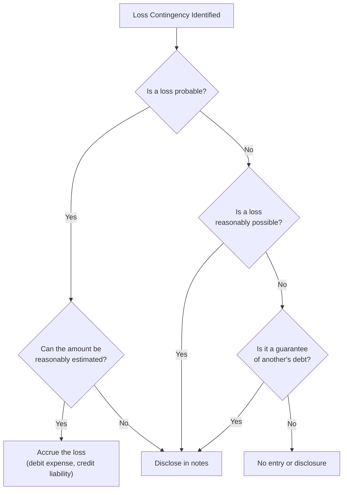

import Tabs from '@theme/Tabs';
import TabItem from '@theme/TabItem';

# Current Liabilities and Contingencies

This chapter has two modules. Module 1 covers payables, accruals, and other obligations recognized as liabilities. Module 2 covers loss and gain contingencies, warranties, and premiums.

## Module 1: Payables and Accrued Liabilities

### Liabilities Defined

A **liability** is a present obligation of an entity to transfer an economic benefit. This definition comes from Financial Accounting Standards Board (FASB) Concepts Statement No. 8, Chapter 4, which replaced the Concepts Statement No. 6 definition in 2021. A liability has two essential characteristics:

1. It is a **present obligation** at the balance sheet date, created by a past transaction or event, that the entity has little or no discretion to avoid.
2. The obligation requires the entity to **transfer or provide an economic benefit** to others, such as cash, goods, or services.

:::info

Older materials define liabilities as **probable future sacrifices** of economic benefits arising from present obligations as a result of past transactions (Concepts Statement No. 6). The current definition drops the word "probable": uncertainty about the outflow affects recognition and measurement, not whether a liability exists. Under either definition, look for a **present obligation** created by a **past event**. Without one, no liability exists.

:::

---

### Current vs. Non-Current Classification

A liability is **current** if it is expected to be settled within **one year** or the **operating cycle**, whichever is longer. All other obligations are non-current.

| Classification | Criteria | Examples |
|---|---|---|
| **Current** | Due within 1 year or operating cycle | Accounts payable, accrued wages, current portion of long-term debt |
| **Non-current** | Due beyond 1 year or operating cycle | Bonds payable, long-term notes, lease obligations |

:::warning

If a debt covenant violation at the balance sheet date makes long-term debt callable, classify the **entire** debt as current. It stays non-current only if one of these applies before the financial statements are issued (or available to be issued):

- The lender waives its right to demand repayment for more than one year from the balance sheet date.
- The agreement provides a grace period, and it is probable the company will cure the violation within that period.

:::

---

### Trade Accounts Payable

Trade accounts payable arise from buying goods or services on credit. When a vendor offers cash discount terms such as 2/10, n/30 (2% off if paid within 10 days; otherwise the full amount is due in 30 days), the buyer can record the payable using the **gross method** or the **net method**.

<Tabs>
<TabItem value="gross" label="Gross Method" default>

Under the gross method, the payable is initially recorded at the **full invoice price**. The discount is recognized only if payment is made within the discount period.

Bear Co. purchases inventory for \$50,000 with terms 2/10, n/30:

**At purchase:**

```journal
Dr. Inventory[a] 50,000
    Cr. Accounts payable[l] 50,000
```

**If paid within 10 days (discount taken):**

```journal
Dr. Accounts payable[l] 50,000
    Cr. Cash[a] 49,000
    Cr. Purchase discounts 1,000
```

**If paid after 10 days (discount lapsed):**

```journal
Dr. Accounts payable[l] 50,000
    Cr. Cash[a] 50,000
```

</TabItem>
<TabItem value="net" label="Net Method">

Under the net method, the payable is initially recorded at the **net amount** (invoice less discount). If the company misses the discount window, the extra cost is recorded as **purchase discounts lost**, a financing expense.

Bear Co. purchases inventory for \$50,000 with terms 2/10, n/30:

**At purchase (recorded net of 2% discount):**

```journal
Dr. Inventory[a] 49,000
    Cr. Accounts payable[l] 49,000
```

**If paid within 10 days:**

```journal
Dr. Accounts payable[l] 49,000
    Cr. Cash[a] 49,000
```

**If paid after 10 days (discount lost):**

```journal
Dr. Accounts payable[l] 49,000
Dr. Purchase discounts lost 1,000
    Cr. Cash[a] 50,000
```

</TabItem>
</Tabs>

:::tip[Exam Tip]

The **net method** is considered theoretically superior because it treats lost discounts as a **financing cost**. The **gross method** is more common in practice.

:::

---

### Trade Notes Payable

A **trade note payable** is a formal written promise to pay a specified amount on a definite date. Unlike accounts payable, notes payable usually carry an explicit **stated interest rate** and a defined maturity.

Polar Co. issues a 6-month, 9%, \$80,000 note payable to a supplier for inventory on October 1:

```journal
Oct 1
Dr. Inventory[a] 80,000
    Cr. Notes payable[l] 80,000
```

At December 31, Polar Co. accrues 3 months of interest:

$$
\text{Interest} = \$80{,}000 \times 9\% \times \frac{3}{12} = \$1{,}800
$$

```journal
Dec 31
Dr. Interest expense 1,800
    Cr. Interest payable[l] 1,800
```

At maturity (April 1), Polar Co. pays the note plus 6 months of interest (\$3,600). Half was accrued at December 31; the other \$1,800 is interest expense of the new year:

```journal
Apr 1
Dr. Notes payable[l] 80,000
Dr. Interest payable[l] 1,800
Dr. Interest expense 1,800
    Cr. Cash[a] 83,600
```

---

### Interest Payable Accruals

Accrue interest at each reporting date on every outstanding obligation:

$$
\text{Accrued Interest} = \text{Principal} \times \text{Annual Rate} \times \frac{\text{Months Outstanding}}{12}
$$

:::note

Even when interest is paid semiannually or annually, accrue interest from the last payment date through the balance sheet date. This follows the accrual basis of accounting.

:::

---

### Current Portion of Long-Term Debt

The portion of a long-term obligation that is due within the next 12 months is classified as a **current liability**.

Grizzly Inc. has a \$300,000 term loan requiring annual principal payments of \$60,000. At year-end, the balance sheet presentation is:

| Line Item | Amount |
|---|---|
| Current portion of long-term debt | \$60,000 |
| Long-term debt (net of current portion) | \$240,000 |

:::tip[Exam Tip]

Short-term obligations expected to be **refinanced** on a long-term basis are an exception. If the company intends to refinance and shows the **ability** to do so before the statements are issued (by actually refinancing or by signing a qualifying financing agreement), the obligation is classified as non-current.

:::

---

### Accrued Liabilities

Accrued liabilities are expenses that have been **incurred** but not yet **paid**. Common accruals include wages, utilities, and rent.

Kodiak Partners has a biweekly payroll of \$140,000 covering ten working days. The pay period runs from Monday, December 23, through Friday, January 3, and the fiscal year ends on Tuesday, December 31. Seven of the ten working days fall in the old year:

$$
\text{Accrued wages} = \$140{,}000 \times \frac{7}{10} = \$98{,}000
$$

```journal
Dec 31
Dr. Wages expense 98,000
    Cr. Wages payable[l] 98,000
```

When the payroll is paid on January 3, the remaining three days (\$42,000) are expense of the new year:

```journal
Jan 3
Dr. Wages payable[l] 98,000
Dr. Wages expense 42,000
    Cr. Cash[a] 140,000
```

---

### Taxes Payable

Each category of tax is a current liability until it is remitted.

#### Property Taxes

Accrue property taxes **ratably over the fiscal year** to which they relate. They are usually assessed by local governments.

Panda Industries receives a \$24,000 property tax assessment for the calendar year. Monthly accrual:

$$
\frac{\$24{,}000}{12} = \$2{,}000 \text{ per month}
$$

```journal
Jan 31
Dr. Property tax expense 2,000
    Cr. Property taxes payable[l] 2,000
```

#### Sales Taxes

Sales taxes collected from customers are held **in trust** for the government. They are never revenue to the seller; they are a liability from the moment of collection.

Cub Entertainment collects \$5,300 from a customer on a \$5,000 sale with 6% sales tax:

```journal
Dr. Cash[a] 5,300
    Cr. Sales revenue 5,000
    Cr. Sales taxes payable[l] 300
```

#### Income Taxes

Current income taxes payable are based on taxable income, which is pretax financial income adjusted for permanent and temporary differences. The income taxes chapter covers this topic in depth. If current tax for the year is \$75,000, the entry is:

```journal
Dec 31
Dr. Income tax expense 75,000
    Cr. Income taxes payable[l] 75,000
```

---

### Payroll Taxes and Deductions

Separate **employee withholdings**, which the employer collects and remits, from **employer payroll taxes**, which are an additional cost to the employer. FICA is the Federal Insurance Contributions Act tax (Social Security and Medicare). FUTA and SUTA are the federal and state unemployment taxes.

| Category | Paid By | Examples |
|---|---|---|
| **Employee withholdings** | Deducted from employee pay | Federal/state income tax, employee FICA, health insurance premiums |
| **Employer taxes** | Additional cost to employer | Employer FICA match, FUTA, SUTA |

Sloth Security has monthly gross payroll of \$200,000. Assume all wages are subject to each tax (no employee has reached a wage-base limit). Withholdings and employer taxes are:

| Item | Employee Portion | Employer Portion |
|---|---|---|
| FICA (Social Security 6.2% + Medicare 1.45%) | \$15,300 | \$15,300 |
| Federal income tax withheld | \$30,000 | N/A |
| State income tax withheld | \$8,000 | N/A |
| FUTA (0.6%) | N/A | \$1,200 |
| SUTA (2.0%) | N/A | \$4,000 |

**Record gross payroll and employee withholdings:**

```journal
Dr. Wages expense 200,000
    Cr. FICA taxes payable[l] 15,300
    Cr. Federal income taxes withheld[l] 30,000
    Cr. State income taxes withheld[l] 8,000
    Cr. Cash[a] 146,700
```

**Record employer payroll taxes:**

```journal
Dr. Payroll tax expense 20,500
    Cr. FICA taxes payable[l] 15,300
    Cr. FUTA taxes payable[l] 1,200
    Cr. SUTA taxes payable[l] 4,000
```

:::warning

Employee withholdings are **not** an additional expense to the employer. They are part of gross wages, which are already expensed, and the employer simply acts as an agent in remitting them. Only the employer's own taxes (its **matching share of FICA**, plus FUTA and SUTA) create payroll tax expense.

:::

---

### Compensated Absences (Vacation and Sick Pay)

Under Accounting Standards Codification (ASC) 710-10, a liability for **compensated absences** (vacation, sick leave) is accrued when all four conditions are met:

1. The obligation relates to services **already rendered**.
2. The rights **vest** or **accumulate**.
3. Payment is **probable**.
4. The amount is **reasonably estimable**.

:::info

- **Vested** rights: The employer must pay even if the employee terminates.
- **Accumulated** rights: Unused days carry forward to future periods.
- **Sick pay** that accumulates but does not vest need **not** be accrued (accrual is permitted but optional).

:::

Bear Co. grants employees 10 vacation days per year that vest on December 31. At year-end, 50 employees each have all 10 days earned but unused, at an average pay rate of \$240 per day:

$$
\text{Accrual} = 50 \text{ employees} \times 10 \text{ days} \times \$240 = \$120{,}000
$$

```journal
Dec 31
Dr. Vacation expense 120,000
    Cr. Vacation liability[l] 120,000
```

---

### Self-Insurance

A company that self-insures **cannot** accrue a liability for future losses before a loss event occurs. No past event has created a present obligation; the company has only assumed future risk.

:::caution

Exam trap: self-insurance creates **no** liability until an actual loss event occurs. You cannot accrue for hurricanes, accidents, or equipment breakdowns that have not yet happened, however probable they seem.

:::

Once a loss event occurs (for example, a fire destroys self-insured inventory), the company records the loss:

```journal
Dr. Fire loss 250,000
    Cr. Inventory[a] 250,000
```

---

### Exit or Disposal Activities (ASC 420)

Under ASC 420, a liability for costs of an **exit or disposal activity** is recognized at fair value when the cost is **incurred**, not when the company commits to an exit plan.

#### Key Cost Categories

| Cost Type | Recognition Point |
|---|---|
| **Involuntary termination benefits** (one-time) | When the plan is communicated to employees, if they are not required to render service beyond the minimum retention period |
| **Contract termination costs** | When the contract is terminated, or at the cease-use date for costs that continue with no economic benefit |
| **Other associated costs** (relocation, consolidation) | When incurred |

Grizzly Inc. announces a plant closure on November 15 and communicates a one-time termination package of \$500,000 to affected employees. They will be terminated on December 31, which is within the minimum retention period, so the full cost is recognized when the plan is communicated:

```journal
Nov 15
Dr. Restructuring expense 500,000
    Cr. Restructuring liability[l] 500,000
```

Grizzly Inc. also has a non-cancelable maintenance contract for the plant with 24 months remaining at \$10,000 per month. After the plant closes on December 31 (the cease-use date), the contract provides no economic benefit. Grizzly recognizes a liability at fair value (generally the present value of the remaining payments), reduced by any amounts it expects to recover:

$$
\text{Liability} = \text{Fair value of the remaining payments} - \text{Expected recoveries}
$$

:::note

**Minimum retention period:** The minimum retention period cannot exceed the legal notification period, or 60 days if there is no legal requirement. If employees must work beyond it to receive termination benefits, the cost is measured at the communication date and recognized **ratably** over the future service period.

**Leases:** Under ASC 842, a lessee already reports a liability for an operating lease. When it stops using leased property, it evaluates the right-of-use asset for impairment instead of recording a separate ASC 420 liability.

:::

---

### Asset Retirement Obligations (ASC 410-20)

An **asset retirement obligation (ARO)** is a legal obligation to dismantle, remove, or remediate a long-lived asset at retirement. The obligation is recognized at **fair value** when incurred, with a matching increase to the carrying amount of the related asset (the **asset retirement cost**, or ARC).

#### Initial Recognition

The ARO is measured at the **present value** of the estimated future retirement cost:

$$
\text{ARO (initial)} = \frac{\text{Estimated Future Cost}}{(1 + r)^n}
$$

Panda Industries installs an offshore oil platform on January 1, Year 1. The estimated removal cost in 20 years is \$5,000,000, and the credit-adjusted risk-free rate is 6%:

$$
\text{ARO} = \frac{\$5{,}000{,}000}{(1.06)^{20}} = \$1{,}559{,}024
$$

```journal
Jan 1, Year 1
Dr. Oil platform (ARC)[a] 1,559,024
    Cr. Asset retirement obligation[l] 1,559,024
```

#### Subsequent Measurement

After initial recognition, two things happen each period:

| Item | Treatment |
|---|---|
| **ARO liability** | Increases via **accretion expense** (interest on the growing obligation) |
| **ARC (asset)** | Decreases via **depreciation** over the asset's useful life |

**Year 1 accretion expense:**

$$
\text{Accretion} = \$1{,}559{,}024 \times 6\% = \$93{,}541
$$

```journal
Dec 31, Year 1
Dr. Accretion expense 93,541
    Cr. Asset retirement obligation[l] 93,541
```

**Year 1 depreciation of ARC** (straight-line over 20 years):

$$
\text{Depreciation} = \frac{\$1{,}559{,}024}{20} = \$77{,}951
$$

```journal
Dec 31, Year 1
Dr. Depreciation expense 77,951
    Cr. Accumulated depreciation (oil platform)[ca] 77,951
```

:::tip[Exam Tip]

Accretion makes the ARO liability **grow** until it equals the full estimated removal cost at the end of the asset's useful life. Over the same period, the ARC is **fully depreciated**. When the asset is retired, any difference between the ARO liability and the actual settlement cost is a **gain or loss on settlement**.

:::

---

## Module 2: Contingencies and Commitments

### Contingencies Defined

A **contingency** is an existing condition, situation, or set of circumstances involving uncertainty about a possible **gain** or **loss**. The uncertainty is resolved when one or more future events occur or fail to occur (ASC 450).

The key distinction: the **condition already exists** at the balance sheet date. Only the **outcome** is uncertain.

---

### Three Likelihood Categories

The accounting treatment depends on the **likelihood** of the future event:

| Likelihood | Definition | Loss Treatment | Gain Treatment |
|---|---|---|---|
| **Probable** | Likely to occur | Accrue if reasonably estimable; otherwise disclose | **Disclose only**; never accrue |
| **Reasonably possible** | More than remote but less than probable | Disclose only | Disclose only |
| **Remote** | Slight chance of occurring | Generally ignore | Ignore |

:::warning

**Gain contingencies are never accrued**, because accrual could recognize income before it is realized. Even a probable gain may only be disclosed in the notes. This treatment reflects **conservatism**.

:::

---

### Loss Contingencies: Accrual and Disclosure

A loss contingency is **accrued** (recognized as a liability and an expense) when **both** conditions are met:

1. It is **probable** that a liability has been incurred as of the balance sheet date.
2. The amount of the loss can be **reasonably estimated**.

If a loss is probable but cannot be reasonably estimated, or if it is only reasonably possible, the contingency is **disclosed** in the notes but not accrued.

#### When a Range of Estimates Exists

| Scenario | Amount to Accrue |
|---|---|
| Single best estimate within the range | The **best estimate** |
| No best estimate identifiable | The **minimum** of the range |

:::info

Under International Financial Reporting Standards (IFRS), when no amount in a range is more likely than another, International Accounting Standard (IAS) 37 requires the **midpoint**. Under U.S. generally accepted accounting principles (GAAP), the **minimum** is accrued. IFRS also uses a lower threshold for "probable" (more likely than not). Both are common exam comparisons.

:::

#### Example: Lawsuit

Kodiak Partners is the defendant in a lawsuit as of December 31, Year 1. Legal counsel advises that a loss is **probable** and estimates it at between \$200,000 and \$500,000, with no amount more likely than another.

Under U.S. GAAP, accrue the minimum:

```journal
Dec 31, Year 1
Dr. Litigation loss 200,000
    Cr. Litigation liability[l] 200,000
```

Kodiak Partners must also **disclose** the nature of the lawsuit and the reasonably possible additional loss of up to \$300,000 above the accrued amount.

#### Example: Reasonably Possible

Cub Entertainment is involved in patent infringement litigation. Legal counsel advises that a loss is **reasonably possible**, in the range of \$100,000 to \$400,000.

- **No journal entry** is recorded.
- The nature of the contingency and the range of possible loss are **disclosed in the notes**.

#### Example: Remote

Bear Co. is named in a frivolous lawsuit. Legal counsel considers the likelihood of loss **remote**.

- **No journal entry** is recorded, and generally **no disclosure** is required.

:::caution

**Exception for remote contingencies:** Guarantees of the indebtedness of others must be **disclosed** even when the likelihood of loss is remote. This includes loan guarantees and standby letters of credit.

:::

---

### Gain Contingencies

Gain contingencies are held to a stricter standard than loss contingencies: they are never accrued.

| Likelihood | Treatment |
|---|---|
| **Probable** | Disclose in notes; do **not** accrue |
| **Reasonably possible** | Disclose in notes |
| **Remote** | No disclosure required |

Polar Co. files a patent infringement lawsuit against a competitor and expects a favorable outcome. Even though legal counsel considers a gain **probable**, Polar Co. may only disclose the expected gain in the notes:

> *"The Company is the plaintiff in a patent infringement action. While the outcome cannot be determined with certainty, management believes a favorable resolution is probable."*

The gain is recognized only when **realized**, typically when a court judgment is rendered or a settlement is finalized.

---

### Premiums and Warranties

Product warranties and premium offers create estimated liabilities that are accrued like loss contingencies under ASC 450. The obligation arises from a past event (the sale), a cost is probable, and the amount can be reasonably estimated.

#### Warranties

Under ASC 606, an **assurance-type warranty** (a promise that the product works as intended) is accrued as an expense at the time of sale. A **service-type warranty** (sold separately, or providing a service beyond that assurance) is a separate performance obligation, so its revenue is deferred.

<Tabs>
<TabItem value="expense" label="Assurance-Type Warranty (Accrual)" default>

Under the **expense warranty approach** (also called the accrual approach), the estimated cost of an assurance-type warranty is expensed in the **same period as the sale** (matching principle).

Panda Industries sells 1,000 units at \$500 each during Year 1. Historical data indicates that 5% of units will require warranty service at an average cost of \$60 per unit:

$$
\text{Estimated warranty cost} = 1{,}000 \times 5\% \times \$60 = \$3{,}000
$$

```journal
Dec 31, Year 1
Dr. Warranty expense 3,000
    Cr. Warranty liability[l] 3,000
```

During Year 2, Panda spends \$2,400 on actual warranty repairs:

```journal
Year 2
Dr. Warranty liability[l] 2,400
    Cr. Parts inventory[a] 1,600
    Cr. Wages payable[l] 800
```

</TabItem>
<TabItem value="sales" label="Service-Type Warranty (Deferred Revenue)">

When a warranty is sold **separately**, such as an extended warranty, it is a service-type warranty (the older term is the **sales warranty approach**). Revenue is **deferred** and recognized over the warranty period because the warranty is a separate performance obligation under ASC 606.

Cub Entertainment sells a 2-year extended warranty for \$600:

```journal
At sale
Dr. Cash[a] 600
    Cr. Unearned warranty revenue[l] 600
```

Revenue recognized at the end of Year 1:

```journal
Dec 31, Year 1
Dr. Unearned warranty revenue[l] 300
    Cr. Warranty revenue 300
```

Actual warranty costs incurred in Year 1 are expensed as incurred:

```journal
Year 1
Dr. Warranty expense 180
    Cr. Cash[a] 180
```

</TabItem>
</Tabs>

#### Premium Offers

Premium offers (for example, "send in 5 box tops and receive a free toy") create a liability similar to a warranty. The company estimates how many premiums will be redeemed and accrues the cost in the period of the sale.

Bear Co. sells cereal and offers a toy (cost \$2 each) for every 5 box tops returned. During Year 1, Bear Co. sells 100,000 boxes and estimates that 60% of box tops will be redeemed:

$$
\text{Expected redemptions} = 100{,}000 \times 60\% = 60{,}000 \text{ box tops}
$$

$$
\text{Premiums expected} = \frac{60{,}000}{5} = 12{,}000 \text{ toys}
$$

$$
\text{Premium expense} = 12{,}000 \times \$2 = \$24{,}000
$$

Bear Co. purchases 15,000 toys and distributes 8,000 during Year 1:

**Purchase of premiums inventory:**

```journal
Dr. Premiums inventory[a] 30,000
    Cr. Cash[a] 30,000
```

**Premiums distributed (8,000 toys × \$2):**

```journal
Dr. Premium expense 16,000
    Cr. Premiums inventory[a] 16,000
```

**Year-end accrual for remaining expected redemptions (12,000 - 8,000 = 4,000 toys × \$2):**

```journal
Dec 31
Dr. Premium expense 8,000
    Cr. Estimated premium liability[l] 8,000
```

Total Year 1 premium expense is \$24,000 (\$16,000 + \$8,000), which equals the estimate.

---

### Summary: Decision Framework for Contingencies

The following decision tree summarizes the accounting treatment for loss contingencies:



:::tip[Final Exam Reminders]

- **Losses**: Accrue when probable and reasonably estimable. If a range has no best estimate, accrue the **minimum** (GAAP) or the **midpoint** (IFRS).
- **Gains**: Never accrue. Disclose when probable or reasonably possible.
- **Warranties**: Accrue assurance-type warranty costs at the point of sale using historical estimates; defer revenue on service-type warranties.
- **AROs**: Recognize at present value; accrete the liability and depreciate the ARC each period.
- **Exit activities**: Recognize costs when **incurred**, not when the plan is approved.
- **Self-insurance**: No accrual until an actual loss event occurs.

:::
