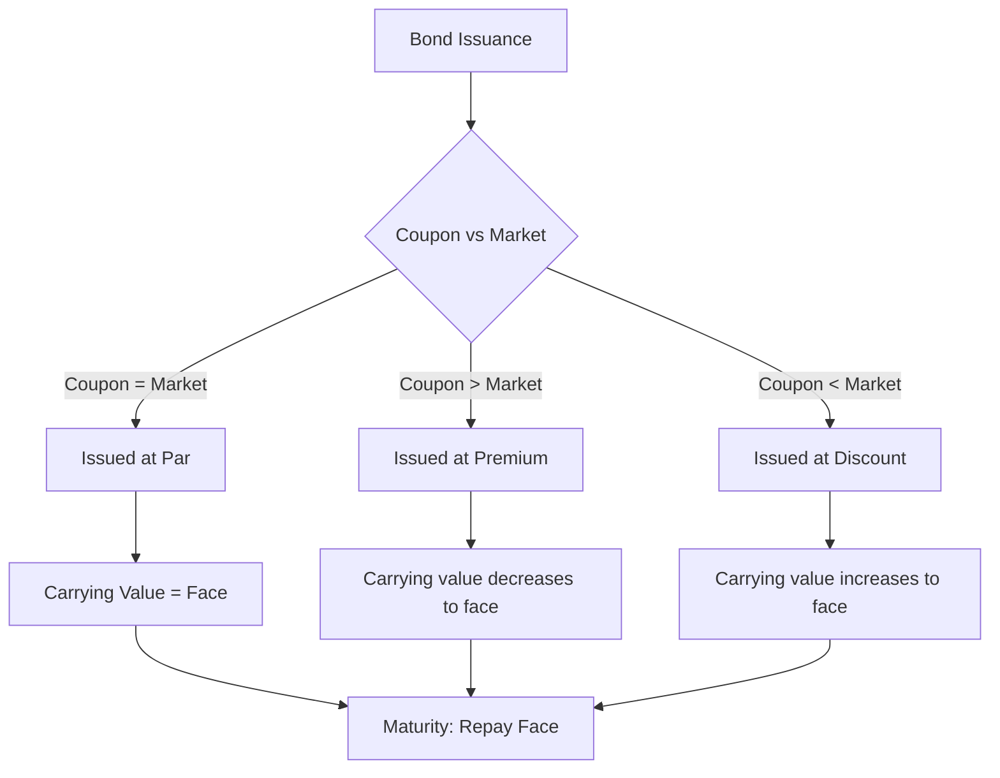

# Long-Term Liabilities & Bonds Payable

## Time Value of Money Overview

The time value of money (TVM) is the principle that a dollar received today is worth more than a dollar received in the future, because today's dollar can earn a return. Two present value (PV) formulas underpin long-term liability accounting:

$$
\text{Present Value of a Single Sum} = \frac{FV}{(1 + r)^n}
$$

$$
\text{Present Value of an Ordinary Annuity} = PMT \times \frac{1 - (1 + r)^{-n}}{r}
$$

Where:

- $FV$ = future value
- $PMT$ = periodic payment
- $r$ = interest rate per period
- $n$ = number of periods

:::info

Bond pricing combines both formulas: the PV of the face value (a single sum) plus the PV of the interest payments (an annuity).

:::

---

## Long-Term Liabilities Defined

A **long-term liability** is an obligation not expected to be settled within one year or the operating cycle, whichever is longer. Examples include bonds payable, long-term notes payable, lease obligations, and pension liabilities.

## Notes Payable at Present Value

Long-term notes payable are recorded at the **present value** of their future cash flows, discounted at the market rate of interest at issuance.

Bear Co. issues a 3-year, \$100,000 note at 8% annual interest when the market rate is also 8%:

$$
\text{PV} = \$100{,}000 \times \frac{1}{(1.08)^3} + \$8{,}000 \times \frac{1 - (1.08)^{-3}}{0.08} = \$100{,}000
$$

When the stated rate equals the market rate, the note is issued at face value.

```journal
Dr. Cash                      100,000
    Cr. Notes payable                 100,000
```

### Noninterest-Bearing Notes

A **noninterest-bearing note** has no stated interest rate, so a market rate must be **imputed** to find its present value. The difference between face value and PV is recorded as a **discount** and amortized to interest expense.

Polar Co. issues a 2-year, \$50,000 noninterest-bearing note for cash when the market rate is 10%:

$$
\text{PV} = \frac{\$50{,}000}{(1.10)^2} = \$41{,}322
$$

```journal
Dr. Cash                       41,322
Dr. Discount on notes payable   8,678
    Cr. Notes payable                  50,000
```

Year 1 interest expense is \$41,322 × 10% = \$4,132:

```journal
Dr. Interest expense            4,132
    Cr. Discount on notes payable       4,132
```

---

## Debt Covenants and Technical Default

Debt agreements often include **covenants**, which are restrictions such as maintaining a minimum current ratio or limiting dividend payments. Violating a covenant is a **technical default**.

:::warning

If a covenant violation at the balance sheet date makes long-term debt callable by the lender, the entire debt must be **reclassified as a current liability**.

:::

The debt remains non-current only if one of these exceptions applies:

1. **Waiver.** Before the financial statements are issued (or available to be issued), the lender waives or loses its right to demand repayment for more than one year from the balance sheet date.
2. **Grace period.** The agreement gives the company a grace period to cure the violation, and it is probable that the company will cure it within that period.

---

## Bonds Payable: Introduction

A **bond** is a formal debt instrument in which the issuer promises to pay the holder:

1. The **face (par) value** at maturity
2. Periodic **interest payments** (coupons) at the stated rate

### Types of Bonds

| Type            | Description                                   |
| --------------- | --------------------------------------------- |
| **Debenture**   | Unsecured; backed only by issuer's credit     |
| **Secured**     | Backed by specific collateral                 |
| **Convertible** | Can be converted into common stock            |
| **Callable**    | Issuer can retire early at a call price       |
| **Zero-coupon** | No periodic interest; issued at deep discount |

---

## Bond Terminology

| Term                          | Meaning                                         |
| ----------------------------- | ----------------------------------------------- |
| Face value                    | Par amount, typically \$1,000 per bond          |
| Coupon (stated) rate          | Rate used to compute periodic cash interest     |
| Effective (market/yield) rate | Rate investors demand; used for PV calculations |
| Maturity date                 | Date the face value is repaid                   |

The relationship between the coupon rate and the market rate determines pricing:

| Coupon vs. Market | Issued At | Carrying Value |
|---|---|---|
| Coupon = Market | **Par** | Face value |
| Coupon > Market | **Premium** | Above face value |
| Coupon < Market | **Discount** | Below face value |

---

## Bond Pricing

A bond's issue price is the PV of its face value plus the PV of its interest payments, both discounted at the **market rate**.

Grizzly Inc. issues \$500,000 of 5-year, 8% bonds with semiannual interest payments when the market rate is 10%.

- Semiannual coupon: \$500,000 × 8% ÷ 2 = \$20,000
- Periods: 5 × 2 = 10
- Market rate per period: 10% ÷ 2 = 5%

$$
\text{PV of face} = \frac{\$500{,}000}{(1.05)^{10}} = \$306{,}956.63
$$

$$
\text{PV of interest payments} = \$20{,}000 \times \frac{1 - (1.05)^{-10}}{0.05} = \$154{,}434.70
$$

$$
\text{Issue price} = \$306{,}956.63 + \$154{,}434.70 = \$461{,}391.33 \approx \$461{,}391
$$

The coupon rate is below the market rate, so the bonds are issued at a **discount** of \$38,609 (\$500,000 - \$461,391).

```journal
Dr. Cash                      461,391
Dr. Discount on bonds payable  38,609
    Cr. Bonds payable                 500,000
```

---

## Carrying Value

$$
\text{Carrying Value} = \text{Face Value} - \text{Unamortized Discount}
$$

or

$$
\text{Carrying Value} = \text{Face Value} + \text{Unamortized Premium}
$$

Carrying value moves toward face value as the discount or premium is amortized.

## Bond Issue Costs

Under current U.S. generally accepted accounting principles (GAAP), set by Accounting Standards Update (ASU) 2015-03, bond issue costs are presented as a **direct deduction** from the carrying amount of the bonds (like a discount), not as a deferred asset. They are amortized to interest expense over the life of the bonds using the effective interest method.

A company that pays \$12,000 of legal, accounting, and underwriting fees to issue bonds records:

```journal
Dr. Discount on bonds payable  12,000
    Cr. Cash                           12,000
```

## Amortization Methods

### Straight-Line Method

The straight-line method allocates the same amount of discount or premium to each period. It is permitted only if the results are **not materially different** from the effective interest method.

$$
\text{Amortization per period} = \frac{\text{Total Discount (or Premium)}}{\text{Number of Periods}}
$$

Using Grizzly Inc.'s discount of \$38,609 over 10 periods:

$$
\text{Per period} = \frac{\$38{,}609}{10} = \$3{,}861
$$

```journal
Dr. Interest expense           23,861
    Cr. Discount on bonds payable       3,861
    Cr. Cash                           20,000
```

### Effective Interest Method (Required by GAAP)

The effective interest method applies a **constant interest rate** (the market rate at issuance) to the carrying value each period.

$$
\text{Interest Expense} = \text{Carrying Value} \times \text{Market Rate per Period}
$$

$$
\text{Amortization} = \text{Interest Expense} - \text{Cash Interest Paid}
$$

**Period 1 for Grizzly Inc.:**

$$
\text{Interest Expense} = \$461{,}391 \times 5\% = \$23{,}070
$$

$$
\text{Amortization} = \$23{,}070 - \$20{,}000 = \$3{,}070
$$

```journal
Dr. Interest expense           23,070
    Cr. Discount on bonds payable       3,070
    Cr. Cash                           20,000
```

New carrying value = \$461,391 + \$3,070 = \$464,461.

**Amortization schedule, first three periods:**

| Period | Beginning Carrying Value | Interest Expense (5%) | Cash Paid (4%) | Discount Amortized | Ending Carrying Value |
|---|---|---|---|---|---|
| 1 | \$461,391 | \$23,070 | \$20,000 | \$3,070 | \$464,461 |
| 2 | \$464,461 | \$23,223 | \$20,000 | \$3,223 | \$467,684 |
| 3 | \$467,684 | \$23,384 | \$20,000 | \$3,384 | \$471,068 |

The carrying value keeps rising until it reaches the \$500,000 face value at maturity.

:::tip[Exam Tip]

For a **discount**, interest expense **increases** each period because the carrying value grows. For a **premium**, interest expense **decreases** because the carrying value shrinks.

:::

---

## Bonds Issued Between Interest Dates

When bonds are issued between interest payment dates, the buyer pays the issuer **accrued interest** from the last interest date to the issue date. The issuer then pays a full interest payment on the next interest date.

Kodiak Partners issues \$200,000 of 6% bonds (interest paid semiannually on January 1 and July 1) at par on March 1.

Accrued interest: \$200,000 × 6% × 2/12 = \$2,000

```journal
Dr. Cash                      202,000
    Cr. Bonds payable                 200,000
    Cr. Interest payable                2,000
```

On July 1, Kodiak Partners pays the full semiannual interest of \$6,000. Only \$4,000 (four months) is interest expense:

```journal
Dr. Interest payable            2,000
Dr. Interest expense            4,000
    Cr. Cash                            6,000
```

---

## Year-End Accrual

If the fiscal year-end falls between interest payment dates, accrue interest from the last payment date to year-end.

Bear Co. has \$300,000 of 8% bonds (interest paid semiannually on April 1 and October 1) and a December 31 year-end. Accrued interest from October 1 to December 31 (3 months):

$$
\$300{,}000 \times 8\% \times \frac{3}{12} = \$6{,}000
$$

```journal
Dr. Interest expense            6,000
    Cr. Interest payable                6,000
```

If the bonds were issued at a premium or discount, also record amortization for the three months.

---

## Troubled Debt Restructuring

A **troubled debt restructuring (TDR)** occurs when a creditor, because of a debtor's financial difficulty, grants a concession that it would not otherwise consider. The debtor accounts for a TDR under Accounting Standards Codification (ASC) 470-60.

### Debtor: Transfer of Assets

The debtor first adjusts the transferred asset to fair value, recognizing a gain or loss on disposition. It then recognizes a restructuring gain for the excess of the debt's carrying amount over the asset's fair value.

Panda Industries settles a \$500,000 note by transferring land with a book value of \$300,000 and a fair value of \$350,000:

- Gain on disposition of land: \$350,000 - \$300,000 = \$50,000
- Gain on restructuring: \$500,000 - \$350,000 = \$150,000

```journal
Dr. Notes payable             500,000
    Cr. Land                          300,000
    Cr. Gain on disposition of land    50,000
    Cr. Gain on restructuring         150,000
```

### Debtor: Equity Transfer

If the debtor issues equity instead, it records the shares at fair value. The difference between the carrying amount of the debt and the fair value of the shares is a restructuring gain.

### Modification of Terms

When terms are modified (lower rate, extended maturity, reduced principal), the debtor compares the **total undiscounted future cash payments** under the new terms with the **carrying amount** of the debt:

- **Future payments exceed the carrying amount:** No gain is recognized. The debtor computes a new effective interest rate and applies it prospectively.
- **Future payments are less than the carrying amount:** The debtor recognizes a gain for the difference and reduces the carrying amount to the total future payments. All later payments reduce the liability, so no future interest expense is recognized.

### Creditor Accounting

Creditors no longer apply separate TDR accounting. ASU 2022-02 eliminated the creditor TDR recognition and measurement guidance for entities that apply the current expected credit loss (CECL) model in ASC 326. A creditor now accounts for a loan modification under the general loan modification guidance and measures credit losses under CECL. The TDR rules above apply to the **debtor**.

## Extinguishment / Retirement of Debt

When bonds are retired before maturity (called or repurchased on the open market), the difference between the **reacquisition price** and the **net carrying amount** is a gain or loss. The net carrying amount is face value plus any unamortized premium, or minus any unamortized discount and issue costs.

$$
\text{Gain (Loss)} = \text{Net Carrying Amount} - \text{Reacquisition Price}
$$

Cub Entertainment retires \$100,000 face value bonds (carrying value \$97,200) at 102:

- Reacquisition price = \$100,000 × 102% = \$102,000
- Unamortized discount = \$100,000 - \$97,200 = \$2,800
- Loss = \$97,200 - \$102,000 = \$4,800

```journal
Dr. Bonds payable             100,000
Dr. Loss on extinguishment      4,800
    Cr. Discount on bonds payable       2,800
    Cr. Cash                          102,000
```

:::note

The gain or loss on extinguishment is reported in **income from continuing operations**. It is not an extraordinary item; ASU 2015-01 eliminated the extraordinary item classification.

:::

---

## Summary



:::note[Chapter Checklist]

- [ ] Calculate PV for notes and bonds using TVM formulas
- [ ] Distinguish premium from discount issuances
- [ ] Apply straight-line and effective interest amortization
- [ ] Record bonds issued between interest dates and year-end accruals
- [ ] Account for troubled debt restructurings from the debtor's perspective
- [ ] Calculate gain or loss on early extinguishment of debt

:::
