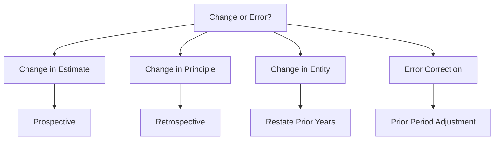

# Accounting Changes and Error Corrections

## Overview

Accounting Standards Codification (ASC) 250 covers four situations: changes in accounting estimate, changes in accounting principle, changes in reporting entity, and corrections of errors. The accounting treatment depends on which type of change occurred.



---

## Changes in Accounting Estimate

A **change in estimate** results from new information, more experience, or changed circumstances. Common examples include:

- Useful life of a depreciable asset
- Salvage value
- Allowance for doubtful accounts
- Warranty obligations
- Inventory obsolescence

### Treatment: Prospective

Changes in estimate are applied **prospectively**, in the current period and future periods. Prior periods are not adjusted.

**Example:** Bear Co. bought equipment for \$120,000 with no salvage value and a 10-year useful life (straight-line). After 4 years, Bear Co. revises the total useful life to 8 years.

Accumulated depreciation after 4 years:

$$
\frac{\$120{,}000}{10} \times 4 = \$48{,}000
$$

Remaining book value:

$$
\$120{,}000 - \$48{,}000 = \$72{,}000
$$

New annual depreciation over the remaining 4 years (8 - 4):

$$
\frac{\$72{,}000}{4} = \$18{,}000
$$

```journal
Dr. Depreciation expense       18,000
    Cr. Accumulated depreciation        18,000
```

:::tip[Exam Tip]

A **change in depreciation method** (for example, from double-declining balance to straight-line) is a **change in estimate effected by a change in principle**. It is accounted for **prospectively**, just like a change in estimate.

:::

---

## Changes in Accounting Principle

A **change in principle** occurs when an entity switches from one generally accepted accounting principle to another. Examples include:

- Changing from first-in, first-out (FIFO) to weighted-average inventory
- Changing from last-in, first-out (LIFO) to FIFO inventory
- Adopting a new Financial Accounting Standards Board (FASB) standard that requires a change (follow the transition method in the new standard)

### Treatment: Retrospective Application

Changes in principle are applied **retrospectively**:

1. Adjust the **beginning balance of retained earnings** for the earliest period presented (the cumulative effect, net of tax).
2. Restate the prior-period financial statements as if the new principle had always been used.
3. Disclose the nature of and reason for the change.

If retrospective application is impracticable, apply the new principle as of the earliest date that is practicable.

**Example:** Polar Co. changes from FIFO to weighted-average on January 1, Year 3. The cumulative effect on prior years is a \$25,000 decrease in inventory and retained earnings. (Ignore income taxes in this example.)

```journal
Dr. Retained earnings          25,000
    Cr. Inventory                      25,000
```

If Year 1 and Year 2 financial statements are presented for comparison, they are restated using weighted-average.

:::warning[Exception: Change to LIFO]

A change **to** LIFO from another method is an exception, because it is impracticable to determine LIFO layers retrospectively. The beginning inventory in the year of change becomes the **first LIFO layer**, and no cumulative adjustment is made.

:::

### Indirect Effects

Indirect effects, such as changes in profit-sharing or royalty payments caused by the principle change, are recognized in the period of change and disclosed. They are **not** included in the retrospective restatement.

---

## Changes in Reporting Entity

A **change in reporting entity** occurs when the reporting entity differs from the entity reported in prior periods. Examples include:

- Presenting consolidated statements instead of individual company statements
- Changing the subsidiaries included in the consolidated statements

### Treatment: Restate Prior Years

All prior-period financial statements presented are **restated** to reflect the new reporting entity, as if the current entity structure had always existed.

---

## Error Corrections

An **error** in previously issued financial statements may result from:

- Mathematical mistakes
- Mistakes in applying generally accepted accounting principles (GAAP)
- Oversight or misuse of facts
- A change from a non-GAAP method to GAAP (an error correction, not a change in principle)

### Treatment: Prior Period Adjustment

Errors are corrected through a **prior period adjustment** to the beginning balance of retained earnings (net of tax) for the earliest period presented.

**Example:** Grizzly Inc. discovers in Year 3 that it failed to record \$40,000 of depreciation expense in Year 1. The tax rate is 21%.

After-tax effect = \$40,000 × (1 - 0.21) = \$31,600

Assume the depreciation was correctly deducted on the Year 1 tax return. The error therefore created a book-tax difference, and the \$8,400 tax effect (\$40,000 × 21%) reduces the deferred tax liability. (If the tax return also omitted the deduction, the debit would go to income taxes payable or a refund receivable instead.)

```journal
Dr. Retained earnings          31,600
Dr. Deferred tax liability      8,400
    Cr. Accumulated depreciation        40,000
```

:::danger

Changing from a **non-GAAP** method (such as the cash basis) to a **GAAP** method (the accrual basis) is an **error correction**, not a change in principle.

:::

---

## Summary of Treatments

| Type | Treatment | Restate Prior Periods? |
| ---- | --------- | ---------------------- |
| Change in estimate | Prospective | No |
| Change in estimate effected by a change in principle | Prospective | No |
| Change in principle | Retrospective | Yes |
| Change in reporting entity | Retrospective (restate) | Yes |
| Error correction | Prior period adjustment | Yes |

---

## Adjusting Journal Entries

Adjusting entries are made at the **end of the accounting period** so that revenues and expenses are recorded in the correct period. They follow three rules:

:::info[Adjusting Entry Rules]

1. They **never involve cash**. Cash entries are recorded when cash changes hands.
2. They always involve **one income statement account** and **one balance sheet account**.
3. They are made at **year-end** (or period-end) before the financial statements are prepared.

:::

### Four Types of Adjustments

#### 1. Accrued Revenue (Revenue Earned, Not Yet Received)

Kodiak Partners earned \$8,000 of consulting fees in December but will not bill the client until January:

```journal
Dr. Accounts receivable         8,000
    Cr. Consulting revenue              8,000
```

#### 2. Accrued Expense (Expense Incurred, Not Yet Paid)

Panda Industries owes employees \$12,000 for work performed in the last week of December:

```journal
Dr. Wages expense              12,000
    Cr. Wages payable                  12,000
```

#### 3. Deferred Revenue (Revenue Received, Not Yet Earned)

Cub Entertainment received \$36,000 on October 1 for a 12-month subscription. By December 31, 3 months have been earned.

Original entry on October 1:

```journal
Dr. Cash                       36,000
    Cr. Unearned revenue               36,000
```

Adjusting entry on December 31 (\$36,000 × 3/12 = \$9,000):

```journal
Dr. Unearned revenue            9,000
    Cr. Subscription revenue            9,000
```

#### 4. Deferred Expense (Expense Paid, Not Yet Incurred)

Bear Co. paid \$24,000 on July 1 for a 12-month insurance policy. By December 31, 6 months have expired.

Original entry on July 1:

```journal
Dr. Prepaid insurance          24,000
    Cr. Cash                           24,000
```

Adjusting entry on December 31 (\$24,000 × 6/12 = \$12,000):

```journal
Dr. Insurance expense          12,000
    Cr. Prepaid insurance              12,000
```

---

## Correcting Entries vs. Adjusting Entries

| Feature | Adjusting Entry | Correcting Entry |
| ------- | --------------- | ---------------- |
| Timing | End of period | Whenever an error is discovered |
| Cash involved? | Never | May involve cash |
| Purpose | Match revenues and expenses to the period | Fix mistakes |
| Accounts | One income statement and one balance sheet account | Any combination |

**Example of a correcting entry:** Polar Co. debited Equipment for a \$5,000 repair that should have been expensed. The error is found in the same period, before the books are closed:

```journal
Dr. Repairs expense             5,000
    Cr. Equipment                       5,000
```

---

## Statement of Retained Earnings: Error Correction Presentation

When a prior period error is corrected, the statement of retained earnings shows the adjustment to the beginning balance. Using the Grizzly Inc. error above:

| Line | Amount |
|---|---|
| Beginning retained earnings (as previously reported) | \$500,000 |
| Prior period adjustment (net of tax) | (\$31,600) |
| **Beginning retained earnings (as restated)** | **\$468,400** |
| Net income | \$120,000 |
| Dividends | (\$30,000) |
| **Ending retained earnings** | **\$558,400** |

---

## Disclosures

For all accounting changes and error corrections, entities must disclose:

- The nature of and reason for the change
- The method of applying the change
- The effect on income from continuing operations, net income, and earnings per share (EPS)
- The cumulative effect on retained earnings (for retrospective changes)

:::note[Chapter Checklist]

- [ ] Classify changes as estimate, principle, entity, or error
- [ ] Apply prospective treatment for changes in estimate
- [ ] Apply retrospective treatment for changes in principle
- [ ] Recognize the LIFO exception
- [ ] Record prior period adjustments for error corrections (net of tax)
- [ ] Master the four types of adjusting entries
- [ ] Distinguish adjusting entries from correcting entries

:::
