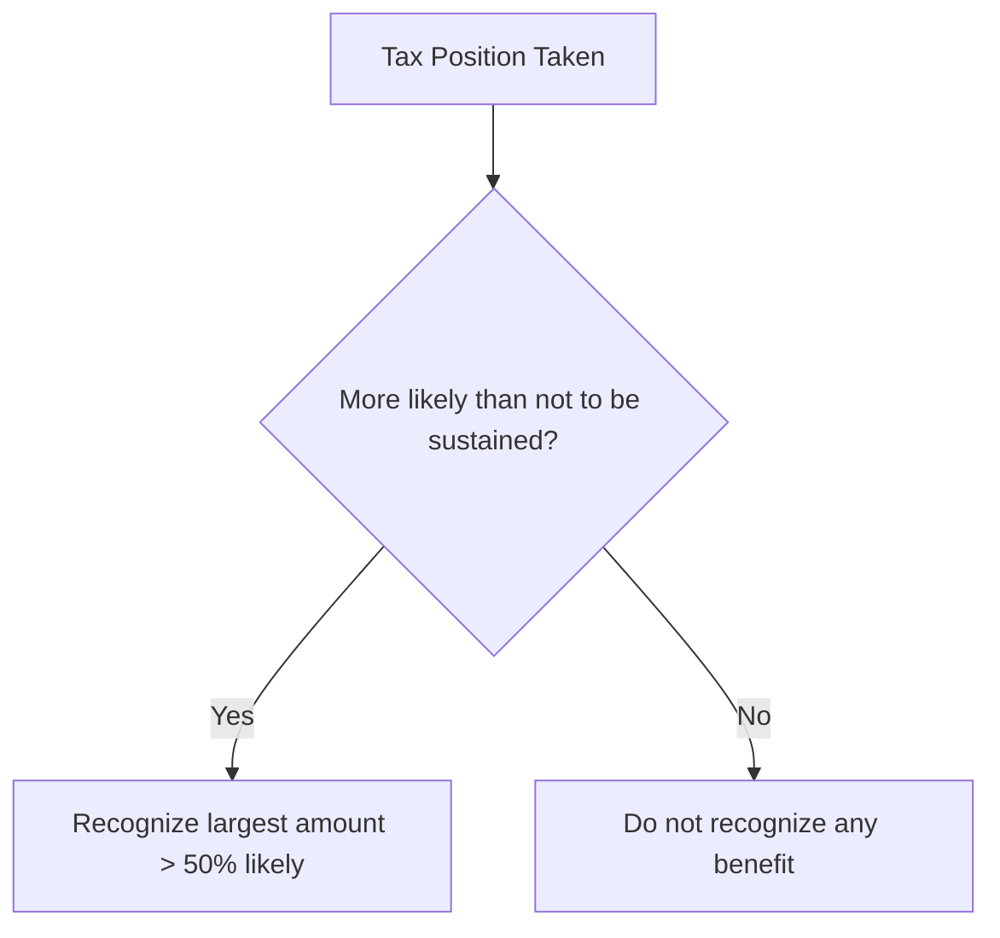

# Accounting for Income Taxes

## GAAP vs. Tax Differences

Generally accepted accounting principles (GAAP) and the Internal Revenue Code (IRC) recognize some revenues and expenses differently. These differences cause **book income** (pretax financial income) to differ from **taxable income**.

$$
\text{Taxable Income} = \text{Pretax Financial Income} \pm \text{Permanent Differences} \pm \text{Temporary Differences}
$$

---

## Permanent vs. Temporary Differences

### Permanent Differences

Permanent differences **never reverse**. They affect either book income or taxable income, but not both, so they do **not** create deferred taxes.

| Example | Effect |
|---|---|
| Municipal bond interest | Included in book income; never taxable |
| Life insurance premiums (company-owned) | Book expense; never deductible |
| Fines and penalties | Book expense; never deductible |
| Life insurance proceeds (company-owned) | Included in book income; never taxable |

### Temporary Differences

Temporary differences **reverse** in future periods. They create **deferred tax assets (DTAs)** or **deferred tax liabilities (DTLs)**.

| Example | Timing | Creates |
|---|---|---|
| Depreciation (straight-line for book, Modified Accelerated Cost Recovery System (MACRS) for tax) | Larger tax deduction now, larger book expense later | **DTL** |
| Estimated warranty liability | Book expense now, tax deduction when paid | **DTA** |
| Bad debt expense (allowance method) | Book expense now, tax deduction when written off | **DTA** |
| Rent collected in advance (unearned rent) | Taxable when received, book income when earned | **DTA** |
| Installment sales | Book income now, taxable when collected | **DTL** |

:::info[Key Principle]

- **Future taxable amounts** create a deferred tax liability (DTL).
- **Future deductible amounts** create a deferred tax asset (DTA).

:::

---

## Computing Tax Expense

Total income tax expense has two components:

$$
\text{Total Tax Expense} = \text{Current Tax Expense (CTE)} + \text{Deferred Tax Expense (DTE)}
$$

### Current Tax Expense

$$
\text{CTE} = \text{Taxable Income} \times \text{Enacted Tax Rate}
$$

### Deferred Tax Expense

$$
\text{DTE} = \Delta DTL - \Delta DTA
$$

Here $\Delta$ is the change in the balance during the period. Deferred tax balances are measured using the **enacted** tax rate expected to apply when the temporary differences reverse.

---

## DTL and DTA Calculations

### Deferred Tax Liability Example

Bear Co. buys equipment for \$100,000. Book depreciation is straight-line over 5 years (\$20,000 per year). Tax depreciation uses MACRS, with a Year 1 deduction of \$33,000. The enacted tax rate is 21%.

| | Book | Tax | Difference |
|---|---|---|---|
| Year 1 depreciation | \$20,000 | \$33,000 | \$13,000 |

The \$13,000 excess tax deduction means Bear Co. will pay **more tax in the future** when the difference reverses.

$$
\text{DTL} = \$13{,}000 \times 21\% = \$2{,}730
$$

```journal
Dr. Income tax expense          2,730
    Cr. Deferred tax liability          2,730
```

### Deferred Tax Asset Example

Polar Co. records an estimated warranty liability of \$50,000. For tax purposes, warranty costs are deductible only when paid. The tax rate is 21%.

$$
\text{DTA} = \$50{,}000 \times 21\% = \$10{,}500
$$

```journal
Dr. Deferred tax asset         10,500
    Cr. Income tax expense             10,500
```

### Bad Debt Example

Grizzly Inc. uses the allowance method and records bad debt expense of \$30,000. For tax purposes, bad debts are deductible only when written off (the direct write-off method). No accounts were written off this year.

$$
\text{DTA} = \$30{,}000 \times 21\% = \$6{,}300
$$

```journal
Dr. Deferred tax asset          6,300
    Cr. Income tax expense              6,300
```

---

## Comprehensive Example

Panda Industries has pretax financial income of \$500,000 and a 21% tax rate. The following differences exist:

| Item | Amount | Type |
|---|---|---|
| Municipal bond interest | \$20,000 | Permanent |
| Excess tax depreciation | \$40,000 | Temporary (DTL) |
| Warranty accrual (not yet paid) | \$15,000 | Temporary (DTA) |

**Step 1: Taxable income**

$$
\$500{,}000 - \$20{,}000 - \$40{,}000 + \$15{,}000 = \$455{,}000
$$

**Step 2: Current tax expense**

$$
\$455{,}000 \times 21\% = \$95{,}550
$$

**Step 3: Deferred taxes**

$$
\text{DTL increase} = \$40{,}000 \times 21\% = \$8{,}400
$$

$$
\text{DTA increase} = \$15{,}000 \times 21\% = \$3{,}150
$$

**Step 4: Total tax expense**

$$
\$95{,}550 + \$8{,}400 - \$3{,}150 = \$100{,}800
$$

Check: (\$500,000 - \$20,000) × 21% = \$100,800. Only the permanent difference changes total tax expense.

```journal
Dr. Income tax expense        100,800
Dr. Deferred tax asset          3,150
    Cr. Income tax payable             95,550
    Cr. Deferred tax liability          8,400
```

---

## Valuation Allowance

A **valuation allowance** reduces a DTA to the amount that is **more likely than not** (a likelihood of more than 50%) to be realized.

:::warning

If it is more likely than not that **some or all** of the DTA will not be realized, a valuation allowance must be recorded.

:::

Factors suggesting a valuation allowance is needed:

- A history of operating losses
- Losses expected in the near future
- Carryforwards that expire unused
- A lack of future sources of taxable income

**Example:** Kodiak Partners has a DTA of \$60,000 but determines that only \$40,000 is more likely than not to be realized:

```journal
Dr. Income tax expense         20,000
    Cr. Valuation allowance            20,000
```

The DTA is presented net: \$60,000 - \$20,000 = \$40,000.

---

## Enacted Tax Rate Changes

When an **enacted** tax rate changes, deferred tax balances are adjusted to the new rate. The adjustment goes to income from continuing operations in the **period of enactment**.

$$
\text{Adjustment} = \text{Temporary Difference Balance} \times (\text{New Rate} - \text{Old Rate})
$$

Bear Co. has a cumulative temporary difference of \$200,000 that created a DTL. The rate changes from 35% to 21%:

$$
\text{Old DTL} = \$200{,}000 \times 35\% = \$70{,}000
$$

$$
\text{New DTL} = \$200{,}000 \times 21\% = \$42{,}000
$$

$$
\text{Reduction} = \$70{,}000 - \$42{,}000 = \$28{,}000
$$

```journal
Dr. Deferred tax liability     28,000
    Cr. Income tax expense             28,000
```

---

## Net Operating Losses (NOL)

A **net operating loss (NOL)** occurs when allowable tax deductions exceed gross income. The carryback and carryforward rules depend on the year the loss arose.

### NOL Rules by Period

| Period of Loss | Carryback | Carryforward |
| -------------- | --------- | ------------ |
| Tax years before 2018 | 2 years back | 20 years forward |
| 2018 to 2020 (CARES Act) | 5 years back | Indefinite (80% limit in tax years after 2020) |
| 2021 and later | **No carryback** | Indefinite, limited to **80% of taxable income** |

The CARES Act is the Coronavirus Aid, Relief, and Economic Security Act of 2020.

:::tip[Exam Tip]

For losses arising in 2021 and later, an NOL carryforward can offset only **80%** of taxable income in any year. The remaining 20% is taxable.

:::

**Example:** Sloth Security has a 2024 NOL of \$100,000 and taxable income of \$150,000 in 2025.

$$
\text{NOL limit} = \$150{,}000 \times 80\% = \$120{,}000
$$

The \$100,000 NOL is below the \$120,000 limit, so all of it can be used:

$$
\text{Taxable income after NOL} = \$150{,}000 - \$100{,}000 = \$50{,}000
$$

When the NOL arises in 2024, Sloth recognizes a DTA of \$100,000 × 21% = \$21,000:

```journal
Dr. Deferred tax asset         21,000
    Cr. Income tax benefit             21,000
```

When the NOL is used in 2025:

```journal
Dr. Income tax expense         21,000
    Cr. Deferred tax asset             21,000
```

---

## Uncertain Tax Positions

Accounting Standards Codification (ASC) 740-10 uses a **two-step approach** for uncertain tax positions:

1. **Recognition:** Recognize the tax benefit only if the position is **more likely than not** (more than 50%) to be sustained on examination, based on its technical merits.
2. **Measurement:** Recognize the **largest amount** of benefit that is more than 50% likely to be realized on settlement.



---

## Balance Sheet Presentation

Under current GAAP (Accounting Standards Update (ASU) 2015-17), **all** deferred tax assets and liabilities are classified as **noncurrent**. DTAs and DTLs of the same tax jurisdiction are netted.

| Component | Classification |
|---|---|
| Income tax payable | Current liability |
| Deferred tax asset | Noncurrent asset |
| Deferred tax liability | Noncurrent liability |

---

## Investee Undistributed Earnings

Under the equity method, the investor's share of investee earnings is book income, but only dividends are taxable. Undistributed earnings therefore create a temporary difference and a DTL.

$$
\text{DTL} = \text{Undistributed Earnings} \times \text{Tax Rate}
$$

This simplified formula ignores any dividends-received deduction (DRD). If a DRD applies, use only the taxable portion of the undistributed earnings.

:::note

The **indefinite reversal** exception applies only to the undistributed earnings of **foreign subsidiaries and foreign corporate joint ventures** that are essentially permanent in duration. If the investor can show those earnings will be reinvested indefinitely, no DTL is recorded. The exception does not apply to an ordinary equity-method investee.

:::

---

## Summary

:::note[Chapter Checklist]

- [ ] Distinguish permanent from temporary differences
- [ ] Calculate current tax expense from taxable income
- [ ] Determine DTLs and DTAs from temporary differences
- [ ] Apply the more-likely-than-not test for the valuation allowance
- [ ] Adjust deferred taxes for enacted rate changes
- [ ] Apply NOL carryback and carryforward rules by time period
- [ ] Evaluate uncertain tax positions using the two-step approach
- [ ] Present all deferred taxes as noncurrent

:::
