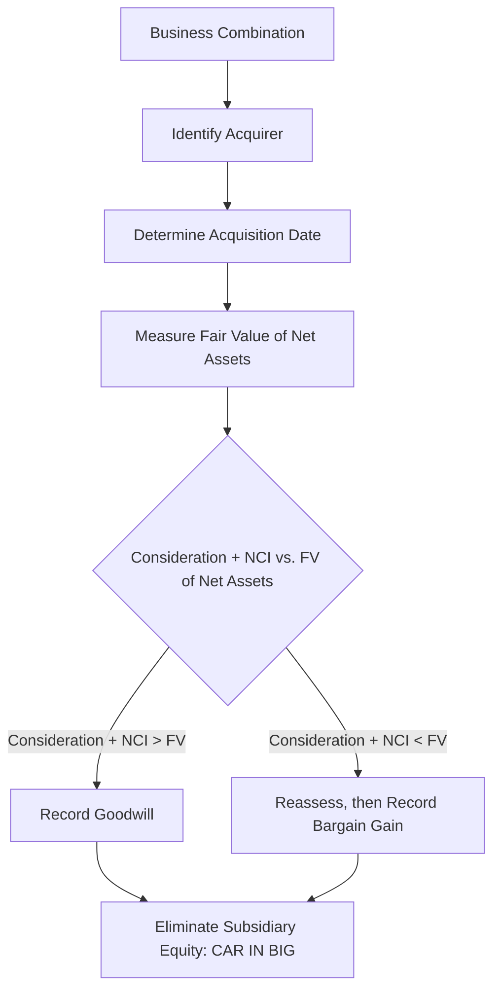

# Business Combinations

## Acquisition Method

Under Accounting Standards Codification (ASC) 805, every business combination is accounted for using the **acquisition method**. The acquirer must:

1. Identify the **acquirer**
2. Determine the **acquisition date**
3. Recognize and measure the **identifiable assets acquired**, **liabilities assumed**, and any **noncontrolling interest (NCI)**
4. Recognize and measure **goodwill** or a **gain from a bargain purchase**

:::info

The acquisition method is the only method allowed. It replaced the older purchase method, and the pooling-of-interests method is no longer permitted. Identifiable assets acquired and liabilities assumed are measured at **fair value (FV)** on the acquisition date, with limited exceptions (such as deferred taxes and employee benefits).

:::

---

## The CAR IN BIG Mnemonic

The consolidation elimination entry at acquisition follows the **CAR IN BIG** framework:

| Letter | Action | Side |
|---|---|---|
| **C** | Eliminate subsidiary **Common stock** | Debit |
| **A** | Eliminate subsidiary **additional paid-in capital (APIC)** | Debit |
| **R** | Eliminate subsidiary **Retained earnings** | Debit |
| **I** | Eliminate the parent's **Investment** account | Credit |
| **N** | Create **Noncontrolling interest** (at fair value) | Credit |
| **B** | Adjust net assets from book value to 100% fair value (**Book-to-fair-value adjustments**) | Debit (credit if FV is below book) |
| **I** | Record **Identifiable intangibles** at fair value | Debit |
| **G** | Record **Goodwill** (or a bargain purchase gain) | Debit (a gain is a credit) |

---

## Step-by-Step Example

Bear Co. acquires 80% of Polar Co. on January 1 for **\$640,000** of consideration. The fair value of the 20% NCI is **\$160,000**. Polar Co.'s balances at acquisition are:

| Account | Book Value | Fair Value |
|---|---|---|
| Total assets | \$700,000 | \$850,000 |
| Total liabilities | \$200,000 | \$200,000 |
| **Net assets** | **\$500,000** | **\$650,000** |

Polar Co.'s book equity is made up of:

| Equity Account | Book Value |
|---|---|
| Common stock | \$100,000 |
| APIC | \$150,000 |
| Retained earnings | \$250,000 |
| **Total equity** | **\$500,000** |

### Calculating Goodwill

Goodwill is the excess of the consideration plus the NCI over the fair value of the identifiable net assets:

$$
\text{Goodwill} = (\text{Consideration} + \text{NCI at FV}) - \text{Net Assets at FV}
$$

$$
\text{Goodwill} = (\$640{,}000 + \$160{,}000) - \$650{,}000 = \$150{,}000
$$

The fair value adjustment to Polar Co.'s net assets is:

$$
\$850{,}000 - \$700{,}000 = \$150{,}000 \text{ (asset step-up)}
$$

### Elimination Entry at Acquisition

```journal
Dr. Common stock (Polar)       100,000
Dr. APIC (Polar)               150,000
Dr. Retained earnings (Polar)  250,000
Dr. Asset step-up              150,000
Dr. Goodwill                   150,000
    Cr. Investment in Polar            640,000
    Cr. Noncontrolling interest        160,000
```

:::tip[Exam Tip]

Total debits equal the **full (100%) fair value** of the subsidiary: \$640,000 (parent share) + \$160,000 (NCI) = \$800,000. This also equals the net assets at FV (\$650,000) plus goodwill (\$150,000).

:::

---

## Identifiable Intangible Assets

The acquirer recognizes an intangible asset **separately from goodwill** if it meets either of two criteria:

- **Contractual-legal criterion:** the asset arises from contractual or legal rights (patents, licenses, customer contracts).
- **Separability criterion:** the asset can be sold, transferred, or licensed on its own.

| Intangible Asset | Criterion Met |
|---|---|
| Customer relationships | Contractual-legal |
| Trade names | Contractual-legal |
| Technology patents | Contractual-legal |
| Customer lists | Separability |
| Non-compete agreements | Contractual-legal |
| In-process research and development (IPR&D) | Either |

**Example:** In the Bear Co. and Polar Co. acquisition, assume \$50,000 of the asset step-up relates to customer relationships. The refined elimination entry is:

```journal
Dr. Common stock (Polar)       100,000
Dr. APIC (Polar)               150,000
Dr. Retained earnings (Polar)  250,000
Dr. Tangible asset step-up     100,000
Dr. Customer relationships      50,000
Dr. Goodwill                   150,000
    Cr. Investment in Polar            640,000
    Cr. Noncontrolling interest        160,000
```

---

## Goodwill vs. Bargain Purchase Gain

### Goodwill

Goodwill arises when the consideration transferred plus the NCI **exceeds** the fair value of the net identifiable assets acquired. Goodwill is:

- **Not amortized** (indefinite life), unless a private company elects the private company alternative to amortize it straight-line over 10 years or less
- Tested for **impairment** at least annually at the reporting unit level
- Recorded only in a business combination (internally generated goodwill is never capitalized)

### Bargain Purchase Gain

A bargain purchase occurs when the fair value of the net identifiable assets **exceeds** the consideration transferred plus the NCI. Before recognizing a gain, the acquirer must:

1. **Reassess** whether all assets acquired and liabilities assumed have been identified and measured correctly
2. **Review** the procedures used to measure the fair values

If a bargain still exists after this review, the acquirer recognizes the gain in **earnings** on the acquisition date.

**Example:** Grizzly Inc. acquires 100% of Sloth Security for \$400,000. Sloth's net identifiable assets have a fair value of \$450,000.

$$
\text{Bargain purchase gain} = \$450{,}000 - \$400{,}000 = \$50{,}000
$$

```journal
Dr. Net identifiable assets    450,000
    Cr. Cash                           400,000
    Cr. Gain on bargain purchase        50,000
```

---

## Measurement Period Adjustments

The acquirer has up to **one year** from the acquisition date to finalize the accounting for a business combination. During this **measurement period**, it adjusts provisional amounts for new information about facts and circumstances that existed at the acquisition date.

:::warning

Measurement period adjustments are recognized in the **reporting period in which the adjustment amount is determined**. Under Accounting Standards Update (ASU) 2015-16, prior periods are **not** restated. The current-period entry includes any effect on earnings (such as extra depreciation) that would have been recorded since the acquisition date, and the acquirer discloses the portion that relates to prior periods.

:::

**Example:** Bear Co. initially recorded goodwill of \$150,000. Six months later, an appraisal shows that an acquired building was undervalued by \$30,000 at the acquisition date:

```journal
Dr. Building                    30,000
    Cr. Goodwill                        30,000
```

Revised goodwill is \$150,000 - \$30,000 = \$120,000.

---

## Contingent Consideration

**Contingent consideration** is an obligation to transfer additional assets or equity if specified future events occur or conditions are met. A common example is an earn-out tied to post-acquisition revenue targets.

### Initial Recognition

Contingent consideration is measured at **fair value** on the acquisition date and included in the consideration transferred.

Panda Industries acquires Kodiak Partners for \$300,000 cash plus contingent consideration with a fair value of \$40,000. Kodiak's net identifiable assets have a fair value of \$280,000, so goodwill is \$340,000 - \$280,000 = \$60,000:

```journal
Dr. Net identifiable assets             280,000
Dr. Goodwill                             60,000
    Cr. Cash                                    300,000
    Cr. Contingent consideration liability       40,000
```

### Subsequent Measurement

The treatment after the acquisition date depends on how the contingent consideration is classified. Changes caused by events after the acquisition date (such as meeting a revenue target) are not measurement period adjustments.

| Classification | Treatment |
| -------------- | --------- |
| **Liability** | Remeasured at fair value each period; changes go to **earnings** |
| **Equity** | Not remeasured; settlement is accounted for within equity |

If the contingent consideration liability increases to \$55,000 at year-end:

```journal
Dr. Loss on contingent consideration     15,000
    Cr. Contingent consideration liability      15,000
```

---

## Acquisition-Related Costs

Costs incurred to complete the acquisition are **expensed as incurred**. Examples include finder's fees, advisory fees, legal fees, and due diligence costs. These costs are not part of the consideration transferred.

Bear Co. pays \$25,000 of legal and advisory fees related to the acquisition:

```journal
Dr. Acquisition expense         25,000
    Cr. Cash                            25,000
```

:::danger

Do **not** capitalize acquisition costs as part of goodwill. The one exception to expensing is the cost of issuing debt or equity securities, which follows the related standard: debt issue costs reduce the carrying amount of the debt, and equity issue costs reduce APIC.

:::

---

## Summary Diagram



:::note[Chapter Checklist]

- [ ] Apply the acquisition method to business combinations
- [ ] Use the CAR IN BIG mnemonic for elimination entries
- [ ] Calculate goodwill as consideration plus NCI minus the FV of net assets
- [ ] Recognize identifiable intangibles separately from goodwill
- [ ] Identify bargain purchase situations and recognize the gain
- [ ] Record measurement period adjustments in the period they are determined, without restating prior periods
- [ ] Measure contingent consideration at fair value and remeasure liabilities through earnings
- [ ] Expense acquisition-related costs as incurred

:::
