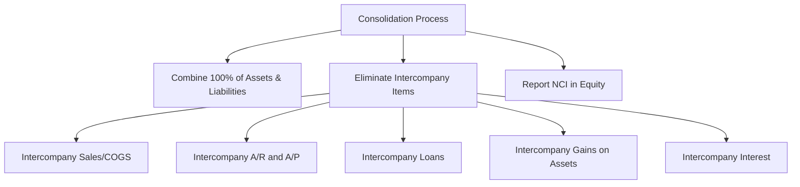

# Consolidated Financial Statements

## Parent-Subsidiary Relationship

A parent must prepare consolidated financial statements when it holds a **controlling financial interest** in one or more subsidiaries. Under the **voting interest model** in Accounting Standards Codification (ASC) 810, control is presumed when the parent owns **more than 50%** of the subsidiary's outstanding voting stock. Under the variable interest entity (VIE) model, the primary beneficiary consolidates a VIE even without majority voting ownership.

:::info

Consolidated statements present the parent and its subsidiaries as a **single economic entity**. All intercompany balances and transactions are eliminated.

:::

---

## Voting Interest Model

| Ownership Level | Accounting Method |
| --------------- | ----------------- |
| Less than 20% | Fair value (or the equity method if significant influence exists) |
| 20% to 50% | Equity method (significant influence presumed) |
| More than 50% | **Consolidation** (control presumed) |

The parent controls the subsidiary's operations and presents combined results. The portion of the subsidiary owned by outside shareholders is the **noncontrolling interest (NCI)**.

---

## Eliminating Intercompany Transactions

Intercompany transactions are eliminated **at 100%**, regardless of the parent's ownership percentage. This prevents double-counting of revenues, expenses, assets, and liabilities.

### Eliminating Intercompany Accounts

**Intercompany receivables and payables:** Bear Co. (parent) has a \$50,000 receivable from Polar Co. (subsidiary):

```journal
Dr. Accounts payable (Polar)    50,000
    Cr. Accounts receivable (Bear)     50,000
```

**Intercompany interest:** Bear Co. charged Polar Co. \$3,000 of interest on an intercompany loan:

```journal
Dr. Interest revenue (Bear)     3,000
    Cr. Interest expense (Polar)        3,000
```

**Intercompany loans:** Bear Co. loaned Polar Co. \$100,000:

```journal
Dr. Notes payable (Polar)     100,000
    Cr. Notes receivable (Bear)       100,000
```

---

## Intercompany Inventory Transactions

When one affiliate sells inventory to another, eliminate the **intercompany sale**, the related **cost of goods sold (COGS)**, and any **unrealized profit** left in ending inventory.

### Downstream Sale (Parent to Subsidiary)

Bear Co. sells inventory costing \$60,000 to Polar Co. for \$80,000. At year-end, Polar Co. still holds 25% of this inventory.

**Step 1: Eliminate the intercompany sale and COGS.**

```journal
Dr. Sales (Bear)               80,000
    Cr. Cost of goods sold             80,000
```

**Step 2: Eliminate the unrealized profit in ending inventory.**

Unrealized profit = (\$80,000 - \$60,000) × 25% = \$5,000

```journal
Dr. Cost of goods sold          5,000
    Cr. Inventory (Polar)               5,000
```

:::tip[Exam Tip]

In a **downstream** sale, 100% of the unrealized profit is eliminated against the **parent's** income. In an **upstream** sale, the unrealized profit is allocated between the parent and the NCI based on ownership percentages.

:::

### Upstream Sale (Subsidiary to Parent)

Polar Co. (an 80%-owned subsidiary) sells inventory costing \$40,000 to Bear Co. for \$55,000. Bear Co. still holds 40% of it at year-end.

**Step 1: Eliminate the intercompany sale and COGS.**

```journal
Dr. Sales (Polar)               55,000
    Cr. Cost of goods sold             55,000
```

**Step 2: Eliminate the unrealized profit.**

Unrealized profit = (\$55,000 - \$40,000) × 40% = \$6,000

```journal
Dr. Cost of goods sold          6,000
    Cr. Inventory (Bear)                6,000
```

The \$6,000 elimination is allocated as follows:

- Parent's share (80%): \$4,800
- NCI's share (20%): \$1,200

---

## Intercompany Bond Transactions

When one affiliate buys the bonds of another on the open market, the debt is effectively **retired** from the consolidated perspective. The difference between the bonds' carrying amount and the purchase price is a **constructive gain or loss**.

Grizzly Inc. (parent) has \$200,000 of bonds outstanding with a carrying amount of \$196,000. Kodiak Partners (subsidiary) buys these bonds on the open market for \$193,000.

Constructive gain = \$196,000 - \$193,000 = \$3,000

**Elimination entry:**

```journal
Dr. Bonds payable (Grizzly)            200,000
    Cr. Discount on bonds (Grizzly)              4,000
    Cr. Investment in bonds (Kodiak)           193,000
    Cr. Gain on constructive retirement          3,000
```

---

## Intercompany Land Transactions

When one affiliate sells land to another, any **unrealized gain or loss** is eliminated until the land is sold to an outside party.

Bear Co. sells land with a book value of \$100,000 to Polar Co. for \$130,000.

**Elimination entry:**

```journal
Dr. Gain on sale of land       30,000
    Cr. Land                           30,000
```

The land stays on the consolidated balance sheet at its **original cost** of \$100,000 until it is sold externally.

---

## Intercompany Depreciable Assets

When one affiliate sells a depreciable asset to another at a gain, two adjustments are required:

1. **Eliminate the unrealized gain** and restore the asset and accumulated depreciation to their original amounts.
2. **Adjust depreciation**, because the buyer is depreciating a higher basis. The excess depreciation is eliminated each year.

Panda Industries sells equipment (cost \$80,000, accumulated depreciation \$30,000) to Cub Entertainment for \$70,000. The remaining life is 5 years.

Gain on intercompany sale = \$70,000 - (\$80,000 - \$30,000) = \$20,000

**Step 1: Eliminate the gain and restore the original cost basis.** Equipment goes from the buyer's \$70,000 back to the original \$80,000 cost, and the original \$30,000 of accumulated depreciation is reinstated:

```journal
Dr. Gain on sale of equipment  20,000
Dr. Equipment                  10,000
    Cr. Accumulated depreciation       30,000
```

**Step 2: Eliminate the excess depreciation.** Cub records depreciation of \$70,000 ÷ 5 = \$14,000 per year. The consolidated amount is \$50,000 ÷ 5 = \$10,000. The \$4,000 difference (\$20,000 ÷ 5) is eliminated each year:

```journal
Dr. Accumulated depreciation    4,000
    Cr. Depreciation expense            4,000
```

At the end of Year 1, Cub carries the equipment at \$56,000 (\$70,000 - \$14,000). The consolidated carrying amount is \$40,000 (\$80,000 cost - \$40,000 accumulated depreciation). The \$16,000 difference is the gain not yet realized (\$20,000 - \$4,000). Each year, \$4,000 more of the gain is realized through the lower consolidated depreciation.

---

## Consolidated Balance Sheet

The consolidated balance sheet combines the parent's and subsidiary's assets and liabilities, with these adjustments:

- **Eliminate** all of the subsidiary's stockholders' equity.
- **Eliminate** the parent's investment in subsidiary account.
- **Add** the fair value adjustments from the acquisition to the subsidiary's assets and liabilities.
- **Report** goodwill as an asset.
- **Report** NCI in the **equity section**, separate from the parent's equity.

:::warning

NCI is presented within **equity** on the consolidated balance sheet, separate from the parent's equity. It is not a liability.

:::

---

## Consolidated Income Statement

The consolidated income statement includes:

- 100% of the parent's revenues and expenses for the **full year**
- 100% of the subsidiary's revenues and expenses for the **post-acquisition period only**
- Elimination of all intercompany revenues and expenses
- A deduction for **net income attributable to NCI** to arrive at net income attributable to the parent

| Line Item | Amount |
|---|---|
| Consolidated revenues | XXX |
| Consolidated expenses | (XXX) |
| **Consolidated net income** | **XXX** |
| Less: Net income attributable to NCI | (XXX) |
| **Net income attributable to parent** | **XXX** |

---

## Consolidated Comprehensive Income

The other comprehensive income (OCI) items of the parent and subsidiary are combined. NCI's share of OCI is reported separately.

## Consolidated Statement of Changes in Equity

This statement shows:

- The parent's equity accounts (common stock, additional paid-in capital (APIC), retained earnings, and accumulated other comprehensive income (AOCI))
- The NCI balance and its changes (NCI share of net income and dividends paid to NCI)

---

## Consolidated Cash Flows in Acquisition Period

The consolidated statement of cash flows reflects these rules:

- Cash paid for the acquisition is reported as an **investing activity**, net of any cash acquired.
- Only the subsidiary's **post-acquisition** cash flows are included.
- Intercompany cash flows are eliminated.

**Example:** Bear Co. pays \$640,000 cash to acquire 80% of Polar Co. Polar Co. had \$40,000 of cash at acquisition. The cash outflow reported in investing activities is:

$$
\$640{,}000 - \$40{,}000 = \$600{,}000
$$

---

## Pushdown Accounting

**Pushdown accounting** is an optional election that lets the acquired entity (the subsidiary) reflect the acquirer's new basis in its **own standalone financial statements**, not only in the consolidation workpapers.

### When It Applies

The acquired entity may elect pushdown accounting each time an acquirer obtains control of it. The election can be made for the reporting period in which the change in control occurs or for a later period. A later election is treated as a change in accounting principle. Once made, the election is irrevocable and applies to all of the acquired entity's assets and liabilities.

### Key Mechanics

When pushdown accounting is applied:

1. The subsidiary restates its **assets and liabilities** to the amounts the acquirer recognized (generally **fair value**), matching the parent's purchase price allocation.
2. The subsidiary records **goodwill** (the excess of the purchase price over the fair value of identifiable net assets) on its own books.
3. The offsetting entry for the step-ups and goodwill is to **APIC**. Some textbooks call this equity account **pushdown capital**.
4. If the acquisition is a **bargain purchase** (purchase price below the fair value of net assets), the subsidiary does **not** record a gain in earnings. It records the amount in APIC instead.
5. Later depreciation and amortization of the stepped-up amounts run through the subsidiary's own income statement.

### Example

Panda Industries acquires 100% of Grizzly Inc. for \$5,000,000. The book value of Grizzly's net assets is \$3,500,000, and the fair value of its identifiable net assets is \$4,200,000. Grizzly elects pushdown accounting.

| Item | Amount |
|---|---:|
| Purchase price | \$5,000,000 |
| Fair value of identifiable net assets | \$4,200,000 |
| **Goodwill** | **\$800,000** |

On Grizzly's standalone books, its assets and liabilities are adjusted to fair value (a net step-up of \$4,200,000 - \$3,500,000 = \$700,000), and \$800,000 of goodwill is recorded:

```journal
Dr. Net assets (step-up to fair value)    700,000
Dr. Goodwill                              800,000
    Cr. Additional paid-in capital              1,500,000
```

Grizzly's total equity is now \$3,500,000 + \$1,500,000 = \$5,000,000, which equals the purchase price. Its pre-acquisition equity is eliminated and replaced with this new basis.

:::info

Pushdown accounting does **not** change the consolidated financial statements. It affects only the subsidiary's **standalone** financial statements. The parent already performs the purchase price allocation in its consolidation workpapers.

:::

:::tip[Exam Tip]

Remember three features of pushdown accounting: (1) it is **optional**, (2) goodwill is recorded on the **subsidiary's** books (not just in the consolidation workpapers), and (3) the offset to the new basis, including any bargain purchase amount, goes to **APIC** rather than earnings.

:::

---

## Summary



:::note[Chapter Checklist]

- [ ] Determine when consolidation is required (more than 50% voting interest)
- [ ] Eliminate 100% of intercompany transactions regardless of ownership percentage
- [ ] Eliminate intercompany inventory profits (downstream vs. upstream)
- [ ] Account for constructive retirement of intercompany bonds
- [ ] Eliminate unrealized gains on intercompany land and depreciable assets
- [ ] Apply pushdown accounting when it is elected
- [ ] Present NCI in the equity section of the consolidated balance sheet
- [ ] Include only post-acquisition subsidiary activity in the income statement
- [ ] Report acquisition cash outflows (net of cash acquired) as investing activities

:::
