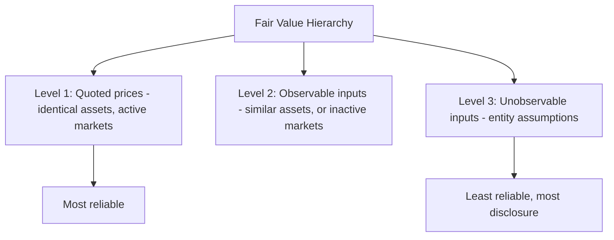

# Fair Value Measurement

## Fair Value Definition

Under Accounting Standards Codification (ASC) 820, **fair value** is defined as:

> The price that would be received to sell an asset or paid to transfer a liability in an **orderly transaction** between **market participants** at the **measurement date**.

Fair value is an **exit price**. It is measured from the perspective of a seller (or a party transferring a liability), not a buyer.

:::info[Key Concepts]

- **Orderly transaction:** not a forced sale or liquidation
- **Market participants:** independent, knowledgeable, willing, and able parties
- **Measurement date:** the date of the financial statements (or an interim measurement date)

:::

---

## Principal Market vs. Most Advantageous Market

Fair value is based on transactions in one of two markets:

1. **Principal market:** the market with the **greatest volume and level of activity** for the asset or liability
2. **Most advantageous market:** if there is no principal market, the market that **maximizes** the amount received (for assets) or **minimizes** the amount paid (for liabilities), after transaction and transport costs

:::tip[Exam Tip]

**Transaction costs** are used to choose the most advantageous market but are **not** included in the fair value measurement itself. **Transport costs** (the cost to move the asset to the market) **are** included in the measurement.

:::

**Example:** Bear Co. holds a commodity that trades in two active markets. Neither market is the principal market.

| Market | Price | Transaction Costs | Transport Costs | Net Proceeds |
|---|---|---|---|---|
| Market A | \$105 | \$3 | \$2 | \$100 |
| Market B | \$103 | \$1 | \$1 | \$101 |

Market B is the most advantageous market (\$101 > \$100). The reported **fair value**, however, excludes transaction costs:

$$
\text{Fair Value} = \$103 - \$1 \text{ (transport)} = \$102
$$

---

## Valuation Approaches

ASC 820 identifies three approaches for measuring fair value.

### 1. Market Approach

The market approach uses prices and other information from **market transactions** involving identical or comparable assets or liabilities.

| Technique | Description |
|---|---|
| Quoted prices | Directly observable market prices |
| Matrix pricing | Prices fixed-income securities by reference to benchmark quoted prices |
| Market multiples | Comparable company analysis using ratios such as price-to-earnings (P/E) or enterprise value to earnings before interest, taxes, depreciation, and amortization (EV/EBITDA) |

**Example:** Polar Co. holds 1,000 shares of a publicly traded stock. The closing price is \$45 per share:

$$
\text{Fair Value} = 1{,}000 \times \$45 = \$45{,}000
$$

### 2. Cost Approach

The cost approach reflects the amount required to **replace** the service capacity of an asset (its **current replacement cost**). It is often used for tangible assets.

$$
\text{Fair Value} = \text{Replacement Cost} - \text{Physical Deterioration} - \text{Functional Obsolescence} - \text{Economic Obsolescence}
$$

**Example:** Grizzly Inc. owns a specialized machine. A new equivalent machine costs \$200,000, and the existing machine has 40% of its useful life remaining:

$$
\text{Fair Value} \approx \$200{,}000 \times 40\% = \$80{,}000
$$

### 3. Income Approach

The income approach converts **future amounts** (cash flows or earnings) to a **single present value**. Techniques include:

| Technique | Description |
|---|---|
| Discounted cash flow (DCF) | Present value of expected future cash flows |
| Option pricing models | Black-Scholes and binomial models |
| Multi-period excess earnings | Used for intangible assets |

**Example:** Panda Industries values a patent using DCF. Expected annual cash flows are \$50,000 for 5 years, discounted at 8%:

$$
\text{Fair Value} = \$50{,}000 \times \frac{1 - (1.08)^{-5}}{0.08} = \$50{,}000 \times 3.99271 = \$199{,}636
$$

---

## Fair Value Hierarchy

ASC 820 sets up a three-level hierarchy based on how **observable** the valuation inputs are. Level 1 inputs are the most reliable, and Level 3 inputs are the least reliable.

### Level 1: Quoted Prices in Active Markets

- **Unadjusted** quoted prices for **identical** assets or liabilities in **active markets**
- The most reliable measurement
- Examples: New York Stock Exchange (NYSE) stock prices and commodity exchange prices

:::info

Level 1 inputs are used without adjustment. A "blockage factor" (a discount for holding a large block of shares) is **not** permitted for Level 1 measurements.

:::

### Level 2: Observable Inputs Other Than Level 1

- Quoted prices for **similar** (not identical) assets or liabilities in active markets
- Quoted prices for identical or similar items in **inactive** markets
- Observable inputs such as interest rates, yield curves, and credit spreads
- Inputs derived from or corroborated by **observable** market data

**Examples:**

- Interest rate swaps priced using the Secured Overnight Financing Rate (SOFR) yield curve
- Real estate valued using comparable sales in the area
- Corporate bonds priced using benchmark Treasury rates plus a credit spread

### Level 3: Unobservable Inputs

- **Entity-developed inputs** that reflect the entity's own assumptions about what market participants would use
- Used when observable inputs are not available
- Require the **most disclosure**

**Examples:**

- Long-term cash flow projections for a private company
- Internally developed discount rates
- Assumptions about future technology adoption rates



### Classification Rules

| Scenario | Level |
| -------- | ----- |
| NYSE-traded equity security | Level 1 |
| Over-the-counter (OTC) bond priced with observable yield curves | Level 2 |
| Private company valued with an internal DCF model | Level 3 |
| Real estate appraised using comparable sales | Level 2 |
| Goodwill tested for impairment using internal projections | Level 3 |

:::warning

The **entire** fair value measurement is classified at the **lowest level input** that is **significant** to the measurement. If a Level 2 measurement uses a significant Level 3 input, the whole measurement is Level 3.

:::

---

## Fair Value Disclosures

Fair value disclosures help users assess the following areas.

### 1. Valuation Techniques and Inputs

- A description of the valuation techniques used (market, cost, or income)
- Key inputs and assumptions
- Any change in technique from prior periods, and the reason for it

### 2. Level 3 Measurement Uncertainty

For recurring Level 3 measurements, entities must disclose:

- A **reconciliation** of beginning to ending balances (showing purchases, sales, gains and losses, and transfers)
- The total gains or losses included in **earnings**, and where they are reported
- A **narrative description of measurement uncertainty**: how changes in significant unobservable inputs could affect fair value

### 3. Impact on Financial Performance

- Unrealized gains and losses on assets and liabilities still held at the reporting date
- Transfers into and out of Level 3, and the reasons for them (Accounting Standards Update (ASU) 2018-13 removed the requirement to disclose transfers between Level 1 and Level 2)

### 4. Required Disclosures Summary

| Measurement Type | Fair Value | Level | Technique | Inputs |
| ---------------- | ---------- | ----- | --------- | ------ |
| Recurring | Required | Required | Required | Required |
| Nonrecurring | Required | Required | Required | Required |

The technique and input disclosures apply to Level 2 and Level 3 measurements.

**Example disclosure:** Kodiak Partners reports an investment property at a fair value of \$1,200,000 (Level 3). It used the income approach, applying a capitalization rate (cap rate) of 7.5% to net operating income. A 50-basis-point change in the cap rate would change the fair value by approximately ±\$80,000.

---

## Exceptions to Fair Value Measurement

Certain items are **excluded** from the scope of ASC 820 or have their own measurement exceptions:

| Exception | Standard |
|---|---|
| Inventory measured at net realizable value (NRV) | ASC 330 |
| Leases | ASC 842 |
| Share-based payment transactions | ASC 718 |
| Asset retirement obligation (ARO) initial measurement, when fair value cannot be reasonably estimated (practicability exception) | ASC 410 |

A practical expedient also applies to certain investments:

- **Net asset value (NAV) per share** may be used as a practical expedient for investments in certain funds (such as hedge funds and private equity funds) that do not have readily determinable fair values.
- Investments measured using the NAV practical expedient are **not** classified within the fair value hierarchy.

---

## Fair Value Option

Under ASC 825, an entity may **elect** to measure certain financial assets and liabilities at fair value (the "fair value option"). Once made, the election is **irrevocable** for that instrument.

Cub Entertainment elects the fair value option for a \$500,000 note payable. At year-end, the note's fair value is \$480,000. The entire decline is caused by a rise in market interest rates, not by a change in Cub's own credit risk:

$$
\text{Gain} = \$500{,}000 - \$480{,}000 = \$20{,}000
$$

```journal
Dr. Notes payable                         20,000
    Cr. Unrealized gain (fair value option)       20,000
```

:::danger

For liabilities measured under the fair value option, the change in fair value caused by **instrument-specific credit risk** is reported in **other comprehensive income (OCI)**, not net income (ASU 2016-01).

:::

---

## Summary

:::note[Chapter Checklist]

- [ ] Define fair value as an exit price in an orderly transaction
- [ ] Distinguish the principal market from the most advantageous market
- [ ] Apply the three valuation approaches (market, cost, income)
- [ ] Classify measurements within the Level 1, 2, and 3 hierarchy
- [ ] Determine the overall level based on the lowest significant input
- [ ] Understand the required disclosures, especially for Level 3 measurements
- [ ] Identify exceptions and the NAV practical expedient
- [ ] Know the fair value option and where credit risk changes are reported

:::
