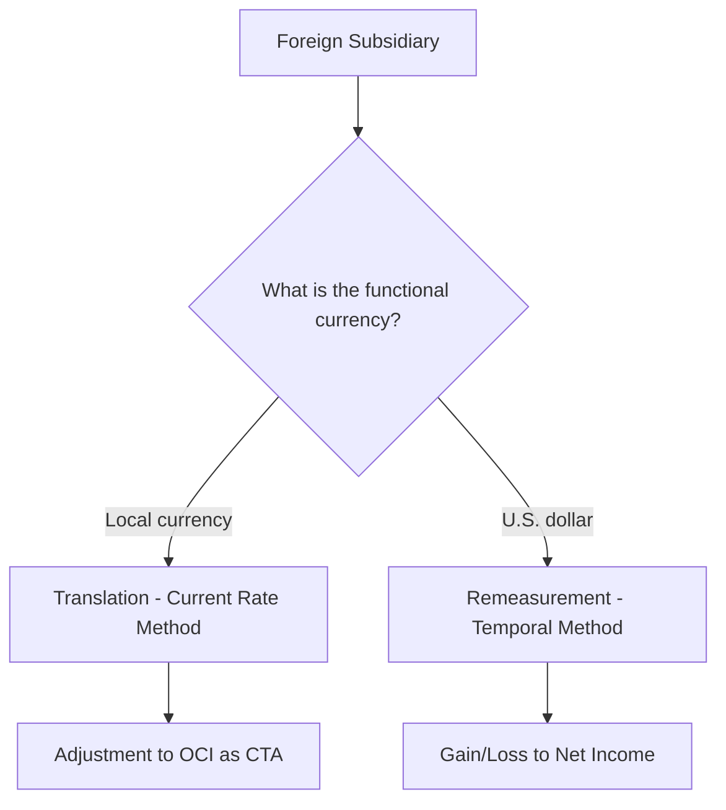

# Foreign Currency Issues

## Overview

A U.S. company that enters into transactions in a foreign currency, or that owns foreign subsidiaries, must account for the effects of exchange rate changes. Accounting Standards Codification (ASC) 830, _Foreign Currency Matters_, covers two main areas:

1. **Foreign currency transactions:** buying or selling goods and services in a foreign currency
2. **Foreign currency translation and remeasurement:** converting a foreign subsidiary's financial statements into U.S. dollars (USD)

---

## Foreign Currency Transactions

A foreign currency transaction is a transaction denominated in a currency other than the company's functional currency (for a U.S. company, usually the U.S. dollar).

### Recording at the Spot Rate

Transactions are first recorded at the **spot rate**, which is the exchange rate on the transaction date.

**Example:** On November 1, Bear Co. sells merchandise to a customer in the UK for £100,000 when the spot rate is \$1.30/£.

$$
\text{Receivable} = £100{,}000 \times \$1.30 = \$130{,}000
$$

```journal
Dr. Accounts receivable       130,000
    Cr. Sales revenue                 130,000
```

### Year-End Remeasurement

At the balance sheet date, **monetary items** (cash, receivables, and payables) denominated in a foreign currency are adjusted to the **current spot rate**. The resulting gain or loss is recognized in **net income**.

On December 31, the spot rate is \$1.35/£:

$$
\text{New receivable value} = £100{,}000 \times \$1.35 = \$135{,}000
$$

$$
\text{Foreign currency gain} = \$135{,}000 - \$130{,}000 = \$5{,}000
$$

```journal
Dr. Accounts receivable         5,000
    Cr. Foreign currency gain           5,000
```

:::tip[Exam Tip]

**Receivables:** If the foreign currency **strengthens**, the U.S. company has a **gain** because the receivable is worth more in U.S. dollars. If it **weakens**, the company has a **loss**.

**Payables:** The effect is reversed. A strengthening foreign currency causes a **loss** because the payable costs more in U.S. dollars.

:::

### Settlement

On February 1, Bear Co. collects the £100,000 when the spot rate is \$1.28/£:

$$
\text{Cash received} = £100{,}000 \times \$1.28 = \$128{,}000
$$

$$
\text{Foreign currency loss} = \$135{,}000 - \$128{,}000 = \$7{,}000
$$

```journal
Dr. Cash                      128,000
Dr. Foreign currency loss       7,000
    Cr. Accounts receivable           135,000
```

### Summary of Exchange Rate Effects

| Situation | Foreign Currency Strengthens | Foreign Currency Weakens |
| --------- | ---------------------------- | ------------------------ |
| **Receivable in foreign currency** | Gain | Loss |
| **Payable in foreign currency** | Loss | Gain |

---

## Forward Contracts (Hedging)

A company can hedge exchange rate risk with a **forward contract**, which locks in a future exchange rate for buying or selling a foreign currency.

### Hedging a Recognized Foreign Currency Receivable

On November 1, Bear Co. enters into a forward contract to sell £100,000 in 90 days at a forward rate of \$1.32/£. The forward contract is a **fair value hedge** of the receivable.

At December 31:

- Spot rate: \$1.35/£
- Forward rate for the remaining 30 days: \$1.33/£

The receivable gain of \$5,000 was recorded above. Because Bear Co. agreed to sell pounds at \$1.32 when the forward rate is now \$1.33, the forward contract has a loss:

$$
\text{Forward contract loss} = £100{,}000 \times (\$1.33 - \$1.32) = \$1{,}000
$$

```journal
Dr. Loss on forward contract    1,000
    Cr. Forward contract                1,000
```

The forward rate moved only \$0.01 while the spot rate moved \$0.05, so in this simplified example the hedge offsets only part of the gain on the hedged item.

:::info

The **forward contract** is recorded on the balance sheet at fair value. For a fair value hedge, changes in its fair value are recognized in earnings, offsetting the gain or loss on the hedged item.

:::

---

## Foreign Currency Translation vs. Remeasurement

A U.S. parent must convert a foreign subsidiary's financial statements into U.S. dollars. The method depends on the subsidiary's **functional currency**.

### Functional Currency Concept

The **functional currency** is the currency of the primary economic environment in which the subsidiary operates.

| Functional Currency | Method | Where Gains and Losses Go |
|---|---|---|
| Foreign (local) currency | **Translation** (current rate method) | Other comprehensive income (OCI), as the cumulative translation adjustment (CTA) |
| U.S. dollar | **Remeasurement** (temporal method) | Net income |



---

## Translation (Current Rate Method)

Translation is used when the functional currency is the **foreign (local) currency**. This method preserves the subsidiary's financial relationships, such as its ratios.

| Financial Statement Item | Exchange Rate Used |
|---|---|
| Assets | **Current rate** (balance sheet date) |
| Liabilities | **Current rate** (balance sheet date) |
| Equity (common stock, additional paid-in capital (APIC)) | **Historical rate** (date of issuance) |
| Revenues and expenses | **Weighted-average rate** for the period |
| Dividends | **Historical rate** (date declared) |

The **CTA** is reported in **accumulated other comprehensive income (AOCI)**, a component of equity.

**Example:** Polar Co. (the U.S. parent) has a subsidiary in Japan whose functional currency is the yen. The subsidiary paid no dividends this year. At year-end:

| Item | Yen Amount | Rate (\$ per ¥) | USD Amount |
|---|---|---|---|
| Total assets | ¥50,000,000 | 0.0068 (current) | \$340,000 |
| Total liabilities | ¥20,000,000 | 0.0068 (current) | \$136,000 |
| Common stock | ¥10,000,000 | 0.0080 (historical) | \$80,000 |
| Beginning retained earnings | ¥15,000,000 | Various (historical) | \$110,000 |
| Revenue | ¥30,000,000 | 0.0070 (average) | \$210,000 |
| Expenses | ¥25,000,000 | 0.0070 (average) | \$175,000 |

Net income is \$210,000 - \$175,000 = \$35,000, so ending retained earnings is \$110,000 + \$35,000 = \$145,000. (In yen, the balance sheet balances: ¥50,000,000 = ¥20,000,000 + ¥10,000,000 + ¥15,000,000 + ¥5,000,000 of net income.)

The CTA is the **plug** that makes the balance sheet balance in U.S. dollars:

$$
\text{CTA} = \text{Total Assets (USD)} - \text{Total Liabilities (USD)} - \text{Equity Accounts (USD)}
$$

$$
\text{CTA} = \$340{,}000 - \$136{,}000 - \$80{,}000 - \$145{,}000 = -\$21{,}000
$$

The CTA is a \$21,000 **debit** balance (a translation loss) in AOCI. This makes sense: the yen weakened from \$0.0080 to \$0.0068, so the subsidiary's net assets are worth fewer dollars at the current rate.

---

## Remeasurement (Temporal Method)

Remeasurement is used when the functional currency is the **U.S. dollar**, or when the subsidiary operates in a highly inflationary economy.

| Financial Statement Item | Exchange Rate Used |
|---|---|
| Monetary assets and liabilities (cash, receivables, payables) | **Current rate** |
| Nonmonetary assets (inventory at cost, fixed assets, intangibles) | **Historical rate** |
| Revenues and expenses | **Weighted-average rate** |
| Depreciation, amortization, and cost of goods sold (when inventory is carried at historical cost) | **Historical rate** |
| Common stock, APIC | **Historical rate** |

The **remeasurement gain or loss** is reported in **net income**, not OCI.

:::warning

A key difference: under translation, **all** assets use the current rate. Under remeasurement, only **monetary** items use the current rate, and **nonmonetary** items use historical rates.

:::

---

## Highly Inflationary Economies

An economy is **highly inflationary** if its cumulative inflation over a 3-year period is approximately **100% or more** (roughly 26% per year, compounded). In that case, the reporting currency (U.S. dollar) is treated as the functional currency, and the **temporal method** (remeasurement) is used regardless of the subsidiary's actual operating environment.

---

## Key Comparison

| Feature | Translation | Remeasurement |
| ------- | ----------- | ------------- |
| When used | Functional currency is the local currency | Functional currency is the U.S. dollar |
| Asset rate | Current | Monetary: current; nonmonetary: historical |
| Revenue and expense rate | Average | Average (except historical-cost items) |
| Equity rate | Historical | Historical |
| Gain or loss reported in | **OCI (CTA)** | **Net income** |

:::tip[Exam Mnemonic]

**"Current goes to CTA":** the current rate method produces a CTA that goes to OCI.

**"Temporal goes to the temporaries (income statement)":** remeasurement gains and losses go directly to net income.

:::

---

## Summary

:::note[Chapter Checklist]

- [ ] Record foreign currency transactions at the spot rate
- [ ] Remeasure monetary items at year-end and recognize gains and losses in income
- [ ] Calculate settlement gains and losses on collection or payment
- [ ] Understand the basics of forward contracts as hedges
- [ ] Determine the functional currency to choose between translation and remeasurement
- [ ] Apply the current rate method (translation) and report the CTA in OCI
- [ ] Apply the temporal method (remeasurement) and report gains and losses in income
- [ ] Identify highly inflationary economies and use the temporal method

:::
