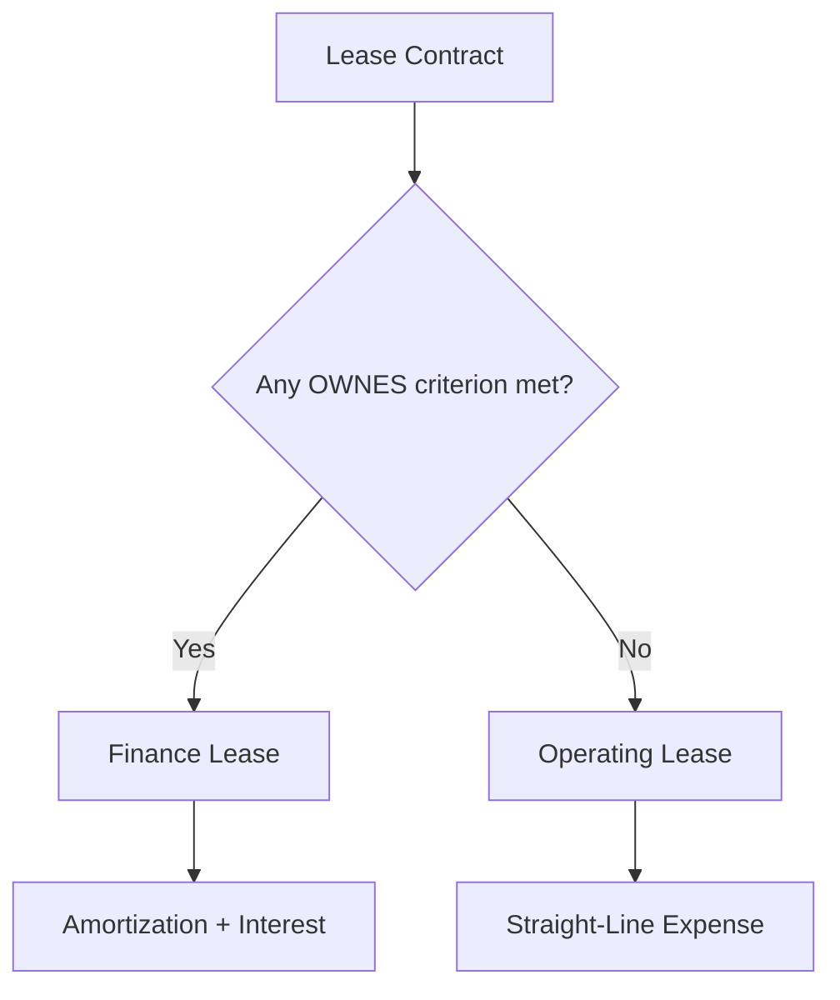

# Lease Accounting

## What Is a Lease?

A **lease** is a contract that conveys the right to control the use of an identified asset for a period of time in exchange for consideration. Under Accounting Standards Codification (ASC) 842, lessees recognize virtually all leases on the balance sheet. The only exception is a narrow election for short-term leases.

:::info

The key question is whether the customer has the **right to control the use** of the asset. That means the customer directs how and for what purpose the asset is used and obtains substantially all of its economic benefits.

:::

---

## Combining and Separating Lease Components

A contract may contain **lease components** (the right to use an asset) and **non-lease components** (services such as maintenance). Lessor costs such as property taxes and insurance are not separate components; any payments for them are allocated to the lease and non-lease components.

- **General rule:** separate each lease component and allocate the consideration based on relative standalone prices
- **Practical expedient:** a lessee may elect (by asset class) to combine lease and non-lease components into a single lease component

**Example:** Bear Co. leases office space for \$10,000 per month. The payment includes \$1,500 per month for common area maintenance (CAM). If Bear Co. elects the practical expedient, the entire \$10,000 is treated as a lease payment. Otherwise, Bear Co. allocates the \$10,000 between the lease and the CAM service based on relative standalone prices.

---

## Classification: Finance vs. Operating Lease (OWNES)

A lessee classifies a lease as a **finance lease** if it meets **any one** of the five OWNES criteria:

| Letter | Criterion | Test |
|---|---|---|
| **O** | Ownership transfer | Title transfers to the lessee by the end of the lease |
| **W** | Written purchase option | Lessee has a purchase option it is reasonably certain to exercise |
| **N** | Ninety percent | Present value (PV) of lease payments ≥ 90% of the asset's fair value |
| **E** | Economic life | Lease term ≥ 75% of the asset's remaining economic life |
| **S** | Specialized asset | Asset has no alternative use to the lessor at the end of the lease |

If **none** of the OWNES criteria are met, the lease is an **operating lease**. (ASC 842 says "substantially all" and "major part"; 90% and 75% are the commonly used thresholds.)

:::tip[Exam Tip]

Both finance and operating leases result in a **right-of-use (ROU) asset** and a **lease liability** on the balance sheet. The difference is in how expense is recognized on the income statement.

:::

---

## Measuring the Lease: Term, Payments, and Discount Rate

### Lease Term

The lease term includes:

- The **noncancellable period**
- Periods covered by an **option to extend**, if the lessee is reasonably certain to exercise it
- Periods covered by an **option to terminate**, if the lessee is reasonably certain **not** to exercise it

### Lease Payments

Lease payments include:

- Fixed payments, less any lease incentives
- Variable payments that depend on an **index or rate**
- The exercise price of a purchase option the lessee is reasonably certain to exercise
- Termination penalties, if the lease term reflects the lessee exercising a termination option
- Amounts probable of being owed under residual value guarantees

:::warning

Variable payments based on **usage** or **performance** (for example, a percentage of sales) are **excluded** from the lease liability and expensed as incurred.

:::

### Discount Rate

- Use the rate **implicit in the lease** if it is readily determinable
- Otherwise, use the lessee's **incremental borrowing rate**

---

## Lessee Operating Lease Accounting

Under an operating lease, the lessee recognizes a **single lease expense on a straight-line basis** over the lease term.

**Example:** Polar Co. enters a 5-year operating lease for equipment on January 1. Annual payments of \$24,000 are due at the **end** of each year. The incremental borrowing rate is 6%.

### Initial Measurement

$$
\text{PV of Lease Payments} = \$24{,}000 \times \frac{1 - (1.06)^{-5}}{0.06} = \$24{,}000 \times 4.21236 = \$101{,}097
$$

```journal
Dr. Right-of-use asset        101,097
    Cr. Lease liability               101,097
```

### Year 1: Payment and Expense

Straight-line lease expense is \$24,000 per year (\$120,000 total payments ÷ 5 years). Behind that single expense:

- Interest on the lease liability: \$101,097 × 6% = \$6,066
- Lease liability reduction: \$24,000 payment - \$6,066 interest = \$17,934
- ROU asset amortization (plug): \$24,000 straight-line expense - \$6,066 interest = \$17,934

Record the payment and the straight-line lease expense:

```journal
Dec 31
Dr. Lease expense              24,000
    Cr. Cash                           24,000
```

Then reduce the lease liability and the ROU asset by the same amount:

```journal
Dec 31
Dr. Lease liability            17,934
    Cr. Right-of-use asset             17,934
```

:::info[Simplified View]

Because the payments are level, the total lease expense equals the cash payment (\$24,000). Behind the scenes, interest accrues on the liability, and the ROU asset is reduced by a plug amount so that total expense stays straight-line.

:::

The balance sheet at the end of Year 1:

- Lease liability: \$101,097 - \$17,934 = \$83,163
- ROU asset: \$101,097 - (\$24,000 - \$6,066) = \$83,163

For an operating lease, the ROU asset equals the lease liability, adjusted for any prepaid or accrued lease payments, lease incentives, and initial direct costs.

---

## Lessee Finance Lease Accounting

Under a finance lease, the lessee recognizes **two separate expenses**: amortization of the ROU asset and interest on the lease liability. Because interest is highest when the liability is largest, total expense is higher in the early years (front-loaded).

**Example:** Grizzly Inc. enters a 4-year finance lease on January 1 for a machine with a fair value of \$80,000. Annual payments are \$22,000 at the end of each year. The rate implicit in the lease is 5%.

### Initial Measurement

$$
\text{PV} = \$22{,}000 \times \frac{1 - (1.05)^{-4}}{0.05} = \$22{,}000 \times 3.54595 = \$78{,}011
$$

The PV is 97.5% of the machine's \$80,000 fair value, so the 90% test is met and the lease is a finance lease.

```journal
Dr. Right-of-use asset         78,011
    Cr. Lease liability                78,011
```

### Year 1

- **Interest expense:** \$78,011 × 5% = \$3,901
- **Lease liability reduction:** \$22,000 - \$3,901 = \$18,099

```journal
Dr. Interest expense            3,901
Dr. Lease liability            18,099
    Cr. Cash                           22,000
```

**ROU asset amortization** is straight-line over the lease term. (If ownership transfers or a purchase option is reasonably certain to be exercised, the asset is amortized over its useful life instead.)

$$
\frac{\$78{,}011}{4} = \$19{,}503
$$

```journal
Dr. Amortization expense       19,503
    Cr. Right-of-use asset             19,503
```

Total Year 1 expense is \$23,404 (\$3,901 + \$19,503), more than the \$22,000 cash payment. That is the front-loading effect.

### Amortization Schedule

| Year | Beg. Liability | Interest (5%) | Payment  | Principal | End Liability |
| ---- | -------------- | ------------- | -------- | --------- | ------------- |
| 1    | \$78,011       | \$3,901       | \$22,000 | \$18,099  | \$59,912      |
| 2    | \$59,912       | \$2,996       | \$22,000 | \$19,004  | \$40,908      |
| 3    | \$40,908       | \$2,045       | \$22,000 | \$19,955  | \$20,953      |
| 4    | \$20,953       | \$1,047       | \$22,000 | \$20,953  | \$0           |

Year 4 interest is rounded so the liability ends at zero.

---

## Comparison: Operating vs. Finance Lease

| Feature                 | Operating Lease                    | Finance Lease                                 |
| ----------------------- | ---------------------------------- | --------------------------------------------- |
| Balance sheet           | ROU asset + Lease liability        | ROU asset + Lease liability                   |
| Income statement        | Single straight-line lease expense | Amortization + Interest (front-loaded)        |
| Cash flow statement     | Operating section                  | Principal in financing; interest in operating |
| Total expense over life | Equals total lease payments        | Equals total lease payments                   |



---

## Short-Term Lease Exception

A lessee may elect **not** to recognize an ROU asset and lease liability for a lease with a term of **12 months or less** at commencement that has no purchase option the lessee is reasonably certain to exercise. Under this election, lease payments are recognized as expense on a **straight-line basis** over the lease term.

**Example:** Kodiak Partners leases a copier for 10 months at \$500 per month. Each month it records:

```journal
Dr. Lease expense                 500
    Cr. Cash                             500
```

:::tip

The short-term lease election is made by **asset class**, not lease by lease.

:::

---

## Disclosures

Lessees must disclose:

- Nature of leasing activities
- Finance and operating lease costs
- Maturity analysis of lease liabilities (each of the next 5 years, then a total for the remaining years)
- Weighted-average remaining lease term
- Weighted-average discount rate
- ROU assets obtained in exchange for new lease liabilities

---

## Summary

:::note[Chapter Checklist]

- [ ] Determine whether a contract contains a lease
- [ ] Apply OWNES criteria to classify as finance or operating
- [ ] Calculate the lease liability using PV of lease payments
- [ ] Record ROU asset and lease liability at commencement
- [ ] Distinguish expense patterns: straight-line (operating) vs. front-loaded (finance)
- [ ] Apply the short-term lease exception when applicable
- [ ] Prepare required disclosures

:::
