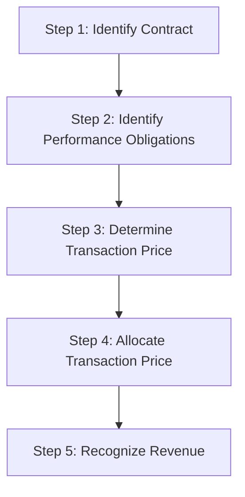

# Revenue Recognition (ASC 606)

## Overview of the Five-Step Model

Accounting Standards Codification (ASC) 606, _Revenue from Contracts with Customers_, provides a unified framework for recognizing revenue. **Core principle:** recognize revenue when (or as) the entity satisfies a performance obligation by transferring a promised good or service to a customer, in the amount of consideration the entity expects to be entitled to in exchange.



---

## Step 1: Identify the Contract

A **contract** exists only when all five criteria are met:

1. Both parties have **approved** the contract and are committed to perform
2. Each party's **rights** regarding the goods or services are identifiable
3. The **payment terms** are identifiable
4. The contract has **commercial substance**
5. Collection of substantially all of the consideration is **probable**

:::info

If a contract does not meet all five criteria, any consideration received is recorded as a **liability** until the criteria are met or the contract is terminated.

:::

### Contract Combination

Two or more contracts entered into at or near the same time with the same customer are **combined** if **any** of the following applies:

- The contracts are negotiated as a package with a single commercial objective
- The consideration in one contract depends on the price or performance of the other
- The goods or services promised in the contracts are a single performance obligation

### Contract Modifications

A modification is treated as a **separate contract** when both conditions are met:

1. The scope increases because of **distinct** goods or services, **and**
2. The price increases by the **standalone selling price** of those goods or services

If the modification is not a separate contract, it is accounted for in one of two ways:

- **Prospectively**, as a termination of the old contract and creation of a new one, when the remaining goods or services are distinct from those already transferred
- With a **cumulative catch-up adjustment** to the existing contract, when the remaining goods or services are not distinct

---

## Step 2: Identify Performance Obligations

A **performance obligation** is a promise to transfer a distinct good or service, or a series of distinct goods or services that are substantially the same and have the same pattern of transfer.

A good or service is **distinct** if both conditions are met:

1. **Capable of being distinct:** the customer can benefit from it on its own or together with readily available resources
2. **Distinct within the context of the contract:** it is separately identifiable from other promises in the contract

**Example:** Bear Co. sells a software license and provides 2 years of post-contract customer support (PCS). The software functions without the PCS. These are **two** performance obligations because the license is distinct from the PCS.

:::tip[Exam Tip]

Shipping and handling performed **after** control transfers is a promised service that may be a separate performance obligation, although an entity may elect to treat it as a fulfillment cost instead. Shipping and handling performed **before** control transfers is a fulfillment cost, not a separate performance obligation.

:::

---

## Step 3: Determine the Transaction Price

The **transaction price** is the amount of consideration the entity expects to be entitled to in exchange for the promised goods or services. The following items affect it.

### Variable Consideration

Variable amounts (discounts, rebates, refunds, bonuses, penalties) are estimated using one of two methods:

| Method | When to Use |
|---|---|
| **Expected value** | Large number of similar contracts |
| **Most likely amount** | Binary outcomes (threshold-based bonuses) |

Variable consideration is included only to the extent it is **probable** that a **significant reversal** of cumulative revenue will not occur when the uncertainty is resolved. This limit is called the **constraint**.

### Significant Financing Component

If the timing of payments gives the customer or the entity a significant financing benefit, the transaction price is adjusted for the time value of money. **Practical expedient:** no adjustment is needed if the period between payment and transfer is expected to be **one year or less**.

### Noncash Consideration

Noncash consideration is measured at **fair value**. If fair value cannot be reasonably estimated, it is measured by reference to the standalone selling price of the goods or services promised.

### Consideration Payable to a Customer

Payments to a customer (for example, slotting fees or cooperative advertising) **reduce the transaction price** unless they are for a **distinct good or service** the entity receives from the customer.

**Example:** Polar Co. pays a retailer \$50,000 for shelf space. This is consideration payable to a customer, so it reduces revenue:

```journal
Dr. Revenue (contra)           50,000
    Cr. Cash                           50,000
```

---

## Step 4: Allocate the Transaction Price

The transaction price is allocated to each performance obligation based on **relative standalone selling prices (SSP)**.

### Determining Standalone Selling Price

The best evidence of SSP is the **observable price** when the entity sells the good or service separately. If that price is not directly observable, SSP is estimated using one of these methods:

| Method | Description |
|---|---|
| Adjusted market assessment | Estimate the price customers in the market would pay |
| Expected cost plus margin | Forecast costs and add an appropriate margin |
| Residual approach | Total transaction price minus the observable SSPs of the other goods or services; allowed only if SSP is highly variable or uncertain |

### Allocating Discounts

A discount is allocated to **all** performance obligations proportionally, unless the entity has observable evidence that the discount relates entirely to one or more (but not all) of them.

**Example:** Grizzly Inc. enters a \$120,000 contract for equipment and installation. The SSPs are \$100,000 (equipment) and \$40,000 (installation), a total of \$140,000. The \$20,000 discount is spread across both obligations by allocating the \$120,000 price in proportion to SSP:

| Obligation | SSP | Ratio | Allocated Price |
|---|---|---|---|
| Equipment | \$100,000 | 71.4% | \$85,714 |
| Installation | \$40,000 | 28.6% | \$34,286 |
| **Total** | **\$140,000** | **100%** | **\$120,000** |

### Allocating Variable Consideration

Variable consideration is allocated entirely to a specific performance obligation only if both conditions are met:

1. The variable payment relates specifically to that obligation, **and**
2. Allocating it entirely to that obligation is consistent with the overall allocation objective

---

## Step 5: Recognize Revenue

Revenue is recognized when (or as) the entity **satisfies a performance obligation** by transferring **control** of the promised good or service to the customer.

### Satisfaction Over Time

A performance obligation is satisfied over time if **any one** of the following criteria is met:

1. The customer simultaneously receives and consumes the benefits as the entity performs (for example, cleaning services)
2. The entity's performance creates or enhances an asset the customer controls (for example, a building on the customer's land)
3. The entity's performance does not create an asset with an alternative use to the entity, **and** the entity has an enforceable right to payment for performance completed to date

#### Measuring Progress

| Method                | Type   | Basis                                 |
| --------------------- | ------ | ------------------------------------- |
| Units delivered       | Output | Physical measure of value transferred |
| Milestones reached    | Output | Contract milestones completed         |
| Surveys or appraisals | Output | Performance completed to date         |
| Costs incurred        | Input  | Cost-to-cost method                   |

$$
\text{Percentage Complete (Cost-to-Cost)} = \frac{\text{Costs Incurred to Date}}{\text{Total Estimated Costs}}
$$

**Example:** Kodiak Partners has a \$2,000,000 construction contract that it accounts for over time using the cost-to-cost method. Total estimated costs are \$1,500,000. Costs incurred in Year 1 are \$600,000, and nothing has been billed yet.

$$
\% \text{ Complete} = \frac{\$600{,}000}{\$1{,}500{,}000} = 40\%
$$

$$
\text{Revenue Year 1} = \$2{,}000{,}000 \times 40\% = \$800{,}000
$$

Because the revenue has not been billed, the debit is to a contract asset:

```journal
Dr. Contract asset            800,000
    Cr. Revenue                       800,000
```

```journal
Dr. Construction expense      600,000
    Cr. Cash (or Materials, Payables)  600,000
```

Year 1 gross profit is \$200,000 (\$800,000 - \$600,000).

:::warning[Loss Recognition on Long-Term Contracts]

When a contract becomes unprofitable, the **entire estimated loss is recognized immediately**. This applies whether revenue is recognized over time or at a point in time. The loss is not deferred until completion.

**Example:** In Year 2, Kodiak Partners revises total estimated costs to \$2,200,000. The contract now has an expected loss of \$200,000 (\$2,200,000 of costs against \$2,000,000 of revenue). The full \$200,000 loss must be reflected by the end of Year 2. Because Year 1 already recognized \$200,000 of gross profit, Year 2 reports a loss of **\$400,000**: \$200,000 to reverse the Year 1 profit plus the \$200,000 expected loss.

:::

### Satisfaction at a Point in Time

If none of the over-time criteria are met, revenue is recognized at the **point in time** when control transfers. Indicators of transfer include:

- The entity has a present right to payment
- The customer has legal title
- The customer has physical possession
- The customer has the significant risks and rewards of ownership
- The customer has accepted the asset

**Example:** Bear Co. ships inventory FOB (free on board) shipping point on December 28 for \$75,000. The inventory cost \$50,000. Control transfers at shipment, so Bear Co. recognizes the sale on December 28:

```journal
Dr. Accounts receivable        75,000
    Cr. Sales revenue                  75,000
```

```journal
Dr. Cost of goods sold         50,000
    Cr. Inventory                      50,000
```

---

## Contract Assets and Contract Liabilities

| Term                   | Definition                                                                 | Example                           |
| ---------------------- | -------------------------------------------------------------------------- | --------------------------------- |
| **Contract asset**     | Right to consideration conditional on something other than passage of time | Revenue recognized before billing |
| **Receivable**         | Unconditional right to consideration                                       | Billed amount due                 |
| **Contract liability** | Obligation to transfer goods/services for which consideration was received | Customer prepayments              |

**Example:** Cub Entertainment receives \$30,000 upfront for a 12-month subscription service:

```journal
Dr. Cash                       30,000
    Cr. Contract liability             30,000
```

Each month, as service is provided (\$30,000 ÷ 12 = \$2,500):

```journal
Dr. Contract liability          2,500
    Cr. Subscription revenue            2,500
```

---

## Other Applications of Revenue Recognition

### Costs to Obtain and Fulfill a Contract

**Incremental costs to obtain a contract** (for example, sales commissions) are capitalized as an asset if the entity expects to recover them. Costs that would be incurred whether or not the contract is obtained (for example, a bid proposal for an unsuccessful contract) are expensed as incurred.

**Contract fulfillment costs** not covered by another standard (such as inventory or property, plant, and equipment) are capitalized as an asset only when all three of the following are met:

1. The costs relate directly to a specific contract (or anticipated contract)
2. The costs generate or enhance resources used to satisfy performance obligations
3. The costs are expected to be recovered

Capitalized costs are amortized on a systematic basis consistent with the pattern of revenue recognition.

:::tip[Exam Tip]

As a practical expedient, costs to obtain a contract may be expensed immediately if the amortization period would be **one year or less**.

:::

### Principal vs. Agent

An entity must determine whether it is a **principal** (controls the good or service before transfer) or an **agent** (arranges for another party to provide the good or service).

| Role | Recognizes | Revenue Equals |
|---|---|---|
| **Principal** | Gross revenue | Full consideration from the customer |
| **Agent** | Net revenue | Fee or commission only |

**Key test:** Does the entity control the specified good or service **before** it is transferred to the customer? If yes, the entity is a principal. If no, it is an agent.

**Example:** Cub Entertainment operates a ticket marketplace. For standard listings, Cub never takes possession of the tickets and has no pricing discretion. It simply connects the seller and buyer and earns a 15% commission. Cub is an **agent** and recognizes revenue equal to its commission.

### Repurchase Agreements

A **repurchase agreement** is a contract in which an entity sells an asset and promises (or has the option) to repurchase it later.

| Type | Description | Accounting |
|---|---|---|
| **Forward** | Entity is **obligated** to repurchase | No sale, because the customer never obtains control. Repurchase price below the original selling price: lease. Repurchase price at or above the original selling price: financing arrangement |
| **Call option** | Entity has the **right** to repurchase | Same as a forward: lease or financing arrangement, based on the same price comparison |
| **Put option** | **Customer** has the right to require repurchase | Repurchase price below the original selling price: lease if the customer has a significant economic incentive to exercise; otherwise, a sale with a right of return. Repurchase price at or above the original selling price: financing arrangement if it exceeds the asset's expected market value; otherwise, a sale with a right of return |

:::info

When a repurchase agreement is a **financing arrangement**, the entity does not derecognize the asset. Instead, it records a financial liability for the consideration received.

:::

### Bill-and-Hold Arrangements

In a **bill-and-hold** arrangement, the entity bills the customer but keeps physical possession of the goods. Revenue may be recognized before the customer receives the product only if **all** of the following criteria are met:

1. There is a **substantive reason** for the arrangement (for example, the customer lacks warehouse space)
2. The product has been **separately identified** as belonging to the customer
3. The product is currently **ready for transfer** to the customer
4. The entity **cannot** use the product or direct it to another customer

**Example:** Grizzly Inc. manufactures specialized equipment for Bear Co. The equipment is complete and Bear Co. has been billed \$200,000, but Bear Co.'s facility is not yet ready to receive it. Grizzly holds the equipment in its warehouse. If all four criteria are met, Grizzly recognizes revenue at the billing date.

### Consignment Arrangements

A **consignment** exists when an entity (the consignor) delivers a product to a dealer (the consignee) to hold until a third-party customer buys it. The consignor retains control until the ultimate sale, so delivery to the consignee is not a sale.

**Revenue recognition:** The consignor recognizes revenue on the **sale to the ultimate customer** or when a defined **holding period expires**, whichever comes first.

Indicators that an arrangement is a consignment:

- The consignor controls the product until a specified event occurs (for example, sale to a third party)
- The consignor can require the return of the product or transfer it to another consignee
- The consignee does not have an unconditional obligation to pay for the product

### Warranty Obligations

Warranties are accounted for in one of two ways, depending on their nature:

| Type | Treatment |
|---|---|
| **Assurance-type warranty** (assures the product works as agreed; often required by law) | Not a separate performance obligation. Accrue estimated warranty costs as a liability at the point of sale (cost accrual) |
| **Service-type warranty** (sold separately, or provides a service beyond assurance) | Separate performance obligation. Allocate a portion of the transaction price and recognize revenue over the warranty period |

A warranty is more likely to be a **separate performance obligation** if:

- It is **not** required by law
- The coverage period is **long** relative to the expected product life
- The entity promises **specified tasks** beyond fixing defects

**Example:** Polar Co. sells a laptop for \$1,200 with a standard 1-year warranty (assurance-type) and offers an optional 2-year extended warranty for \$150 (service-type). The \$1,200 is recognized at the point of sale, along with an accrual for estimated costs under the standard warranty. The \$150 extended warranty revenue is recognized ratably over the 2-year extended period.

### Customer Right of Return

When a customer has the right to return a product, the entity should:

1. Recognize revenue for the consideration it expects to be **entitled to keep** (that is, excluding estimated returns)
2. Record a **refund liability** for the portion expected to be returned
3. Recognize an **asset** (with a corresponding reduction of cost of sales) for the right to recover products from customers when the refund liability is settled

**Example:** Kodiak Partners sells \$500,000 of merchandise and estimates a 5% return rate based on historical data. Cost of goods is 60% of the selling price.

```journal
Dr. Accounts receivable        500,000
    Cr. Sales revenue                  475,000
    Cr. Refund liability                25,000
```

```journal
Dr. Cost of goods sold         285,000
Dr. Right of return asset       15,000
    Cr. Inventory                      300,000
```

Total cost is \$500,000 × 60% = \$300,000. The cost of the expected returns is \$25,000 × 60% = \$15,000, which becomes the right of return asset.

---

## Presentation and Disclosure

Revenue may be presented as a single line item on the income statement. Entities must also disclose revenue **disaggregated** into categories that show how economic factors affect the nature, amount, timing, and uncertainty of revenue and cash flows. Common categories include:

- Type of good or service
- Geography
- Market or customer type
- Contract type
- Timing of transfer (point in time vs. over time)

Nonpublic entities may elect to disclose, at a minimum, revenue disaggregated by timing of transfer, plus qualitative information.

:::note[Chapter Checklist]

- [ ] Apply all five criteria to identify a valid contract
- [ ] Determine when goods/services are distinct performance obligations
- [ ] Estimate variable consideration and apply the constraint
- [ ] Allocate the transaction price using relative SSP
- [ ] Distinguish over-time from point-in-time revenue recognition
- [ ] Recognize estimated losses on long-term contracts immediately
- [ ] Classify contract assets, receivables, and contract liabilities
- [ ] Capitalize recoverable costs to obtain or fulfill a contract
- [ ] Determine principal vs. agent and report gross vs. net revenue
- [ ] Identify repurchase agreements and determine if a sale has occurred
- [ ] Apply bill-and-hold criteria before recognizing revenue
- [ ] Distinguish assurance-type from service-type warranties
- [ ] Account for customer right of return with a refund liability

:::
