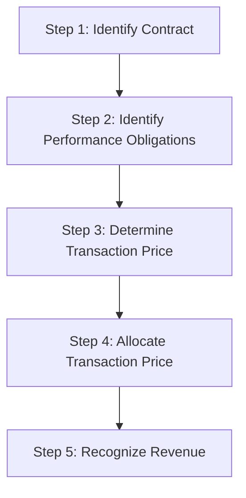

# Revenue Recognition (ASC 606)

Revenue is usually the largest number on the income statement, and for decades the rules for recognizing it differed by industry. Accounting Standards Codification (ASC) 606, _Revenue from Contracts with Customers_, replaced them with one model for all industries. Its **core principle**: recognize revenue when (or as) the entity transfers promised goods or services to a customer, in the amount of consideration the entity expects to be entitled to in exchange. FAR asks you to recall the five-step model, determine the amount and timing of revenue and prepare the journal entries, and account for the costs of obtaining and fulfilling contracts. This chapter takes the five steps in order, then covers contract assets and liabilities, contract costs, and the special arrangements that appear most often on the exam. Contributions received by not-for-profit entities follow different rules and are covered in [Not-for-Profit Accounting](../specialized-reporting/not-for-profit-accounting.md).



---

## Step 1: Identify the Contract

A **contract** is an agreement that creates enforceable rights and obligations. It falls under ASC 606 only when all five criteria are met:

1. Both parties have **approved** the contract and are committed to perform
2. Each party's **rights** regarding the goods or services are identifiable
3. The **payment terms** are identifiable
4. The contract has **commercial substance**
5. Collection of substantially all of the consideration is **probable**

If a contract does not meet all five criteria, any consideration received is recorded as a **liability** until the criteria are met or the contract is terminated and the consideration is nonrefundable.

### Contract Combination

Two or more contracts entered into at or near the same time with the same customer are **combined** if any of the following applies: they were negotiated as a package with a single commercial objective, the price in one depends on the price or performance of the other, or the goods or services promised in them are a single performance obligation.

### Contract Modifications

A modification is treated as a **separate contract** when both conditions are met:

1. The scope increases because of **distinct** goods or services, **and**
2. The price increases by the **standalone selling price** of those goods or services

If the modification is not a separate contract, it is accounted for in one of two ways. If the remaining goods or services are distinct from those already transferred, the entity accounts for it **prospectively**, as if it had terminated the old contract and created a new one. If they are not distinct, the entity records a **cumulative catch-up adjustment** to revenue on the existing contract.

---

## Step 2: Identify Performance Obligations

A **performance obligation** is a promise to transfer a distinct good or service, or a series of distinct goods or services that are substantially the same and have the same pattern of transfer.

A good or service is **distinct** if both conditions are met:

1. **Capable of being distinct:** the customer can benefit from it on its own or together with readily available resources
2. **Distinct within the context of the contract:** it is separately identifiable from other promises in the contract (it is not, for example, an input to a combined item the customer contracted for)

Bear Co. sells a software license and provides 2 years of post-contract customer support (PCS). The software functions without the PCS. These are **two** performance obligations because the license is distinct from the PCS.

Shipping and handling deserves a note. Shipping performed **before** the customer obtains control is a fulfillment cost, not a performance obligation. Shipping performed **after** control transfers is a promised service, but the entity may elect to treat it as a fulfillment cost as well.

---

## Step 3: Determine the Transaction Price

The **transaction price** is the amount of consideration the entity expects to be entitled to in exchange for the promised goods or services. It excludes amounts collected for third parties, such as sales taxes. Four items can make it differ from the stated contract price.

### Variable Consideration

Variable amounts (discounts, rebates, refunds, bonuses, penalties) are estimated using whichever of two methods better predicts the amount:

| Method | When to Use |
|---|---|
| **Expected value** (probability-weighted amount) | A large number of contracts with similar characteristics |
| **Most likely amount** | Only two possible outcomes, such as a performance bonus that is earned or not |

Variable consideration is included only to the extent it is **probable** that a **significant reversal** of cumulative revenue will not occur when the uncertainty is resolved. This limit is called the **constraint**, and it is reassessed at each reporting date.

### Significant Financing Component

If the timing of payments gives the customer or the entity a significant financing benefit, the transaction price is adjusted for the time value of money. As a **practical expedient**, no adjustment is needed if the period between payment and transfer is expected to be **one year or less**.

### Noncash Consideration

Noncash consideration, such as goods, services, or shares received from the customer, is measured at **fair value**. If fair value cannot be reasonably estimated, it is measured by reference to the standalone selling price of the goods or services promised.

ASU 2025-07, eligible for testing January 1, 2027, addresses payment in equity instruments. When an entity receives shares or share options from a customer as payment, it applies this Topic 606 noncash consideration guidance, and not the derivatives guidance (ASC 815) or the equity securities guidance (ASC 321), until its right to receive or keep the instruments is unconditional. Only then does the entity account for them as an investment under that other guidance.

### Consideration Payable to a Customer

Payments to a customer, such as slotting fees or cooperative advertising allowances, **reduce the transaction price** unless they are for a **distinct good or service** the entity receives from the customer.

Polar Co. pays a retailer \$50,000 for shelf space. This is consideration payable to a customer, so it reduces revenue:

```journal
Dr. Revenue (contra)           50,000
    Cr. Cash                           50,000
```

Some companies pay customers in equity, for example warrants that vest as the customer buys more. This **share-based consideration payable to a customer** is measured under the stock compensation guidance (ASC 718) and also reduces the transaction price. ASU 2025-04, eligible for testing January 1, 2027, clarifies three points for these awards: vesting conditions based on the customer's purchases (including purchases by the customer's own customers) are **performance conditions**; the entity must **estimate forfeitures** rather than recognize them as they occur; and the variable consideration constraint does not apply. Awards to employees and other nonemployees are unaffected.

---

## Step 4: Allocate the Transaction Price

The transaction price is allocated to each performance obligation based on **relative standalone selling prices (SSP)**.

### Determining Standalone Selling Price

The best evidence of SSP is the **observable price** when the entity sells the good or service separately. If that price is not directly observable, SSP is estimated using one of these methods:

| Method | Description |
|---|---|
| Adjusted market assessment | Estimate the price customers in the market would pay |
| Expected cost plus margin | Forecast costs and add an appropriate margin |
| Residual approach | Total transaction price minus the observable SSPs of the other goods or services; allowed only if SSP is highly variable or uncertain |

### Allocating Discounts

A discount is allocated to **all** performance obligations proportionally, unless the entity has observable evidence that the discount relates entirely to one or more (but not all) of them.

Grizzly Inc. enters a \$120,000 contract for equipment and installation. The SSPs are \$100,000 (equipment) and \$40,000 (installation), a total of \$140,000. The \$20,000 discount is spread across both obligations by allocating the \$120,000 price in proportion to SSP:

| Obligation | SSP | Ratio | Allocated Price |
|---|---|---|---|
| Equipment | \$100,000 | 71.4% | \$85,714 |
| Installation | \$40,000 | 28.6% | \$34,286 |
| **Total** | **\$140,000** | **100%** | **\$120,000** |

### Allocating Variable Consideration

Variable consideration is allocated entirely to one performance obligation only if the variable payment relates specifically to that obligation **and** allocating it entirely to that obligation is consistent with the overall allocation objective.

---

## Step 5: Recognize Revenue

Revenue is recognized when (or as) the entity **satisfies a performance obligation** by transferring **control** of the promised good or service to the customer. The first question is whether control transfers over time or at a point in time.

### Satisfaction Over Time

A performance obligation is satisfied over time if **any one** of the following criteria is met:

1. The customer simultaneously receives and consumes the benefits as the entity performs (for example, cleaning services)
2. The entity's performance creates or enhances an asset the customer controls (for example, a building on the customer's land)
3. The entity's performance does not create an asset with an alternative use to the entity, **and** the entity has an enforceable right to payment for performance completed to date

Revenue is then recognized by measuring **progress** toward completion. **Output methods** measure value transferred, such as units delivered, milestones reached, or surveys of work performed. **Input methods** measure the entity's efforts, most often costs incurred to date relative to total expected costs (the cost-to-cost method):

$$
\text{Percentage Complete (Cost-to-Cost)} = \frac{\text{Costs Incurred to Date}}{\text{Total Estimated Costs}}
$$

Kodiak Partners has a \$2,000,000 construction contract that it accounts for over time using the cost-to-cost method. Total estimated costs are \$1,500,000. Costs incurred in Year 1 are \$600,000, and nothing has been billed yet.

$$
\% \text{ Complete} = \frac{\$600{,}000}{\$1{,}500{,}000} = 40\%
$$

$$
\text{Revenue Year 1} = \$2{,}000{,}000 \times 40\% = \$800{,}000
$$

Because the revenue has not been billed, the debit is to a contract asset:

```journal
Dr. Contract asset            800,000
    Cr. Revenue                       800,000
```

```journal
Dr. Construction expense      600,000
    Cr. Cash (or Materials, Payables)  600,000
```

Year 1 gross profit is \$200,000 (\$800,000 - \$600,000).

:::warning[Loss Recognition on Long-Term Contracts]

For construction-type and production-type contracts, when a contract becomes unprofitable, the **entire estimated loss is recognized immediately**, whether revenue is recognized over time or at a point in time.

In Year 2, Kodiak Partners revises total estimated costs to \$2,200,000. The contract now has an expected loss of \$200,000 (\$2,200,000 of costs against \$2,000,000 of revenue). The full \$200,000 loss must be reflected by the end of Year 2. Because Year 1 already recognized \$200,000 of gross profit, Year 2 reports a loss of **\$400,000**: \$200,000 to reverse the Year 1 profit plus the \$200,000 expected loss.

:::

### Satisfaction at a Point in Time

If none of the over-time criteria are met, revenue is recognized at the **point in time** when control transfers. Indicators of transfer include a present right to payment, the customer's legal title, physical possession, the significant risks and rewards of ownership, and the customer's acceptance of the asset.

Bear Co. ships inventory FOB (free on board) shipping point on December 28 for \$75,000. The inventory cost \$50,000. Control transfers at shipment, so Bear Co. recognizes the sale on December 28:

```journal
Dr. Accounts receivable        75,000
    Cr. Sales revenue                  75,000
```

```journal
Dr. Cost of goods sold         50,000
    Cr. Inventory                      50,000
```

---

## Contract Assets and Contract Liabilities

When performance and payment happen at different times, the contract creates an asset or a liability:

| Term                   | Definition                                                                 | Example                           |
| ---------------------- | -------------------------------------------------------------------------- | --------------------------------- |
| **Contract asset**     | Right to consideration conditional on something other than the passage of time | Revenue recognized before the entity has the right to bill |
| **Receivable**         | Unconditional right to consideration (only the passage of time is required) | Billed amount due                 |
| **Contract liability** | Obligation to transfer goods or services for which consideration was received (or is due) | Customer prepayments              |

Cub Entertainment receives \$30,000 upfront for a 12-month subscription service:

```journal
Dr. Cash                       30,000
    Cr. Contract liability             30,000
```

Each month, as service is provided (\$30,000 ÷ 12 = \$2,500):

```journal
Dr. Contract liability          2,500
    Cr. Subscription revenue            2,500
```

---

## Costs to Obtain and Fulfill a Contract

**Incremental costs of obtaining a contract**, costs the entity would not have incurred if it had not won the contract, such as sales commissions, are capitalized as an asset if the entity expects to recover them. Costs that would be incurred whether or not the contract is obtained, such as legal fees for drafting a bid, are expensed as incurred. As a practical expedient, incremental costs may be expensed immediately if the amortization period would be **one year or less**.

**Costs to fulfill a contract** that are not covered by another standard (such as inventory or property, plant, and equipment) are capitalized only when all three of the following are met:

1. The costs relate directly to a specific contract (or anticipated contract)
2. The costs generate or enhance resources used to satisfy performance obligations in the future
3. The costs are expected to be recovered

Capitalized contract costs are **amortized** on a systematic basis consistent with the pattern of transfer of the related goods or services, and they are tested for impairment.

Bear Co. pays a salesperson a \$12,000 commission for signing a customer to a 3-year service contract. The commission would not have been paid without the contract, and Bear expects to recover it, so Bear capitalizes it:

```journal
Jan 1
Dr. Contract acquisition costs[a] 12,000
    Cr. Cash[a] 12,000
```

The service is provided evenly, so Bear amortizes the asset over the 3-year contract:

```journal
Dec 31
Dr. Commission expense 4,000
    Cr. Contract acquisition costs[a] 4,000
```

---

## Principal vs. Agent

When another party is involved in providing goods or services to a customer, the entity must decide whether it is a **principal** or an **agent**. The key test is whether the entity **controls** the specified good or service **before** it is transferred to the customer.

| Role | Controls the Good or Service First? | Revenue Equals |
|---|---|---|
| **Principal** | Yes | Full consideration from the customer (gross) |
| **Agent** | No; it arranges for another party to provide it | Fee or commission only (net) |

Cub Entertainment operates a ticket marketplace. For standard listings, Cub never takes possession of the tickets and has no pricing discretion. It simply connects the seller and buyer and earns a 15% commission. Cub is an **agent** and recognizes revenue equal to its commission.

---

## Special Arrangements

### Repurchase Agreements

A **repurchase agreement** is a contract in which an entity sells an asset and promises (or has the option) to repurchase it later. If the entity must or may repurchase the asset, the customer never really obtains control, so no sale is recorded.

| Type | Description | Accounting |
|---|---|---|
| **Forward** | Entity is **obligated** to repurchase | No sale. Repurchase price below the original selling price: lease. Repurchase price at or above the original selling price: financing arrangement |
| **Call option** | Entity has the **right** to repurchase | Same as a forward: lease or financing arrangement, based on the same price comparison |
| **Put option** | **Customer** has the right to require repurchase | Repurchase price below the original selling price: lease if the customer has a significant economic incentive to exercise; otherwise, a sale with a right of return. Repurchase price at or above the original selling price: financing arrangement if it exceeds the asset's expected market value; otherwise, a sale with a right of return |

When a repurchase agreement is a **financing arrangement**, the entity keeps the asset on its books and records a financial liability for the consideration received.

### Bill-and-Hold Arrangements

In a **bill-and-hold** arrangement, the entity bills the customer but keeps physical possession of the goods. Revenue may be recognized before delivery only if **all** of the following criteria are met:

1. There is a **substantive reason** for the arrangement (for example, the customer lacks warehouse space)
2. The product has been **separately identified** as belonging to the customer
3. The product is currently **ready for transfer** to the customer
4. The entity **cannot** use the product or direct it to another customer

Grizzly Inc. manufactures specialized equipment for Bear Co. The equipment is complete and Bear Co. has been billed \$200,000, but Bear Co.'s facility is not yet ready to receive it. Grizzly holds the equipment in its warehouse. If all four criteria are met, Grizzly recognizes revenue at the billing date.

### Consignment Arrangements

In a **consignment**, an entity (the consignor) delivers a product to a dealer (the consignee) to hold until a third-party customer buys it. The consignor keeps control until the ultimate sale, so delivery to the consignee is not a sale. The consignor recognizes revenue when the consignee sells to the end customer (or when a defined holding period expires). Indicators of a consignment are that the consignor controls the product until a specified event, can require its return or transfer it to another dealer, and the consignee has no unconditional obligation to pay for it.

### Warranties

An **assurance-type warranty** (assuring the product works as agreed) is not a separate performance obligation; its expected cost is accrued as a liability at the point of sale. A **service-type warranty** (sold separately, or providing a service beyond assurance) is a separate performance obligation, so part of the transaction price is allocated to it and recognized over the coverage period. A warranty is more likely to be a service-type warranty if it is **not** required by law, its coverage period is **long**, or it promises **specified tasks** beyond fixing defects. The journal entries for both kinds are shown in [Current Liabilities and Contingencies](../liabilities/current-liabilities-and-contingencies.md).

Polar Co. sells a laptop for \$1,200 with a standard 1-year warranty (assurance-type) and offers an optional 2-year extended warranty for \$150 (service-type). The \$1,200 is recognized at the point of sale, along with an accrual for estimated costs under the standard warranty. The \$150 is recognized ratably over the 2-year extended period.

### Customer Right of Return

When a customer has the right to return a product, the entity:

1. Recognizes revenue for the consideration it expects to be **entitled to keep** (excluding estimated returns)
2. Records a **refund liability** for the amount expected to be refunded
3. Recognizes an **asset** (with a corresponding reduction of cost of sales) for the right to recover the products expected to be returned

Kodiak Partners sells \$500,000 of merchandise and estimates a 5% return rate based on historical data. Cost of goods is 60% of the selling price.

```journal
Dr. Accounts receivable        500,000
    Cr. Sales revenue                  475,000
    Cr. Refund liability                25,000
```

```journal
Dr. Cost of goods sold         285,000
Dr. Right of return asset       15,000
    Cr. Inventory                      300,000
```

Total cost is \$500,000 × 60% = \$300,000. The cost of the expected returns is \$25,000 × 60% = \$15,000, which becomes the right of return asset.

---

## Presentation and Disclosure

Revenue may be presented as a single line item on the income statement. Entities must also disclose revenue **disaggregated** into categories that show how economic factors affect the nature, amount, timing, and uncertainty of revenue and cash flows, such as type of good or service, geography, market or customer type, contract type, and timing of transfer (point in time vs. over time). Nonpublic entities may elect to disclose, at a minimum, revenue disaggregated by timing of transfer, plus qualitative information.
