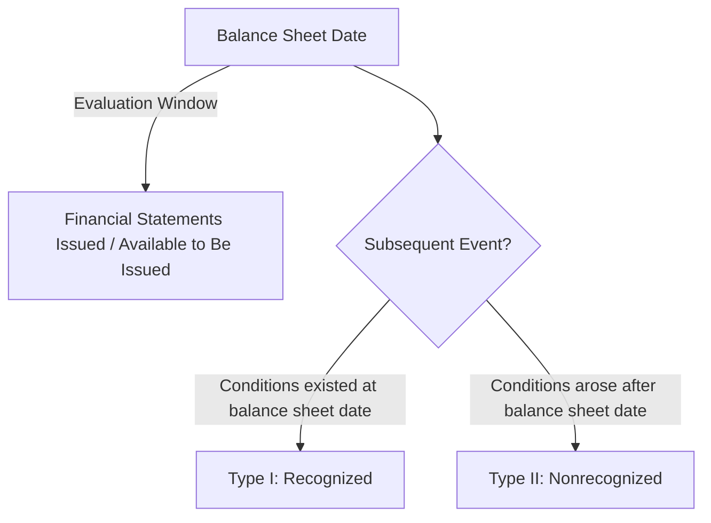

# Subsequent Events

## Definition

**Subsequent events** are events or transactions that occur **after the balance sheet date** but **before the financial statements are issued** (or available to be issued). Accounting Standards Codification (ASC) 855 requires entities to evaluate subsequent events and determine whether they require adjustment of, or disclosure in, the financial statements.



---

## Two Types of Subsequent Events

### Type I: Recognized Events (Adjusting)

A recognized subsequent event provides **additional evidence** about conditions that **existed at the balance sheet date**. The financial statements are **adjusted** to reflect the new information.

:::info[Key Principle]

Type I events clarify or confirm a condition that already existed on the balance sheet date. The financial statements are updated because the event improves the estimate of an amount already recorded.

:::

**Examples of Type I events:**

| Event | Rationale |
|---|---|
| Settlement of litigation for a lawsuit filed before year-end | The obligation existed at the balance sheet date |
| Customer bankruptcy confirming that a receivable was uncollectible | The customer's financial difficulty existed at year-end |
| Sale of inventory below cost, confirming a net realizable value (NRV) write-down | The decline in value existed at year-end |
| Resolution of a tax dispute for a prior-year position | The tax position existed at year-end |

**Example:** Bear Co.'s fiscal year ends December 31. On February 10, before the financial statements are issued, a court rules that Bear Co. must pay \$250,000 to settle a lawsuit filed in October. Bear Co. had previously accrued \$150,000 as a contingent liability.

Because the lawsuit existed at December 31, this is a **Type I event**. Bear Co. increases the accrual by \$100,000 (\$250,000 - \$150,000):

```journal
Dr. Loss from litigation      100,000
    Cr. Estimated liability           100,000
```

The financial statements now reflect the \$250,000 liability.

### Type II: Nonrecognized Events (Nonadjusting)

A nonrecognized subsequent event provides evidence about conditions that **arose after the balance sheet date**. The financial statements are **not adjusted**. The event may require **disclosure** in the notes if omitting it would make the financial statements misleading.

:::warning

Type II events reflect new conditions, so they do **not** change amounts on the balance sheet. They must still be disclosed if their omission would make the financial statements misleading.

:::

**Examples of Type II events:**

| Event | Rationale |
|---|---|
| Business combination after year-end | New transaction that did not exist at year-end |
| Issuance of debt or equity after year-end | New financing activity |
| Loss from fire or natural disaster after year-end | New event, not a condition at year-end |
| Customer bankruptcy caused by an event after year-end (for example, a fire) | New condition arising after the balance sheet date |
| Decline in market value of investments after year-end | New market conditions |
| Declaration of a stock split after year-end | New corporate action |

**Example:** On January 25, a fire destroys Polar Co.'s main warehouse (uninsured loss of \$2,000,000). Polar Co.'s fiscal year ends December 31, and the financial statements have not yet been issued.

This is a **Type II event**. The fire occurred after the balance sheet date and does not relate to conditions that existed at December 31. Polar Co. does **not** adjust the financial statements, but it **discloses** the nature of the event and an estimate of its financial effect:

> _Subsequent Event Disclosure:_ On January 25, a fire destroyed the Company's main warehouse, resulting in an estimated uninsured loss of approximately \$2,000,000. This event occurred after the balance sheet date and is not reflected in the accompanying financial statements.

---

## Evaluation Period

The evaluation period depends on the type of filer.

### SEC Filers

Securities and Exchange Commission (SEC) filers evaluate subsequent events through the date the financial statements are **issued** (filed with the SEC).

### Non-SEC Filers

Non-SEC filers evaluate subsequent events through the date the financial statements are **available to be issued**. That is the date the financial statements are complete in a form and format that complies with generally accepted accounting principles (GAAP) and all approvals necessary for issuance have been obtained.

| Entity Type | Evaluate Through | Disclose the Date? |
|---|---|---|
| SEC filer | Date financial statements are **issued** | Not required |
| Non-SEC filer | Date financial statements are **available to be issued** | Required |

:::tip[Exam Tip]

A non-SEC filer must disclose **the date through which subsequent events have been evaluated** and whether that date is the date the financial statements were issued or the date they were available to be issued. SEC filers are not required to disclose this date.

:::

---

## Decision Framework

| Question                                           | If Yes                                      | If No                                    |
| -------------------------------------------------- | ------------------------------------------- | ---------------------------------------- |
| Did the condition exist at the balance sheet date? | **Type I:** adjust the financial statements | **Type II:** disclose only (if material) |
| Would omission of the disclosure be misleading?    | Disclose in the notes                       | No action required                       |

**Additional examples with classification:**

| Scenario | Type | Action |
|---|---|---|
| Grizzly Inc. settles a damage claim from an accident before year-end for \$80,000 (previously accrued at \$60,000) | Type I | Adjust accrual to \$80,000 |
| Kodiak Partners acquires a competitor on January 15 | Type II | Disclose the acquisition details |
| Panda Industries declares a 10% stock dividend on January 20 | Type II | Disclose; adjust earnings per share (EPS) retroactively for the new shares |
| Sloth Security discovers a material fraud that occurred during the reporting period | Type I | Adjust financial statements |
| Cub Entertainment signs a major lease agreement in January | Type II | Disclose if material |

---

## Reissuance of Financial Statements

When financial statements are **reissued** (for example, included in a later filing or presented as comparative statements), the entity generally does **not** recognize events that occur between the original issuance date and the reissuance date.

:::danger[Exception]

If the financial statements are **revised** to correct an error, the entity evaluates events through the new issuance date, but the evaluation is limited to the effects of the revision. New Type II events arising after the original issuance date do **not** need to be disclosed in the revised statements.

:::

---

## Revised Financial Statements

If financial statements are revised after issuance (for example, to correct a material error discovered after the statements were issued):

1. Non-SEC filers disclose the dates through which subsequent events were evaluated in **both** the original and the revised financial statements
2. Evaluate subsequent events only as they relate to the **revision**
3. Disclose that the subsequent events evaluation is limited to the revision

---

## Comparison Table

| Feature                    | Type I (Recognized)                              | Type II (Nonrecognized)                 |
| -------------------------- | ------------------------------------------------ | --------------------------------------- |
| Condition timing           | Existed at balance sheet date                    | Arose after balance sheet date          |
| Financial statement effect | **Adjust** amounts                               | **No adjustment**                       |
| Disclosure required?       | Yes (inherent in the adjustment)                 | Yes, if omission would be misleading    |
| Examples                   | Litigation settlement, receivable collectibility | Acquisitions, disasters, stock issuance |

---

## Summary

:::note[Chapter Checklist]

- [ ] Define the subsequent events evaluation window
- [ ] Distinguish Type I (recognized/adjusting) from Type II (nonrecognized/nonadjusting) events
- [ ] Adjust financial statements for Type I events with updated estimates
- [ ] Disclose Type II events if omission would be misleading
- [ ] Know the evaluation period for SEC vs. non-SEC filers
- [ ] Understand reissuance and revised financial statement rules
- [ ] Know that non-SEC filers must disclose the date through which subsequent events were evaluated

:::
