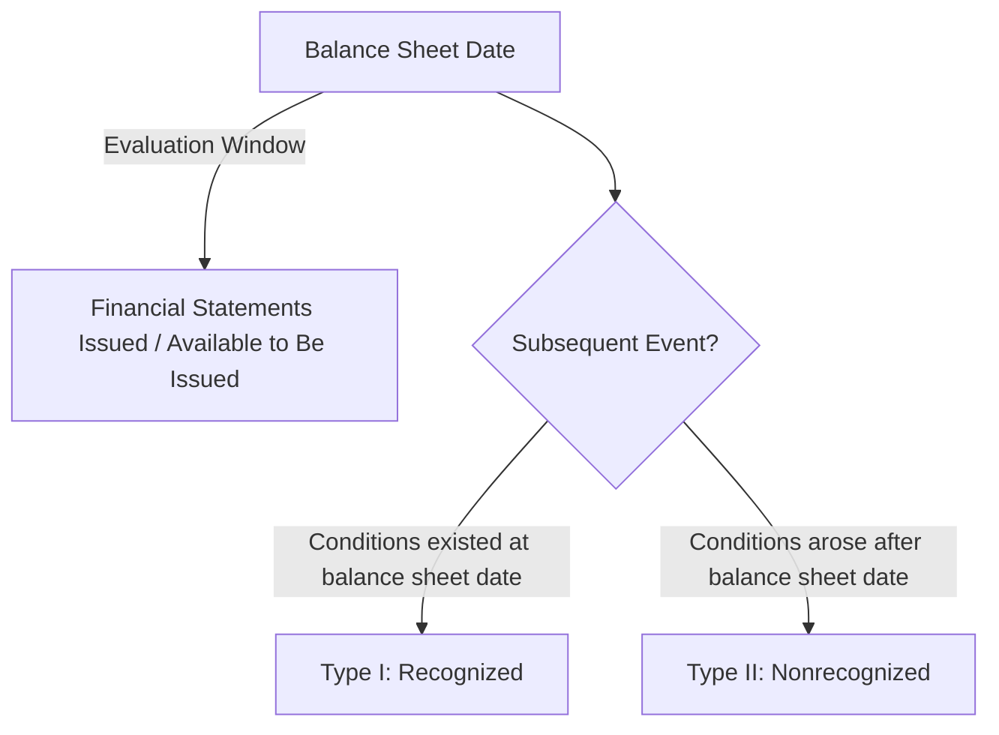

# Subsequent Events

Financial statements describe the company at the balance sheet date, but they are not finished until weeks or months later. Things happen in that gap: a lawsuit settles, a customer goes bankrupt, a warehouse burns down. Some of these events tell us more about conditions that already existed at year-end, and some are entirely new. Accounting Standards Codification (ASC) 855 sorts them into two types. The first type changes the numbers in the statements; the second is at most disclosed. FAR asks you to identify a subsequent event, classify it, and compute any adjustment or disclosure. This chapter covers the evaluation period, the two types with examples, and what happens when statements are reissued.



## The Evaluation Period

**Subsequent events** are events or transactions that occur **after the balance sheet date** but **before the financial statements are issued** or **available to be issued**. Which end date applies depends on the entity:

| Entity Type | Evaluate Through | Disclose the Date? |
|---|---|---|
| Securities and Exchange Commission (SEC) filer | Date the financial statements are **issued** (filed with the SEC) | Not required |
| Other entities | Date the financial statements are **available to be issued** | Required |

Financial statements are **available to be issued** when they are complete in a form and format that complies with generally accepted accounting principles (GAAP) and all approvals necessary for issuance have been obtained. An entity that is not an SEC filer must disclose the date through which it evaluated subsequent events and whether that date is the date the statements were issued or the date they were available to be issued.

State and local governments follow a similar rule under GASB Statement No. 105 (eligible for testing since July 1, 2026): they evaluate events through the date the statements are available to be issued and disclose that date.

---

## Type I: Recognized Subsequent Events

A **recognized** (Type I, or adjusting) subsequent event provides **additional evidence** about conditions that **existed at the balance sheet date**. The financial statements are **adjusted** to reflect it, because the event improves the estimate of an amount that belongs in those statements.

| Event | Why It Is Type I |
|---|---|
| Settlement of a lawsuit filed before year-end | The obligation existed at the balance sheet date |
| Customer bankruptcy caused by financial difficulty that existed at year-end | The receivable was already impaired |
| Sale of inventory below cost, confirming a net realizable value (NRV) write-down | The decline in value existed at year-end |
| Resolution of a tax dispute about a prior-year position | The tax position existed at year-end |

Bear Co.'s fiscal year ends December 31. On February 10, before the financial statements are issued, a court rules that Bear Co. must pay \$250,000 to settle a lawsuit filed in October. Bear Co. had accrued \$150,000 at year-end.

Because the lawsuit existed at December 31, this is a **Type I event**. Bear Co. increases the accrual by \$100,000 (\$250,000 - \$150,000), so the year-end statements report the \$250,000 liability:

```journal
Dr. Loss from litigation      100,000
    Cr. Estimated liability           100,000
```

---

## Type II: Nonrecognized Subsequent Events

A **nonrecognized** (Type II, or nonadjusting) subsequent event provides evidence about conditions that **arose after the balance sheet date**. The financial statements are **not adjusted**, because the event is a new development, not information about year-end. The event is **disclosed** if omitting it would make the financial statements misleading. The disclosure describes the nature of the event and an estimate of its financial effect, or states that an estimate cannot be made.

| Event | Why It Is Type II |
|---|---|
| Business combination after year-end | New transaction |
| Issuance of debt or equity after year-end | New financing activity |
| Loss from a fire or natural disaster after year-end | New event, not a condition at year-end |
| Customer bankruptcy caused by an event after year-end (for example, a fire) | New condition arising after the balance sheet date |
| Decline in the market value of investments after year-end | New market conditions |
| Stock split or stock dividend declared after year-end | New corporate action |

On January 25, a fire destroys Polar Co.'s main warehouse, an uninsured loss of \$2,000,000. Polar Co.'s fiscal year ends December 31, and the financial statements have not yet been issued. The fire did not relate to conditions at December 31, so this is a **Type II event**. Polar Co. does **not** adjust its statements, but it **discloses** the event:

> _Subsequent Event Disclosure:_ On January 25, a fire destroyed the Company's main warehouse, resulting in an estimated uninsured loss of approximately \$2,000,000. This event occurred after the balance sheet date and is not reflected in the accompanying financial statements.

:::tip[Exam Tip]

Two customer bankruptcies after year-end can be treated differently. Ask **why** the customer failed. If the cause (a deteriorating financial condition) existed at year-end, adjust the allowance. If the cause arose afterward (a fire in January), disclose only.

:::

---

## Classifying Events in Practice

| Scenario | Type | Action |
|---|---|---|
| Grizzly Inc. settles a claim from an accident before year-end for \$80,000 (accrued at \$60,000) | Type I | Increase the accrual to \$80,000 |
| Sloth Security discovers a material fraud that occurred during the reporting period | Type I | Adjust the financial statements |
| Kodiak Partners acquires a competitor on January 15 | Type II | Disclose the acquisition |
| Cub Entertainment signs a major lease agreement in January | Type II | Disclose if material |
| Panda Industries declares a 10% stock dividend on January 20 | Type II | Disclose; also restate earnings per share (EPS) retroactively for the new shares |

The stock dividend is the one Type II event that changes a number in the statements. EPS for all periods presented is computed using the new share count, because a stock dividend or split changes the number of shares without changing the company's resources.

---

## Reissued and Revised Financial Statements

Financial statements are sometimes **reissued** after they were first issued, for example when they are included in a later filing or presented again as comparative statements. In reissued statements, the entity does **not** recognize events that occurred between the original issuance date (or available-to-be-issued date) and the reissuance date, unless GAAP or regulatory requirements call for the adjustment.

**Revised** financial statements, such as statements corrected for an error or restated for the retrospective application of a new standard, are a form of reissued statements. An entity that is not an SEC filer discloses in the revised statements both the date through which subsequent events were evaluated in the original statements and the date through which they were evaluated in the revised statements.
