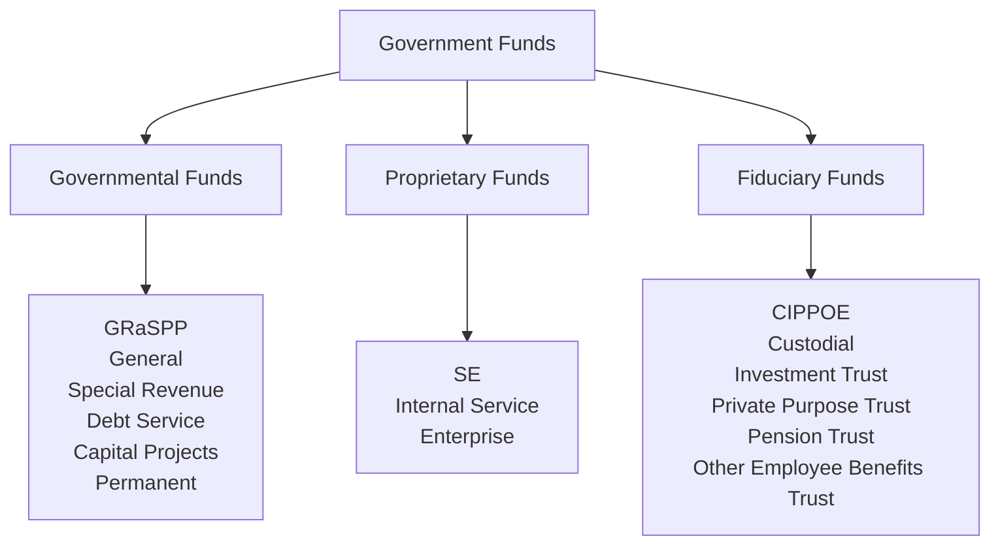

# Governmental Accounting

State and local governments, such as cities, counties, school districts, and special-purpose districts like water authorities, follow standards set by the **Governmental Accounting Standards Board (GASB)**, not the Financial Accounting Standards Board (FASB). Government-owned hospitals and public universities follow GASB too. Governments report for a different reason than businesses do. Instead of measuring profit, governmental reporting demonstrates **accountability**: it shows that public money was raised and spent in line with laws, budgets, and donor or grantor restrictions. FAR tests two foundational ideas, the **measurement focus and basis of accounting** used in each kind of statement and the choice of the right **fund** for an activity, and this chapter covers both. Budgetary accounting, encumbrances, fund balance classifications, and the full reporting model are tested in BAR.

The FAR references for this topic are the GASB Codification, the GASB Statements, and, starting with the 2027 blueprint, the Statements and Interpretations of the National Council on Governmental Accounting (NCGA). The NCGA was GASB's predecessor, and its pronouncements remain in effect unless GASB has superseded them. NCGA Statement 1, for example, set out the basic principles of fund accounting, and NCGA Interpretation 3 is the source of the 60-day rule for property tax revenue discussed below.

## Fund Accounting

A government runs many activities with money that comes with strings attached: a gas tax that may be spent only on roads, a bond issue that must pay for a new school, a trust held for retired employees. To show that each pool of money was used as required, governments use **fund accounting**. A **fund** is a fiscal and accounting entity with a **self-balancing set of accounts** that tracks the resources dedicated to a particular activity or objective. Fund accounting serves three purposes:

1. **Monitoring compliance** with legal and contractual requirements
2. **Tracking spending** by purpose
3. **Budgetary control** over appropriations

---

## Measurement Focus and Basis of Accounting

Two terms describe how any set of governmental statements is prepared. The **measurement focus** is *what* is being measured: which resources the statement reports. The **basis of accounting** is *when* transactions are recognized. Governments use two combinations:

| Feature | Current Financial Resources Focus, Modified Accrual Basis | Economic Resources Focus, Accrual Basis |
|---|---|---|
| Used by | **Governmental funds** | **Proprietary funds**, **fiduciary funds**, and the **government-wide** statements |
| What is reported | Current financial assets and the liabilities they will be used to pay | All assets and liabilities, including capital assets and long-term debt |
| Revenue recognition | When **measurable and available** | When earned (exchange transactions) or when GASB's criteria for taxes and grants are met, with no availability test |
| Outflows | **Expenditures**, recognized when the fund liability is incurred | **Expenses**, recognized when incurred |
| Capital assets | Expenditure when acquired; not reported in the fund; no depreciation | Capitalized and depreciated |
| Long-term debt | Proceeds are an other financing source; the debt is not reported in the fund | Reported as a liability |
| Interest on long-term debt | Generally recognized when due | Accrued |

The current financial resources focus answers a narrow question: what resources does the fund have available to spend in the near term, and what near-term claims are there against them? That is why a governmental fund reports no buildings and no bonds payable. The economic resources focus answers the business-style question: what does the government own and owe, and what did its services cost this year?

---

## Modified Accrual in Practice

Under the modified accrual basis, **revenues** are recognized when they are **measurable and available**. *Available* means collectible within the current period or soon enough afterward to pay liabilities of the current period. For property taxes, "soon enough" means no more than **60 days** after year-end. For other revenues, each government sets and discloses its own availability period.

**Expenditures** are recognized when the related fund liability is incurred. The main exception is principal and interest on general long-term debt, which are generally recognized when **due**.

Bear City levies \$5,000,000 of property taxes for the current year. It expects \$4,800,000 to be collected during the year or within 60 days after year-end, \$150,000 to be collected 61 to 120 days after year-end, and \$50,000 to be uncollectible. In the General Fund:

```journal
Dr. Property taxes receivable       5,000,000
    Cr. Allowance for uncollectible taxes       50,000
    Cr. Property tax revenue                 4,800,000
    Cr. Deferred inflows of resources          150,000
```

The \$150,000 is not available at year-end, so it is reported as a **deferred inflow of resources**, not revenue. In the following year, when the taxes are collected and become available, Bear City recognizes them as revenue of that year:

```journal
Dr. Cash                              150,000
    Cr. Property taxes receivable              150,000
```

```journal
Dr. Deferred inflows of resources      150,000
    Cr. Property tax revenue                   150,000
```

The government-wide statements use accrual accounting, which has no availability test. There, Bear City reports all \$4,950,000 of collectible taxes levied for the year (\$5,000,000 - \$50,000) as revenue of the current year.

---

## Accrual Accounting in Proprietary and Fiduciary Funds

Proprietary funds operate like businesses within the government, and fiduciary funds hold resources for others. Both use the **economic resources** measurement focus and the **accrual** basis, so their accounting looks much like a company's.

Polar Valley Water Utility, an enterprise fund of Grizzly County, bills customers \$3,000,000 for water services and buys a new water treatment facility for \$8,000,000:

```journal
Dr. Accounts receivable             3,000,000
    Cr. Charges for services (operating revenue)   3,000,000
```

```journal
Dr. Capital assets (water treatment facility)  8,000,000
    Cr. Cash                                     8,000,000
```

At year-end, the utility records depreciation of \$400,000:

```journal
Dr. Depreciation expense               400,000
    Cr. Accumulated depreciation                   400,000
```

Compare a governmental fund. If Grizzly County built a new courthouse through a capital projects fund, the fund would report the \$8,000,000 as an **expenditure**, report no capital asset, and record no depreciation. The courthouse would appear, and be depreciated, only in the government-wide statements.

---

## The Three Fund Categories

Governments group their funds into three categories, each with its own fund types:



The mnemonics **GRaSPP** (governmental), **SE** (proprietary), and **CIPPOE** (fiduciary) are a quick way to remember the eleven fund types.

### Governmental Funds (GRaSPP)

Governmental funds account for the government's general activities, which are financed mainly by taxes and grants.

| Fund | Purpose |
|---|---|
| **General Fund** | All resources not required to be reported in another fund; every government has exactly one |
| **Special Revenue Fund** | Proceeds of specific revenue sources that are restricted or committed to a specified purpose other than debt service or capital projects (for example, a gas tax for road maintenance) |
| **Debt Service Fund** | Resources restricted, committed, or assigned to pay principal and interest on general long-term debt |
| **Capital Projects Fund** | Resources restricted, committed, or assigned to acquire or construct major capital facilities (other than those of proprietary or trust funds) |
| **Permanent Fund** | Resources legally restricted so that only earnings, not principal, may be used to support the government's own programs (for example, a cemetery perpetual-care endowment) |

### Proprietary Funds (SE)

Proprietary funds account for business-type activities financed mainly by user charges.

| Fund | Purpose |
|---|---|
| **Internal Service Fund** | Provides goods or services to **other departments** of the government, on a cost-reimbursement basis (for example, a motor pool, central IT, or printing) |
| **Enterprise Fund** | Provides goods or services to the **general public** for a fee (for example, water, sewer, and electric utilities, airports, and toll roads) |

An activity **must** be reported as an enterprise fund if any one of three criteria is met: it is financed with debt secured solely by a pledge of the net revenues from its fees and charges; laws or regulations require its costs, including capital costs, to be recovered through fees; or its pricing policies set fees to recover its costs, including capital costs.

### Fiduciary Funds (CIPPOE)

Fiduciary funds account for resources the government holds **in a trust or custodial capacity** for others. Because the resources belong to others, fiduciary funds are **excluded** from the government-wide statements.

| Fund | Purpose |
|---|---|
| **Custodial Fund** | Resources held for other parties that are not held in a qualifying trust (for example, taxes collected on behalf of other governments) |
| **Investment Trust Fund** | The external portion of investment pools the government manages for other governments |
| **Private-Purpose Trust Fund** | Trust arrangements whose principal and income benefit individuals, private organizations, or other governments |
| **Pension Trust Fund** | Resources held in trust for employee pension plans |
| **Other Employee Benefit Trust Fund** | Resources held in trust for other postemployment benefit (OPEB) plans and similar plans |

---

## Choosing the Right Fund

A government should use the **General Fund** unless a law, contract, or GASB standard calls for a separate fund, and it should use the fewest funds consistent with those requirements. The exam often describes an activity and asks which fund records it:

| Activity | Fund |
|---|---|
| Police and fire department salaries | General Fund |
| A state gas tax that must be spent on road maintenance | Special Revenue Fund |
| Resources set aside to pay principal and interest on general obligation bonds | Debt Service Fund |
| Constructing a new city hall with bond proceeds | Capital Projects Fund |
| An endowment whose earnings maintain a public cemetery | Permanent Fund |
| A municipal water utility that charges residents for service | Enterprise Fund |
| A central motor pool that charges other departments for vehicle use | Internal Service Fund |
| Property taxes the county collects for the school district | Custodial Fund |
| A trust for city employees' retirement benefits | Pension Trust Fund |
| A trust whose income pays scholarships to local students | Private-Purpose Trust Fund |

Two contrasts trip up candidates. A **permanent fund** benefits the government's own programs, while a **private-purpose trust fund** benefits outsiders. An **internal service fund** sells to other departments, while an **enterprise fund** sells to the public.

---

## Government-Wide and Fund Financial Statements

A government's basic financial statements present two views of the same government.

The **government-wide statements** (the statement of net position and the statement of activities) report the government as a whole using the **economic resources** focus and **accrual** basis. They separate **governmental activities** from **business-type activities** and exclude fiduciary funds. Internal service funds, although they are proprietary funds, are generally folded into governmental activities, because they mainly serve governmental departments.

The **fund financial statements** report each fund category using its own measurement focus: governmental funds on the current financial resources focus and modified accrual basis, and proprietary and fiduciary funds on the economic resources focus and accrual basis.

Because governmental funds and governmental activities are measured differently, the government must **reconcile** them. The reconciling items come straight from the measurement focus table above: capital assets (expenditures in the funds, depreciated assets government-wide), long-term debt (an other financing source in the funds, a liability government-wide), accrued interest, and revenues deferred in the funds because they were not available.

---

## Looking Ahead to BAR

The BAR section builds on this foundation with budgetary accounting and encumbrances, fund balance classifications (nonspendable, restricted, committed, assigned, and unassigned), interfund activity, and the full financial reporting model, including the changes made by GASB Statement No. 103. Start with [Budgetary Accounting and Encumbrances](../../bar/governmental-transactions-and-items/budgetary-accounting-and-encumbrances.md) and [Deriving Government-Wide Financial Statements](../../bar/governmental-transactions-and-items/deriving-government-wide-financial-statements.md).
