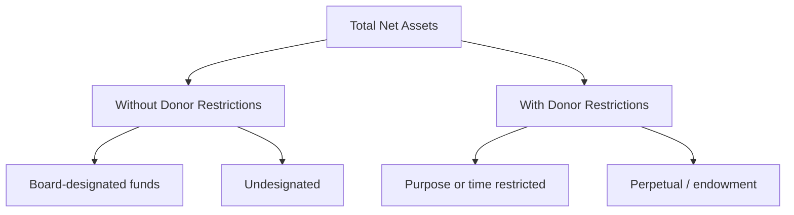
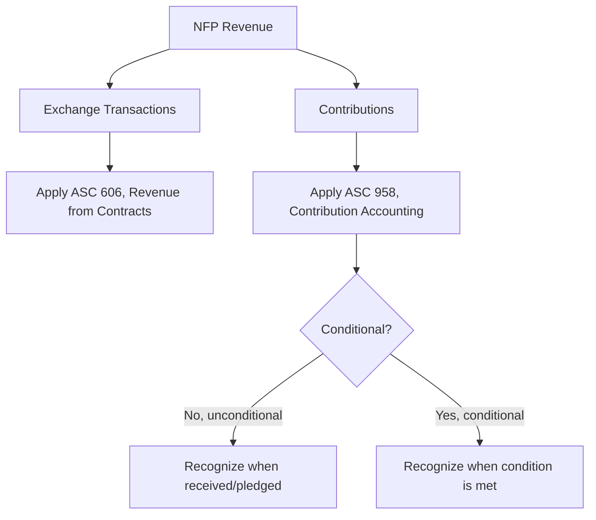
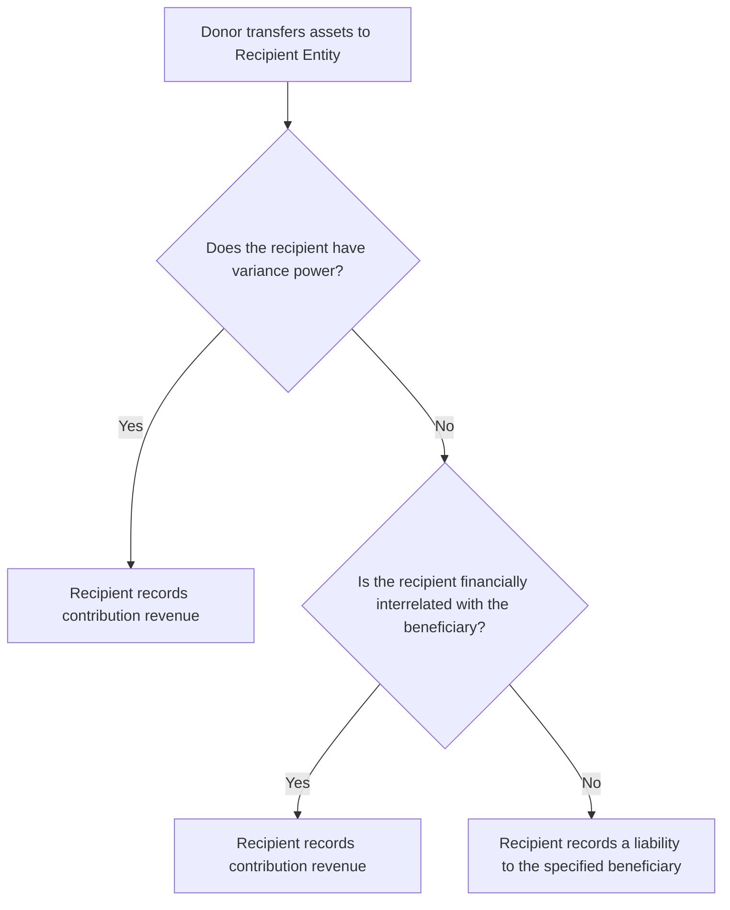

import Tabs from '@theme/Tabs';
import TabItem from '@theme/TabItem';

# Not-for-Profit Accounting

Not-for-profit (NFP) accounting is a **high-frequency FAR topic**. Expect questions that ask you to distinguish NFP financial statements from commercial ones, classify net assets, recognize contributions, and handle specialized revenue streams.

NFP entities include private hospitals, universities, museums, and charitable organizations. Nongovernmental NFPs follow generally accepted accounting principles (GAAP) set by the Financial Accounting Standards Board (FASB), mainly ASC 958 of the FASB Accounting Standards Codification (ASC). They use the **full accrual basis** of accounting.

---

## Financial Statements Overview

NFPs prepare three required financial statements (commercial entities prepare four):

| NFP Statement | Commercial Equivalent |
|---|---|
| Statement of Financial Position | Balance Sheet |
| Statement of Activities | Income Statement |
| Statement of Cash Flows | Statement of Cash Flows |

:::tip[Exam rule]

NFPs do **not** prepare a statement of stockholders' equity. They have no owners, so net assets replace equity.

:::

All NFPs must also present an **analysis of expenses by both function and nature** in one location. The analysis may appear on the face of the statement of activities, in a separate statement (often called a statement of functional expenses), or in the notes. Before ASU 2016-14 (an Accounting Standards Update), only **voluntary health and welfare organizations** (VHWOs) had to present this analysis, as a separate statement.

### Functional vs. Natural Classification

| Classification Type | Examples |
|---|---|
| **Functional** (what the money was spent on) | Program services, management and general, fundraising |
| **Natural** (what type of cost) | Salaries, rent, depreciation, supplies |

---

## Statement of Financial Position

The statement of financial position reports assets, liabilities, and **net assets**. Net assets are divided into two classes:



### Net Assets Without Donor Restrictions

These are resources with **no donor-imposed restrictions**. The governing board may internally earmark funds (called **board-designated** or **quasi-endowment** funds). These funds are still classified as without donor restrictions because the board can reverse the designation at any time.

:::info

Board-designated funds are **not** donor-restricted. They remain in the "without donor restrictions" class, though they may be disclosed separately.

:::

### Net Assets With Donor Restrictions

These are resources subject to **donor-imposed** stipulations of two kinds:

- **Time or purpose restrictions**: the donor specifies when or how the funds may be used (for example, "use for scholarships in 2026").
- **Perpetual restrictions**: the donor requires that the principal be maintained indefinitely (endowments). Only the investment return may be spent, subject to any additional restrictions.

### Reclassification of Net Assets

When a donor restriction is satisfied (by the passage of time or by fulfilling the stated purpose), the NFP reclassifies the amount:

```journal
Dr. Net assets with donor restrictions[e] 50,000
    Cr. Net assets without donor restrictions[e] 50,000
```

This entry appears on the statement of activities as "**Net assets released from restrictions**."

:::warning

If a contribution is received and its restriction is satisfied in the **same reporting period**, the NFP may report it as without donor restrictions. This is an accounting policy election that must be applied consistently and disclosed.

:::

---

## Statement of Activities

The statement of activities reports the change in each class of net assets and the change in total net assets. It is organized around **revenues, expenses, gains, and losses**.

| Line Item | Description |
|---|---|
| Change in net assets without donor restrictions | Unrestricted revenues and gains, plus net assets released from restrictions, minus expenses |
| Change in net assets with donor restrictions | Restricted contributions and investment returns, minus net assets released from restrictions |
| Change in total net assets | Sum of both classes |

### Program Services vs. Support Services

Expenses are reported by **function**:

| Category | Examples |
|---|---|
| **Program services** | Direct mission activities, such as education, patient care, and research |
| **Support services: management and general** | Accounting, human resources, executive office |
| **Support services: fundraising** | Donor solicitation, special events, grant writing |

### Joint Cost Allocation

Some activities serve both program and support functions, such as a direct-mail campaign that educates the public and also solicits donations. The **joint costs** of such an activity may be allocated between functions only if all three criteria are met: **purpose**, **audience**, and **content**. If any criterion is not met, all costs of the activity are reported as fundraising.

<Tabs>
  <TabItem value="icf" label="Bruin Community Foundation" default>

Bruin Community Foundation mails 100,000 brochures about childhood literacy (program purpose) that also include a donation envelope (fundraising purpose). Total cost is \$200,000. The foundation meets all three criteria and determines that 60% of the cost relates to the educational content and 40% to fundraising.

| Function | Allocation |
|---|---|
| Program (education) | \$120,000 |
| Fundraising | \$80,000 |

  </TabItem>
  <TabItem value="bear" label="Bear Valley Hospital">

Bear Valley Hospital sends a health-awareness mailer that also asks for annual fund contributions. Total cost is \$75,000, allocated 70% to program and 30% to fundraising.

| Function | Allocation |
|---|---|
| Program (community health) | \$52,500 |
| Fundraising | \$22,500 |

  </TabItem>
</Tabs>

---

## Statement of Cash Flows

NFPs follow the same **ASC 230** rules as commercial entities. Cash flows are classified as operating, investing, or financing.

| Activity | Examples |
|---|---|
| **Operating** | Cash received from service recipients, contributions used for operations, interest and dividends received |
| **Investing** | Purchase and sale of investments, purchase of equipment |
| **Financing** | Proceeds from borrowing, donor-restricted contributions for long-term purposes |

:::tip[Exam rule]

Contributions that donors restrict for the **acquisition of long-lived assets** are classified as **financing activities**, not operating. However, **board-designated** contributions for construction with **no donor restriction** remain **operating activities**.

:::

**Example:** Polar University receives a \$500,000 unrestricted donation. The board votes to set it aside for a new library wing. On the statement of cash flows, the \$500,000 is an **operating** cash inflow because the restriction is internal, not donor-imposed.

---

## Revenue Recognition for NFPs

NFP revenue falls into two broad buckets: **exchange transactions** and **contributions**.



### Exchange Transactions

An exchange transaction is one in which each party receives and gives up approximately **equal value**. Examples include tuition, patient fees, and membership dues with substantial benefits.

Exchange transactions follow ASC 606, the same revenue recognition rules commercial entities use. Revenue is recognized when (or as) the NFP satisfies a **performance obligation** by transferring the promised goods or services.

Exchange revenue is generally classified as **without donor restrictions**.

### Contributions: General Rules

A **contribution** is a voluntary, unconditional, nonreciprocal transfer in which a resource provider does not receive equal value in return. Key rules:

| Concept | Rule |
|---|---|
| Unconditional promise (pledge) | Recognize as **revenue** when the pledge is made, net of estimated uncollectible amounts |
| Conditional promise | Do **not** recognize until the condition is met |
| Cash contributions | Recognize at amount received |
| Noncash contributions | Recognize at **fair value** on the date of the gift |

:::info[Conditional vs. Unconditional]

A **condition** requires both a **barrier** (something the recipient must do or that must occur) and a **right of return** or **right of release** if the barrier is not overcome. A mere restriction on how to use the funds is **not** a condition.

:::

### Unconditional Promises to Give (Pledges)

When a donor makes an unconditional pledge, the NFP records a receivable and revenue immediately.

**Example:** On November 15, a donor pledges \$100,000 to Bruin Community Foundation, payable in full on March 1 of the following year. The foundation estimates that 3% will be uncollectible.

Because the cash is due in a later period, the pledge carries an **implied time restriction**. The revenue is therefore reported as with donor restrictions, net of the estimated uncollectible amount.

```journal
Nov 15
Dr. Pledges receivable[a] 100,000
    Cr. Allowance for uncollectible pledges[ca] 3,000
    Cr. Contribution revenue (with donor restrictions)[e] 97,000
```

Pledges due in more than one year are recorded at the **present value** of estimated future cash flows. The discount is later accreted as additional contribution revenue, not interest income.

### Conditional Promises

A conditional promise is **not** recognized as revenue or a receivable until the condition is met.

**Example:** Kodiak Partners pledges \$200,000 to Bear Valley Hospital on the condition that the hospital raises \$500,000 in matching funds by December 31. Until the hospital reaches the \$500,000 threshold, no revenue or receivable is recorded. Once the condition is met:

```journal
Dr. Pledges receivable[a] 200,000
    Cr. Contribution revenue[e] 200,000
```

### Donated Services

Donated services are recognized as contribution revenue only if **either** of these criteria is met:

1. The services **create or enhance a nonfinancial asset** (for example, a contractor builds a wall for a charity), **or**
2. **All three** of the following are true: the services require **specialized skills**, the person providing them **possesses those skills**, and the services would typically need to be **purchased** if not donated (for example, an attorney donates legal work).

When a service qualifies, the NFP records contribution revenue and an equal expense (or an asset, if the service created or enhanced a nonfinancial asset).

:::warning

Volunteer time at a soup kitchen or gift shop generally does **not** meet the recognition criteria. The services are not specialized and do not enhance a nonfinancial asset.

:::

<Tabs>
  <TabItem value="recognize" label="Recognized" default>

A licensed CPA donates 40 hours of audit services to Polar University. The CPA's normal billing rate is \$250 per hour, so the services are worth \$10,000 (40 × \$250).

```journal
Dr. Accounting expense 10,000
    Cr. Contribution revenue (donated services)[e] 10,000
```

  </TabItem>
  <TabItem value="not" label="Not Recognized">

Fifteen volunteers donate 200 total hours sorting donations at the Bruin Community Foundation warehouse. Although valuable, the services do not require specialized skills and do not enhance a nonfinancial asset. **No journal entry** is recorded.

  </TabItem>
</Tabs>

### Donated Collection Items

Works of art, historical treasures, and similar items **need not be capitalized** if all three conditions are met:

1. The items are **held for public exhibition, education, or research**.
2. The items are **protected, kept unencumbered, cared for, and preserved**.
3. Proceeds from any sale of items are used to acquire **other collection items** or for the **direct care** of existing collections.

If the NFP elects not to capitalize, neither an asset nor revenue is recorded. The policy must be applied consistently and disclosed.

### Donated Materials and Supplies

Significant donated materials are recognized at **fair value** as both an asset (or an expense, if used immediately) and contribution revenue.

```journal
Dr. Inventory (donated supplies)[a] 15,000
    Cr. Contribution revenue (donated materials)[e] 15,000
```

Contributed nonfinancial assets (gifts in kind) are presented as a **separate line item** in the statement of activities, apart from contributions of cash and other financial assets.

### Donor-Imposed Restrictions

Contributions with donor restrictions are recognized as **revenue with donor restrictions** in the period **received or pledged**. They are not deferred until the restriction is met.

**Timing rule:** an unconditional gift or pledge is recognized as revenue on the date of the gift or pledge, whether or not it is restricted.

When the restriction is later satisfied, a reclassification moves the amount to "without donor restrictions."

---

## Fundraising Activities

When an NFP runs a fundraising event that gives donors a premium (such as a tote bag, a dinner, or a concert ticket), split the donor's payment as follows:

| Component | Treatment |
|---|---|
| Cost of the premium | **Fundraising expense** |
| Payment in excess of the premium's fair value | **Contribution revenue** |
| Fair value of the premium received by the donor | **Exchange revenue** |

**Example:** Grizzly Inc. (an NFP) holds a gala dinner. Tickets cost \$500 each. The fair value of the dinner is \$120. For each ticket sold:

- Contribution revenue = \$500 - \$120 = **\$380**
- Exchange (special event) revenue = **\$120**

```journal
Dr. Cash[a] 500
    Cr. Contribution revenue[e] 380
    Cr. Special event revenue[e] 120
```

The cost of the dinner (say \$80 per plate) is recorded as fundraising expense:

```journal
Dr. Fundraising expense 80
    Cr. Cash[a] 80
```

---

## NFP Educational Institutions

Tuition revenue at NFP colleges and universities is reported net of scholarships. Gross tuition is often displayed first, with scholarships treated as either:

- A **contra-revenue** (scholarship allowance) that reduces gross tuition, when no service is required, **or**
- An **expense**, when the student performs a service (for example, a teaching assistantship).

**Example:** Polar University bills \$10,000,000 in tuition. It awards \$1,500,000 in merit-based scholarships (no service required) and \$400,000 in assistantship stipends (service required).

| Item | Amount |
|---|---|
| Gross tuition revenue | \$10,000,000 |
| Less: scholarship allowance | (\$1,500,000) |
| Net tuition revenue | \$8,500,000 |
| Assistantship expense | \$400,000 |

---

## NFP Health Care Organizations

NFP health care entities (hospitals, clinics) follow ASC 606 for patient revenue and have specialized presentation rules:

| Item | Treatment |
|---|---|
| **Patient service revenue** | Reported at the amount the provider expects to be entitled to: gross charges less contractual adjustments, discounts, and implicit price concessions |
| **Charity care** | **Not recorded** as revenue at all; disclosed in the notes only |
| **Uncollectible amounts** | Amounts not expected to be collected at the time of service are **implicit price concessions** that reduce revenue. **Bad debt expense** (an operating expense) applies only when a patient's ability to pay declines after the service |
| **Other operating revenue** | Cafeteria, parking, gift shop |
| **Nonoperating revenue** | Unrestricted gifts, investment income, gains on sale of assets |

:::tip[Exam rule]

Charity care is **never** recognized as revenue. The notes disclose the charity care policy and the level of charity care provided, measured at **cost**.

:::

**Example:** Bear Valley Hospital provides services with gross charges of \$5,000,000. Contractual adjustments with insurers total \$1,200,000. Based on past experience with self-pay patients, the hospital expects not to collect another \$150,000 at the time of service. Charity care at standard rates would have been \$300,000.

| Line | Amount |
|---|---|
| Gross patient charges | \$5,000,000 |
| Less: contractual adjustments | (\$1,200,000) |
| Less: implicit price concessions | (\$150,000) |
| Net patient service revenue | \$3,650,000 |

The \$300,000 of charity care is **excluded** from revenue. The notes disclose the cost of providing that care. If a patient who was expected to pay later cannot (for example, because of bankruptcy), the write-off is bad debt expense, not a reduction of revenue.

---

## Transfers of Assets to Other Entities

When a donor makes a contribution **through an intermediary** (such as a community foundation), the recipient's accounting depends on two factors:



### Key Definitions

| Term | Meaning |
|---|---|
| **Variance power** | The recipient can redirect the assets to a beneficiary other than the one specified by the donor |
| **Financially interrelated** | (1) One entity has the ability to **influence the operating and financial decisions** of the other, **and** (2) one entity has an **ongoing economic interest** in the other's net assets |
| **Specified beneficiary** | The entity the donor intends to ultimately receive the assets |

### Recipient Entity Accounting

<Tabs>
  <TabItem value="variance" label="With Variance Power" default>

Panda Industries donates \$300,000 to Bruin Community Foundation, specifying Bear Valley Hospital as the beneficiary. The foundation has **variance power** and may redirect the funds.

The foundation records **contribution revenue**:

```journal
Dr. Cash[a] 300,000
    Cr. Contribution revenue[e] 300,000
```

  </TabItem>
  <TabItem value="interrelated" label="Financially Interrelated">

Panda Industries donates \$300,000 to Bruin Community Foundation for Bear Valley Hospital. The foundation has **no variance power** but is financially interrelated with the hospital.

The foundation records **contribution revenue**:

```journal
Dr. Cash[a] 300,000
    Cr. Contribution revenue[e] 300,000
```

  </TabItem>
  <TabItem value="liability" label="Neither">

Panda Industries donates \$300,000 to Bruin Community Foundation for Bear Valley Hospital. The foundation has **no variance power** and is **not** financially interrelated with the hospital.

The foundation records a **liability**, not revenue:

```journal
Dr. Cash[a] 300,000
    Cr. Liability to Bear Valley Hospital[l] 300,000
```

  </TabItem>
</Tabs>

### Specified Beneficiary Accounting

The specified beneficiary (for example, Bear Valley Hospital) recognizes its **right to the assets** held by the recipient **unless** the donor explicitly granted the recipient variance power.

- If the beneficiary and the recipient are **financially interrelated**, the beneficiary reports an **interest in the net assets** of the recipient.
- Otherwise, the beneficiary reports a receivable (or a beneficial interest) and contribution revenue.

---

## Financial Instruments and Investments

NFPs report **debt and equity investments** at **fair value** on the statement of financial position (with limited exceptions for certain equity method or consolidation situations).

### Gains and Losses

| Type | Reporting |
|---|---|
| Realized gains/losses | Statement of activities |
| Unrealized gains/losses | Statement of activities |
| Default classification | Without donor restrictions, unless the donor or law restricts investment returns |

:::info

Both realized and unrealized gains and losses flow through the **statement of activities**. NFPs do not report other comprehensive income (OCI).

:::

### Investment Return Reporting

Investment returns (interest, dividends, and realized and unrealized gains and losses) are reported **net of external and direct internal investment expenses**.

$$
\text{Net investment return} = \text{Interest} + \text{Dividends} + \text{Realized gains/losses} + \text{Unrealized gains/losses} - \text{Investment expenses}
$$

### Underwater Endowments

An endowment is **underwater** when its current fair value falls **below the original gift amount** (the historic dollar value) or the amount the donor or law requires to be maintained.

**Example:** A donor gave \$1,000,000 to Bruin Community Foundation as a permanent endowment. After market declines, the endowment's fair value drops to \$920,000, an unrealized loss of \$80,000.

```journal
Dr. Unrealized loss on endowment investments 80,000
    Cr. Investment in endowment[a] 80,000
```

The \$80,000 loss is reported in **net assets with donor restrictions** (it stays with the endowment). The endowment continues to be classified as net assets with donor restrictions even though it is underwater.

:::caution

Underwater endowments require specific **disclosures**: the fair value of underwater funds, the original gift amounts (or the amounts required to be maintained), and the aggregate amount by which the funds are underwater. The governing board's policy on spending from underwater endowments must also be disclosed.

:::

---

## Comprehensive Example

Bruin Community Foundation reports the following activity for the year ended December 31:

| Transaction | Amount | Classification |
|---|---|---|
| Unrestricted contributions received | \$800,000 | Without donor restrictions |
| Donor-restricted contribution for scholarships | \$200,000 | With donor restrictions |
| Scholarships awarded (satisfying restriction; expense included in program services) | \$120,000 | Reclassification |
| Unrestricted investment return, net of fees | \$45,000 | Without donor restrictions |
| Unrealized loss on endowment (underwater) | \$30,000 | With donor restrictions |
| Program services expense | \$600,000 | Without donor restrictions |
| Management and general expense | \$110,000 | Without donor restrictions |
| Fundraising expense | \$55,000 | Without donor restrictions |

**Statement of Activities (simplified):**

| | Without Donor Restrictions | With Donor Restrictions | Total |
|---|---|---|---|
| Contributions | \$800,000 | \$200,000 | \$1,000,000 |
| Investment return | 45,000 | (30,000) | 15,000 |
| Net assets released from restrictions | 120,000 | (120,000) | 0 |
| **Total revenues and gains** | **965,000** | **50,000** | **1,015,000** |
| Program services | (600,000) | 0 | (600,000) |
| Management and general | (110,000) | 0 | (110,000) |
| Fundraising | (55,000) | 0 | (55,000) |
| **Change in net assets** | **\$200,000** | **\$50,000** | **\$250,000** |

:::note[Exam rule]

Expenses are **always** reported in the "without donor restrictions" column. When restricted funds are spent, the reclassification entry first moves the amount into "without donor restrictions."

:::

---

## Summary of Key Exam Points

1. NFPs use **two net asset classes**: without donor restrictions and with donor restrictions.
2. Board-designated funds remain **without donor restrictions**.
3. Unconditional pledges are recognized as **revenue when pledged**; conditional pledges wait until the condition is met.
4. Donated services are recognized only if they **enhance a nonfinancial asset** or require **specialized skills** that would otherwise be purchased.
5. Charity care is **never** recorded as revenue; it is disclosed in the notes, measured at cost.
6. Restricted contributions are recognized as **revenue when received or pledged**, not when spent.
7. All investment gains and losses (realized and unrealized) go through the **statement of activities**.
8. Underwater endowments remain in **net assets with donor restrictions**, with required disclosures.
9. Recipient entities record a **liability** when they lack both variance power and financial interrelation with the beneficiary.
10. Donor-restricted contributions for long-lived asset purchases are **financing activities** on the statement of cash flows.
